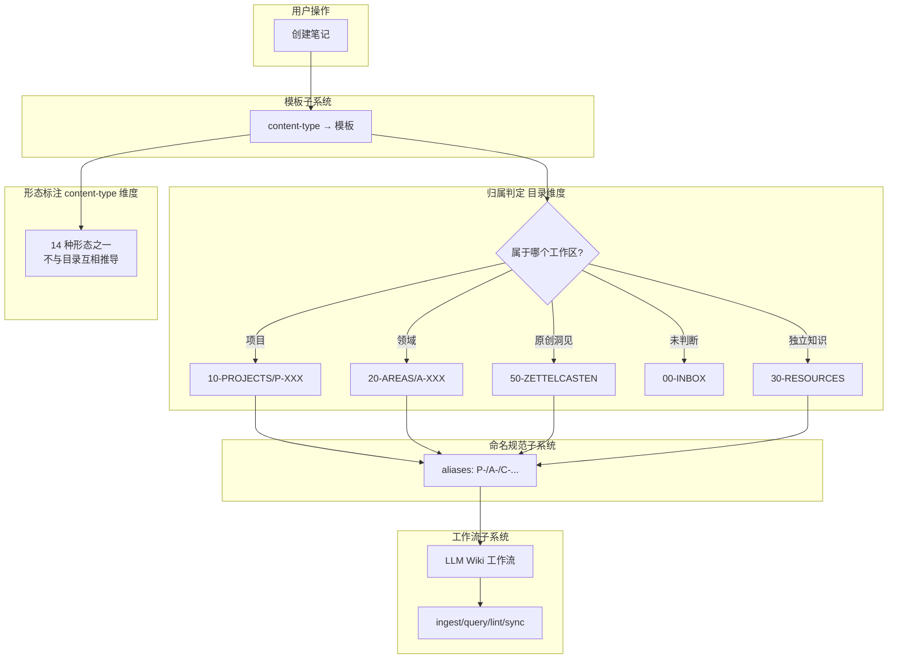

## 概念：本库子系统概述

> [!note] 本文件定位
> 本文件是**架构深化视图**，非本库唯一入口。它从「九大子系统」的视角展开本库的内部设计。
> 首次了解本库请从 [[本库指南]]（唯一入口）开始，本文件作为其架构维度的深化补充。

> 本库是基于 PARA 笔记法 + 卡片盒笔记法构建的个人数字花园，集成 LLM Wiki 维护系统。

**解决的核心痛点**：如何让笔记系统既有行动导向（PARA），又有知识内化（Zettelkasten），还能被 LLM 持续维护？

---

### 核心命题

- 本库通过目录结构子系统实现 PARA 映射
	- **原理**：数字前缀排序 + 语义由目录决定（10-PROJECTS → P，20-AREAS → A，30-RESOURCES → R，40-ARCHIVE → R）
- 本库通过 content-type 分类子系统决定笔记形态
	- **原理**：content-type 只描述形态，不决定目录；归属由目录独立判定（两维度正交，详见 [[本库目录结构]]）
- 本库通过三层架构子系统实现知识的分层管理
	- **原理**：原子笔记层 (50-ZETTELCASTEN) → Wiki 层 (30-RESOURCES) → Archive (40-ARCHIVE)，atomic 是已内化的洞见、source of truth

> ![[本库设计原则#一、本库目标结构]]

- 本库通过工作流子系统实现 LLM 自动化维护
	- **原理**：ingest/query/lint/sync/inbox-review 工作流分工明确
- 本库通过命名规范子系统实现一致性
	- **原理**：前缀放 aliases，文件名用纯标题，正文引用更通顺
- 本库通过 Anki 集成子系统实现知识外化记忆
	- **原理**：atomic/term 生成卡片，question 收敛后生成，源笔记与卡片同源维护
- 本库通过[[知识粒度子系统]]实现「领域 → 专题 → 原子」三层组织
	- **原理**：area 管责任（长期目标），MOC 管地图（聚合索引），concept/atomic 管事实（单一概念）

---

### 运行机制

> 工作流应交给本地AI，个人写笔记时只关注内容，而不必关心笔记间的连接、元数据等



---

### 关键子系统

#### 1. 目录结构子系统

> 目录树的唯一真值见 [[本库目录结构]]。下表仅为架构视角的 PARA 映射解说。

| 目录 | PARA 映射 | 归属判定 |
|------|-----------|----------|
| `10-PROJECTS/` | P (项目) | 目录即归属（工作区，形态不限） |
| `20-AREAS/` | A (领域) | 目录即归属（容器，以 area 为主） |
| `30-RESOURCES/` | R (资源) | 目录即归属（独立知识的默认落点） |
| `40-ARCHIVE/` | Archive | 状态决定 |
| `50-ZETTELCASTEN/` | Zettelkasten | 目录即归属（单形态 atomic） |
| `60-BLOGS/` | 输出 | 目录即归属（单形态 article） |
| `90-DIARY/` | 时间序列 | 目录即归属（单形态 diary） |

#### 2. content-type 分类子系统

> content-type 的唯一真值见 [[笔记类型规范]]。

#### 3. 命名规范子系统

> 文件名与 `aliases` 的唯一真值见 [[文件名与别名规范]]；目录名见 [[本库目录结构]]。

```bash
一致性原则：前缀放 aliases，文件名用纯标题
```

#### 4. 三层架构子系统

| 层级 | 目录 | 负责方 | 内容 |
|------|------|--------|------|
| 原子笔记层 | 50-ZETTELCASTEN | 你 | 已内化的洞见，source of truth |
| Wiki 层 | 30-RESOURCES | 内容你写 / 包装 AI 补 | concept/moc/sop/term/comparison/question/record/roadmap/person |
| Archive | 40-ARCHIVE | 你 + LLM | 过时知识 |

> [!note] 「负责方」的准确含义见 [[人机分工规范]]：Wiki 层的**内容**可能来自你（你写的概念）或 AI（收敛的外部事实），但**包装（bookkeeping）一律由 AI 维护**。

#### 5. 工作流子系统（LLM Wiki）

| 工作流 | 触发 | 职责 |
|--------|------|------|
| ingest | 新 atomic | atomic → wiki 层整合 |
| inbox-review | 用户要求 | 审核 Inbox，判断类型，移动目录 |
| query | 用户提问 | wiki 层查询回答 |
| lint | 定时/手动 | 健康检查（矛盾/孤儿/缺口/过时/一致性） |
| sync | 笔记变更 | 状态同步，不记录 wiki-log |

#### 6. Anki 集成子系统

**核心判断**：Anki 只奖励「有稳定正确答案的知识」，卡片挂在收敛产物上。

| 来源类型 | 是否生成卡片 | 说明 |
|---------|------------|------|
| `atomic` | ✅ 主候选 | 单句洞察、永不修改 → recall 卡 |
| `term` | ✅ 生成 | 术语定义是经典闪卡素材 |
| `question` | ⛔ 收敛后 | 未收敛不生成，验证出答案/SOP 后才进 |
| `concept` / `sop` / `moc` / 其他 | ⛔ 不生成 | 聚合/流程/索引类，非记忆单元 |

**关键点**：
- 卡片用 `#card` 语法内联标记在源笔记中，与源笔记同源维护
- 卡片质量遵循 [[知识卡片制作原则]]（最小信息、主动回忆、具体化）
- 详细规则见 [[_anki-sync-rules]]

#### 7. 知识粒度子系统（领域 → 专题 → 原子）

三层粒度模型，避免「宏观领域过宽」与「碎片化卡片无体系」两个极端：

| 粒度 | 载体 | 职责 | 判断准则 |
|------|------|------|----------|
| 宏观·领域 | `area`（20-AREAS） | 责任领域：愿景/里程碑/SOP/健康度 + 专题导航 | 持续数年，仅做分类根与导航 |
| 中观·专题 | `moc`（30-RESOURCES） | 知识地图 + 研究容器：聚合同主题 concept/sop/term | 资料 5~20 篇高价值内容 / 攻关 1~3 周 |
| 微观·原子 | `concept` / `term` / `atomic` | 单一概念、事实、可复用模式 | 10 分钟查阅 |

**核心原则：area 管责任，MOC 管地图。**

- area 是 PARA 的「A」——动词（我负责什么），必须含长期目标；知识地图职责下放给 MOC
- MOC 是名词（这里有什么知识），只做索引不设目标；是 NotebookLM 等 AI 研究容器的对应物
- 中观层判定标准：资料容量 5~20 篇高价值长文/源码/规范；产出目标可闭环；学习周期 1~3 周
- 粒度不当的调整：过宽（"学好前端"）→ 拆小为专题；过碎（单一 API）→ 并入专题 MOC
- area 的「关键领域」段应作为**专题导航**，只列子领域 Area 与专题 MOC 链接，不再平铺 concept

> 详细说明见 [[知识粒度子系统]]。

---

### 子系统关系

```bash
用户操作 → 模板子系统 → 目录结构子系统 → 命名规范子系统 → 知识粒度子系统 → 三层架构子系统 → 工作流子系统
                              ↓
                        wiki-index (导航)
                              ↓
                         wiki-log (记录)
                              ↓
                        Anki 集成子系统 (知识外化记忆)
```

**核心原则**：
- 目录结构是物理组织，content-type 是逻辑分类
- aliases 是检索索引，文件名是语义标题
- atomic 是 source of truth，三层架构是知识分层
- 工作流是 LLM 自动化维护的职责边界
- Anki 集成是知识外化记忆，卡片与源笔记同源维护
- 知识粒度是组织尺度：area 管责任、MOC 管地图、concept/atomic 管事实

---

### 知识图谱

- **上位**：[[本库指南]] — 本库的核心设计理念和规范文档
- **下位**：
	- [[PARA笔记法]] — 行动导向的项目/领域/资源/归档分类
	- [[卡片盒笔记法]] — 原子笔记和双向链接的知识内化方法
	- [[LLM Wiki]] — LLM Wiki 方法论
	- [[llm-wiki-schema]] — LLM 维护知识库的作业指南
- **相关**：
	- [[wiki-index]] — 知识库导航索引
	- [[wiki-log]] — append-only 时间线日志
	- [[_content-type-rules]] — content-type 定义和内联规则
	- [[_ingest-rules]] — ingest 工作流
	- [[_lint-rules]] — lint 工作流
	- [[_anki-sync-rules]] — Anki 集成规则

---

### 参考延伸

- [[本库指南]] — 本库的核心设计理念、目录结构、规范和工作流
- [[llm-wiki-schema]] — LLM Wiki 作业指南索引
