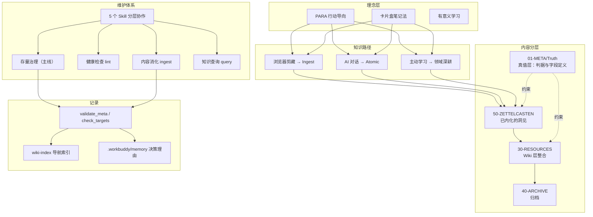

> [!hint]  
> 本库设计美学：Less is more（在本库读作「维护动作的最小化」，读法见 [[本库设计原则]]）  
> 本库设计原则：行动导向、知识地图、系统学习  
> 本库方法论：PARA 笔记法 + 卡片盒笔记法 + 有意义学习  
> 本库工作流：捕获 → 加工 → 内化 → 行动


> [!important] 本文件定位
> 本文件是**本库设计与使用的唯一入口**。所有「本库是什么、怎么组织、如何上手」的问题，先从这里出发。
> 其余文档是本入口的子视角：[[本库子系统概述]] 是**架构唯一真值**（目录、分层、子系统关系都以它为准），[[本库设计原则]] 是设计原则切片，[[本库脚本化]] 是脚本化的判断边界（该做什么、不做什么），[[本库Bases约定]] 是 `.base` 的写法与陷阱，[[本库踩坑手册]] 收「写错不报错」的操作坑，各类规范见 [[真值索引]]。

---

## 核心理念

本库是一个**个人数字花园**，基于以下原则构建：

1. **PARA 行动导向**：项目（Project）→ 领域（Area）→ 资源（Resource）→ 归档（Archive）
2. **卡片盒内化**：闪念 → 文献 → 永久笔记
3. **物理位置与逻辑分类分工**：目录（物理位置＝归属）与 content-type（逻辑分类＝形态）各司其职、互不推导——不再有一一映射表，判定归属只看「属于哪个工作区」（详见 [[本库目录结构]]）
4. **保持上下文完整**：笔记内容优先服务于当前上下文，引用原子笔记是补充而非必须
5. **有意义学习**：笔记通过上位、下位、并列、相关等关系建立联系——写一条链接等于做一次同化，桶名与判据见 [[知识图谱词表]]
6. **一致性原则**：所有类型前缀（P-/A-/Q-/MOC-/SOP-/T-/C-/VS-）统一放在 aliases 别名属性中，文件名只使用纯标题
7. **三层粒度**：领域（area，责任）→ 专题（MOC，知识地图）→ 微观（concept/term/atomic，事实），避免过宽与过碎两个极端

---

## 两个入口

本库同时是第二大脑和数字花园。这两个用途的失败模式恰好相反，所以不该共用一张目录。

| | 第二大脑（自己用） | 数字花园（别人看） |
|:--|:--|:--|
| 读者 | 你 | 陌生人 |
| 前提 | 记得地图 | 没有地图 |
| 动作 | 找一篇已经知道的东西 | 从零开始逛 |
| 入口 | 目录 → `up` → 正文；[[wiki-index]] | [[本库领域索引]] → area → MOC |
| 失败模式 | **孤岛**：笔记在，但找不到 | **迷宫**：三跳内失去方向 |

由此得到两条约束：

- **检索侧不缺网，缺唯一路径。** 目录 + `up` 已经是树，不要为了交叉引用去动它——同一篇笔记出现五个上级不是丰富，是决策瘫痪。
- **花园侧不缺节点，缺步道。** [[wiki-index]] 有 1200 多条，它是电话簿：查得到，走不进去，不作对外落地页。
  花园的**门**是 [[本库领域索引]]：19 个责任领域按层级排开，每个进去都有一条可走的路。

两者共用同一批节点，只是走不同的边：检索走 `up`（纵向、单值），花园走正文知识图谱（横向、多值）。

**密度是成熟度，不是入口。** [[数字花园]] 里那条「花园的价值在于链接密度」说的是长期成熟度；入口是当下的门槛。两者都要，但顺序不能反——一个有 33% 节点带边的库，先把入口做好读者走得动；只提密度不提入口，读者进不去。

一条自检：**如果一个 MOC 里没有任何笔记从它往外链，它只是目录，不是步道。**

## 目录结构

> 📖 完整目录结构真值见 [[本库目录结构]]（唯一权威定义，本文件不再维护副本）。

---

## 模板位置

模板存放在 `content/_templates/`：

| 模板                   | 用途             |
| -------------------- | -------------- |
| template_area.md     | Area 领域模板      |
| template_moc.md      | MOC 索引模板       |
| template_atomic.md   | 原子笔记模板         |
| template_concept.md  | 概念笔记模板         |
| template_term.md     | 术语笔记模板         |
| template_sop.md      | SOP 流程模板       |
| template_project.md  | 项目模板           |
| template_diary.md    | 日记模板           |
| template_week.md     | 周报模板           |
| template_comp.md     | 对比笔记模板         |
| template_question.md | 问题笔记模板         |
| template_article.md  | 博客文章模板         |
| template_roadmap.md  | 演进路线模板         |
| template_record.md   | 记录模板（事件 / 素材） |
| template_sub_project.md | 专项子项目模板（content-type 同为 `project`） |
| template_source.md   | 信源卡模板（content-type 同为 `record`，带评分字段） |

> [!tip]  
> 使用 Obsidian 的 Templater 插件创建笔记时，会自动根据 content-type 选择对应模板。

> [!warning] 启动脚本不在模板目录
> `_scripts/template_startup.md` 是 Templater 的启动模板（调用 `autoArchiveInbox` 把 Inbox 中滞留超过 14 天的笔记移入归档区），**故意不放在 `_templates/`**：那里会被 Templater 收进「插入模板」列表，误选会把当前笔记直接归档走。它的路径登记在 `.obsidian/plugins/templater-obsidian/data.json` 的 `startup_templates`，移动该文件时必须同步改那里。

---

## 元数据规范

字段定义、content-type 分类、类型对比 → 详见 [[元数据规范]]

**速查**：

- **没有 `status` 字段**：笔记处在哪个阶段看目录（INBOX→RESOURCES→ZETTELCASTEN→ARCHIVE），新旧看最后写入时间（`file.mtime`）。理由见 [[元数据规范#为什么没有 status 字段（2026-10-24 废除）]]
- **归档原则**：atomic 永不过期、永不被删除；其他类型过时/孤立时归档而非删除
- **content-type 只定形态**：字段回答「这篇笔记怎么写」，不决定放哪个目录；归属由目录独立判定。唯一例外是三个单形态目录（50-ZETTELCASTEN→atomic、60-BLOGS→article、90-DIARY→diary）

---

## 文件名与别名

文件名、`aliases` 前缀、子主题命名规则 → 详见 [[文件名与别名规范]]

目录编号与 `_` 下划线前缀约定 → 详见 [[本库目录结构]] 的「前缀语义」

**核心原则**：前缀仅用于 aliases 检索，WikiLink 引用使用纯标题。

---

## 标签规范

标签格式与推荐标签体系 → 详见 [[标签规范]]

**核心原则**：content-type ≠ tags（content-type 决定形式与模板，tags 描述主题用于横向分类）。

---

## 工作流

### 逻辑 1：PARA 行动导向

```bash
需要做事 → 创建项目(P-) → 关联领域(A-) → 项目/领域发展中发散观点 → 形成原创笔记
     ↓
项目结束 / 领域不活跃 → 归档(40-ARCHIVE)
```

- **触发**：有明确要做的事情
- **路径**：项目 → 领域 → 原创笔记
- **补充来源**：50-ZETTELCASTEN（原创）和 30-RESOURCES（外部）

### 逻辑 2：卡片盒捕获加工

```bash
对某领域感兴趣 → 领域笔记(A-/MOC-)发散 → 形成概念/原子笔记 → 加工内化
```

- **触发**：兴趣驱动
- **路径**：领域 → 原创笔记
- **不需要项目**

### 生命周期
 
```bash
fleeting → active → archived
```

---

## 系统设计

本库由多层系统组合而成，各方法论在不同层面发挥作用。以下是整体架构总览——**这张图是缩略版，唯一真值在 [[本库子系统概述]]**，两处冲突时以那份为准：



> 上面这张 Mermaid 画的是**流向**：方法论如何落到路径、分层、维护与记录。要看**构成**——四组十一个子系统各自是什么、彼此怎么摆——见 [[本库子系统概述]] 的「架构总图」，图源文件是 `_resources/本库架构.excalidraw`，在 Obsidian 里打开后切到 EXCALIDRAW VIEW 即可直接编辑。图与正文逐项对应，改结构时两处要一起改。

### 组件总览

| 层级      | 组件                         | 位置                     | 职责        |
| ------- | -------------------------- | ---------------------- | --------- |
| **理念**  | PARA + ZK + 有意义学习          | 本指南 → 核心理念             | 为什么这么组织知识 |
| **方法**  | 三条内化路径                   | SOP-知识内化工作流            | 知识如何变成自己的 |
| **分层**  | atomic → wiki → Truth → Archive | [[本库子系统概述]]（四层架构子系统） | 知识存放位置与判据归属 |
| **维护**  | 5 个 Skill + 治理主线            | _skills-overview.md、[[存量治理]] | 谁负责哪些操作、日常做什么 |
| **规则**  | ingest/lint/query/sync 各规则 | 01-META/Specification/ | 具体执行标准 |
| **记录**  | wiki-index / `.base` / memory | 01-META/Index/、库根 `.workbuddy/memory/` | 结构化状态与决策理由 |

> 架构细节一律以 [[本库子系统概述]] 为准；本表只做入口级导航，不复述定义。

### 如何索引

- **想了解设计哲学** → 本指南 → 核心理念
- **想知道知识怎么变成自己的** → SOP-知识内化工作流
- **想知道系统内部怎么搭的** → [[本库子系统概述]]（架构唯一真值）
- **想一眼看全库构成** → [[本库子系统概述]] →「架构总图」（`_resources/本库架构.excalidraw`），四组十一子系统的分层图
- **想知道 LLM 怎么维护** → llm-wiki-schema + \_skills-overview；日常治理走 [[存量治理]]
- **想查看当前知识库状态** → wiki-index；最近的改动与决策理由 → 库根 `.workbuddy/memory/`
- **想执行具体操作** → 各 `_rules.md` 和 skill 文档

---

## 索引入口

- [[本库领域索引|领域索引]] - 查看所有领域
- [[方法论汇总]] - 查看所有方法论
- [[标签汇总]] - 查看所有标签
- [[工作流汇总]] - 查看所有工作流

---

## 工具链

- Obsidian - 笔记软件
- Templater - 模板生成
- Linter - 格式规范化
- Dataview - 数据查询
- Excalidraw - 绘图
- Quartz - 静态网站生成

## LLM Wiki 系统

本库已集成 LLM Wiki 维护系统，让 AI 持续构建和维护知识库：

- **[[llm-wiki-schema]]** — LLM 的作业指南，定义 ingest/query/lint 工作流
- **[[本库的实际运行方式]]** — 实际驱动力是判据先行与全库回填，与上面这套方法论的关系写在那一篇
- **[[wiki-index]]** — 知识库导航索引，按 content-type 分类
- **[[wiki-log]]** — append-only 时间线日志，冻结于 2026-10-27，只作考古（后续记录见库根 `.workbuddy/memory/`）
- **wiki-sync-state** — 记录 git 提交记录，已停用（停在 2026-10-23）

### 四层架构

`50-ZETTELCASTEN`（原子）→ `30-RESOURCES`（Wiki）→ `40-ARCHIVE`（归档），加上承载判据的 `01-META/Truth`（真值）。四层的负责方、边界与为什么不合并，见 [[本库子系统概述]] 的「四层架构子系统」——本节只指路，不复述表格。

### 工作流

- **存量治理（主线）**：诊断 → 定判据 → 改真值 → 回填 → 校验 → 记录，见 [[存量治理]]
- **ingest**：只在 `00-INBOX/` 有素材时启动 → 判型 → 更新相关 wiki 页面 → 更新索引
- **query**：查 wiki-index → 读 wiki 层 → 深入 atomic → 综合回答
- **lint**：矛盾检测、孤儿页面、概念缺口、索引一致性；字段与链接校验另由 `_scripts/validate_meta.py` 承担