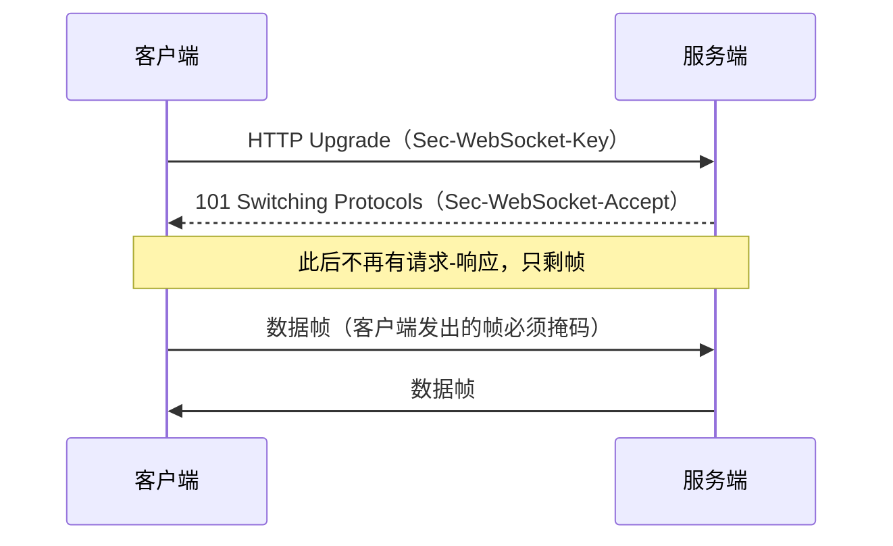

> [!note] 这是一篇范文，不是一篇知识笔记
> 判据在 [[atomic 设计]]（atomic 怎么写）与 [[笔记类型规范]]（concept 是什么），本文一律不复制。本文只回答一件事：**这两张卡片怎么接起来才算组织好了。**
> 取材自 [[WebSocket]] 与挂在它下面的三篇 atomic，内容以那四篇为准。注释在阅读视图里不显示，编辑或源码里才看得见。

<!--
为什么拿 WebSocket 取材：它是全库最小的一簇——1 篇 concept + 3 篇 atomic，正好够看清每一条接缝。大概念（比如浏览器缓存那篇）接缝更多，但会被内容淹掉。
怎么看这篇范文：先读注释，再回头把注释全删掉看一遍——剩下的应该是一篇正常的 concept，没有一句是「为了示范而写」的废话。
-->

## 一、范文：concept 怎么组织 atomic

### 概念：WebSocket

> WebSocket 是借 HTTP 握手升级出来的一条双向帧通道，连接的生命周期从此独立于任何一次请求。

解决的核心痛点：HTTP 只能由客户端发起，服务器想「主动」，只能靠轮询空转。

**WebSocket 卖的不是更快，而是「连接归谁所有」**：请求-响应模型里，连接属于一次请求，请求结束它就该关；WebSocket 把连接从请求里拆出来，双向与主动推送才谈得上。下面三条命题都挂在这句话上。

<!--
讲解 1：第一段只做两件事——「它是什么」和「它和近邻差在哪」。
不要写目录（本节讲 A、B、C），那是 MOC 的职责；也不要写「本文将介绍」，那是 article 的开头。
定义那一句同时就是 description 的来源：description 是它的压缩，不是另写一句。
-->

<!--
讲解 2：那句加粗是整篇最贵的一行，也是 concept 唯一不能被 atomic 替代的东西。
atomic 给的是判断，但判断之间是什么关系，只有 concept 能说。
全库 357 篇 concept 里只有 181 篇有「核心命题」段。缺的那一半，多半就是缺这一行——没有主轴，核心命题段只能退化成一串链接清单，读者读完不知道这几条为什么放在一起。
-->

#### 核心命题

- [[全双工只保证通道双向，不保证推得到人]]
- [[WebSocket 省的是重复握手，保活仍得自己做]]
- [[WebSocket帧头相比HTTP头部大幅减少重复开销]]

三条的顺序不是随意的：第一条说连接的形状（双向），第二条说连接的寿命（会静默断），第三条说连接的单价（帧头小）。先有形状，才谈得上寿命与单价；倒过来读会得出「它比 HTTP 省钱，所以该用 WebSocket」这个错误结论——第三条自己就写着，这个优势在 HTTP/2 之后已经收窄。

<!--
讲解 3：核心命题段只放链接，不写「原理：」。这是全篇最需要改的一条。
库里 181 篇有核心命题段的 concept，115 篇写了「原理：」行（64%）。抽查的结果是：那行写的多半是那篇 atomic 自己的论据，等于把内容抄成第二份，改一处漂一处，且不会报错。
本页改前那三行都可删：
  · 第一条的原理写「HTTP 是请求-响应模型」——那是机制，不是「全双工不保证推得到人」的依据；
  · 第二条写「HTTP 每次都要 TCP 握手」——恰好漏掉标题后半句「保活仍得自己做」；
  · 第三条写「帧格式减少开销」——同义反复。
判据一句话：这一条后面跟的是「它为什么能成立」，还是「它在这条链上定下什么」？前者是复述，删；后者是分工，留（就是上面那段顺序说明）。
-->

<!--
讲解 4：链接指向的篇目不必都在本页「下面」。
up 表示归档位置（挂在谁下面），不表示论证归属（谁在用它）。反过来说也成立：一篇 atomic 的 up 是 A，但它最常被 B 引用，那它就该出现在 B 的核心命题段。
证据：[[浏览器缓存与客户端存储体系]] 把协议那一半的机制放在下位 [[HTTP缓存机制]]，而不是自己展开。所以「挂在本页三篇 = 本页三条命题」这个等式不存在；本页真正的判据是「这三条撑不撑得起主轴」。
-->

#### 运行机制

<!--
讲解 5：机制是 concept 的活，不是 atomic 的。
判断一段该放哪，只问一句：它解释的是「一条命题为什么成立」，还是「这套东西怎么运转」？后者留在这里。
反过来说，atomic 里出现「第一步…第二步…」基本就是放错了格子——那也是「## 论据/示例 下再套 ### 论据」这个病灶的来源。
机制写全还有个副作用：atomic 的边界才能写成一句话并指过来（「说的是协议层，不是运维层」），不必在边界里复述握手过程。
-->

#### 关键区别

| 维度 | WebSocket | [[SSE]] | HTTP 轮询 |
|:--|:--|:--|:--|
| 方向 | 双向 | 服务器 → 客户端 | 客户端问、服务器答 |
| 连接 | 一条长期连接 | 一条长期连接 | 每次新建 |
| 省在哪 | 握手与重复头部 | 免轮询、免握手 | 无 |
| 什么时候别用 | 只需下行文本、要穿企业代理 | 需要客户端上行 | 实时性要求高 |

<!--
讲解 6：这张表能留在 concept 里，是因为它回答的是「本概念的边界在哪」，四个维度全都服务于「什么时候选它」。
如果表长到要覆盖七八个维度、还要给每个方案打分，它就不是 concept 的一节，而是一篇 comparison——库里已经有 [[WebSocket vs SSE vs Long Polling]]，那才是全维度对比的家。
判据：这张表是为了给本概念划界，还是为了比较几个对象？前者留，后者搬。
-->

#### 适用范围

- ✅ **适用场景**
	- 双向且高频：协作编辑、聊天、游戏同步、监控面板
	- 服务器要主动找客户端：订单状态、告警
- ⛔ **误用**
	- 低频更新（小时级）：HTTP 足够，长连接只是多一份要维护的状态
	- 拿它做 REST：资源语义、缓存、错误码全要自己重造
- **失效边界**
	- 中间设施不透明：代理、网关、CDN 默认不理解 Upgrade，企业网络里被拦是常见故障
	- 连接会静默死：移动网络切换、NAT 超时都算，协议层不负责告诉你
	- 有状态即要路由：多实例部署得做粘性会话或共享 pub/sub

<!--
讲解 7：这三类东西分工不同，混了就白写。
  · ✅ 适用场景 = 什么时候选它（决策依据）
  · ⛔ 误用 = 它对，但被用错了地方（反模式）
  · 失效边界 = 它自己解释不了、也解决不了的部分（能力的尽头）
注意这里的「失效边界」与 atomic 的「边界」不同轴：atomic 的边界是「这条判断何时不成立」，这里是「这个概念管不到哪」。两者内容不该互相搬运，搬过去就变成一篇讲两件事的卡片。
-->

#### 批判

- 无内建会话层：重连、心跳、消息确认、背压全部要自建，这也是 Socket.IO 这类库存在的原因
- 对中间设施不友好：缓存、压缩、可观测性在 HTTP 里都是免费的，这里要重造一遍
- 边界在收窄：HTTP/2 的流与 HTTP/3 的多路复用已经能承载推送，SSE 又更省，「非它不可」的场景比 2015 年少得多

<!--
讲解 8：批判不是自选动作。
一篇没有批判的 concept 是宣传页——它只告诉你这东西好，不告诉你它为什么可能被替代。而「边界在收窄」这类判断，恰恰是三个月后最有用的一句：它决定你要不要为一个正在变窄的方案建长期设施。
-->

#### 问题与流程

- **相关问题**
	- [[为什么 WebSocket 需要应用层心跳，而不能依赖 TCP Keep-Alive]]（待写）— 卡在「协议层的存活」与「应用层的可用」不是一回事
	- [[Q-WebSocket连接断开如何处理]]（待写）— 重连策略怎么定
- **相关流程**
	- [[使用 WebSocket 实现实时双向通信]] — 从握手到重连的完整落地
	- [[SOP-WebSocket 长连接保活与重连]]（待写）

<!--
讲解 9：Q 与 SOP 放同一节，是因为它们是同一批问题的两端：问题先发散，收敛之后就成了流程。
分开放（存量里 FAQ 与 SOP 两节并存）就看不出血缘——某个 SOP 到底收敛了哪个问题，只能靠猜。
这一节可以整节删掉：没有相关 Q 或 SOP 时不要留「（暂无，待补充）」，那种占位没人会回来填。
-->

#### 知识图谱

- **上位**：[[网络协议]] — 它是一条应用层协议，只是握手借了 HTTP
- **并列**：
	- [[SSE]] — 同样解决服务器主动推送，但只有单向
	- [[HTTP]] — 同一层的请求-响应协议，本概念是它的替代方案
	- [[WebSocket vs SSE vs Long Polling]] — 三者成本对比
- **相关**：
	- [[WebSocket心跳机制]]（待写）— 保活策略
	- [[WebSocket断线重连]]（待写）— 容错处理
- **外部资料**
	- [RFC 6455](https://datatracker.ietf.org/doc/html/rfc6455) — 协议规范
	- [MDN: WebSocket API](https://developer.mozilla.org/en-US/docs/Web/API/WebSocket) — API 参考

<!--
讲解 10：三处必须改的细节。
① 「上位」改前写的是裸词「网络协议」，不是链接——裸词在知识图谱里是一条断边，视图里看不见，也不报错。除「外部资料」桶（那里放网址）之外，桶里一律放双链语法。
② 改前把 RFC 与 MDN 单列成「参考资料」一节，那是旧写法；网址统一进「外部资料」桶，全库只有这一套桶名，定义见 [[知识图谱词表]]。
③ 桶的顺序固定为 上位 → 下位 → 并列 → 相关 → 外部资料，没有内容的桶整行删掉。
-->

---

## 二、范文：atomic 怎么接回去

> [!warning] 这一节的正文摘自 [[WebSocket 省的是重复握手，保活仍得自己做]]。只调了形态（观点行、关联节），判断一字未加；论据从三条压到一次实测。

### WebSocket 省的是重复握手，保活仍得自己做

> 一次 Upgrade 之后所有消息复用同一条 TCP 连接，省掉的是每次重连的开销；但连接会静默断，心跳与重连仍得自己写。

**边界**：复用连接的前提是连接没断。移动网络切换、NAT 超时、代理空闲断开都会让长连接静默失效——「无需重复建立」说的是协议层，不是运维层。有状态还意味着多实例部署要做粘性会话或共享 pub/sub。

#### 论据/示例（可选）

- 握手：`Upgrade: websocket` + `Sec-WebSocket-Key` → `101 Switching Protocols`
- 实测：1000 个事件只建 1 条 TCP 连接、0 个额外 HTTP 请求

<!--
讲解 11：上面那个小标题只为切分本页的范文，真实 atomic 的正文里没有它——`>` 引用行就是正文第一行。
标题已经是判断，引用行不必复述标题。
改前这一行是「WebSocket 只需~~一次握手~~，后续消息复用同一条连接，无需重复建立」——那是改名前的描述句，删改痕迹还留在里面。
两处各管一件事：标题要在列表、图谱、搜索结果里独立成立；引用行要在正文里把「省了什么」和「没省什么」一次说完。这也是批量改名最常见的一种残留——标题升成断言了，正文还停在描述。判据：把标题遮住，只读这一行，能不能读出同一个判断。
-->

<!--
讲解 12：边界是唯一必填的一格，也是「洞见」与「断言」的分界。
写法上只有一个要求：它是给观点划范围的，不是给观点补机制的。
这一格现在做对了两件事——把标题里最容易被夸大的半句（「省握手」）限定回协议层，并顺带说出代价（有状态要路由）。
反例在库里同样多：边界格写成「HTTP 每次请求都要三次握手」，那是机制，该上移到 concept 的运行机制。
-->

<!--
讲解 13：论据只留一条（这里是同一次实测的两行，算一条）。
2026-10-30 定的归属规则看复用度，不看被几处引用：只服务这一个论点、写得进一行的，留在这里；服务两个以上论点或要展开成节的，上移到承载该机制的 concept，atomic 只留指针。
所以这一节该短。若这份实测还要支撑「帧头小」那条命题，它就不再是这条的论据，而是机制：搬进 concept，两篇各自回链。
-->

<!--
讲解 14：这里在真实笔记里不该有「关联」一节，2026-10-30 起模板已删除，所以范文里也没有。
为什么删：实测 114/119 篇有它，其中 82% 的第一条链接就是 up 的副本、89% 是不带关系标签的裸链接。它同时造成两处手工维护的同一条事实，还给「建连接」开了个不用说理由的低成本出口。
那两个问题分别由谁回答：谁引用了我 → 反向链接面板；我挂在谁下面 → `up: "[[WebSocket]]"`。都不用手写。
-->

---

## 三、两张卡片之间只有三条线

| 线 | 谁写 | 写在哪 | 为什么不能反过来 |
|:--|:--|:--|:--|
| 归属 | atomic | `up` 字段 | 一篇 atomic 只能挂一个地方，这是归档问题，不是论证问题 |
| 引用 | concept | 核心命题段里的双链 | concept 是论证现场，它决定哪几条判断撑得起主轴、按什么顺序撑 |
| 复用 | concept | 运行机制 / 关键区别 / 适用范围 | 被第二处需要的论据就不再是论据，而是机制，该上移 |

三条线都是单向的。反过来的那两条（atomic 回链 concept、concept 抄 atomic 的论据）在库里对应两类真实故障：前者制造 `up` 的副本，后者制造不报错的漂移。

<!--
照着这篇写，但不要照着改存量：全库还有 176 篇 concept 没有核心命题段，那是一次独立的治理，与本篇的形态无关。
-->
