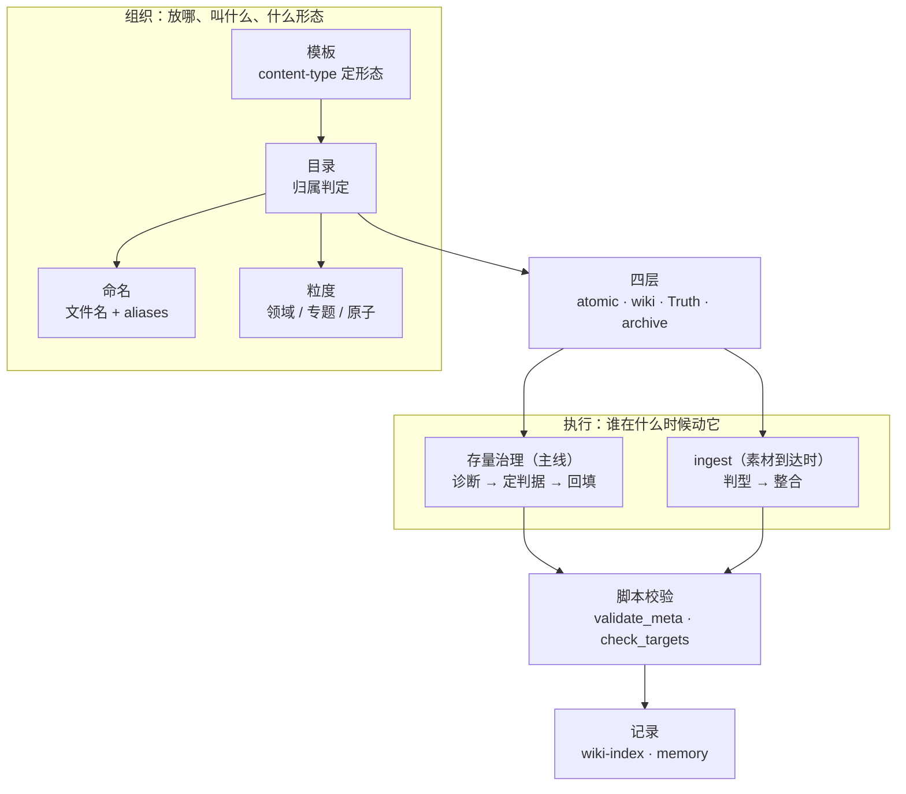

## 概念：本库子系统概述

> [!note] 本文件定位
> 本文件是**本库架构的唯一真值**：目录怎么分、形态怎么定、知识怎么分层、谁在什么时候动它、留下什么痕迹。
> 首次了解本库请从 [[本库指南]] 开始（入口与上手路径）；本文件回答「内部是怎么搭起来的」。其余文档只引用本文件，不复述架构——复述一次就多一个过期点。

> 本库以卡片盒笔记法为主结构、PARA 为容器，构成个人数字花园。2026-10 起，实际驱动它的不是「新素材流入」，而是**判据先行 → 固化到 Truth → 全库回填**（见 [[本库的实际运行方式]]）。

**解决的核心痛点**：如何让一套笔记系统同时具备行动导向、知识内化和可被 LLM 持续维护的一致性——这三件事的约束互相冲突：行动导向要求粗粒度容器，内化要求细粒度原子，一致性要求单一真值。

---

### 核心命题

- 本库通过目录结构子系统分派容器，不按形态映射
	- **原理**：数字前缀排序 + 语义由目录决定。PARA 只贡献两个容器（10-PROJECTS 时间盒、20-AREAS 责任域）与退役位（40-ARCHIVE）；30-RESOURCES 不是 PARA 的 R，而是「形态已判、无容器」的缺省落点；卡片盒贡献主结构 50-ZETTELCASTEN（详见 [[本库目录结构]]）
	- **修订记录（2026-11-07）**：此处原写「实现 PARA 映射，10→P、20→A、30→R、40→Archive」。该表述已废除，因为 30 的实际职能是归属缺省而非 PARA 的 R。改动理由见 [[判据总览]] 第四节的「已识别的后起解释」。
- 本库通过 content-type 分类子系统决定笔记形态
	- **原理**：content-type 只描述形态，不决定目录；归属由目录独立判定（两维度正交，详见 [[本库目录结构]]）
- 本库通过四层架构子系统实现知识的分层管理
	- **原理**：原子笔记层（50-ZETTELCASTEN）→ Wiki 层（30-RESOURCES）→ 真值层（01-META/Truth）→ Archive（40-ARCHIVE）。真值层 2026-10 才独立成层，它承载「判据住在哪」，三层模型此前没有给它位置
- 本库通过工作流子系统把维护动作分成主副两条线
	- **原理**：日常主线是存量治理；llm-wiki 的 ingest / query / lint / sync 只在素材到达或提问时启动，不是日常
- 本库通过命名规范子系统实现一致性
	- **原理**：前缀放 aliases，文件名用纯标题，正文引用更通顺
- 本库通过[[知识粒度子系统]]实现「领域 → 专题 → 原子」三层组织
	- **原理**：area 管责任（长期目标），MOC 管地图（聚合索引），concept/atomic 管事实（单一概念）
- 本库通过 Anki 集成子系统实现知识外化记忆
	- **原理**：atomic/term 生成卡片，question 收敛后生成，源笔记与卡片同源维护
- 判据必须有脚本兜底，否则不成立
	- **原理**：一条判据只写在文档里，能不能守住取决于下一次有没有人记得；写成 `validate_meta.py` 才变成每次都能跑的东西。但没有脚本查得了「判据本身对不对」，这条边界决定了下面第 9 项的分工

> ![[本库设计原则#一、本库目标结构]]

---

### 运行机制

一条创建链把「形态、归属、命名」定下来，两个循环共用同一套校验与记录：



> 工作流应交给本地 AI；人写笔记时只关注内容，不必关心连接与元数据。

---

### 架构总图

上方 Mermaid 画的是**流向**（谁接在谁后面）；下图画的是**构成**（每组有哪几项，以及执行组里两条线的并列关系）。同一套架构的两种读法，不是两个版本。

![[本库架构.excalidraw]]

> [!tip] 读图顺序
> 自上而下既是四组的顺序，也是依次判定的顺序：先定**放哪、叫什么、什么形态** → 再看**分到哪一层** → 然后才是**谁去动它** → 最后**留下什么痕迹**。
> 第三组里越靠左权重越高：存量治理是日常主线，llm-wiki 只在素材到达或提问时启动；底部那条脚本条是两者共用的收尾手段。
> 图本身在 `_resources/本库架构.excalidraw.md`，在 Obsidian 里切 EXCALIDRAW VIEW 即可改；改完不必再动本节文字。

---

### 关键子系统

分四组，顺序是「组织 → 分层 → 执行 → 记录」。**不数总数**——数字比内容更容易过期，上一版写「九大」而正文只有七个，就是这么来的。

#### 一、组织：东西放哪、叫什么、什么形态

**1. 目录结构子系统**

> 目录树的唯一真值见 [[本库目录结构]]。下表仅为架构视角的结构角色解说。

| 目录 | 结构角色 | 归属判定 |
|------|-----------|----------|
| `00-INBOX/` | 入口·原料 | 待审核素材的临时落点 |
| `10-PROJECTS/` | 容器·时间盒 | 目录即归属（工作区，形态不限） |
| `20-AREAS/` | 容器·责任域 | 目录即归属（容器，以 area 为主） |
| `30-RESOURCES/` | 缺省落点 | 目录即归属（形态已判、无容器时的去处；出口判据见该节） |
| `40-ARCHIVE/` | 退役 | 状态决定 |
| `50-ZETTELCASTEN/` | 主结构·卡片盒 | 目录即归属（单形态 atomic） |
| `60-BLOGS/` | 输出 | 目录即归属（单形态 article） |
| `90-DIARY/` | 时间序列 | 目录即归属（单形态 diary） |
| `01-META/` | 元系统 | 真值、索引、日志、模板、脚本——不存知识，存规则 |

**2. content-type 分类子系统**

> 14 种形态的唯一真值见 [[笔记类型规范]]。要点：形态与归属是正交维度，不存在「concept 就放 30-RESOURCES」这类映射。

**3. 命名规范子系统**

> 文件名与 `aliases` 的唯一真值见 [[文件名与别名规范]]；目录名见 [[本库目录结构]]。

```bash
一致性原则：前缀放 aliases，文件名用纯标题
```

**4. 知识粒度子系统（领域 → 专题 → 原子）**

三层粒度模型，避免「宏观领域过宽」与「碎片化卡片无体系」两个极端：

| 粒度 | 载体 | 职责 | 判断准则 |
|------|------|------|----------|
| 宏观·领域 | `area`（20-AREAS） | 责任领域：愿景/里程碑/SOP/健康度 + 专题导航 | 持续数年，仅做分类根与导航 |
| 中观·专题 | `moc`（多在 30，也可在项目目录） | 知识地图 + 研究容器：聚合同主题 concept/sop/term | 资料 5~20 篇高价值内容 / 攻关 1~3 周 |
| 微观·原子 | `concept` / `term` / `atomic` | 单一概念、事实、可复用模式 | 10 分钟查阅 |

**核心原则：area 管责任，MOC 管地图。**

- area 是 PARA 的「A」——动词（我负责什么），必须含长期目标；知识地图职责下放给 MOC
- MOC 是名词（这里有什么知识），只做索引不设目标；是 NotebookLM 等 AI 研究容器的对应物
- 粒度不当的调整：过宽（"学好前端"）→ 拆小为专题；过碎（单一 API）→ 并入专题 MOC

> 详细说明见 [[知识粒度子系统]]。

#### 二、分层：知识如何分层

**5. 四层架构子系统**

| 层级 | 目录 | 负责方 | 内容 |
|------|------|--------|------|
| 原子笔记层 | 50-ZETTELCASTEN | 你 | `atomic` 形态，source of truth；不看由谁写出 |
| Wiki 层 | 30-RESOURCES | 内容你写 / 包装 AI 补 | 形态已判、无容器归属的知识（形态不限，见 [[本库目录结构]]） |
| 真值层 | 01-META/Truth | 你 + LLM | 判据、字段定义、命名规则的唯一来源（2026-10 起独立成层） |
| Archive | 40-ARCHIVE | 你 + LLM | 过时知识 |

> [!note] 「负责方」的准确含义见 [[人机分工规范]]：Wiki 层的**内容**可能来自你（你写的概念）或 AI（收敛的外部事实），但**包装（bookkeeping）一律由 AI 维护**。

#### 三、执行：谁在什么时候动它

**6. 模板与创建链路子系统**

形态决定模板，模板决定开局字段，这条链是新笔记的唯一入口：

```bash
content-type → _templates/template_<形态>.md → uid / date-created → Templater 渲染
```

- `<% %>` 占位符只有 **Templater** 认，核心 Templates 插件会把它原样写进文件且不报错
- `_scripts/template_startup.md` 是启动模板（不在 `_templates/`，否则会被收进「插入模板」列表），负责把 Inbox 中滞留超 14 天的笔记移入 `40-ARCHIVE`
- 字段定义见 [[元数据规范]]，形态定义见 [[笔记类型规范]]

**7. 存量治理子系统（主线）**

当既有内容与判据不一致时的处置路径：**诊断 → 判据定夺 → 改真值 → 回填 → 校验 → 记录**。

- 三种结局：判据对存量错 → 回填；存量对判据错 → 改真值；边界没写清 → 补边界
- 顺序不可反：先改真值再改引用最后改存量，否则中间会出现两套定义并存的窗口
- 完整步骤、坑点与验证记录见 [[存量治理]]；为什么它是主线见 [[本库的实际运行方式]]

**8. llm-wiki 工作流子系统（副线）**

| 工作流 | 触发 | 职责 | 实际状态 |
|--------|------|------|---------|
| ingest | `00-INBOX/` 有素材 | 素材 → 判型 → wiki 层整合 | 素材到达时启动 |
| inbox-review | 用户要求 | 审核 Inbox，判断类型，移动目录 | 按需 |
| query | 用户提问 | wiki 层查询回答 | 按需 |
| lint | 定时/手动 | 健康检查（矛盾/孤儿/缺口/过时/一致性） | 内容层检查；字段与链接由 `validate_meta.py` 承担 |
| sync | 笔记变更 | 状态同步 | 已停用（停在 2026-10-23） |

> 五个工作流的规则住在本文件之外：[[llm-wiki-schema]] 索引，[[_ingest-rules]] / [[_query-rules]] / [[_lint-rules]] / [[_sync-rules]] 分列。本文件只给它们定位，不复述步骤。

**9. 脚本与校验子系统**

判据的落地手段。分两类，职责不重叠：

| 类别 | 脚本 | 作用 |
|------|------|------|
| 校验 | `validate_meta.py`（`--all` / `--links`）、`check_targets.py`、`scan_orphan_atomic.py` | 查字段与枚举是否合 Truth、查链接与 `up` 写法、查空父级 |
| 生成 | `build_wiki_index.py`、`stats.py`、`count_words.py`、`apply_up_mapping.py` | 重建索引、出统计快照、字数、一次性迁移 |
| 看板 | `areaBacklinks.js`、`scorecard.js`、`diaryPanel.js`、`weekPanel.js`、`brokenLinks.js`、`templater/autoArchiveInbox.js` | 领域页反链、信源评分、日记与周记面板、断链清单、Inbox 自动归档 |

- **判据：判据类的改动值得写脚本，单篇改动不值得。** 写脚本的成本只有在会被反复执行时才收得回
- **已知盲区**：`build_wiki_index.py` 不索引 `.claude/`（隐藏目录），改过 `SKILL.md` 不会反映到索引
- 完整清单与判断边界见 [[本库脚本化]]

#### 四、记录：留下什么痕迹

**10. 索引与看板子系统**

| 组件 | 位置 | 性质 | 状态 |
|------|------|------|------|
| `wiki-index` | 01-META/Index | 全量名册，由脚本重建，**不要手改** | 在用 |
| `.base` 视图 | `99-ASSETS/Bases/` | 清单与下钻；读不到别的笔记的字段，因此只出清单、不出指标 | 在用 |
| `areaBacklinks.js` | _scripts | 领域页看板：反链按 content-type 分组 | 在用 |
| `wiki-log` | 01-META/Log | 条目级时间线 | 冻结于 2026-10-27 |
| `wiki-sync-state` | 01-META | git 变更检测 | 停用于 2026-10-23 |
| `.workbuddy/memory/` | 库根 | 决策理由与变更叙事，按天分文件 | 在用（wiki-log 的继任者） |

> `.base` 的写法与陷阱见 [[本库Bases约定]]；索引格式见 [[_wiki-index-format]]。

**11. Anki 集成子系统**

**核心判断**：Anki 只奖励「有稳定正确答案的知识」，卡片挂在收敛产物上。

| 来源类型 | 是否生成卡片 | 说明 |
|---------|------------|------|
| `atomic` | ✅ 主候选 | 单句洞察、永不修改 → recall 卡 |
| `term` | ✅ 生成 | 术语定义是经典闪卡素材 |
| `question` | ⛔ 收敛后 | 未收敛不生成，验证出答案/SOP 后才进 |
| `concept` / `sop` / `moc` / 其他 | ⛔ 不生成 | 聚合/流程/索引类，非记忆单元 |

- 卡片用 `#card` 语法内联标记在源笔记中，与源笔记同源维护
- 卡片质量遵循 [[知识卡片制作原则]]（最小信息、主动回忆、具体化）
- 详细规则见 [[_anki-sync-rules]]

---

### 子系统关系

```bash
组织（形态 → 归属 → 命名 → 粒度）
   ↓
分层（atomic → wiki → Truth → archive）
   ↓
执行（治理主线 / ingest 副线）→ 脚本校验
   ↓
记录（wiki-index · .base · 看板 · memory · Anki）
```

**核心原则**：

- **目录是物理组织，content-type 是逻辑分类**——两者正交，互不推导
- **真值只有一处**：字段、形态、命名、关系桶全部落在 `01-META/Truth/`，Guide 与 Specification 只引用
- **判据先行**：组织的每一环都由判据决定，判据变了就回填，回填完必须过校验
- **两个循环共用一套校验与记录**：治理主线和 ingest 副线的区别只在触发条件，不在收尾要求
- **记什么、记到哪**：结构化状态进 `wiki-index`，决策理由进 `memory`，二者不互相替代

---

### 知识图谱

- **上位**：[[本库指南]] — 本库的入口与上手路径
- **下位**：
	- [[PARA笔记法]] — 本库只取它的三个容器位（项目 / 领域 / 归档），R 不落地
	- [[卡片盒笔记法]] — 原子笔记和双向链接的知识内化方法
	- [[知识粒度子系统]] — 领域 → 专题 → 原子
	- [[llm-wiki-schema]] — LLM 维护知识库的作业指南
- **相关**：
	- [[本库目录结构]] — 目录树的唯一真值
	- [[笔记类型规范]] — 14 种形态的唯一真值
	- [[元数据规范]] — 字段与 `up` 的唯一真值
	- [[真值索引]] — 全部真值文档的入口
	- [[本库的实际运行方式]] — 实际驱动力：判据先行、全库回填
	- [[存量治理]] — 主线工作流的操作步骤
	- [[本库脚本化]] — 脚本清单与「该不该写脚本」的判断边界
	- [[本库Bases约定]] — `.base` 写法与陷阱
	- [[_skills-overview]] — skill 分层与职责
	- [[wiki-index]] — 知识库导航索引
