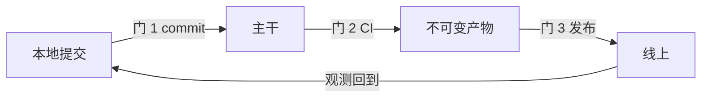

## 背景

前端工程化在库里不缺名词。`前端工程化工具` 这个 MOC 挂了 21 个工具名，但其中 12 个还是红链；能点开的 9 篇各自都对，合起来却拼不出一条能跑的路——每篇回答「它是什么」，没有一篇回答「它接在谁后面、坏了往上还是往下查」。

真正会出事的也不是单篇笔记里写错的那一行，是接缝：

- **配置是对的，门没连上**。`lint-staged` 配了规则，husky 的 hook 没装，提交照样过；CI 里写了 `npm test`，但 PR 的必过检查没勾上，红了也能合。
- **门连上了，产物回不去**。回滚要重新构建，而构建跑的是 `main`，于是「回滚」实际是又发了一版新代码。
- **发得出去，出事了查不到**。Sentry 没传 sourcemap，堆栈全是压缩后的行列号，一条线上报错等于一个坐标。

三件事的共同点：**没有任何一处配置写错，错在两段的接缝**。所以这个专项的产出不是「补齐工具笔记」，而是能指出接缝在哪，并在它断的时候说得出该看哪一段。

## 核心目标

**Outcome**：从一个空目录能搭起一条从提交到上线的链路，并对任意一次故障说出它断在哪一段、由什么证据定位。验收的方式是「指给我看在哪」——某个配置文件、某条流水线、某个面板上的那条告警。

**不做什么**：

- 不写 CI 厂商的操作手册。[[GitHub Actions]] 只写到本专项用到的语法，不做全量语法表。
- 不读打包器源码。说清「dev 不打包靠什么」为止，不进 AST、插件生命周期、loader 执行细节。
- 不碰 SSR、微前端、Monorepo。它们与本专项的前提（单仓、单应用、一个产物）冲突，领域页里另有位置。
- 不做性能优化。[[前端性能优化]] 与 [[缓存机制学习专项]] 负责那一段；本专项只到「产物体积能被定位」。

## 战略地图

链路本身是有序的，因为它靠产物传递：没有能构建的产物，质量门无处可挂；没有可信的产物，「回滚」只是一句空话。所以三段不是三个主题，是一条线上的三段，每段各有一道门。

### KR1：构建链路——说清 dev 与 build 在哪一步分岔

**判据**：能指出分岔发生在哪个环节（模块由谁解析 / 是否打包 / 何时压缩），并拿一份真实产物报告给出优化前后的两个数字。

- [ ] 对照 [[Vite]] 与 [[Webpack]] 的 dev 与 build 两条路径，写成一条 atomic（待写：开发态与构建态的分岔不在压缩，在模块由谁解析）
- [ ] 按 [[构建分析与优化（Vite）]] 跑一次产物报告，挑一个真实项目定位体积问题，记下优化前后数字
- [ ] 把 [[你了解哪些构建优化手段？如何提升构建速度和最终产物体积？]] 的手段按「治体积 / 治速度」重排——现在的清单是混着的，混着就没法按需取

### KR2：质量闸门——三道门各拦一次故意的违规

**判据**：commit / merge / 上线三道，每道都能演示「我故意写坏，它拦下了」，并说得出为什么不能并成一道。

- [ ] 按 [[通过husky+lint-staged进行代码质量防护]] 装 commit 门，故意提交一个 lint 错，截图为证
- [ ] 接上最小样本：[[单元测试]] 一个（Vitest 尚未立篇，见下表红链）+ [[Playwright]] 一条 E2E
- [ ] 在 [[CI-CD流程]] 里串起 build + test，让失败真的能阻断合并

### KR3：交付与观测——一次上线，一次回溯

**判据**：回滚不需要重新构建；一次线上错误走完「告警 → 定位 → 修复 → 验证」四步，每步留时间戳。

- [ ] 产物按版本目录存放、文件名带内容哈希，回滚 = 切指针而不是重跑流水线
- [ ] 按 [[如何选择前端监控方案]] 的判据选一个方案，把 sourcemap 真正传上去
- [ ] 补一节「回滚与缓存怎么配合」——这一步与 [[缓存机制学习专项]] 的 KR3 重叠，两边共用一份结论，不各写一遍

## 学习路径

> 顺序不是学习法选出来的，是产物依赖定死的：构建是入口，质量门挂在产物上，回滚只能在不可变产物上成立。每行的自测答不出，就是这一阶段没学完。

| 阶段 | 读什么 | 自测（答不出就是没学） |
|:--|:--|:--|
| 1. 构建 | [[前端构建与打包]] → [[Vite]] → [[Webpack]] → [[前端构建工具对比]] → [[Tree Shaking]] | dev 下 `import` 一个组件，浏览器拿到的是源码还是模块图？构建后又是什么？中间那一步是谁做的？ |
| 2. 质量 | [[ESLint]] → [[Husky]] → [[通过husky+lint-staged进行代码质量防护]] → [[单元测试]] → [[集成测试]] → [[Playwright]] | lint 与 `tsc` 谁先跑，为什么？为什么 commit 门不该跑 E2E？ |
| 3. 交付与观测 | [[CI-CD流程]] → [[持续集成与持续部署]] → [[GitHub Actions]] → [[前端监控]] → [[前端监控指标采集]] → [[如何选择前端监控方案]] | 回滚为什么不能重新构建？产物不可变的两个必要条件是什么？没传 sourcemap 时，一条报错你能拿到什么、拿不到什么？ |

三篇不在任何阶段里：[[建立前端工程规范]]、[[代码审查流程]]、[[版本控制与协作流程]]。它们是收尾动作——链路真跑通过之后才有资格写规范，否则写出来的是想象。这也是这个专项最容易做反的一处：先写规范再建链路，规范一定对，链路一定不通。

## 进展

**当前阶段**：未开始。三段全包，按 1 → 2 → 3 推进，不预设哪段已过。

**当前障碍**：

- 12 处工具红链（Rspack / Rollup / SWC / esbuild / Jest / Vitest / Cypress / Prettier / Storybook / Docker / Sentry / Module Federation）。其中 **Vitest 与 Prettier 在阶段 2 的必经路径上**，先补这两篇，其余继续挂着——它们是选型对象，不是学习路径上的节点。
- [[前端构建与打包]] 仍是旧写法 MOC：`status` / `related` / `para` 三个已废除字段，章节目录带 emoji，与 [[前端工程化工具]] 不同构。读它要切换一次心智，但不必为这个专项先改它。

**下一步**：

- 跑 [[前端构建与打包]] 这条线，把「dev 与 build 在哪分岔」写成第一篇 atomic。

## 验收（费曼检验）

> 不看笔记，讲给一个只会写页面、没配过构建的人听。卡住的那一处不是「再读一遍」，是这里缺一张 atomic。
> 形式一栏写清口述 / 写出 / 现场做题——凭记忆讲才算验，拿着稿子讲不算。

| 检验点（即 KR） | 形式 | 结果 | 卡在哪 | 产出 |
|:--|:--|:--|:--|:--|
| 构建链路：dev 与 build 在哪一步分岔，并给出一次优化的两个数字 | 口述 5 分钟 + 打开一份产物报告 | 过 / 未过 | | [[开发态与构建态的分岔不在压缩，在模块由谁解析]]（待写） |
| 质量闸门：三道门各拦什么，为什么不能并成一道 | 现场改坏一个文件，走完三道 | 过 / 未过 | | 待写：三道门的分工不是粒度，是「错误代价的落点」不同 |
| 交付与观测：回滚为什么不重建，一次线上错误怎么定位 | 口述 5 分钟 | 过 / 未过 | | 待写：回滚要成立，产物必须与构建环境解耦 |

## 决策日志

| 日期 | 当时的判断 | 后来（验证 / 推翻） |
|:--|:--|:--|
| 2026-11-03 | 三段全包，不预设起点，而不是「先把工具笔记补完」 | 待验证：若阶段 1 一遍就过，说明该起点应后移，前端工程的缺口其实在阶段 2 |
| 2026-11-03 | 性能、微前端、Monorepo 不进本专项 | 待验证：三者都与「单仓单应用」前提冲突，进来会把 KR 拉到 5 个以上 |
| 2026-11-03 | `expire` 定 2026-12-31，与缓存专项对齐 | — |

## 复盘

> 收尾时写。只回答两个问题，不重新总结一遍 KR——KR 的结论在验收表里已经有了。

**与预期的偏差**：

- {{哪些原本以为要学的其实不用学；哪些以为不用学的其实是主线}}

**被推翻的判断**：

- {{原判断 → 实际发生了什么 → 因此调整了什么}}

## 知识图谱

- **上位**：
	- [[前端工程]] — 本专项只覆盖其中「交付链路」那一段（构建 / 质量 / 观测），不管性能与架构方案
- **并列**：
	- [[缓存机制学习专项]] — 同一个人、同一套形态（判定框架 + 概念 + 自测）的另一条链路专项
- **相关**：
	- [[前端性能优化]] — 产物可控之后才谈得上优化，顺序不能反
	- [[软件工程]] — 质量闸门的判据来自它（缺陷越晚发现越贵），前端只是落地形态
	- [[前端工程演进]] — 这条链路为什么长成现在这样，每一步都有历史原因
- **外部资料**
	- [webpack: Concepts](https://webpack.js.org/concepts/) — 依赖图与 loader / plugin 分工的真值
	- [Vite: Why Vite](https://vite.dev/guide/why.html) — dev 不打包的理论依据，官方自己的说法
	- [GitHub Actions 文档](https://docs.github.com/en/actions) — 流水线语法的唯一来源
