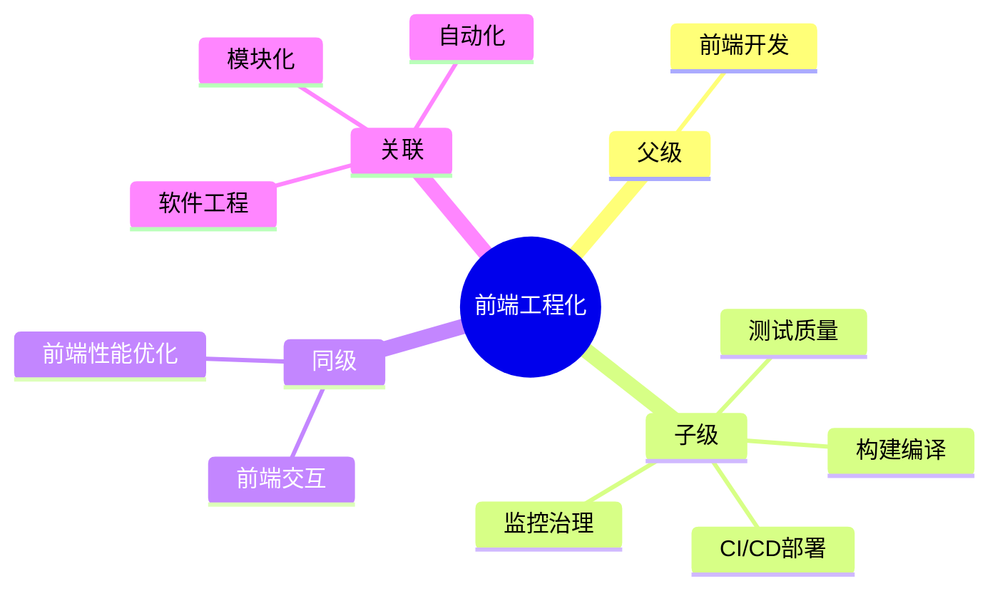

## Area: 前端工程

> 将软件工程方法论应用于前端开发，通过规范化、模块化、自动化解决规模化、协作化和性能优化挑战。

**核心目标**：提效、保质、监控。

### 领域定义

- **核心范畴**：开发体验优化、构建编译、质量保障、部署运维、监控治理
- **不包括**：具体业务代码实现、UI 设计
- **与相关领域的区别**：
	- [[前端工程]] 关注「如何高效、可控地交付」
	- [[前端交互]] 关注「如何响应用户」
	- [[前端性能优化]] 关注「如何让页面加载更快」
	- 与 [[软件工程]] 的分工：软件工程给方法与判据，本领域负责这套方法在前端技术栈上的具体形态

### 里程碑

- **愿景**：能独立搭起并维护一条从提交到上线的交付链路，说清每个环节为什么存在、坏了怎么查
- **里程碑**：
	- [ ] 阶段 1：构建链路——从一个空目录搭出开发、构建、产物分析三段可用的配置
		- [ ] 开发态热更新与构建态产物的差异能解释（为什么产出不同、差在哪一步）
		- [ ] 产物分析报告能定位一次真实的体积问题，并说清优化前后的数字
	- [ ] 阶段 2：质量闸门——提交前、合并前、上线前各有一道自动检查
		- [ ] ESLint + Prettier + husky/lint-staged 串成 commit 门，故意违规能被拦下
		- [ ] 单元测试与 E2E 各有一个能跑通的样本（Vitest / Playwright）
		- [ ] CI 上跑通 build + test，失败能阻断合并
	- [ ] 阶段 3：交付与观测——一次真实上线，加一次线上问题回溯
		- [ ] 能独立完成构建产物部署与回滚，回滚不需要重新构建
		- [ ] 接入错误监控（Sentry），用一次线上错误走完「告警 → 定位 → 修复 → 验证」

> 判据：三个阶段各自的验收物都能在项目里指出来——配置文件、流水线、监控面板上的那条告警。写不出「在哪个项目的哪一处」，就是还没达成。愿景原写「提效、保质、监控」三个词，那是目标的方向，不是可验收的落点，故拆成上面九条。

### 专题导航

> 中观层：三个下级 MOC 分管工具、构建、性能；concept 应逐步沉到它们下面，领域页只留入口。

- **工具与生态** — [[前端工程化工具]]（构建工具、测试框架、代码质量、CI/CD、架构方案）
- **构建与打包** — [[前端构建与打包]]（代码转换、模块打包、产物优化）
- **性能** — [[前端性能优化]]（加载、渲染、运行时）
- **路线** — [[前端工程演进]] · [[前端工程师能力地图]]
- **跨领域** — [[设计模式]] · [[软件工程]]（方法论来源，归属在对方）

#### 领域内笔记（待下沉到上述 MOC）

> 下面是原本平铺在领域页的概念。三个 MOC 尚未接完线，先留在原处便于查找；接完后逐条移到对应 MOC，领域页不再保留清单。

- **Roadmap**
	- [[前端工程演进]]
	- [[前端工程师能力地图]]
- **核心概念**
	- [[微前端]]
	- [[脚手架]]
	- [[Monorepo|Monorepo]]
	- [[Turborepo]]
	- [[模块化与组件化开发]]
	- [[第三方库]]
	- [[前端工程化与前端开发生命周期.excalidraw]] — 前端开发生命周期全景图
- **核心判断**（atomic）
	- [[域名分片在HTTP2下从优化变成反模式]] — 为旧协议约束而生的优化，会随协议升级整体反转
- **构建编译**
	- [[前端工程化工具]] — 工具索引
	- [[Vite]] — 下一代构建工具
	- [[Webpack]] — 模块打包器
	- [[Rspack]] — 高性能打包器
	- [[pnpm]] — 现代包管理器
	- [[tsconfig.json]] — TS 编译器核心配置文件
	- [[package.json]] — Node.js 核心元数据文件
- **测试质量**（测试金字塔：[[单元测试]] → [[集成测试]] → E2E）
	- [[Vitest]] — 单元测试
	- [[Playwright]] / [[Cypress]] — E2E 测试
	- [[网络抓包与接口分析]]
- **代码质量**
	- [[ESLint]] — 代码检查
	- [[Prettier]] — 代码格式化
	- [[Husky]] — Git Hooks
- **CI/CD**
	- [[GitHub Actions]] — 自动化工作流
	- [[Docker]] — 容器化
- **前端监控**
	- [[Sentry]] — 错误监控
	- [[前端监控与告警实践]] — 监控体系
- **版本控制与协作**
	- [[Git命令与工作流速查]] — Git 常用命令速查
	- [[Git Hooks]]

### FAQ

> 该领域的常见问题（链接 Question 或 MOC）

- [[前端工程化相关面试题]] — 工程化面试题聚合索引
- [[Webpack vs Vite]]
- [[Q-如何选择构建工具]]
- [[为什么使用SSR（服务端渲染）？]]
- [[AI全栈项目如何科学选型前端与后端框架]]

### 执行系统

> 该领域自有的执行流程与工具。方法论可以从别的领域借，归属不出——借来的流程写进「跨领域引用」并注明所有权在谁。

- **核心流程**
	- [[建立前端工程规范]] — 从零定一套项目规范
	- [[构建前端脚手架]] — 脚手架的结构与模板
	- [[代码审查流程]] — PR 创建、审查、合并
	- [[CI-CD流程]] — 从提交到部署的流水线
	- [[版本控制与协作流程]] — 分支模型与提交约定
	- [[通过husky+lint-staged进行代码质量防护]] — 提交前的自动门
	- [[全栈项目技术选型指南]]
	- 发布流程 — 版本管理 → 构建产物 → 部署验证
- **关键工具**
	- [[前端工程化工具]] — 工具选型清单
	- [[Sentry]] — 线上错误的第一现场
- **跨领域引用**
	- [[设计模式]] · [[软件工程]] — 方法论归属在对方，本领域只负责落地形态

### 探索前沿

- Serverless 如何改变前端边界
- AI 辅助编程如何整合进 Code Review
- 如何量化工程化 ROI

### 领域知识图谱



```dataviewjs
// 领域页看板（逻辑在 _scripts/areaBacklinks.js）
await dv.view("_scripts/areaBacklinks")
```
