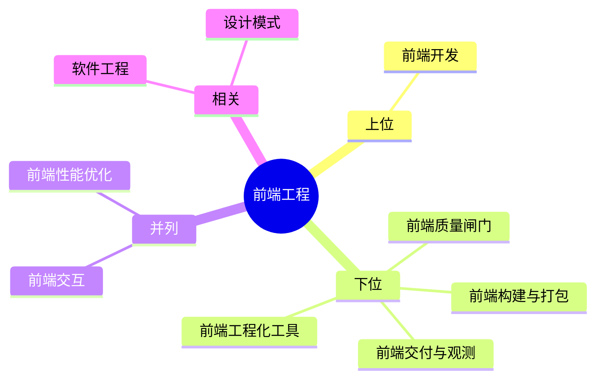

## Area: 前端工程

> 将软件工程方法论应用于前端开发，通过规范化、模块化、自动化解决规模化、协作化和性能优化挑战。

**核心目标**：提效、保质、监控。

### 领域定义

- **核心范畴**：开发体验优化、构建编译、质量保障、部署运维、监控治理
- **不包括**：具体业务代码实现、UI 设计
- **与相关领域的区别**：
	- [[前端工程]] 关注「如何高效、可控地交付」
	- [[前端交互]] 关注「如何响应用户」
	- [[前端性能优化]] 关注「如何让页面加载更快」
	- 与 [[软件工程]] 的分工：软件工程给方法与判据，本领域负责这套方法在前端技术栈上的具体形态

### 里程碑

- **愿景**：能独立搭起并维护一条从提交到上线的交付链路，说清每个环节为什么存在、坏了怎么查
- **里程碑**：
	- [ ] 阶段 1：构建链路——从一个空目录搭出开发、构建、产物分析三段可用的配置
		- [ ] 开发态热更新与构建态产物的差异能解释（为什么产出不同、差在哪一步）
		- [ ] 产物分析报告能定位一次真实的体积问题，并说清优化前后的数字
	- [ ] 阶段 2：质量闸门——提交前、合并前、上线前各有一道自动检查
		- [ ] ESLint + Prettier + husky/lint-staged 串成 commit 门，故意违规能被拦下
		- [ ] 单元测试与 E2E 各有一个能跑通的样本（Vitest / Playwright）
		- [ ] CI 上跑通 build + test，失败能阻断合并
	- [ ] 阶段 3：交付与观测——一次真实上线，加一次线上问题回溯
		- [ ] 能独立完成构建产物部署与回滚，回滚不需要重新构建
		- [ ] 接入错误监控（Sentry），用一次线上错误走完「告警 → 定位 → 修复 → 验证」

> 判据：三个阶段各自的验收物都能在项目里指出来——配置文件、流水线、监控面板上的那条告警。写不出「在哪个项目的哪一处」，就是还没达成。愿景原写「提效、保质、监控」三个词，那是目标的方向，不是可验收的落点，故拆成上面七条。
>
> 逐条落地见 [[前端工程学习专项]]：三个阶段各对应一篇子专项（[[前端工程学习专项-构建]] / [[前端工程学习专项-质量]] / [[前端工程学习专项-交付]]），**勾选都在那份父页的 KR 下**，子专项只装读什么、自测与决定项；本页按阶段整体打勾，不逐条维护，否则同一件事要在三个地方各勾一半。
>
> 注意两套分法不是同一条轴：本页按**链路三段**切，父专项的 KR 按**深度三档**切（讲得出 / 做得出 / 用得上）。所以「阶段 2 打勾」不等于「某个 KR 达成」——前者是学完了没，后者是学到哪一档。

### 专题导航

> 中观层按里程碑三段切，每段一个 MOC：构建链路 → 质量闸门 → 交付与观测。分类依据是**链路顺序**，不是工具类别——所以同一件工具可能既在名录里，又在某一段的门口。
> 领域页只留入口，不列笔记清单；具体笔记挂在哪，去对应的 MOC 看。

- **阶段 1 构建链路** — [[前端构建与打包]]（代码转换、模块打包、产物优化）
- **阶段 2 质量闸门** — [[前端质量闸门]]（提交前、合并前、上线前三道门）
- **阶段 3 交付与观测** — [[前端交付与观测]]（流水线、部署回滚、监控告警）
- **工具名录** — [[前端工程化工具]]（全量工具名，按类别排，不含链路判断）
- **性能** — [[前端性能优化]]（横切三段，不属任何一段）
- **RoadMap** — [[前端工程演进]] · [[前端工程师能力地图]]（躺在 40-ARCHIVE，需决定恢复还是重写）
- **跨领域** — [[设计模式]] · [[软件工程]]（方法论来源，归属在对方）

### FAQ

> 该领域的常见问题（链接 Question 或 MOC）

- [[前端工程化相关面试题]] — 工程化面试题聚合索引
- [[Webpack vs Vite]]
- [[如何选择构建工具]]（待写）
- [[为什么使用SSR（服务端渲染）？]]
- [[AI全栈项目如何科学选型前端与后端框架]]

### 执行系统

> 三类流程都已挂到对应 MOC，本页不再重复列名册。这里只留一条没有笔记承接的步骤。

- **发布步骤**：版本号 → 构建产物 → 部署验证 → 回滚点。库里没有独立笔记，缺口记在 [[前端交付与观测]] 的待探索
- **跨领域引用**：[[设计模式]] · [[软件工程]] — 方法论归属在对方，本领域只负责落地形态

### 探索前沿

- Serverless 如何改变前端边界
- AI 辅助编程如何整合进 Code Review
- 如何量化工程化 ROI

### 领域知识图谱



> 生命周期全景（图）：[[前端工程化与前端开发生命周期.excalidraw]]

```dataviewjs
// 领域页看板（逻辑在 _scripts/areaBacklinks.js）
await dv.view("_scripts/areaBacklinks")
```
