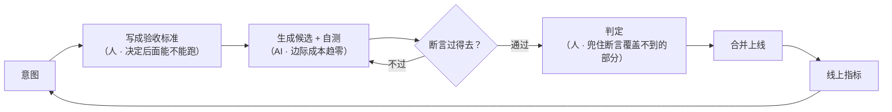

## 概念：AI First

> AI First 不是把 AI 加进现有流程，而是把「从意图到候选」这一段整体外包出去——人只留两处：写验收标准，和判定候选对不对。它真正改变的不是速度，是**瓶颈的位置**。

**解决的核心痛点**：AI 辅助阶段把补全塞进编辑框，人仍然逐行写、逐行改，收益被人的输入速度封顶。流程一步没少，只是在人的动作里换了一个更快的按键。

判据（可当场验证）：**同一条流程里，AI 的输出是直接成为下一步的输入，还是先进人的收件箱排队？** 前者是 AI First，后者只是 AI 辅助。这条判据不看装了什么工具，只看队列在哪一侧堆起来。

### 核心命题

> 只放链接，不写「原理」——原理是那篇 atomic 自己的论据，抄过来就是第二份真值

- [[「值不值得做」不能外包给 AI，事实性问题可以直接问]]
- [[AI提问质量取决于上下文结构化程度]]

两条一正一反，顺序不能换。第一条划出 AI 拿不到的那一项输入——目标函数，因此裁决权必须留给人；第二条说清人能给的又是什么——把目标、约束、示例结构化之后注进上下文，AI 才不需要猜。合起来正好是本页要守住的两处人工位置：**标准由人写，候选由 AI 出**。缺第一条会滑向「让 AI 决定做什么」，缺第二条会滑向「AI 猜我要什么」。

### 运行机制

图里有两处人，一处机器。**AI 与断言之间那一圈是自动的**——生成、跑断言、不过就重生成，人不介入。人只在两头出现：开头写标准，结尾做判定。

判定之所以还要人，是因为断言永远覆盖不全：断言能挡住「明显不对」，挡不住「对了但不是想要的那个」。剩下的这部分只能由拿着目标函数的人来判。

三条推论：

- **循环发生在 AI 与断言之间，不在人与 AI 之间。** 如果每个候选都要人先读一遍才决定要不要重跑，这个循环就退回成人肉循环，收益归零。所以 AI First 的前提不是更强的模型，是一层能自动判对错的断言。
- **瓶颈从「写」移到「写标准」。** 写代码的产能不再受人头限制，但「这件事算不算做对了」仍然只能由人写下来。写不出标准的任务，在这条链的入口就断了。
- **审查带宽成为新的上限。** 生成变快而判定没变快，队列就堆在判定一侧。所以该优化的是判定的成本——更硬的断言、更小的改动、更快的反馈——而不是再提生成速度。

### 关键区别

| 维度 | AI First | AI 辅助（Copilot 阶段） | 传统 |
|:---|:---|:---|:---|
| **人的位置** | 写标准、做判定 | 写代码，AI 在编辑框里补全 | 写代码、做判定 |
| **AI 输出的去向** | 直接进下一步（校验 / 部署） | 进人的编辑框 | 无 |
| **瓶颈** | 验收标准的清晰度 | 人的输入速度 | 人的输入速度 |
| **判定依据** | 断言 / 契约 / 指标 | 人从头读一遍 | 人从头读一遍 |
| **该被度量的东西** | 交付频率与变更失败率 | 编码速度 | 工时 |

一句话：三者的差别不在工具强弱，在**生成权与判定权有没有分开**。

### 适用范围

- ✅ **验收标准能写成断言的任务**
	- 有测试框架、有类型、有 API 契约、有 schema 的模块。这类任务的「对错」机器可以判，人才有资格只留判定位。这是 AI First 落地唯一的硬前提。
- ✅ **高度模式化的批量生成**
	- 脚手架、接口实现、迁移脚本、测试用例、样板组件。共性是有现成参照物，AI 的输出可以逐项比对，不需要人重新建立判断标准。
- ⛔ **装了工具就宣称范式迁移**
	- 判据是队列位置，不是工具清单。全员装了补全、但每个 PR 仍要人从头读到尾的团队，还在 AI 辅助阶段——它只是把打字变快了。
- ⛔ **把「要不要做」交给 AI**
	- 目标函数不在上下文里，AI 只能反问你，或者替你猜一个。这正是第一条核心命题挡的那件事。
- **失效边界**
	- **标准写不出来的任务**：探索性重构、性能调优、跨系统隐性约束——「算做对了」本身要边做边发现。在这类任务上，生成越快越像赌博：候选很多，没人能判。
	- **判定成本高于生成成本时**：读一段 500 行生成代码比写它更慢，收益是负的。此时正确的动作是缩小单次改动量，不是换模型。
	- **本页不解释的部分**：同一个模型为什么在不同团队效果差十倍。答案在上下文与组织接缝上，不在范式层。

### 批判

- **外部批判**
	- **软件工程韧性学派**：代码库会「表面膨胀但深层理解断层」。生成变便宜之后，没人通读过的那部分系统遇到极端偶发 bug 时，排查与重构的认知门槛反而更高——而这部分成本通常不出现在当期账上。
	- **安全与合规审计派**：生成代码的供应链来源、许可证合规、以及把专有上下文送进第三方模型，都是范式真落地时才结算的成本，且发生在开发流程之外。
- **内在张力**
	- **它宣称会带动组织重构，事实往往相反。** [[多团队共建的 Agent 会退化成组织架构的复印件]] 给了机制：AI 不重组边界，它复制现有边界并放大接缝。所以「先上 AI，组织自然会变」很少发生；更常见的是组织先改，AI 才轮得到生效。
	- **生成成本趋零，判定成本不趋零。** 总成本的下限从「写」移到「判」，而判的成本取决于标准有多清楚——这件事 AI 帮不上，因为标准本身就是要由外部给出的目标函数。天花板因此在「组织能不能把什么算做对了写下来」这一侧，不在模型那一侧。
	- **证据结构可疑。** 这个范式最常被引用的效果证据是厂商新闻稿里的人效数字。自我陈述不是证据：没有基线，没有失败率，也没说代价落在谁身上。判断它有没有真的发生，只能看自己流程里队列位置的移动。

### 问题与流程

- **相关问题**
	- [[Q-如何让 LLM 稳定完成开发任务]] — 卡在「验收标准怎么写」：机制入口处堵的就是这一步，题面已登记，正文未写
- **相关流程**
	- [[AI输出质量评估]] — 「判定」那一步的分层检查（正确性 → 完整性 → 安全性 → 性能）
	- [[提示词工程最佳实践]] — 「把目标函数注入上下文」那一步的具体写法

### 知识图谱

- **上位**：[[软件工程]] — 它管「一笔改动要过哪四道」（判据 / 结构 / 验证 / 交付）；本页不改这四道，改的是每一道里的**判定方式**：从「人读一遍」换成「断言判、人兜底」。那页说「评价标准要重写」，具体所指就是这一句
- **下位**：暂无——本页没有一篇 `up` 指向它。更具体的形态（Claude Code 用法、MCP、Agent 编排）都挂在 [[人工智能]] 领域下，它们回答「怎么用」，不回答「范式怎么变」
- **并列**：
	- [[DevOps]] — 同样是「删掉一个交接点」的范式，但它删的是开发与运维之间那一段，靠流程与激励，不靠生成能力
	- [[持续集成与持续部署]] — 同样把人工步骤换成自动闸门，但它假设人仍然是唯一的生成者
- **相关**：
	- [[提示词工程]] — 上下文是 AI First 新加的那项输入
	- [[AI输出质量评估]] — 判定那一步的落地流程
	- [[AI辅助编程]] — 它描述的是本页要离开的那一阶段
	- [[智能体编排]] — AI 承担的不止单次生成时，才需要这一层
- **外部资料**
	- [Auddia Adopts AI-First Development Model](https://www.globenewswire.com/news-release/2026/08/25/3350297/0/en/auddia-adopts-ai-first-development-model-to-accelerate-product-delivery-across-its-platforms.html) — 厂商新闻稿。**只能当作「组织如何自我陈述」的样本**，不能当作范式有效的证据：无基线、无失败率
	- [AI-First Software Development](https://rywalker.com/ai-first-software) — 实践者总结，可读的是它对「上下文与规范先于模型」的排序

### 待探索

- **「验收标准怎么写」** —— 真瓶颈，库里只有 [[Q-如何让 LLM 稳定完成开发任务]] 一个空题面
- **审查带宽与生成速度的比值** —— 没有量化方法，也就没法判断什么时候该停下来改标准
- **AI 参与下的交付度量** —— 交付频率、变更失败率、恢复时长在 AI 参与后哪些还成立、哪些失真，库里零篇
- **小团队这个前提** —— 常说「精简团队数倍吞吐」，但它依赖「目标函数能被一个人写清」，团队一变大就失效。这块没有笔记
