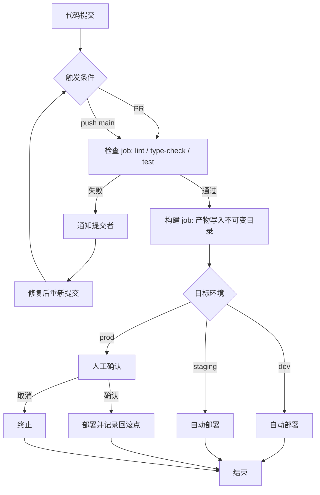

## SOP：前端 CI/CD 流程

> 本页只管一件事：这条流水线怎么搭。
> **CI 与 CD 的区别、闸门该不该去掉、部署策略怎么选，判据在 [[持续集成与持续部署]]，本页不重复。** 两页的分工按一句话检验：把前端换成 Java，需要改的是本页。

### 适用与不适用

- 适用：前端单仓项目首次接流水线；已有流水线要缩短时长，或者要补回滚点
- 不适用：需要多环境编排、基础设施即代码（Terraform / K8s）的团队。那已经进入平台工程，超出「前端交付」这一段

### 流程图



### 核心步骤

1. **触发**：PR 到 main、push 到 main、打 tag。三者对应不同的门，见 [[前端质量闸门]]
2. **安装依赖**：用 `npm ci` 而不是 `npm install`。lockfile 进了版本库时，只有 `ci` 会因不一致而失败——`install` 会顺手改 lockfile，让 CI 和本地悄悄分叉
3. **检查**：lint、type-check、单元测试三道，工具与挂法在 [[前端质量闸门]]，本页只负责把它们放进同一个 job
4. **构建**：`vite build`，产物写入**不可变目录**（按 commit 短哈希或版本号命名），不覆盖上一次的产物
5. **部署**：dev / staging 自动，prod 需人工确认
6. **记回滚点**：部署前把上一个可用产物路径写进发布记录

> 第 4 步的「不可变目录」是回滚成立的前提，也是本 SOP 与「直接覆盖部署」唯一的实质区别。少了它，第 6 步无从执行，回滚只能靠重新构建一次——而重新构建出来的产物，未必是上次那个。

### 环境与确认

| 环境 | 分支 | 触发 | 人工确认 | 用途 |
|:---|:---|:---|:---|:---|
| dev | develop | push 即部署 | 否 | 联调，允许坏 |
| staging | main | 检查通过即部署 | 否 | 与生产同构，验证产物 |
| prod | tag | 打 tag 后 | 是 | 真实用户 |

> 原稿这里放了一段 `deploy.config.js`。库里没有这个文件，也没有哪个工具认这个约定，是编出来的配置——已换成上面这张表。要真落地，环境差异应该写在流水线定义里，而不是另造一个配置文件。

### 配置要点（四条有数字的）

- **缓存**：缓存依赖目录，key 用 lockfile 哈希。key 不随 lockfile 变，缓存永远是旧的；随 lockfile 变但每次都 miss，等于没缓存
- **并行**：lint、type-check、单测互不依赖，拆成三个 job 并行——总时长取最长的那个，不是三者相加
- **矩阵**：多 Node 版本、多浏览器只在你确实要支持多版本时才有意义，否则是给自己加失败概率
- **密钥**：一律走仓库 Secrets，不写进 workflow 文件。fork 来的 PR 默认拿不到 Secrets，这正是安全边界，不要试图绕开

### 示例（GitHub Actions）

```yaml
name: CI/CD

on:
  push:
    branches: [main, develop]
  pull_request:
    branches: [main]

jobs:
  lint-and-test:
    runs-on: ubuntu-latest
    strategy:
      matrix:
        node: [22]
    steps:
      - uses: actions/checkout@v4
      - uses: actions/setup-node@v4
        with:
          node-version: ${{ matrix.node }}
          cache: 'npm'
      - run: npm ci
      - run: npm run lint
      - run: npm run type-check
      - run: npm run test

  build:
    runs-on: ubuntu-latest
    needs: lint-and-test
    steps:
      - uses: actions/checkout@v4
      - uses: actions/setup-node@v4
        with:
          node-version: 22
          cache: 'npm'
      - run: npm ci
      - run: npm run build
      - name: 产物按 commit 归档
        run: |
          mkdir -p dist-releases/${{ github.sha }}
          cp -r dist/* dist-releases/${{ github.sha }}/
      - uses: actions/upload-artifact@v4
        with:
          name: dist-${{ github.sha }}
          path: dist-releases/

  deploy:
    runs-on: ubuntu-latest
    needs: build
    if: github.ref == 'refs/heads/main'
    environment: production   # 在仓库设置里给这个 environment 配审批人，人工确认就在这里
    steps:
      - uses: actions/download-artifact@v4
        with:
          name: dist-${{ github.sha }}
      - name: 部署并记录回滚点
        run: |
          echo "上一个可用产物记录进发布台账，再切流量"
```

> 人工确认不用自己写逻辑，GitHub 的 `environment` + required reviewers 就是这件事；自建 CI 才需要自己加一个 approve 阶段。

### 常见坑点

- ⛔ **流水线步骤过多** → 耗时上升、快速反馈的价值消失。控制在十分钟内，超了就拆并行，不要靠加机器
- ⛔ **缺少缓存策略** → 每次全量装依赖，慢而且不稳
- ⛔ **生产部署没有确认环节** → 可能直接放出有问题的版本
- ⛔ **部署直接覆盖上一次产物** → 回滚只能重新构建，产物已经不是上次那个
- 🔧 **流水线随机失败** → 查并行任务竞争、时区、以及缓存 key 撞车
- 🔧 **部署后页面空白** → 查静态资源路径、CDN 缓存；如果是「部分用户白屏」，多半是 HTML 与 JS 不同批（见 [[灰度]]）
- 🔧 **时长从 3 分钟悄悄涨到 15 分钟** → 没有给流水线设时长告警，退化是渐进的

### 知识图谱

- **上位**：[[前端交付与观测]] — 阶段 3 的第一件交付物
- **并列**：[[持续集成与持续部署]] — 判据与区别在那边，本页不写
- **相关**：
	- [[前端质量闸门]] — 本页第 3 步的具体内容
	- [[版本控制与协作流程]] — 触发条件由分支模型决定
	- [[GitHub Actions]] — 本页示例所用的平台
	- [[使用Claude-Code自动化CI-CD流水线]] — 同一件事的 AI 辅助形态
