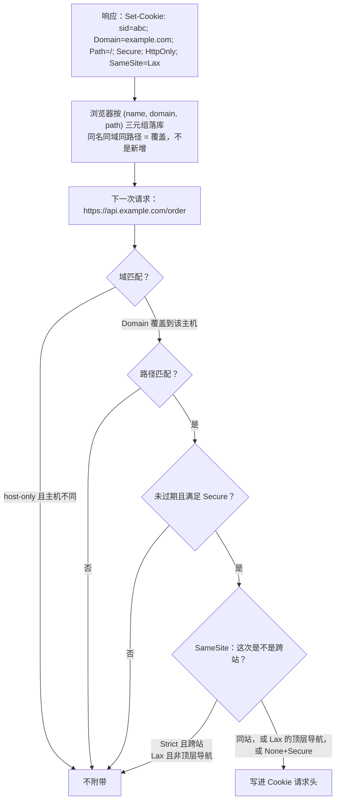

## 概念：Cookie

> Cookie 是 HTTP 的状态管理机制：服务端用响应头 `Set-Cookie` 让浏览器存下一段键值，浏览器此后每次发出匹配的请求都自动把它放进 `Cookie` 请求头。它的价值不在存储，而在「自动附带」——这是浏览器里唯一会跟着请求走的存储。

**解决的核心痛点**：HTTP 是无状态协议，服务端凭什么判断「这两次请求来自同一个已登录用户」？让浏览器每次自动带上一个凭证，是最省事的答案。

---

## 核心命题

- [[Cookie用于服务端通信和会话状态管理]]
	- **原理**：写入在服务端（`Set-Cookie`）、读取也在服务端（`Cookie` 头），浏览器只做保管与附带，所以 Cookie 天生是「会话」而非「本地数据」
- [[SameSite按站而非源判定是否附带Cookie]]
	- **原理**：是否附带由「站」（scheme + 可注册域名）判定，比源更粗：兄弟子域互为跨源却同站，照样带

> 两条命题合起来给出本页的范围：这里只回答「Cookie 在哪一步被写入、在哪一步被附带、判据是什么单位」。至于该给某个业务配哪些属性、token 该放 Cookie 还是 Header，属于策略侧，见 [[Web安全]]。

---

## 运行机制

一次往返分三段：服务端写、浏览器存、浏览器带。



### 属性各自作用在哪一步

| 属性 | 作用环节 | 省略时的默认行为 |
|:---|:---|:---|
| `Domain` | 存储位置与域匹配 | 不写即 host-only，只回给设置它的那个主机，子域收不到 |
| `Path` | 路径匹配 | 取当前请求路径的目录前缀；`/admin` 下设的 Cookie 不会发给 `/shop` |
| `Max-Age` / `Expires` | 过期 | 会话 Cookie，关掉浏览器即消失 |
| `Secure` | 发送 | 明文 HTTP 下照发，等同没有 |
| `HttpOnly` | **读取**，与发送无关 | `document.cookie` 读得到，XSS 就能偷走 |
| `SameSite` | 发送（按站判定） | 现代浏览器按 `Lax` 处理，老资料写「默认 None」是过时说法 |
| `Partitioned` | 存储键 | 第三方场景下同一条 Cookie 可被所有嵌入方共用；加上后按顶层站点各存一份 |

三个前缀不是装饰，是服务端自证：`__Secure-` 要求带 `Secure`；`__Host-` 要求 `Secure` + `Path=/` + 不带 `Domain`，把作用域钉死在单个主机上。

### 三个容易记错的点

- **端口与 scheme 都不参与匹配**：`localhost:3000` 与 `localhost:8080` 共用同一批 Cookie；`http://example.com` 与 `https://example.com` 也共用（`Secure` 只拦发送，不拦存储）。两者只在 SameSite 的「站」判定里才有区别。
- **`HttpOnly` 挡的是「读」，不是「带」**：它让 `document.cookie` 看不见该条，但该条照样随请求发出。这也是为什么它能防 XSS 偷凭证，却对 CSRF 毫无作用。
- **同名不是一条**：三元组不同就是两条独立 Cookie，`Cookie` 头里会同时出现两个同名值，服务端读到哪个取决于顺序。删除时也要 `Domain` / `Path` 对齐，否则删不掉。

```http
Set-Cookie: sid=abc123; Path=/; Max-Age=86400; Secure; HttpOnly; SameSite=Lax
```

---

## 关键区别

Cookie 与 Web Storage 常被当成同类，实际分的是「要不要跟着请求走」：

| | Cookie | localStorage / sessionStorage | IndexedDB |
|:---|:---|:---|:---|
| 随请求自动发送 | ✅ 唯一 | ✗ 要 JS 手动塞进 Header | ✗ |
| 服务端可设置 | ✅ `Set-Cookie` | ✗ | ✗ |
| 服务端可控的安全属性 | ✅ `HttpOnly` / `Secure` / `SameSite` | ✗ 页面脚本全可读 | ✗ |
| 容量 | 规范下限单条约 4KB、每域 50 条、总量 3000 条，各浏览器实装更高 | 5–10MB | 按配额，通常数百 MB |
| 跨子域共享 | ✅ `Domain` 放开即可 | ✗ 严格同源 | ✗ |

所以「用 localStorage 存 token 更灵活」是把最贵的一层（`HttpOnly`）换成了最便宜的便利。四种方案的分工与取舍见 [[Web Storage]]，那一页不重复 Cookie 的机制。

---

## 适用范围

- ✅ **该用 Cookie**
	- **会话标识**：需要服务端读、且希望浏览器自动携带的凭证
	- **服务端要参与判断的少量状态**：灰度标记、A/B 分组、地区偏好——凡是首屏 HTML 渲染前就要知道的
- ⛔ **不该用 Cookie**
	- **当通用存储用**：偏好、草稿、缓存数据塞进 Cookie，每个请求都在为它付带宽，还可能顶到 4KB
	- **存能读到的敏感数据**：`HttpOnly` 之外的部分对页面脚本完全透明
- **失效边界**
	- **没有 cookie jar 就不是 Cookie**：curl、原生 App、服务间调用都没有「自动附带」，此处的 Cookie 退化为一个普通字符串
	- **跨源 `fetch` 默认不带**：需要 `credentials: 'include'`，且服务端 `Access-Control-Allow-Origin` 不能是 `*`，见 [[CORS凭证与跨域]]
	- **分区之后不再是全局身份**：`Partitioned` 把第三方 Cookie 绑到顶层站点，同一个嵌入方在两个站点下拿到的是两份不同的值
	- **它无法证明请求是谁发起的**：请求头由浏览器代填，服务端拿到 Cookie 只能确认「这个浏览器持有凭证」，不能确认这次点击出自用户本人——[[CSRF]] 的根就在这里

---

## 演进

| 时间 | 事件 |
|:---|:---|
| 1994 | Netscape 为购物车引入 Cookie，没有规范 |
| 2011 | RFC 6265 收口，成为第一个正式标准 |
| 2016 | `SameSite` 进入 6265bis 草案，此前跨站附带是默认行为 |
| 2020-02 | Chrome 80 把 `SameSite` 缺省值改为 `Lax`，跨站附带从默认变成例外 |
| 2024-01 | Chrome 对 1% 用户默认限制第三方 Cookie（作测试） |
| 2024-07 / 2025-04 | Google 先后放弃「淘汰第三方 Cookie」与「独立授权提示」，改为保留用户在设置里自行管理 |
| 2025-10-17 | Google 退役大部分 Privacy Sandbox API（Topics、Protected Audience、Attribution Reporting 等），只留 CHIPS、FedCM、Private State Tokens |
| 2026-10 | RFC 10025（6265bis）处于 RFC Editor 最终审校，尚未发布；发布后废止 RFC 6265 |

第三方 Cookie 的现状因此是分裂的：Safari 自 2020 年起默认阻断，Firefox 自 2019 年 ETP 起阻断、2022 年改为按顶层站点分区，Chrome 至今默认启用。「Chrome 要淘汰第三方 Cookie」这句话在 2024 年 7 月之后已经过期，写方案时不能再按它做规划。

---

## 知识图谱

- **上位**：[[Web Storage]] — 客户端存储的聚合概念，Cookie 是其中唯一与网络请求绑定的一个
- **下位**：
	- [[Cookie用于服务端通信和会话状态管理]] — 用途层面的具体命题
	- [[SameSite按站而非源判定是否附带Cookie]] — 附带判据里的一条具体规则
- **并列**：
	- [[localStorage用于长期存储简单键值对数据]] — 同属客户端存储，区别只在是否随请求发送
- **相关**：
	- [[CSRF]] — 利用「自动附带」发起请求
	- [[XSS]] — 读得到 `document.cookie`，`HttpOnly` 是它的对手
	- [[CORS凭证与跨域]] — 跨源请求默认不带，需显式授权
	- [[浏览器安全机制]] — 「站」「源」「来源」三种判定单位的分工
	- [[登录页面怎么做]] — 这套机制的落地形态
- **外部资料**
	- [RFC 6265](https://www.rfc-editor.org/rfc/rfc6265) — 现行标准
	- [draft-ietf-httpbis-rfc6265bis](https://httpwg.org/http-extensions/draft-ietf-httpbis-rfc6265bis.html) — RFC 10025 定稿前的草案文本
	- [MDN: Set-Cookie](https://developer.mozilla.org/en-US/docs/Web/HTTP/Headers/Set-Cookie)
	- [MDN: 使用 Partitioned 属性的 Cookie（CHIPS）](https://developer.mozilla.org/en-US/docs/Web/Privacy/Privacy_sandbox/Partitioned_cookies)
