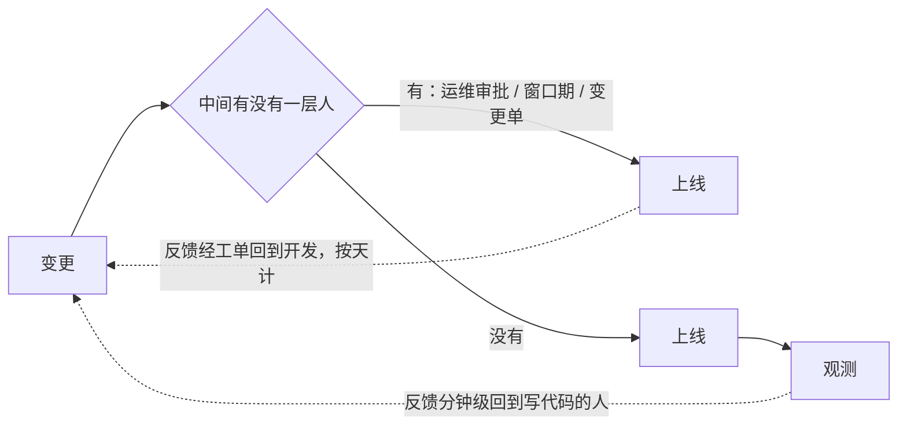

## 概念：DevOps

> DevOps 不是一套工具，也不是一个岗位。它删掉的是开发与运维之间的**那个交接点**——让发出变更的人自己承担变更落地后的后果。

**解决的核心痛点**：开发的目标是把变更送出去，运维的目标是让线上不出事。变更即风险，于是两个目标天然对冲。这不是责任心问题，是激励结构问题：只要这两个目标分属两个团队，中间必然长出审批、冻结窗口、变更单。这些东西不是官僚病，是冲突的必然产物——把人换掉、把流程简化掉，它们还会以别的形式长回来。

所以判据不看「有没有 CI/CD」，看**线上出事的时候第一个动作是什么**：

- 打开监控、翻日志 → 责任已经落到写代码的人身上，交接点删掉了
- 打电话找运维、开个单子 → 只是把工具换了，交接模型原封不动

仓库里装着 Jenkins、跑着 K8s、挂着监控，而出事仍然先找运维的团队，满地都是。工具能自动化流程，改不了谁在半夜被叫起来。

### 运行机制

差别不在速度，而在**反馈回到谁手上**。

被删掉的不只是一个人，而是一次判断。只要有交接，反馈就必然经过一层「这事值不值得追」的评估——而这条评估的成本常常高于修复本身：线上一个空指针，从被发现到写代码的人知道，中间隔着复现、描述、转达三步，每步都在损耗细节。删掉交接点，等于把这条路从「跨团队协作」压缩成「同一个人的两步」，噪声在这一步消失。

这也是为什么 DevOps 真正见效的地方是**恢复时间**，不是发布速度：发布快一倍，收益是线性的；从「发现到动手」从两小时缩到十分钟，收益是每次事故都兑现一次。

### 关键区别

DevOps、SRE、平台工程经常被当成同义词，其实回答的是三个不同问题：

| 维度 | DevOps | [[SRE]]（待写） | [[平台工程]]（待写） |
|:---|:---|:---|:---|
| 回答的问题 | **谁**对线上负责 | 用什么**数字**判断负责到位 | 怎么让**不负责的人也能自助** |
| 形态 | 组织约束、激励结构 | 一套工程做法：SLO、错误预算、事后复盘 | 内部产品：自助平台、黄金路径 |
| 典型产物 | 同一个团队同时背「变更快」与「线上稳」 | 错误预算耗尽即冻结发布 | 一次点击拿到环境，不必找人 |
| 失效方式 | 只换工具不换职责 | 流量太小时 SLO 算不出来 | 平台没人用，因为不强制 |

三者的次序是：DevOps 说「谁背」，SRE 把「背到什么程度」变成可计算的数，平台工程把「背」的成本摊薄。跳过第一步直接做第三步，得到的是一个没人用的平台——因为原团队并没有被要求自助。

### 适用范围

- ✅ **成立的前提**
	- **部署频率高到交接成本超过建设成本**。一年发两次版的团队上 DevOps 是纯支出：交接一次的成本远低于搭一条流水线。
	- **出事后必须由写代码的人看现场**。前端尤其明显——报错的行号、sourcemap 能不能还原、CDN 上那份是哪次构建的产物，只有他知道该看什么，交接出去等于让对方从零猜。
	- **变更可被机器验证**。构建可重复、有测试可跑，否则自动化只是把「发错版本」加速。
- ⛔ **误用**
	- **买工具宣告转型**：上了 Jenkins、迁了 K8s、装了监控，职责一格没动。
	- **设「DevOps 工程师」岗位**：目标是把边界删掉，做法却是给这条边界新设一个头衔，等于把它固化。
- **失效边界**
	- **强合规审计要求职责分离**。金融、医疗类系统的变更审批是法定要求，不是文化偏好。DevOps 改不动它，只能把边界画在审计允许的范围之内——这类组织里「同一个提交又合并又上线」是违规，不是先进。
	- **团队小到本来没有专职运维时，交接点不存在，DevOps 无从删起**。很多配套实践（自助平台、SLO、错误预算）在小团队是纯开销，因为它们解决的是协作成本，而小团队没有这项成本。
	- **它管「谁负责」，不管「怎么不出错」**。DevOps 压缩的是发现时间与恢复时间，不降低出错概率。把它当质量手段会失望——质量要靠测试与评审，那是另一条线，见 [[前端质量闸门]]。

### 批判

- **工具化降级**：DevOps 是最容易被采购替代的「文化」。因为工具看得见、能验收，而「谁半夜起来」看不见、没法写进验收标准，于是转型往往停在能验收的那一半。
- **岗位名的自相矛盾**：「DevOps 工程师」是一个以消灭该边界为目标的边界。它的存在本身说明组织其实没打算改激励结构，只是想把冲突交给一个中间人。
- **指标可被博弈**：DORA 的四个指标（部署频率、变更前置时间、变更失败率、恢复时长）都能在不提升实际交付能力的前提下变好看——把提交拆小可以刷前置时间，少报事故可以刷失败率。
- **内在张力**：DevOps 要求同一个人既求快又求稳，而这两个目标在个人层面同样对冲。它没有消解冲突，只是把冲突从组织边界挪进了同一个人的判断里。这条张力没有解法，只能外化——错误预算就是把它变成数字的一种尝试，而数字一旦定了，又开始了新一轮博弈。

### 问题与流程

- **相关流程**
	- [[CI-CD流程]] — 交接点删掉之后，那条链具体怎么搭：触发、缓存、不可变产物、人工确认放在哪

### 知识图谱

- **上位**：[[软件工程]] — 软件工程里「谁对线上负责」这一支的实践纲领
- **下位**：
	- [[持续集成与持续部署]] — 最具体的一条实践，只覆盖流水线这一层
- **相关**：
	- [[前端交付与观测]] — 本概念在一次前端发布上的投影：前端本来没有「运维」这个角色，SPA 之后才有了交接点，所以要重演一遍
	- [[灰度]] — 把爆炸半径变成可控变量，是拿掉人工闸门的前提之一
	- [[GitHub Actions]] — 工具层，本页不涉及
- **外部资料**
	- 《Accelerate》（Forsgren / Humble / Kim, 2018）— DORA 四指标的实证来源，也是「度量交付能力」这件事的通行基准
	- 《The Phoenix Project》（Kim, 2013）— 交接点冲突的叙事版，读它是为了认出激励结构，不是为了学「要有勇气」
	- Google《Site Reliability Engineering》— SRE 侧的真值，错误预算的原始定义
