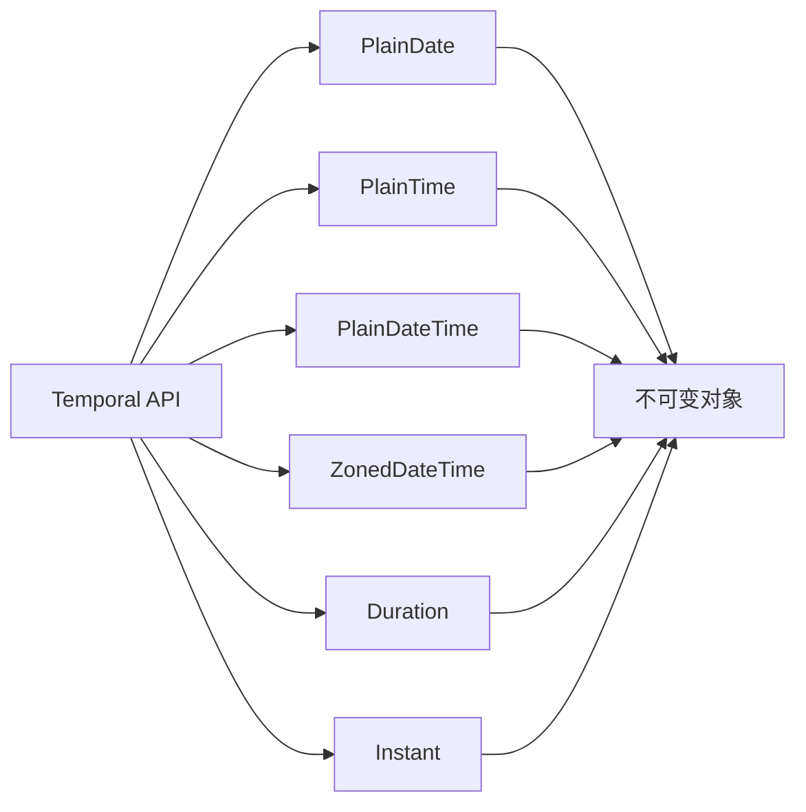

## 概念：ES2026

> ECMAScript 2026（ES17）是 ECMA-262 第 17 版，2026-06-30 由 Ecma 大会批准。七项新特性全部是标准库补齐，没有语法层改动。

版本归属更正（2026-10-27）：本文旧版把 `using`、`Temporal API`、`Records & Tuples` 当成 ES2026 的核心特性，三项都不在本版里——`using`（显式资源管理）2025-05 达 Stage 4 但未进当年版本；`Temporal` 2026-03 达 Stage 4、错过截止，归入 ES2027；`Records & Tuples` 2025-04 被 TC39 撤回，由 Composites 提案接替。原文按这三项写的内容已整段移到下方「未进入本版的三项」，内容保留、归属更正。

ES2026 实际只有七项：`Map`/`WeakMap` 的 `getOrInsert`、`JSON.parse` reviver 的源文本访问与 `JSON.rawJSON`、`Iterator.concat`、`Uint8Array` 的 Base64/Hex 互转、`Math.sumPrecise`、`Error.isError`、`Array.fromAsync`。

---

### 核心命题

- ES2026 是标准库补齐版，不是语法革命 — 七项全部是既有 API 的缺口填补
	- **原理**：能进年度版本的 Stage 4 提案大多落在内置对象上，语法层改动要等更长的共识周期
- `Error.isError()` 让跨 realm 的错误判断第一次可靠 — `instanceof Error` 在 iframe、Worker 之间恒为 false
	- **原理**：它读内部槽位而非原型链，`Symbol.toStringTag` 伪造不过去
- `Map.getOrInsert` 把 has→set→get 三连压成一次调用 — 缓存初始化与计数的样板代码消失
	- **原理**：键不存在时插入默认值（或回调结果）并返回，`WeakMap` 同步获得同名方法
- `Math.sumPrecise` 修的是静默失准 — `[1e20, 0.1, -1e20]` 求和得到 0 而不是 0.1
	- **原理**：中间过程不丢精度，只在最后一次舍入

### 七项特性的归类

| 缺口 | 特性 | 替代掉的手写代码 |
|:---|:---|:---|
| 错误识别 | `Error.isError()` | `instanceof Error` / `Object.prototype.toString` |
| Map 取值插入 | `Map.prototype.getOrInsert` / `getOrInsertComputed` | `if (!m.has(k)) m.set(k, v); m.get(k)` |
| 迭代器拼接 | `Iterator.concat` | 手写 generator 或先转数组再展开 |
| 异步数组构造 | `Array.fromAsync` | `for await` + `push` |
| 二进制编解码 | `Uint8Array` 的 `toBase64`/`toHex`/`fromBase64`/`fromHex` | `btoa`/`atob`、`base64-js` |
| 浮点求和 | `Math.sumPrecise` | `reduce((a, b) => a + b, 0)` |
| JSON 精度与源文本 | `JSON.parse` reviver 第三参数、`JSON.rawJSON` | 手写大整数后处理 |

---

### 运行机制

七项都是内置对象上的方法或函数，没有新的执行模型。四条最容易记错的语义：

```javascript
// Error.isError 读内部槽位，跨 realm 也成立
const iframeError = new frames[0].Error('boom');
Error.isError(iframeError);   // true
iframeError instanceof Error; // false

// getOrInsert 只在键不存在时插入并返回；需要惰性计算用 getOrInsertComputed
cache.getOrInsert('k', 0);
cache.getOrInsertComputed('k', (key) => compute(key));

// Math.sumPrecise 中间过程不丢精度，只在最后一次舍入
Math.sumPrecise([1e20, 0.1, -1e20]);              // 0.1
[1e20, 0.1, -1e20].reduce((a, b) => a + b, 0);    // 0

// Iterator.concat 惰性串联，不产生中间数组
Iterator.concat([1, 2], new Set([3]), (function* () { yield 4; })());
```

`Uint8Array` 一侧是六个方法：`toBase64`/`toHex` 编码，`fromBase64`/`fromHex` 解码出新数组，`setFromBase64`/`setFromHex` 写进已有数组并返回 `{ read, written }`。`JSON.parse` 的 reviver 第三参数拿到的是该值的源文本片段，配 `JSON.rawJSON` 才能在 `stringify` 一侧保持大整数。

---

### 应用场景

- ✅ **适用场景**
	- **跨 realm 错误判断**：`Error.isError()` 适用于 Worker、iframe 间的错误传递
	- **二进制数据处理**：`Uint8Array` 编解码适用于加密、文件处理、数据传输
	- **异步流处理**：`AsyncIterator` 辅助方法适用于流式数据处理、响应式编程
	- **精确浮点求和**：`Math.sumPrecise()` 适用于统计计算、数据分析中大量浮点数累加
	- **迭代器串联**：`Iterator.concat()` 适用于合并多个数据流、分页数据拼接
	- **JSON 精度保持**：`JSON.rawJSON` 和 reviver 第三参数适用于大整数 ID、精度敏感的数值传输
	- **Map upsert**：`Map.getOrInsert()` 适用于缓存初始化、配置管理、计数统计等场景
- ⛔ **误用**
	- **过早依赖 ES2026**：新特性需要浏览器/运行时支持，需要关注兼容性

---

### 未进入本版的三项

以下三项常被算进 ES2026，实际都不在。原文按「ES2026 核心特性」写的段落整段保留在这里，只更正归属。

#### `using`（显式资源管理）

- 原观点：`using` / `await using` 将改变 JavaScript 资源管理模式 — 从手动 `try-finally` 走向声明式自动管理
	- **原理**：通过 `Symbol.dispose()` 实现作用域结束时自动调用，类似于 C# `using`、Python `with`
- 归属：2025-05 达 Stage 4，未进当年版本

```javascript
// 同步资源管理
using file = openFile('test.txt');
file.write('hello');
// → 作用域结束时自动调用 file[Symbol.dispose]()

// 异步资源管理
await using connection = await db.connect();
const result = await connection.query('SELECT * FROM users');
// → 作用域结束时自动调用 await connection[Symbol.asyncDispose]()
```

- 适用场景：文件操作、数据库连接、网络请求、锁管理等需要明确释放的资源

| 维度 | `using` 声明 | `try-finally` |
|:---|:---|:---|
| **代码量** | 简洁 | 冗长 |
| **资源泄漏风险** | 低（自动化） | 高（易忘） |
| **异步支持** | `await using` | 需手动处理 |

#### `Temporal API`

- 原观点：`Temporal API` 是 JavaScript 日期时间的范式转换 — 从有设计缺陷的 `Date` 走向现代不可变日期时间对象
	- **原理**：`Date` 是可变的、时区处理差、API 不一致，`Temporal` 全部修正
- 归属：2026-03 达 Stage 4，错过 ES2026 截止，进入 ES2027



- 适用场景：时区转换、日期计算、日程管理

#### `Records & Tuples`

- 原观点：`Records & Tuples` 填补了 JavaScript 缺乏原生不可变数据结构的空白
	- **原理**：通过 `#record` / `#tuple` 语法创建不可变对象和数组，实现值相等性比较
- 归属：2025-04 被 TC39 撤回，理由是「给语言加新原始类型」未能取得共识；由 Composites 提案接替，2026-10 处于 Stage 2
- 适用场景：状态管理、函数式编程、数据比较
- 误用提醒：对简单对象使用 `#record` 可能影响性能

---

### SOP

> ES2026 相关标准化操作流程

- **暂无相关 SOP 笔记** — ES2026 为新发布标准，实际使用案例待积累

---

### FAQ

> ES2026 相关开放性问题，待进一步探索

- [[Q-ES2026浏览器兼容性如何]]
- [[Q-Temporal API和date-fns的区别]]
- [[Q-using声明和Symbol.dispose的关系]]
- [[Q-Records & Tuples和TypeScript Readonly的区别]]

---

### 知识图谱

> 知识图谱链接 term（术语定义）和相关 concept，建立概念关系网络

- **上位**：
	- [[ECMAScript]] — ES2026 是 ECMA-262 的第 17 版
- **下位**：
	- [[Error.isError]] — 跨 realm 判断错误对象
	- [[Math.sumPrecise]] — 无累积误差的浮点求和
	- [[Map.getOrInsert]] — Map / WeakMap 的 upsert
	- [[Iterator.concat]] — 迭代器惰性串联
	- [[JSON.rawJSON]] — JSON 源文本访问
- **并列**：
	- [[ES2015]] — 上一次重大更新
	- [[ES2025]] — ES2026 的前一个版本
- **相关**：
	- [[Javascript版本演进]] — 版本时间线，差异总表在这里
	- [[Promise]] — 异步编程基础
	- [[async-await|async/await]] — 异步语法糖
	- [[TypeScript]] — JavaScript 超集
	- [[using 声明]] · [[Temporal API]] — 常被误算进本版，实际分别在待定与 ES2027
- **外部资料**
	- [MDN - ECMAScript 2026](https://developer.mozilla.org/en-US/docs/Web/JavaScript)
	- [W3Schools - JavaScript 2026](https://www.w3schools.com/js/js_2026.asp)
