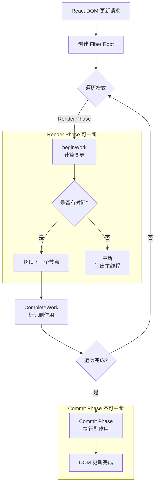
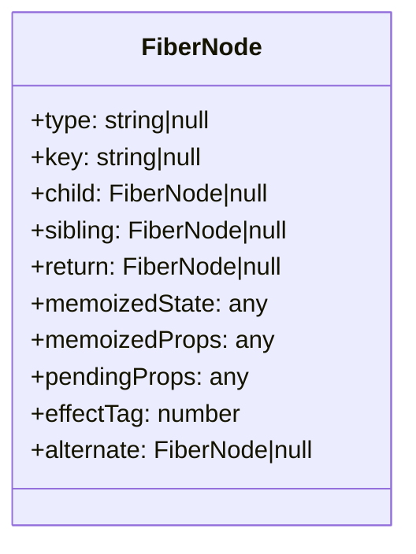

## 概念：Fiber架构

> React 16 引入的新协调引擎，将同步整树渲染改为异步可中断的链表遍历，使得渲染任务可以分片执行。

**解决的核心痛点**：React 15 的 Stack Reconciler 采用同步递归调和，同步遍历整棵 Virtual DOM 树，中途无法中断，导致大型应用在渲染时主线程阻塞，用户交互卡顿。

---

### 核心命题

- [[React Fiber 是可中断的增量渲染架构]]
	- 原理：把 VDOM 树拆成 Fiber 链表，利用 requestIdleCallback 分片执行
- [[React Fiber 采用链表结构代替递归]]
	- 原理：递归树遍历无法中断，链表因为存储了节点指针，所以可以终端和恢复
- [[React Fiber 的时间切片基于优先级调度]]
	- 原理：高优先级任务（例如用户交互）能够打断低优先级任务（例如列表渲染）

---

### 运行机制



#### Fiber 节点结构



#### 双缓存机制


#### 调度细节

React 没有直接用 `requestIdleCallback`，而是自己实现了一套带优先级的调度器。原因很简单：`requestIdleCallback` 只有「空闲 / 不空闲」两个状态，表达不了「用户点击应当打断列表渲染」——它能回答「还能跑多久」，回答不了「下一个该跑谁」。

```javascript
// 简化后的 workLoop：每处理完一个单元，问一次「还能继续吗」
function workLoop() {
  while (nextUnitOfWork && !shouldYield()) {
    nextUnitOfWork = performUnitOfWork(nextUnitOfWork)  // 返回下一个待处理节点
  }
  if (nextUnitOfWork) scheduleCallback(workLoop)        // 没做完，排进下一帧
}
```

`shouldYield()` 内部判断的是「这一帧还剩多少时间」，默认切片约 5ms——留出余量给浏览器做样式计算与绘制，否则感知上仍然是卡顿。

| 优先级 | 典型来源 | 是否被抢占 |
|:---|:---|:---|
| Immediate | 同步任务、`flushSync` | 否（自己会打断别人） |
| UserBlocking | 点击、输入、hover | 否（同上） |
| Normal | `setState` 触发的常规更新、列表渲染 | 是 |
| Low / Idle | 预加载、数据分析 | 是 |

低优先级任务长时间被打断会饿死，React 用过期的兜底机制强制推进——所以「低优先级」不等于「一定最后完成」，只是「先让位」。

---

### 关键区别

| 维度 | Stack Reconciler (React 15) | Fiber Reconciler (React 16+) |
|:---|:---|:---|
| **结构** | 递归树 | 链表 |
| **执行** | 同步整树渲染 | 异步可中断 |
| **中断点** | 无法中断 | 任意单元可中断 |
| **优先级** | 无 | 有（异步优先级调度） |
| **主线程** | 阻塞直到完成 | 让出给高优先级任务 |
| **更新恢复** | 从头开始 | 从中断点恢复 |

---

### 应用场景

- ✅ **适用场景**
	- **大型列表渲染**：大量数据时不会阻塞用户输入
	- **动画/过渡**：保持 60fps 流畅度
	- **数据预取**：高优先级响应用户交互，低优先级处理数据加载
- ⛔ **误用**
	- **setState 同步期望**：Fiber 的异步批处理可能导致批量更新，非预期同步行为

---

### 知识图谱

- **上位**：[[React]] — React 生态的核心架构
- **相关**：
	- [[React版本演进]] — Fiber 在 React 16 中引入
	- [[Virtual DOM|VDOM]] — Fiber 操作的底层对象
	- [[Concurrent Mode]] — Fiber 的能力扩展
	- [[useTransition]] — 基于 Fiber 优先级的 API
	- [[Scheduler|Scheduler]] — Fiber 的优先级调度基于Scheduler
