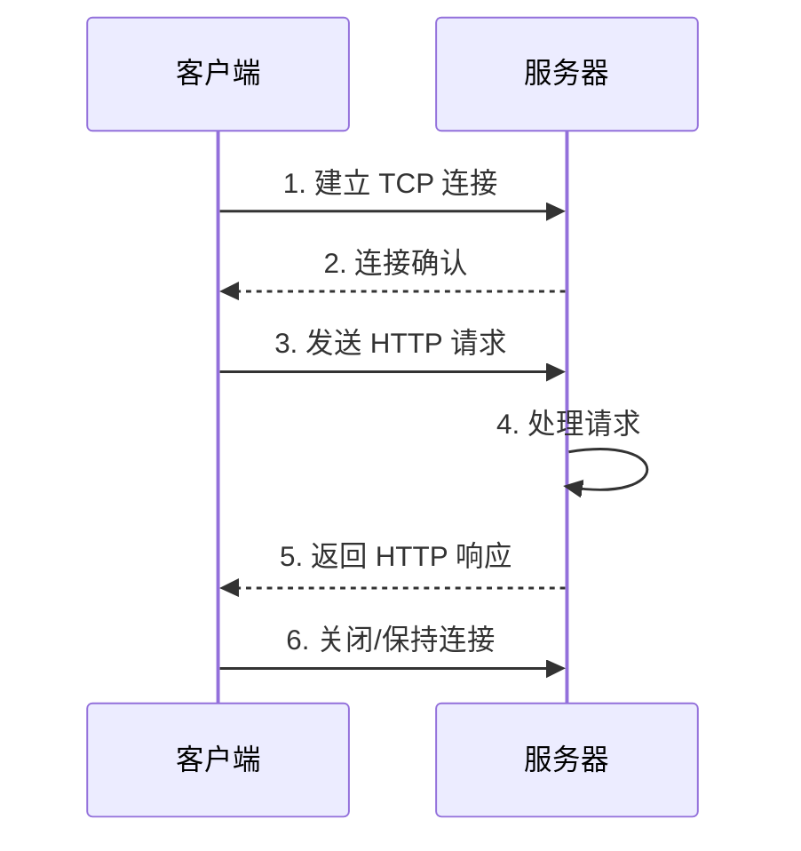

> HTTP（Hypertext Transfer Protocol，超文本传输协议）是一种用于在 Web 服务器和客户端之间传输数据的应用层协议，是构建在 TCP/IP 协议之上的请求 - 响应式协议。

**解决的核心痛点**：如何让客户端和服务器之间进行高效、可靠的数据通信？HTTP 定义了标准化的请求 - 响应格式，使得不同系统之间可以相互通信。

---

## 核心命题

- [[HTTP 是基于请求-响应模型的无状态协议]]
	- **原理**：客户端发起请求，服务器返回响应；每个请求都是独立的，服务器不保存客户端状态，需要通过 Cookie、Session 或 Token 维护状态
- [[HTTP 是可扩展的协议]]
	- **原理**：通过自定义头部、状态码、请求方法等，可以灵活扩展协议功能，满足不同业务需求
- [[HTTP1.1管道化要求服务端必须按序回传，导致应用层队头阻塞]]
	- **原理**：响应里没有 Stream ID，客户端只能按「请求发出的顺序」匹配响应，故服务端必须按序回传——这个约束是协议层的，不是实现问题，浏览器因此默认不启用管道化
- [[HTTP2在极端丢包环境下会导致传输层队头阻塞]]
	- **原理**：分帧跑在 TCP 之上，而滑动窗口与重传是连接级的——丢一个包，整个连接停下等重传，所有流一起卡住。阻塞被替换而非消除

---

## 运行机制

1. **建立连接**：基于 TCP（HTTP/3 基于 QUIC）
2. **发送请求**：包含方法、URI、头部、正文
3. **处理请求**：服务器根据 URI 查找资源
4. **返回响应**：包含状态码、头部、响应体
5. **关闭连接**：HTTP/1.1 默认持久连接

---

## 版本对照

各版本的逐项对照见 [[HTTP版本演进]]——那份是全库唯一一份矩阵，本条不重复版本差异。这里只讲所有版本共用的部分：请求-响应模型、无状态、可扩展性。

版本节点的取舍也是同一条规则：每版只写「它引入了什么、解决了上一版什么问题、自己又留下什么」，横向对照一律回那一篇看。原 `HTTP1.0` 一篇只剩两条独有命题，已并入 [[HTTP版本演进]] 的阶段详情，笔记移入 `40-ARCHIVE`。

---

## 应用场景

- ✅ **适用场景**
	- **网页浏览**：浏览器与服务器通信
	- **API 接口**：前后端数据交互
	- **文件传输**：上传/下载资源
- ⛔ **误用**
	- **明文传输敏感信息**：应使用 HTTPS
	- **频繁建立连接**：应使用持久连接或 HTTP/2

---

## FAQ

- [[网络协议相关问题]]

---

## 知识图谱

- **上位**：[[网络协议]] — HTTP 是应用层协议之一
- **下位**：
	- [[HTTP版本演进]] — 五个版本的演进线与对照矩阵
	- [[HTTP1.1]] — 持久连接、管道化
	- [[HTTP2]] — 二进制分帧、多路复用
	- [[HTTP3]] — 基于 QUIC
	- [[HTTP缓存机制]] — HTTP 的缓存层，与版本无关⭐
- **并列**：
	- [[WebSocket]] — 双向通信协议
- **相关**：
	- [[HTTPS]] — HTTP 的安全版本
	- [[RESTful API]] — 基于 HTTP 的 API 设计风格

---

## 参考延伸

- [HTTP | MDN](https://developer.mozilla.org/zh-CN/docs/Web/HTTP)
- [RFC 7231 - HTTP/1.1](https://httpwg.org/specs/rfc7231/)
- [RFC 7540 - HTTP/2](https://httpwg.org/specs/rfc7540/)
