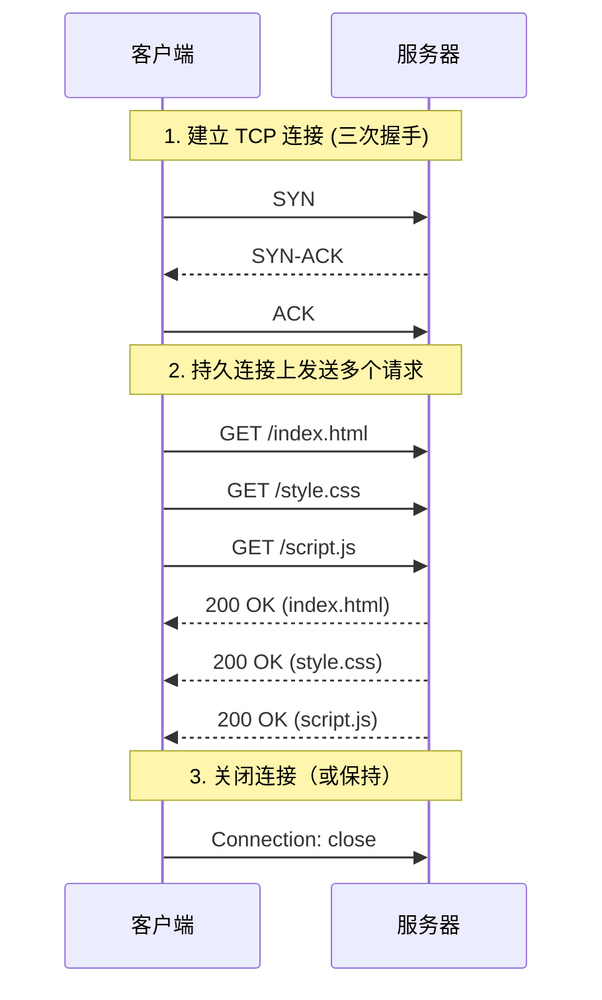

> HTTP/1.1 (Hypertext Transfer Protocol 1.1) 是 HTTP 协议的第二个主要版本，在 HTTP/1.0 基础上引入了持久连接、管道化、分块传输等特性，提高了 Web 应用的性能和效率。

**解决的核心痛点**：如何减少 TCP 连接建立的开销，提升页面加载速度？

本条只写这一版引入了什么。与前后版本的逐项对照见 [[HTTP版本演进]]——那是全库唯一一份版本矩阵，各版本笔记不再各写一张。

---

## 核心命题

- [[HTTP1.1 通过持久连接减少 TCP 连接建立次数]]
	- **原理**：默认开启 Keep-Alive，同一个 TCP 连接可处理多个请求 - 响应，避免重复三次握手
- [[HTTP1.1管道化要求服务端必须按序回传，导致应用层队头阻塞]]
	- **原理**：无需等待前一个响应返回，即可发送下一个请求，提升网络利用率

---

## 运行机制

---

## 应用场景

- ✅ **适用场景**
	- **兼容性强**：所有浏览器和服务器都支持，适用于需要广泛兼容性的场景
	- **简单请求**：请求数量较少时，持久连接已能满足性能需求
- ⛔ **误用**
	- **大量并发请求**：应使用 HTTP/2 或 HTTP/3，避免队头阻塞
	- **敏感数据传输**：应使用 HTTPS 而非明文 HTTP/1.1

---

## 知识图谱

- **上位**：[[HTTP]] — HTTP/1.1 是 HTTP 协议的一个版本
- **下位**：
	- [[持久连接]] — HTTP/1.1 的核心特性
	- [[管道化]] — HTTP/1.1 的请求并发方式
- **并列**：
	- [[HTTP版本演进]] — 同一版本序列的演进线
	- HTTP/1.0 — 前身，内容已并入 [[HTTP版本演进]]
	- [[HTTP2]] — HTTP/1.1 的后续版本
- **相关**：
	- [[TCP]] — HTTP/1.1 的传输层协议
	- [[队头阻塞]] — HTTP/1.1 的性能瓶颈

---

## 参考延伸

- [MDN HTTP/1.1](https://developer.mozilla.org/en-US/docs/Web/HTTP/1.1)
- [RFC 7231 - HTTP/1.1](https://httpwg.org/specs/rfc7231/)
