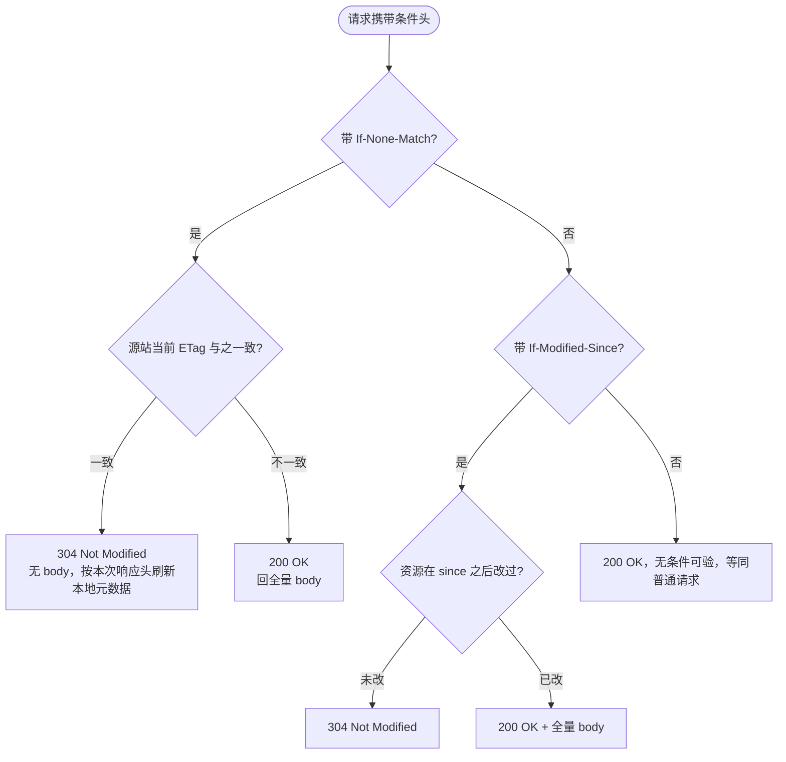

## 概念：HTTP协商缓存

> 协商缓存指这样一个往返：客户端手里有一份副本，把它携带的验证器（`ETag` 对 `If-None-Match`，`Last-Modified` 对 `If-Modified-Since`）发给源站，由源站裁决这份副本还能不能用。未变更则回 `304 Not Modified`——没有响应体，只有头，客户端复用本地副本；已变更则回 `200 OK` 与全量内容。

**解决的核心痛点**：强缓存一旦过期，客户端就不再知道副本是否还成立。没有这一层，唯一的选择是回源重下整份资源；有了它，一个大概率没变的副本只需付一次「头对头」的往返，就能把几 MB 的重复传输压到几百字节。

**它是一层条件请求语义，不是一个缓存档位**：3==04 不是「命中」的另一种形式，而是「验证通过」这一个结论==。副本能不能用本来由 [[新鲜度]] 判定，这里只是把判定权临时交回源站。下面四条命题都挂在这个交接上。

### 核心命题

- [[强缓存省掉整个请求，协商缓存省掉响应体]]
- [[ETag的校验优先级严格高于Last-Modified以保证内容层面的强一致性]]
- [[Last-Modified存在秒级精度截断与伪变更误判双重缺陷]]
- [[分布式集群环境下默认ETag计算策略容易引发协商缓存击穿]]

四条的顺序是从收益退回前提。第一条先划清这一档到底省了什么（响应体，不是往返），后三条都在回答「这次往返怎么会白付」：第二条给裁决次序，第三条给这个次序的理由（时间戳只有秒级，还会被伪变更触发，因此只能当兜底），第四条把同一件事从协议换到部署视角。第三条是第二条的支撑；第四条则是另一类失败——它与协议实现得对不对无关，只与部署得齐不齐有关。

### 运行机制

一次条件请求只有两条可能的裁决路径，规范把 `If-None-Match` 放在前面：

图里没有「两个都验一遍」的分支，因为规范要求的就是忽略它：请求同时带 `If-None-Match` 与 `If-Modified-Since` 时，源站必须以 `If-None-Match` 的结果为准，不再去评估后者（RFC 9110 §13.1.3）。「优先级」三个字的实际含义是这个，而不是「先验一个再验一个、两个都过才返回 304」。

三个容易被漏掉的细节：

1. 304 不是空响应。`Cache-Control`、`ETag`、`Date`、`Vary` 都可能在这次响应里出现，客户端据此刷新本地副本的元数据——新的 `Date` 把 `current_age` 归零，副本于是重新变新鲜。这就是「一次 304 顺带给强缓存续了命」；漏掉这一环，会以为协商完还得再回源一次。
2. 强验证器比字节，弱验证器比语义。`W/` 前缀表示「语义等价即可」，所以动态压缩会按编码把同一份内容分出多个 ETag 版本，CDN 也常把源站的强 ETag 降为弱 ETag。
3. 这一档的收益与响应体大小成正比。一两个 KB 的小文件，304 的等待时间可能比直接 200 还长——往返还在，服务端仍要算一次哈希。

### 关键区别

协商缓存内部真正的分岔是两种验证器，而不是「协商缓存 vs 强缓存」——后者是 [[HTTP缓存机制]] 那张表，这里不重复：

| 维度 | [[ETag]]（实体标签） | [[Last-Modified]]（最后修改时间） |
|:--|:--|:--|
| 是什么 | 内容指纹，字节或语义层面的版本标识 | 时间元数据，GMT 绝对时间戳 |
| 请求映射头 | `If-None-Match` / `If-Match` | `If-Modified-Since` / `If-Unmodified-Since` |
| 精度 | 字节级（强）或语义级（弱，`W/`） | 秒级，1 秒内的多次写看不见 |
| 规范地位 | 同时在场时以它为准 | 次之，兜底 |
| 服务端开销 | 要读文件或算哈希，用 CPU 换精度 | 读 `mtime`，几乎零成本 |
| 集群一致性 | 默认策略含 inode，节点间天然不同 | 靠 NTP 对齐时钟即可 |

`If-Match` 与 `If-Unmodified-Since` 是同一对验证器的另一副面孔：它们服务的是并发写（乐观锁），不是缓存。条件请求这个语义比缓存宽，本页只取缓存那一半。

### 适用范围

- ✅ 适用场景
	- 频繁发布、又必须秒级感知的入口文件：SPA 的 `index.html` 配 `Cache-Control: no-cache`，未变更时 304 复用本地 HTML，变更时立刻拿到新版本。
	- 大体积、变更不频繁的动态响应：对 JSON 或报表按内容算 ETag，重复请求由 304 省掉传输。判据是响应体够大、算哈希的成本低于传输成本。
	- 接不上构建管线的老系统：文件名带不了哈希，就没有命名式失效可用，协商缓存是唯一还能感知更新的手段。
- ⛔ 误用
	- 带内容哈希的资源又配协商缓存：`app.[contenthash].js` 本该 `max-age=31536000, immutable`，配成协商缓存等于每次刷新都白付一次往返。
	- 高并发下对超大响应实时算强 ETag：每个请求都对几十 MB 的内容算 SHA-256，会把网关 CPU 打满，换来的是本就不多的带宽节省。
	- 把 `no-cache` 当成「不缓存」：它恰恰是要存下来，只是每次都要验证。真正的「不存」是 `no-store`。
- 失效边界
	- 省带宽不等于省时间：在 RTT 主导的弱网里，304 与 200 的首字节时间几乎一样，用户感知不到改善。要救首屏，得靠强缓存或不发请求。
	- 验证器被中间层改写：反向代理抹掉自定义 ETag、动态压缩改变 ETag、CDN 把强降弱，都会让本可复用的请求落空，而客户端侧看不出来。
	- 时钟与精度不受控：`Last-Modified` 的秒级截断与 NTP 偏差、默认 ETag 里的 inode，都是部署环境的属性，协议层无法纠正。
	- 服务端要真的会算：不少框架默认不发 `ETag`，或只拼一个固定值；没有可比的验证器，条件请求根本不会发生。

### 批判

- 外部批判
	- 省带宽的收益正在被传输层吃掉：HTTP/2 头部压缩之后，一次 304 的开销主要落在 RTT 而不是字节上。在 RTT 敏感的场景用协商缓存救首屏，是选错了工具。
	- 现代构建体系把它挤到了边缘：内容哈希加 URL 指纹把失效控制上移到构建期，静态资源一旦落进这一档就被视为配置失误。真正还依赖它的，只剩入口文件、API 响应和接不上构建管线的老系统。
- 内在张力
	- 精确性与开销反向：强 ETag 保证字节级一致但要算哈希，`Last-Modified` 几乎免费却会误判，弱 ETag 折中而放弃严格一致。三者之间没有免费的中间点。
	- 一致性责任被推给部署：协议只要求「验证器能代表内容」，没说它怎么生成。于是同一份规则在单机上成立、在集群上失效，而失败的形态是命中率缓慢下降——不报错，只在成本报表里显形。
	- 304 的语义依赖客户端守规矩：「顺带刷新新鲜度」被写进规范却不受实现约束，同一份配置在不同客户端上的实际效果可以不同。

### 问题与流程

- 相关问题
	- [[为什么浏览器按F5刷新和Ctrl+F5强制刷新时协商缓存的表现完全不同？]]（待写）— 请求侧指令与验证器的两种改法
	- [[Nginx中开启gzip压缩后为什么ETag会自动加上W前缀变成弱验证？]]（待写）— 编码参与内容哈希，校验范围因此收窄
	- [[大文件分片断点续传时If-Range是如何与ETag协同工作的？]]（待写）— 范围请求要求验证器可比到字节
- 相关流程
	- [[前端静态资源多级缓存配置规范]] — 哈希资产走强缓存、入口 HTML 走协商缓存的 Nginx 编排
	- [[SOP-分布式集群Nginx关闭Inode避免ETag击穿调优]]（待写）— 统一后端节点的 ETag 生成口径，让验证器回到全局事实

### 知识图谱

- 上位：[[HTTP缓存机制]] — 协商缓存是它复用判定失败后的那一步
- 下位：
	- [[ETag]] — 内容指纹式验证器，强弱两档
	- [[Last-Modified]] — 时间戳式验证器，秒级精度
	- [[304 Not Modified]]（待写）— 验证通过的响应形态，无 body 有头
- 并列：
	- [[HTTP强缓存]] — 同一个「要不要发请求」问题的另一侧解法
- 相关：
	- [[新鲜度]] — 强缓存那一侧的判定式，304 之后靠新的 `Date` 重新起算
	- [[If-None-Match]]（待写）— 条件请求头，携带 ETag 的那一半
	- [[If-Modified-Since]]（待写）— 条件请求头，携带时间戳的那一半
	- [[Cache-Control]] — `no-cache` 与 `must-revalidate` 的载体
	- [[Content-Hash]] — 把失效控制上移到构建期的那个替代方案
	- [[Inode]]（待写）— 默认 ETag 在集群上不一致的根源
	- [[RTT]] — 协商缓存省不掉的那个往返
- 外部资料
	- [RFC 9110 §13 Conditional Requests](https://www.rfc-editor.org/rfc/rfc9110#name-conditional-requests) — 优先级与求值顺序的规范原文
	- [RFC 9111 §4.3 Validation](https://www.rfc-editor.org/rfc/rfc9111#name-validation) — 304 之后缓存如何更新元数据
	- [MDN: ETag](https://developer.mozilla.org/en-US/docs/Web/HTTP/Headers/ETag) — 强弱验证器与生成策略
	- [Nginx: etag 指令](https://nginx.org/en/docs/http/ngx_http_core_module.html#etag) — 默认 ETag 的实现细节
