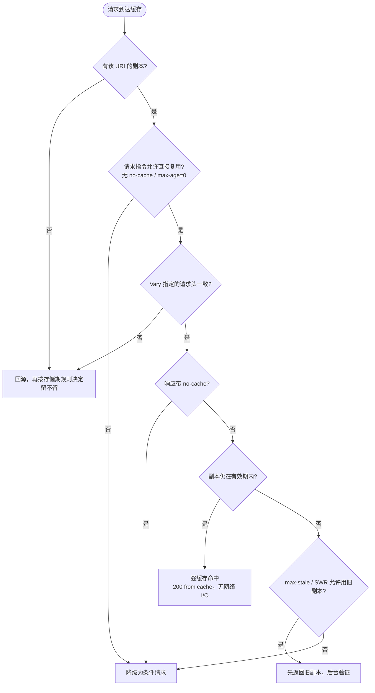

## 概念：HTTP强缓存

> HTTP强缓存指这样一个结果：缓存里已有一份该资源的副本，而这次请求允许复用这份副本，响应于是由缓存自身直接返回，全过程不产生网络 I/O。DevTools 把它记作 `200 (from disk cache)` 或 `200 (from memory cache)`，请求列表里根本看不到这次请求发出去。

**解决的核心痛点**：HTTP 是无状态协议，若每次访问都回源，静态资产要为每一个字节重复付一次往返（[[RTT]]）与一次服务端 I/O。强缓存把「这份内容还能不能用」的裁决权下放给持有副本的一方，把重复访问的成本压到只剩一次本地读取。

**它是一个结果，不是一套机制**：强缓存没有专属标头，也没有专属开关，只有「复用判定全部通过」这一个状态。规范里同样没有这个词条。下面五条命题都挂在这个状态上。

### 核心命题

- [[强缓存命中要求五个条件同时成立而时间只是其中之一]]
- [[max-age是缓存时长的上限而非保证]]
- [[immutable不延长有效期只取消有效期内的条件请求]]
- [[强缓存的失效只能靠改名，协议层没有主动撤销通道]]
- [[文件名能否随内容变化，决定了它敢不敢用长期强缓存]]

这五条按「判定的形状 → 其中一道门 → 门内可追加的让步 → 命中之后的代价 → 代价落到哪里」收窄。第一条定的是命中这个状态的边界：它是五道门同时成立，不是某个头配对了就算；第二条把五道门里最容易被误当成全部的那一道单独拎出来；第三条限定在门内还能追加什么（`immutable` 只减验证、不减时间）；第四条转过来讲代价——副本已在对方手上，撤回通道只剩改名；第五条把这条代价翻译成对文件名的要求。前四条都在解释现象（配了 `max-age` 为什么还会请求、发版后为什么还是旧文件），只有第五条能直接落到构建配置上。

### 运行机制

缓存做的事分成两个阶段，两者的判决依据完全不同，混起来是绝大多数误配的来源：

| 阶段 | 问什么 | 依据 | 结果 |
|:--|:--|:--|:--|
| 存储期（§3） | 这份响应该不该留在缓存里 | 请求方法、状态码是否可缓存、`no-store`、共享缓存下的 `private` 与 `Authorization` | 不该留，后面所有判定都无从谈起 |
| 复用期（§4） | 这份副本能不能拿来应答这次请求 | URI 与方法、请求指令、`Vary`、响应 `no-cache`、新鲜度 | 能，强缓存命中；不能，交给 [[HTTP协商缓存]] |

复用期拆开是五个必须同时成立的条件：

1. 目标一致：URI 与请求方法都对得上。`Vary: *` 会让这一条永远不成立。
2. 请求没否决：没有 `no-cache`、没有 `max-age=0`，`min-fresh` 要求的余量仍在。反向的放宽指令是 `max-stale` 与 `only-if-cached`。
3. `Vary` 匹配：响应头 `Vary` 列出的那些请求头，要与当前请求逐一相符。
4. 响应没否决：响应自身不带 `no-cache`。带了就必须每次验证，无论它多新鲜。
5. 仍新鲜，或允许使用旧的：`freshness_lifetime > current_age`，或命中 `max-stale`、`stale-while-revalidate`。

第 2、3、4 条与时间无关，也最常被漏掉：一个 `max-age=31536000` 的响应只要带 `no-cache`，一次都不会被直接复用；一个 `Vary: User-Agent` 的资源，命中率按 UA 版本数衰减。

下图只画复用期——能不能存下来是另一组判断，发生在更前面：

命中不等于零成本。磁盘读取、反序列化、`Vary` 比对都要花时间；省掉的是网络往返与传输。所以「0 RTT」是对网络层的准确表述，不能顺推成「没有开销」——在冷启动的机械盘上，Disk Cache 命中比同城 CDN 命中还慢的情况是存在的。

### 关键区别

命名落差先拆掉，否则下面每条区别都会歪：

| | 中文教材的三分 | RFC 9111 的两段 |
|:--|:--|:--|
| 分法 | 强缓存 / 协商缓存 / 不缓存，三档并列 | 能不能复用（§4）→ 复用前要不要验证（§4.3） |
| 「强缓存」的位置 | 第一档，被当成一套机制 | 没有这个词条。它是 §4 的复用判定全部通过之后产生的结果 |
| 「不缓存」的位置 | 第三档，与前两档并列 | 不在判定链上。`no-store` 在存储期（§3）就已经出局，副本从来没存在过，谈不上「有没有过期」 |

合起来看，强缓存不是三档里的第一档，而是「复用判定全部通过」这个状态的别名。

落到指令层面，真正容易混的不是强缓存与协商缓存的分工（[[HTTP缓存机制]] 已列过），而是这一组指令各自关掉哪一档——它们的效果可以一样，关的位置不同：

| 指令 | 位置 | 允许存下来 | 每次都要验证 | 常见误读 |
|:--|:--|:--|:--|:--|
| `max-age=0` | 响应 | 允许 | 是——副本一落地就 stale | 以为等于不缓存 |
| `no-cache` | 响应 | 允许，且连新鲜度都不看 | 是 | 以为等于不缓存 |
| `no-store` | 响应 | 不允许 | —（没有副本可验） | 以为只是「不缓存到磁盘」 |
| `must-revalidate` | 响应 | 允许 | 仅在 stale 后禁止使用旧副本 | 以为它影响 fresh 判定 |
| `no-cache` | 请求 | — | 本次强制验证 | 与响应侧的 `no-cache` 混为一谈 |

`max-age=0` 与 `no-cache` 的语义差别只有一句：前者让新鲜度立刻失效，后者干脆跳过新鲜度这一步。理论上 `max-stale` 能救前者、救不了后者，实践中浏览器不发 `max-stale`，所以两者行为几乎一致。工程上该写 `no-cache`，`max-age=0` 是等价的老写法。

顺带解释了 `F5` 为什么能绕过强缓存：那不是浏览器的特权，而是它自己替你发了一条请求侧的 `max-age=0`。`Ctrl + F5` 发的是请求侧 `no-cache` 并且丢掉 `If-None-Match` 与 `If-Modified-Since`，所以连验证也一并跳过了。

### 适用范围

- ✅ 适用场景
	- 内容哈希资产：`Cache-Control: max-age=31536000, immutable`。前提是文件名随内容变，否则一年内没有任何手段撤回。
	- 旧版本还能用的共享资源：字体、图标、vendor 包、图片。判据是「版本错配不破坏功能」——旧图只是旧，不会让页面报错。
	- 带版本号的接口：`/v1/…` 可以做秒级到分钟级的短强缓存，代价是发布窗口内的延迟可接受。
- ⛔ 误用
	- 无哈希、无版本的文件名配长强缓存：`app.js` 给 30 天，发布后客户端不会来请求，也没有远程撤回的通道。
	- 入口 HTML 长强缓存：HTML 是把用户引到新哈希的唯一入口，它一旦长缓存，整个命名式失效体系断链。
	- 用户私有数据进共享缓存：漏写 `private` 时，CDN 会把 A 的响应发给 B。
- 失效边界
	- `max-age` 是上限不是保证：缓存可以因配额、LRU、用户清理随时丢弃副本。「配了一年」不等于「一年内一定不请求」。
	- 用户交互不受约束：`F5`、`Ctrl + F5` 都能绕过，前者发 `max-age=0`，后者发 `no-cache` 且不带验证器。
	- Service Worker 在上游：`fetch` 处理器一旦接管，走 Cache Storage 还是走 network 由它决定，HTTP 缓存可能根本不被问到。
	- `Vary` 是命中率的分母：列了高基数的头，命中率按基数衰减，而不是按资源数。
	- 明文 HTTP 下 `immutable` 应被忽略：RFC 8246 §3 把它定性为 soft pinning，缓存投毒会沿整个有效期放大，因此建议客户端只信任 HTTPS 上的这个指令。

### 批判

- 外部批判
	- 命名式失效把协议问题改写成构建问题：既然 HTTP 没有主动撤销通道，就用改 URL 代替改内容。代价是 URL 空间单调增长、旧版本无法回收，而整条链的正确性压在一个前提上——用户必须先拿到新的 HTML。
	- `immutable` 的收益与风险不对称：它省下的是刷新时的一批无效 304，放弃的是有效期内的全部自我纠错机会。RFC 8246 自己给了三条削弱它的建议，说明规范作者对这条指令的信任是有条件的。
- 内在张力
	- `max-age` 是单方面的承诺：发出去之后，服务端在有效期内失去话语权。命中率越高，撤回能力越弱——两者是同一枚硬币，不是可以同时优化的两个指标。
	- 私有缓存与共享缓存共用一套指令：`private` 与 `s-maxage` 是对这一点的补丁。同一份响应在浏览器与 CDN 上可以有完全不同的行为，而排查问题时通常只看得到其中一端。
	- 省掉往返与秒级感知不可兼得：`stale-while-revalidate` 只是把那次往返挪出关键路径，并没有取消它，容易误读成「两个都要到了」。

### 问题与流程

- 相关问题
	- [[为什么max-age写一年并不等于用户一年内不会请求这个文件？]]（待写）— 配额、淘汰、清缓存、隐私模式四者都能让副本中途消失
	- [[为什么入口HTML不能长缓存而带哈希的JS反而越长越安全？]]（待写）— 命名与失效的替代关系
	- [[Vary头为什么会让强缓存命中率按基数衰减？]]（待写）— 命中率的分母从「资源数」变成「头组合数」
	- [[共享缓存的s-maxage与浏览器的max-age冲突时哪一端说了算？]]（待写）— `Age` 与两套指令的作用域
- 相关流程
	- [[前端静态资源多级缓存配置规范]] — 哈希资产与 HTML 入口的 Nginx 缓存策略编排
	- [[SOP-排查强缓存不生效的定位流程]]（待写）— 按复用期五道门逐条排除：请求指令 → `Vary` → 响应 `no-cache` → 新鲜度计算 → 是否被中间件改写

### 知识图谱

- 上位：[[HTTP缓存机制]] — 强缓存是它复用判定的通过状态
- 下位：
	- [[immutable]]（待写）— 在有效期之内追加「不必验证」的限定
	- [[Expires]]（待写）— 同一判定的绝对时间版本，多一层对客户端时钟的依赖
- 并列：
	- [[HTTP协商缓存]] — 同一个「要不要发请求」问题的另一侧解法
- 相关：
	- [[新鲜度]] — 强缓存执行的判定式定义在这里
	- [[Cache-Control]] — 两侧指令的共同载体
	- [[Content-Hash]] — 命名式失效成立的前提
	- [[CDN]] — `s-maxage` 与 `Age` 生效的共享缓存层
	- [[RTT]] — 强缓存省掉的那个往返
- 外部资料
	- [RFC 9111 §4 Constructing Responses from Caches](https://www.rfc-editor.org/rfc/rfc9111#name-constructing-responses-from) — 复用判定的规范原文
	- [RFC 9111 §3 Storing Responses in Caches](https://www.rfc-editor.org/rfc/rfc9111#name-storing-responses-in-caches) — 什么能存下来
	- [RFC 8246](https://www.rfc-editor.org/rfc/rfc8246) — `immutable` 的定义与安全考量
	- [MDN: Cache-Control](https://developer.mozilla.org/en-US/docs/Web/HTTP/Headers/Cache-Control) — 指令速查
