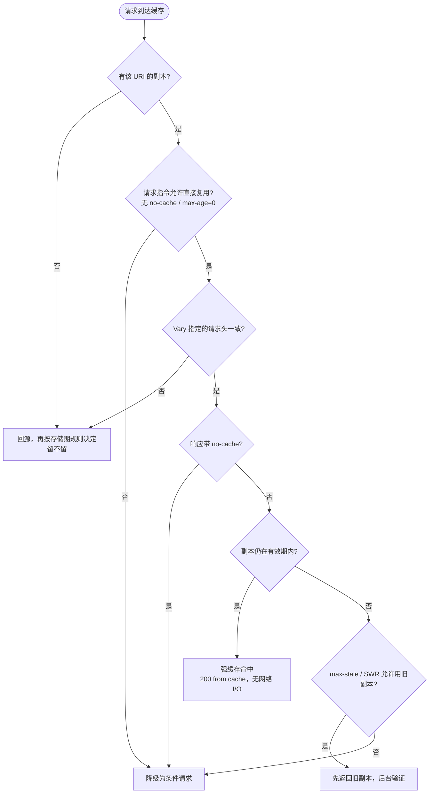

## 概念：HTTP强缓存

> **HTTP强缓存** 指这样一个结果：缓存里已有一份该资源的副本，而这次请求允许复用这份副本，于是响应由缓存自身直接返回，全过程不产生网络 I/O。DevTools 把它记作 `200 (from disk cache)` 或 `200 (from memory cache)`，请求列表里根本看不到这次请求发出去。

**解决的核心痛点**：HTTP 是无状态协议，若每次访问都回源，静态资产要为每一个字节重复付一次往返（[[RTT]]）与一次服务端 I/O。强缓存把「这份内容还能不能用」的裁决权下放给持有副本的一方，把重复访问的成本压到只剩一次本地读取。

---

### 概念边界：它是一个结果，不是一个机制

先把命名落差拆掉，否则后面的判断都会歪：

| | 中文教材的三分 | RFC 9111 的两段 |
|:--|:--|:--|
| 分法 | 强缓存 / 协商缓存 / 不缓存，三档并列 | 能不能**复用**（§4）→ 复用前要不要**验证**（§4.3） |
| 「强缓存」的位置 | 第一档，被当成一套机制 | 没有这个词条。它是 §4 的复用判定全部通过之后产生的结果 |
| 「不缓存」的位置 | 第三档，与前两档并列 | 不在判定链上。`no-store` 在**存储期**（§3）就已经出局，副本从来没存在过，谈不上「有没有过期」 |

所以本篇讲的是把那个高频词对回规范，而不是介绍一套独立机制：**强缓存命中 = 复用判定全部通过 = 五道门同时成立**。五道门里只有最后一道在问时间（[[新鲜度]]）。这一条一旦看清，「配了 max-age 怎么还是每次请求」这类问题就不再玄学。

### 核心命题

> 本节只留标题，正文待补。四条标题都是可判断真假的命题，写的时候要补的是**边界**，不是把标题复述一遍。

- [[max-age是缓存时长的上限而非保证]]
	- 待补：磁盘配额、LRU 淘汰、用户清缓存、隐私模式都能让副本中途消失；`max-age` 约束的是「可以复用多久」，不是「一定留着多久」
- [[immutable不延长有效期只取消有效期内的条件请求]]
	- 待补：RFC 8246 的作用域严格限制在 fresh 期间；进入 stale 后照常验证，强制刷新也照常忽略它
- [[强缓存命中要求五个条件同时成立而时间只是其中之一]]
	- 待补：URI 与方法、请求指令、`Vary`、响应 `no-cache`、新鲜度；前四条与时间无关
- [[强缓存的失效只能靠改名字协议层没有主动撤销通道]]
	- 待补：purge 是 CDN 厂商 API 不是协议；`Content-Hash` 就是这条约束逼出来的工程答案

### 运行机制

缓存做的事分成两个阶段，两者的判决依据完全不同，混起来是绝大多数误配的来源：

| 阶段 | 问什么 | 依据 | 结果 |
|:--|:--|:--|:--|
| **存储期**（§3） | 这份响应该不该留在缓存里 | 请求方法、状态码是否可缓存、`no-store`、共享缓存下的 `private` 与 `Authorization` | 不该留 → 后面所有判定都无从谈起 |
| **复用期**（§4） | 这份副本能不能拿来应答**这次**请求 | URI 与方法、请求指令、`Vary`、响应 `no-cache`、新鲜度 | 能 → 强缓存命中；不能 → 交给 [[HTTP协商缓存]] |

复用期拆开是五个必须同时成立的条件：

1. **目标一致**：URI 与请求方法都对得上。`Vary: *` 会让这一条永远不成立。
2. **请求没否决**：没有 `no-cache`、没有 `max-age=0`、`min-fresh` 要求的余量仍在。反向的放宽指令是 `max-stale` 与 `only-if-cached`。
3. **`Vary` 匹配**：响应头 `Vary` 列出的那些请求头，要与当前请求逐一相符。
4. **响应没否决**：响应自身不带 `no-cache`。带了就必须每次验证，无论它多新鲜。
5. **仍新鲜，或允许使用旧的**：`freshness_lifetime > current_age`，或命中 `max-stale`、`stale-while-revalidate`。

第 2、3、4 条与时间无关，也最常被漏掉：一个 `max-age=31536000` 的响应只要带 `no-cache`，一次都不会被直接复用；一个 `Vary: User-Agent` 的资源，命中率按 UA 版本数衰减。

下图只画复用期——能不能存下来是另一组判断，发生在更前面：

命中不等于零成本。磁盘读取、反序列化、`Vary` 比对都要花时间；省掉的是网络往返与传输。所以「0 RTT」是对网络层的准确表述，不能顺推成「没有开销」——在冷启动的机械盘上，Disk Cache 命中比同城 CDN 命中还慢的情况是存在的。

### 关键区别

真正容易混的不是「强缓存 vs 协商缓存」（[[HTTP缓存机制]] 已列过），而是**这一组指令各自关掉哪一档**。它们的差别不在效果，在于关在哪个环节：

| 指令 | 位置 | 允许存下来 | 每次都要验证 | 常见误读 |
|:--|:--|:--|:--|:--|
| `max-age=0` | 响应 | 允许 | 是——副本一落地就 stale | 以为等于不缓存 |
| `no-cache` | 响应 | 允许，且**连新鲜度都不看** | 是 | 以为等于不缓存 |
| `no-store` | 响应 | **不允许** | —（没有副本可验） | 以为只是「不缓存到磁盘」 |
| `must-revalidate` | 响应 | 允许 | 仅在 stale 后禁止使用旧副本 | 以为它影响 fresh 判定 |
| `no-cache` | **请求** | — | 本次强制验证 | 与响应侧的 `no-cache` 混为一谈 |

`max-age=0` 与 `no-cache` 的语义差别只有一句：前者让新鲜度立刻失效，后者干脆跳过新鲜度这一步。理论上 `max-stale` 能救前者、救不了后者，实践中浏览器不发 `max-stale`，所以两者行为几乎一致。**工程上该写 `no-cache`**，`max-age=0` 是等价的老写法。

顺带解释了 `F5` 为什么能绕过强缓存：那不是浏览器的特权，而是它自己替你发了一条请求侧的 `max-age=0`。`Ctrl + F5` 发的是请求侧 `no-cache` **并且丢掉** `If-None-Match` / `If-Modified-Since`，所以连验证也一并跳过了。

### 适用范围

- ✅ **适用场景**
	- **内容哈希资产**：`Cache-Control: max-age=31536000, immutable`。前提是文件名随内容变，否则一年内没有任何手段撤回。
	- **旧版本还能用的共享资源**：字体、图标、vendor 包、图片。判据是「版本错配不破坏功能」——旧图只是旧，不会让页面报错。
	- **带版本号的接口**：`/v1/…` 可以做秒级到分钟级的短强缓存，代价是发布窗口内的延迟可接受。
- ⛔ **误用**
	- **无哈希、无版本的文件名配长强缓存**：`app.js` 给 30 天，发布后客户端不会来请求，也没有远程撤回的通道。
	- **入口 HTML 长强缓存**：HTML 是把用户引到新哈希的唯一入口，它一旦长缓存，整个命名式失效体系断链（见 FAQ）。
	- **用户私有数据进共享缓存**：漏写 `private` 时，CDN 会把 A 的响应发给 B。
- **失效边界**
	- **`max-age` 是上限不是保证**：缓存可以因配额、LRU、用户清理随时丢弃副本。「配了一年」不等于「一年内一定不请求」。
	- **用户交互不受约束**：`F5`、`Ctrl + F5` 都能绕过；前者发 `max-age=0`，后者发 `no-cache` 且不带验证器。
	- **Service Worker 在上游**：`fetch` 处理器一旦接管，走 Cache Storage 还是走 network 由它决定，HTTP 缓存可能根本不被问到。
	- **`Vary` 是命中率的分母**：列了高基数的头，命中率按基数衰减，而不是按资源数。
	- **明文 HTTP 下 `immutable` 应被忽略**：RFC 8246 §3 把它定性为 soft pinning，缓存投毒会沿整个有效期放大，因此建议客户端只信任 HTTPS 上的这个指令。

### 批判

- **外部批判**
	- **命名式失效把协议问题改写成构建问题**：既然 HTTP 没有主动撤销通道，就用「改 URL」代替「改内容」。代价是 URL 空间单调增长、旧版本无法回收，且整条链的正确性压在一个前提上——用户必须先拿到新 HTML。而 HTML 自己恰恰不能长缓存，于是「永久缓存」的体系有一个必须靠「永不缓存」兜底的洞。
	- **`immutable` 的收益与风险不对称**：它省下的是刷新时的一批无效 304，放弃的是有效期内的全部自我纠错机会。RFC 8246 自己给了三条削弱它的建议，说明规范作者对这条指令的信任是有条件的。
- **内在张力**
	- **`max-age` 是单方面的承诺**：发出去之后，服务端在有效期内失去话语权。命中率越高，撤回能力越弱——两者是同一枚硬币，不是可以同时优化的两个指标。
	- **私有缓存与共享缓存共用一套指令**：`private` / `s-maxage` 是对这一点的补丁。同一份响应在浏览器与 CDN 上可以有完全不同的行为，而排查问题时通常只看得到其中一端。
	- **省掉往返与秒级感知不可兼得**：`stale-while-revalidate` 只是把那次往返挪出关键路径，并没有取消它，读者容易误读成「两个都要到了」。

### 机制与流程

#### FAQ

> 本节只留问题，答案待写。四个都是查文档查不到、需要自己推的。

- [[为什么max-age写一年并不等于用户一年内不会请求这个文件？]] — 配额、淘汰、清理缓存、隐私模式
- [[为什么入口HTML不能长缓存而带哈希的JS反而越长越安全？]] — 命名与失效的替代关系
- [[Vary头为什么会让强缓存命中率按基数衰减？]] — 命中率的分母从「资源数」变成「头组合数」
- [[共享缓存的s-maxage与浏览器的max-age冲突时哪一端说了算？]] — `Age` 与两套指令的作用域

#### SOP

> 本节同样只留标题。两条分工是「按规范配好」与「配好了却没生效时怎么查」，不是同一件事的两个版本。

- [[SOP-前端静态资源多级缓存配置规范]] — 区分哈希资产与 HTML 入口的 Nginx 缓存策略（已有两篇 concept 引用，仍是红链）
- [[SOP-排查强缓存不生效的定位流程]] — 按复用期的五道门逐条排除：请求指令 → `Vary` → 响应 `no-cache` → 新鲜度计算 → 是否被中间件改写

### 知识图谱

> 固定五个桶，判据见 [[知识图谱词表]]。

- **上位**：[[HTTP缓存机制]] — 强缓存是它复用判定的通过状态
- **下位**：
	- [[immutable]]（待写） — 在有效期之内追加「不必验证」的限定
	- [[Expires]]（待写） — 同一判定的绝对时间版本，多一层对客户端时钟的依赖
- **并列**：
	- [[HTTP协商缓存]] — 同一个「要不要发请求」问题的另一侧解法
- **相关**：
	- [[新鲜度]] — 强缓存执行的判定式定义在这里
	- [[Cache-Control]]（待写） — 两侧指令的共同载体
	- [[Content-Hash]]（待写） — 命名式失效成立的前提
	- [[CDN]] — `s-maxage` 与 `Age` 生效的共享缓存层
	- [[RTT]] — 强缓存省掉的那个往返
- **外部资料**
	- [RFC 9111 §4 Constructing Responses from Caches](https://www.rfc-editor.org/rfc/rfc9111#name-constructing-responses-from) — 复用判定的规范原文
	- [RFC 9111 §3 Storing Responses in Caches](https://www.rfc-editor.org/rfc/rfc9111#name-storing-responses-in-caches) — 什么能存下来
	- [RFC 8246](https://www.rfc-editor.org/rfc/rfc8246) — `immutable` 的定义与安全考量
	- [MDN: Cache-Control](https://developer.mozilla.org/en-US/docs/Web/HTTP/Headers/Cache-Control)
