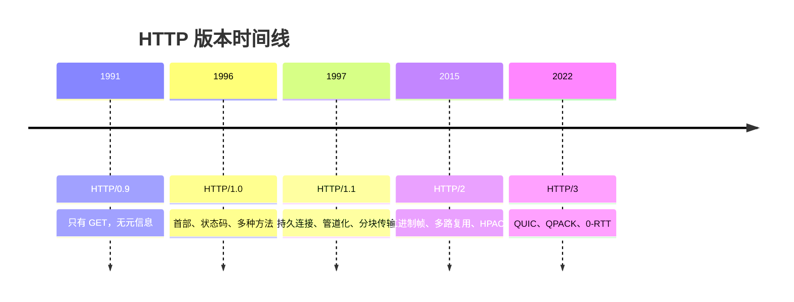

## HTTP 版本演进

> HTTP 的五次换版可以做成一件事来读：每次都在回答「上一个版本把阻塞留在了哪一层」。0.9 只有拿，1.0 补上元信息，1.1 省掉重复握手却换来按序回传，2 打散请求却仍在一条 TCP 上排队，3 把连接挪出内核。阻塞从未归零，只是粒度越来越细。

**时间跨度**：1991（HTTP/0.9）→ 2022（HTTP/3，RFC 9114）

**演进动力**：不是功能不够，是每一版的性能优化都会把瓶颈挪到下一层——省了握手就撞上按序回传，拆了请求就撞上 TCP 的整连接停等。

---

### 演进概览

---

### 阶段详情

#### HTTP/0.9（1991）

- 核心变化：只有 `GET`，请求是一行路径，响应是纯 HTML，没有首部、没有状态码。
- 解决的问题：让文档能在网络上被引用。
- 留下的问题：传不了图片、传不了元信息，也无法判断成败。
- 说明：这一版从未有正式 RFC，只有一份 W3C 的说明文档，因此本库不给它单独建笔记。

#### HTTP/1.0（1996，RFC 1945）

- 核心变化：引入首部、状态码、多种请求方法，以及 `Content-Type`；默认短连接，一个资源一次 TCP 握手。
- 解决的问题：把一个只能取 HTML 的协议变成能传任意类型的通用传输协议。
- 留下的问题：每多一个资源就多一轮三次握手，页面上二十个资源就是二十次往返。
- 说明：本阶段原有一篇独立笔记（`HTTP1.0`），2026-10-27 重组时并入本节，那篇已移入 `40-ARCHIVE`。它的两条独有命题仍单独成文：[[HTTP1.0 采用短连接模式]]、[[HTTP1.0 是无状态协议]]。

#### HTTP/1.1（1997，RFC 2068；1999 重写为 RFC 2616）

- 核心变化：持久连接成为默认、管道化、分块传输编码、`Host` 首部必需、`Cache-Control` 等缓存控制增强。
- 解决的问题：省掉重复握手，同一连接可以连续发多个请求。
- 留下的问题：管道化要求服务端按序回传，前一个响应慢就堵住后面所有请求——[[HTTP1.1管道化要求服务端必须按序回传，导致应用层队头阻塞]]，浏览器因此默认不启用。
- 详见：[[HTTP1.1]]

#### HTTP/2（2015，RFC 7540）

- 核心变化：[[二进制分帧]]、同连接多路复用（靠 Stream ID 匹配请求与响应）、HPACK头部压缩、服务器推送。
- 解决的问题：应用层队头阻塞不再成立，响应可以乱序返回。
- 留下的问题：分帧仍跑在一条 TCP 上，而重传与滑动窗口是连接级的——[[HTTP2在极端丢包环境下会导致传输层队头阻塞]]。阻塞被替换而非消除。
- 详见：[[HTTP2]]

#### HTTP/3（2022，RFC 9114）

- 核心变化：跑在 QUIC（UDP）之上，QPACK 头部压缩、0-RTT 重连、连接迁移。
- 解决的问题：TCP 层队头阻塞，单一流丢包不再拖住其他流。
- 留下的问题：单条流内部仍须有序等待，[[QUIC只缩小阻塞粒度而不消除单流内的有序等待]]；且 UDP 在部分网络会被限速或阻断。
- 详见：[[HTTP3]]

---

### 版本对照矩阵

> 全库唯一一份。各版本笔记不再各写一张表——同一个事实写五处，必然有一处先烂（2026-10-27 重组前，`HTTP` 的关键区别表写着「HTTP/2 队头阻塞：无」，而它自己挂的核心命题正是在论证 TCP 层阻塞仍存在）。

| 维度 | 0.9 | 1.0 | 1.1 | 2 | 3 |
|:--|:--|:--|:--|:--|:--|
| 报文格式 | 纯文本 | 纯文本 | 纯文本 | 二进制帧 | 二进制帧 |
| 连接复用 | 无（一请求一连接） | 无，默认短连接 | 持久连接（默认） | 单一 TCP 上多流 | 单一 QUIC 上多流 |
| 并发机制 | 无 | 无 | 管道化（实际不启用） | 多路复用 | 多路复用 |
| 头部压缩 | 无首部 | 无 | 无 | HPACK | QPACK |
| 队头阻塞 | 无（不排队） | 无（不排队） | 应用层：响应须按序 | TCP 层：丢包整连接停等 | 仅单流内有序等待 |
| 底层传输 | TCP | TCP | TCP | TCP | QUIC（UDP） |
| TLS | 不适用 | 可选 | 可选 | 事实上必需 | 内置 |

读这张表的要点：队头阻塞那一行不是「有 / 无」的开关，而是阻塞所在层的迁移。判「某版本还有没有队头阻塞」，必须先问阻塞发生在哪一层。

---

### 关键转折点

**文本到二进制（1.1 → 2）。** 报文边界从「找换行符」变成「读帧长度」，代价是失去人眼可读，收益是再也没有解析歧义，且一条连接内可以交错传输多个流。

**TCP 到 QUIC（2 → 3）。** 把连接从内核挪到用户态，流成了彼此独立的可靠通道。这一步动的不是 HTTP，是它脚下的传输层——也是为什么 HTTP/3 的很多收益其实属于 QUIC。

**优化手段的倒转。** 域名分片在 HTTP/1.1 下是标准优化（绕开单域名的连接数限制），在 HTTP/2 下变成反模式：拆到多个域名等于开多条连接，多路复用失效，还会各自重新握手。见 [[域名分片在HTTP2下从优化变成反模式]]。

---

### 知识图谱

- **上位**：[[HTTP]] — 本笔记是 HTTP 的一条演进线，不是另一个协议
- **并列**：
	- [[HTTP1.1]] — 同属 HTTP 版本序列
	- [[HTTP2]] — 同上
	- [[HTTP3]] — 同上
- **相关**：
	- [[队头阻塞]] — 贯穿五个版本的同一个问题
	- [[多路复用]] — HTTP/2 的并发手段
	- [[QUIC]] — HTTP/3 的传输层
	- [[HTTP缓存机制]] — 与版本演进正交的另一条优化线
- **外部资料**：
	- [RFC 1945 — HTTP/1.0](https://www.rfc-editor.org/rfc/rfc1945)
	- [RFC 2616 — HTTP/1.1](https://www.rfc-editor.org/rfc/rfc2616)
	- [RFC 7540 — HTTP/2](https://www.rfc-editor.org/rfc/rfc7540)
	- [RFC 9114 — HTTP/3](https://www.rfc-editor.org/rfc/rfc9114)
