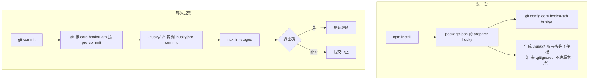

## 概念：Husky

> Husky 是 Git Hooks 的**分发器**：把钩子脚本从本机的 `.git/hooks` 搬到仓库里的 `.husky/`，再用一条 `prepare` 脚本让每个克隆都自动接上。

**解决的核心痛点**：`.git` 不进版本库，所以「我们团队都在 pre-commit 跑 lint」这件事只能靠口头传达。谁没配，谁就一路裸提交——而且没有任何人会知道。

### 运行机制

两条链，只有第一条是 Husky 自己做的：

三条由这张图推出的结论：

1. **要提交的是 `.husky/<hook>`，不是 `.husky/_/`。** `_` 是本机生成的执行器与存根，里面自带一个内容为 `*` 的 `.gitignore`。把它提交上去，等于把一个人的执行器发给全队。
2. **退出码是唯一的接口。** Husky 不读输出、不判断对错，只把 git 要的返回值转出去。所以「检查跑过但什么都没查」和「检查通过」在它眼里完全一样——门是否有效，取决于钩子里那行命令，不取决于 Husky。
3. **分发只发生一次**，绑在 `prepare` 上。任何让 `prepare` 不跑的操作（`--ignore-scripts`、生产安装不装 devDependencies、从旧版本拖过来的工作区），结果都是钩子**根本不存在**，而提交照常成功、不报错。

> v9 起钩子就是普通 shell 脚本，不再需要 `source .husky/_/husky.sh`，也不需要 shebang。旧教程里 `. "$(dirname "$0")/_/husky.sh"` 那行是 v5–v8 的写法，照抄会在 v9 打一条 deprecation 提示。

### 关键区别

和「手写一条 `core.hooksPath`」相比，Husky 多出来的只有分发这一个环节：

| 维度 | Husky | 手写 `core.hooksPath` |
|:---|:---|:---|
| **分发** | `prepare` 挂在 install 上，克隆后自动生效 | 每人自己敲一次，漏了就漏了 |
| **依赖** | 要有 Node 与 `node_modules` | 只要 git |
| **钩子入口** | `.husky/_/h` 统一转调，钩子文件里只写命令 | 直接把路径指到脚本目录 |
| **换方案成本** | 要先清掉那个 config，否则旧入口继续生效 | 同样，但没人记得是自己设的 |

所以它加的不是能力，是**一条分发通道**：它没让钩子更强，只让「全队都有钩子」不必靠口头传达。

### 适用范围

- ✅ **适用场景**
	- **团队协作的 Node / 前端仓库**：钩子里要跑 ESLint、Prettier、`tsc`，本来就有 `node_modules`，多一个依赖不增加门槛
	- **需要配置随仓库走**：新人 clone 完 `install` 一次就对齐，不必读一份「环境配置说明」
	- **只要本地快速反馈**：秒级拦住，远程的强制卡点交给 [[CI-CD流程]]
- ⛔ **误用**
	- **当唯一防线**：`--no-verify`、`HUSKY=0` 都能跳过，服务端必须留对等卡点
	- **在 pre-commit 里跑全量测试、E2E、构建**：每次提交几十秒，通常撑不过三周就被 `-n` 绕过。重活放 pre-push 或 CI
	- **在非 Node 仓库里为十行 shell 引入 `node_modules`**：Go / Python 项目用自带二进制的方案更划算
- **失效边界**
	- **只对本机的 git 命令行生效**：走 libgit2 之类自带实现的 GUI / IDE 不一定执行钩子；`git commit -n` 与 `HUSKY=0` 直接跳过。哪一种在你手上的客户端里成立，需实测
	- **只对「装过」的克隆生效**：`prepare` 没跑 = 钩子不存在 = 静默放行，全程无报错。这是它最常见的失效方式，比被绕过更常见
	- **独占 `core.hooksPath`**：这个 config 设上之后，`.git/hooks` 里的东西**全部**失效，包括队友自己写的脚本和别的工具写进去的钩子，同样无提示
	- **不判断检查是否有效**：规则写错、`tsc` 配漏了文件，钩子照样绿灯退出

### 批判

- **过度承诺「统一」**
	- 它统一的是配置，不是环境。同一份 `pre-commit` 跑在各人的 Node 版本、各人的依赖树上，行为可以不同，而 Husky 管不到这一层
- **内在张力**
	- **门槛与绕过的博弈**：越慢越多人 `-n`，一旦 `-n` 成为肌肉记忆，门连同「这次改动值不值得等」的判断一起消失了——而后者本来是这扇门想留下的东西
	- **把反馈和强制塞进同一个位置**：本地门没法强制（谁都能跳过），只能劝；所以它越像强制，被绕过的成本越低、绕过后的错觉越大
	- **为一条通道付一份工具链**：一个 Go 仓库要在 CI 里跑 `npm ci` 才能有钩子，成本与收益不成比例

### 问题与流程

- **相关问题**
	- [[如何确保代码在本地提交前通过规范校验]] — 它问的是「这道门怎么才算真的生效」，Husky 只解决其中的分发那一层
- **相关流程**
	- [[通过husky+lint-staged进行代码质量防护]] — 从安装到「真的拦住一次提交」的完整配置，本页只讲到它为什么能拦住

### 知识图谱

- **上位**：[[Git Hooks]] — 它提供机制（事件 + 退出码），Husky 只负责把这份配置搬进版本库
- **相关**：
	- [[pre-commit Hook工作流]] — 钩子里最常被 Husky 接管的那一段：触发、暂存区过滤、重新暂存
	- [[ESLint]] — 钩子里最常调用的检查器；它判对错，Husky 只负责在正确的时间叫它
	- [[CI-CD流程]] — 同一批检查在远端的对等卡点，可绕过的本地门不能是唯一门
- **外部资料**
	- [Husky 官方文档](https://typicode.github.io/husky/)
	- [git hooks 手册](https://git-scm.com/docs/githooks) — 每个钩子的触发时机与 `--no-verify` 的覆盖面

### 待探索

- **`lint-staged`** 未立。本页把它当「另一个工具」一句话带过，但钩子里到底查什么、查多快由它决定
- **`commitlint`** 未立。`commit-msg` 那一格的配套，本页只提了名字，没写它凭什么能拦住不合规的信息
