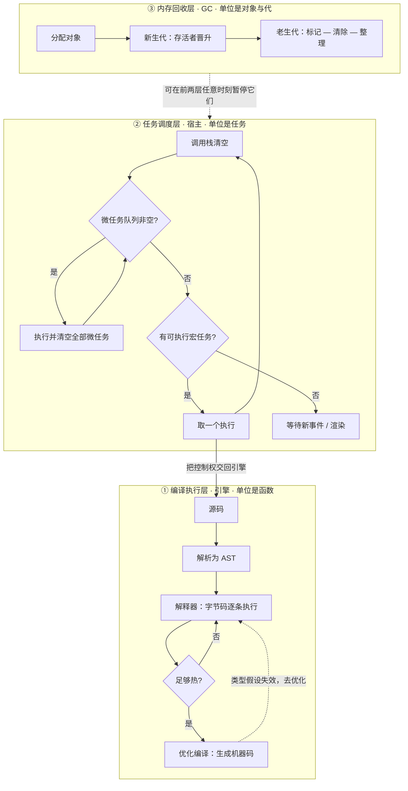

## 概念：JS 执行机制

> **JS 执行机制**回答的不是「这段代码算出什么」，而是「谁在什么时候拿到控制权」。它由两个规范域拼成：引擎决定一段代码怎么被编译和执行（ECMAScript 语义 + 引擎实现），宿主决定哪段代码何时获得执行权（HTML 规范的任务队列，或 Node 的 libuv 阶段）。

**解决的核心痛点**：语言规范只定义「执行一段脚本会得到什么结果」，从不规定「多个回调之间怎么排队」。而页面的真实行为几乎全由后者决定——`setTimeout(fn, 0)` 排在 `Promise.then` 后面，这条结论在任何一行 ECMAScript 里都查不到。单看语言规范，解释不了自己代码的执行顺序。

### 核心命题

- [[现代 JS 引擎的性能来自分层编译与去优化，不来自解释执行]]
	- **原理**：引擎的职责边界止于「执行一段代码」——解析、编译、优化、执行都在它的范围内，而「下一段代码什么时候开始」不归它管。这条边界正是本篇要分成两半的起点。
- [[JavaScript的单线程约束的是一个调用栈而非线程数量]]（待写）
	- **原理**：引擎自己就开着编译线程、优化线程、并发标记线程；宿主可以起多个 Worker，每个各有独立的栈与事件循环。被串行化的只有「用户代码同时在栈上的帧数」——因为任一时刻只有一个栈在跑用户的函数。
- [[JavaScript的非阻塞来自把等待转移给宿主]]（待写）
	- **原理**：网络与文件等待由操作系统或线程池承担，回调经队列回到栈上，所以等待不占用栈。位移的前提是「有别人可以等」；纯计算没有可转移的对象，必然原地阻塞。

### 运行机制

三段机制各有自己的时间单位，这是把它们分开看的理由——不是三个模块，是三种尺度：

| 层 | 时间单位 | 谁负责 | 卡住时的表现 | 看哪里 |
|:--|:--|:--|:--|:--|
| **编译执行层** | 单个函数、一段热点循环 | 引擎：解释器 → 基线编译 → 优化编译 | 某个函数一直慢，但页面仍在响应 | 火焰图里的长函数、去优化记录 |
| **任务调度层** | 一个宏任务、一批微任务 | 宿主：事件循环 | 整页冻结、输入延迟、动画掉帧 | 长任务（>50 ms）、Main 轨道 |
| **内存回收层** | 一次 GC 周期 | GC（分代回收） | 周期性停顿，和代码位置对不上 | Memory 面板、GC 事件 |

判据只有一句：**「慢」的归因先问卡在哪一层，再问卡在哪一行。** 因为三层的修复手段互不通用——编译层靠稳定数据形状（别让对象结构中途变形、别让类型假设失效），任务层靠切分任务（主动让出控制权），内存层靠减少存活对象（断引用、控生命周期）。拿任务层的手段（`setTimeout` 切片）去治内存层的停顿，只会把停顿挪个位置。

三层之间只有两条通道，其余全是隔离：

1. **任务层 → 执行层**：`J --> A`。事件循环每轮只做一件事——把控制权交给引擎，跑完一个任务的全部同步代码。
2. **内存层 → 其他两层**：GC 是唯一能在「你没写代码的地方」暂停你的东西。这也是为什么内存问题的症状总是不守时——它不挑代码位置。

至于「微任务何时清空」，规范的说法是在**调用栈为空时**执行一次微任务检查点，而不是「宏任务结束后」；两种说法在单任务场景下等价，在嵌套场景下不等价。这条细节归 [[事件循环]]，本篇只留位置。

### 关键区别

**同一个引擎，两个宿主**。执行机制相同，调度机制不同：

| 维度 | 浏览器 | Node.js |
|:--|:--|:--|
| 调度者 | HTML 规范定义的事件循环 | libuv 的循环 + V8 的微任务队列 |
| 任务来源 | 多个任务源（定时器、用户交互、网络、渲染），源之间的顺序由实现决定 | 按阶段推进：timers → pending → poll → check → close |
| 微任务 | Promise、`queueMicrotask`、`MutationObserver` | 同左，另有 `process.nextTick`——独立队列，**先于** Promise 回调 |
| 帧 | 每轮有机会渲染 | 无渲染概念 |
| 相同的部分 | 引擎执行模型、单一调用栈、栈空时清空微任务 | 同左 |

结论：**换宿主换的是调度，不是执行。** 背熟了浏览器的输出顺序，在 Node 里对不上，往往不是记错，而是调度者换了人。

**JS 的并发模型不是「单线程」对「多线程」**。与前一篇对比表常见的写法不同，JS 也能并行（Worker、子进程、WASM 线程）；真正的区别在共享内存：Java、Go 的并行单位共享同一片堆，靠锁与内存模型约束竞争；JS 的并行单位是彼此隔离的 agent，默认只能靠消息复制通信，要共享必须显式申请 `SharedArrayBuffer` 并自行用 `Atomics` 约束。所以准确的说法是**消息传递 + 单栈**，而不是「没有并行」。

### 适用范围

- ✅ **适用场景**
	- **给「卡」做归因**：先分层，再定位。是长函数（编译层）、长任务（任务层），还是 GC 停顿（内存层），三者的排查入口完全不同。
	- **判断一段代码能不能进关键路径**：只要它占着栈，渲染与输入就都在等它；能不能让出，取决于它是否有可转移的等待。
	- **跨端迁移**：把代码从浏览器搬到 Node、或搬进 Worker 时，执行模型不变、调度规则变，需要重新核对的只有后者。
- ⛔ **误用**
	- **拿「单线程」否掉并行方案**：这是把「单一调用栈」误读成「进程只有一个线程」。计算密集任务该用 Worker 或子进程，而不是在栈上切得更碎。
	- **拿「非阻塞」给纯计算开脱**：没有等待可以转移的代码不存在非阻塞版本，只有「切分后仍然阻塞，只是分多次」。
	- **在微任务里递归排队**：微任务队列在本轮清空之前不会让出控制权，递归排队会饿死渲染与输入，症状和死循环一样，但堆栈看不出来。
- **失效边界**
	- **解释不了 WASM**：它有独立的调用栈与线性内存，控制权进出需要跨越边界，本篇的三层模型不覆盖这段。
	- **解释不了数据竞争**：一旦用了 `SharedArrayBuffer`，正确性就不再由「单栈」保证，要靠 `Atomics` 与内存序，这是另一套模型。
	- **解释不了引擎内部的并行**：并发标记、后台编译都会影响观测到的耗时，但从 JS 侧看不见，只能用引擎自己的日志与 trace。

### 批判

- **外部批判**
	- **「单线程、非阻塞」是教材压缩的产物，两个词各丢了一半。** 「单线程」丢掉了引擎内部的并行线程与宿主的多 agent 模型；「非阻塞」丢掉了它其实是异步 I/O 多路复用加队列回投。压缩在入门时降低门槛，在排查时却会把人引向错误的问题——去找「哪个线程慢」，而真问题在「哪个任务太长」。
- **内在张力**
	- **这个标题跨了两个规范域，没有单一权威文档。** ECMAScript 定义语义与作业（Job）的抽象，任务队列与微任务检查点由 HTML 规范定义，Node 又在 libuv 之上另有一套。任何人讲「JS 执行机制」都在缝合两个来源，缝合处的取舍就是各家说法冲突的根源。本篇同样如此：所有关于「何时让出」的判断，都以浏览器宿主为准，在 Node 里需要按上表重算。
	- **「执行」与「调度」的边界在规范里清楚，在代码里模糊。** 一个 `await` 看起来是让出，实际是把自己注册成微任务；一次属性访问看起来是执行，可能触发一次 GC 停顿。分层是分析工具，不是运行时事实。

### 问题与流程

- **相关问题**
	- [[Q-如何理解 JavaScript 的事件循环机制]] — 卡在「机制」与「输出顺序」被当成同一件事：前者是三层如何交接控制权，后者只是第二层的一个特例
- **相关流程**
	- [[SOP-使用Promise处理异步操作]] — 把异步流程收敛成可读的链式写法（**尚未写**）

### 知识图谱

> 固定五个桶，判据见 [[知识图谱词表]]。

- **上位**：[[JavaScript]] — 语言领域中「运行机制」这一支的总览
- **下位**：
	- [[JavaScript 引擎]] — 第一层：编译与执行的实现
	- [[执行栈]] — 第二层的载体，控制权在谁手里的直接体现
	- [[事件循环]] — 第二层的调度规则
	- [[执行上下文]] — 栈帧里装的是什么
	- [[作用域链]] — 执行期的变量查找路径
- **并列**：
	- [[浏览器工作原理]] — 同一个宿主，视角换成渲染管线而非脚本调度
- **相关**：
	- [[宏任务]] · [[微任务]] — 第二层的两类队列，规则细节归各自条目
	- [[字节码]] — 第一层的中间产物
	- [[V8 引擎]] — 第一层的具体实现，本篇只取它的分工而不展开
	- [[script 阻塞解析的同时也阻塞后续下载，defer 与 async 只改执行时机]] — 执行层与解析层的交汇点
	- [[闭包]] — 执行结束后上下文仍被引用，是内存层与执行层的交汇
	- [[Web Worker]] — 突破单一调用栈的那条路
- **外部资料**
	- [ECMAScript 语言规范](https://tc39.es/ecma262/) — 定义语义，不定义调度；本篇「两个规范域」的依据
	- [HTML 规范：事件循环](https://html.spec.whatwg.org/multipage/webappapis.html#event-loops) — 任务队列与微任务检查点的权威定义
	- [Node.js：事件循环、定时器与 nextTick](https://nodejs.org/en/learn/asynchronous-work/event-loop-timers-and-nexttick) — 宿主差异表的来源
	- [V8 博客](https://v8.dev/blog) — 编译与优化策略的第一手材料
