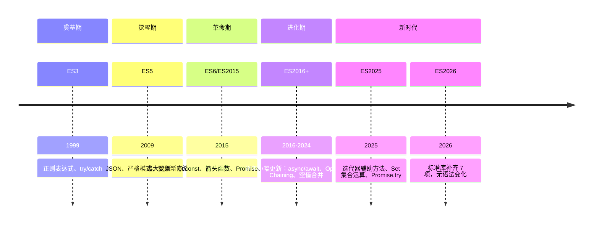

## JavaScript 版本演进

> 记录 JavaScript 语言从 ES3 到 ES2026 的版本演进历程，展现一门语言如何从 "10 天设计 " 走向现代工程化

**时间跨度**：ES3 (1999) → ES2026 (当前)
**演进动力**：弥补早期设计缺陷 + 适应现代开发需求 + 回应社区呼声

---

### 演进概览

---

### 阶段详情

#### ES3 (1999)

- **时间**：1999 年 12 月
- **核心变化**：首个国际化标准
- **解决的关键问题**：确立 JavaScript 作为浏览器脚本语言的基础语法
- **相关概念**：[[正则表达式]] — ES3 引入正则表达式支持

#### ES5 (2009)

- **时间**：2009 年 12 月
- **核心变化**：
	- `JSON.parse` / `JSON.stringify`
	- 严格模式 (`'use strict'`)
	- 数组新方法 (`forEach`, `map`, `filter`, `reduce`)
	- `Object.create`、`Object.defineProperty`
- **解决的关键问题**：提供标准数据格式处理 + 开启现代化写法
- **相关概念**：[[JSON]] — 原生 JSON 支持

#### ES6/ES2015 (2015)

- **时间**：2015 年 6 月
- **核心变化**（最大一次更新，50+ 新特性）：
	- 块级作用域：`let` / `const`
	- 箭头函数：`() => {}`
	- 类：`class` 语法
	- 模块：`import` / `export`
	- Promise 异步编程
	- 解构赋值：`const { a, b } = obj`
	- 模板字符串：`` `Hello ${name}` ``
	- 展开运算符：`…arr`
	- 生成器函数：`function*`
	- Proxy / Reflect
- **解决的关键问题**：从 " 草图语言 " 走向 " 工程化语言 "，填补了类、模块、异步等工程必需功能
- **相关概念**：
	- [[Promise]] — 原生异步编程
	- [[Class]] — 面向对象语法

#### ES2016 - ES2020

| 版本     | 时间   | 核心特性                                             |
|:----- |:--- |:----------------------------------------------- |
| ES2016 | 2016 | 指数运算符 `**`、`Array.prototype.includes`            |
| ES2017 | 2017 | `async`/`await`、共享内存 (`SharedArrayBuffer`)       |
| ES2018 | 2018 | 异步迭代 (`for await of`)、Rest/Spread 属性             |
| ES2019 | 2019 | `Array.prototype.flat`、可选捕获 (`catch (e) {}`)     |
| ES2020 | 2020 | 可选链 `?.`、空值合并 `??`、`BigInt`、`Promise.allSettled` |

#### ES2021 - ES2024

| 版本     | 时间   | 核心特性                                               |
| :----- | :--- | :------------------------------------------------- |
| ES2021 | 2021 | 逻辑赋值运算符 `\|\|=`、`&&=`、`??=`、数字分隔符 `_`              |
| ES2022 | 2022 | 顶层 `await`、Class 私有字段 `#field`、正则 `d` 标志           |
| ES2023 | 2023 | `Array.prototype.toSorted`、`toReversed`、哈希 bang 语法 |
| ES2024 | 2024 | `Array.prototype.groupBy`、`Promise.withResolvers`  |

#### ES2025 (2025)

- **时间**：2025 年 6 月（第 16 版，11 项）
- **核心变化**：
	- 迭代器辅助方法：`Iterator.prototype.map`、`filter`、`take`、`drop`、`flatMap`、`reduce`、`toArray`，惰性求值
	- Set 集合运算：`union`、`intersection`、`difference`、`symmetricDifference`、`isSubsetOf`、`isSupersetOf`、`isDisjointFrom`
	- `Promise.try()`：把同步抛错与异步拒绝收进同一条链
	- 正则三件套：`RegExp.escape()`、`(?i:…)` 局部修饰符、同名捕获组跨分支复用、`/v` 标志
	- `Float16Array` + `Math.f16round()`：半精度浮点
	- Import Attributes 与原生 JSON 模块导入：`import data from './c.json' with { type: 'json' }`
- **解决的关键问题**：把迭代、集合、正则三处的手写样板收进标准库
- **相关概念**：
	- [[async-await]] — 异步编程
	- [[ES2025]] — 本版术语页
	- [[What's new in ECMAScript 2025]]

#### ES2026 (2026)

- **时间**：2026 年 6 月 30 日获批（第 17 版，7 项）
- **核心变化**（全部是标准库补齐，无语法层改动）：
	- `Map`/`WeakMap` 的 `getOrInsert` / `getOrInsertComputed`：一次调用完成取值或插入
	- `JSON.parse` reviver 第三参数（源文本访问）与 `JSON.rawJSON()`：大整数精度不再丢失
	- `Iterator.concat`：惰性串联多个迭代器
	- `Uint8Array` 的 `toBase64`/`toHex`/`fromBase64`/`fromHex` 等六个方法
	- `Math.sumPrecise`：中间不丢精度的求和
	- `Error.isError`：跨 realm 判断错误对象
	- `Array.fromAsync`：从异步可迭代对象构造数组
- **解决的关键问题**：消灭 has→set→get、`btoa`、`reduce` 求和、手写大整数后处理这几类样板代码
- **不在本版**：`using`（2025-05 达 Stage 4，未进当年版本）、`Temporal`（错过截止，归 ES2027）、`Records & Tuples`（2025-04 撤回，由 Composites 接替）
- **相关概念**：
	- [[ES2026]] — 本版术语页
	- [[Error.isError]]
	- [[Math.sumPrecise]]
	- [[What's new in ECMAScript 2026]]

---

### 关键转折点

| 时间点             | 转折内容                           | 影响              |
|:-------------- |:----------------------------- |:-------------- |
| 1995            | Brendan Eich 10 天设计 JavaScript | 语言灵魂奠定，但早期设计粗糙  |
| 1999 ES3        | 首个国际化标准                        | JavaScript 走向规范 |
| 2009 ES5        | 严格模式 + JSON                    | 现代化开端           |
| 2015 ES6        | 50+ 新特性，模块化、类、Promise          | 工程化门槛大幅降低       |
| 2017 ES2017     | async/await                    | 异步编程主流方案        |
| 2026 [[ES2026]] | 7 项标准库补齐，无语法变化                 | 消灭一批样板代码         |

---

### 版本对照

只看数量会误判：ES2015 有 50+ 项、ES2026 只有 7 项，但真正的分界是「有没有动语法」。

| 维度 | ES2015 | ES2025 | ES2026 |
|:---|:---|:---|:---|
| 版次 | 第 6 版 | 第 16 版 | 第 17 版 |
| 批准时间 | 2015-06 | 2025-06 | 2026-06-30 |
| 特性数 | 50+ | 11 | 7 |
| 语法层改动 | 有：`let`/`const`、`class`、模块、箭头函数 | 无 | 无 |
| 主题 | 语言重构 | 迭代器、Set、正则补齐 | 标准库缺口补齐 |
| 典型收益 | 能写工程化代码 | 少写工具函数 | 少写样板代码 |
| 定位 | 分水岭 | 打磨 | 补洞 |

判断某特性是否属于某版，看两处：TC39 finished-proposals 表里的 Expected Publication Year，以及该提案达 Stage 4 的月份是否赶在当年 3 月冻结之前。`Array.fromAsync` 2023 年就能用，但规范 PR 2025-12 才合入，所以算 ES2026 而不是 ES2025；`Temporal` 2026-03 达 Stage 4 却晚于冻结，归 ES2027。

---

### 未来展望

- **趋势**：
	- 渐进式增强（每年小更新，而非大版本跳跃）
	- 更多声明式语法糖
	- 更好的类型安全方案（TypeScript 协作）
- **ES2027+ 待定方向**：
	- Temporal API：已定 Stage 4，2027 年版的头号特性
	- Composites：Records & Tuples 撤回后的接替方案，当前 Stage 2
	- Pattern Matching：模式匹配语法，仍在提案阶段
	- 装饰器：Stage 3 停留四年后 2026-05 降回 Stage 2.7
- **值得关注**：
	- ECMAScript 提案流程（新特性通过 Stage 推进）
	- TypeScript 与 ECMAScript 的协作

---

### 知识图谱

- **上位**：
	- [[JavaScript]] — 演进线所属的语言
	- [[ECMAScript]] — 每年发布的规范
- **相关**：
	- [[ES2015]] · [[ES2025]] · [[ES2026]] — 三个节点各自成页
	- [[TypeScript]] — 编译目标逐年跟随 ECMAScript 版次
