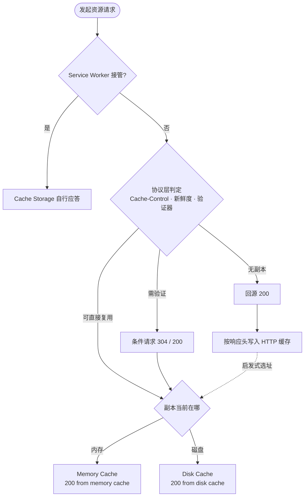

## 概念：Memory Cache 与 Disk Cache

> Memory Cache 与 Disk Cache 是浏览器 HTTP 缓存的两种物理存放位置：前者是当前渲染进程内存里的短期副本，后者是持久化到磁盘、可跨会话复用的副本。DevTools 的 Size 列把它们标成 `200 (from memory cache)` 与 `200 (from disk cache)`。

问题起点：同一份响应在不同时刻会命中不同位置，而常见的解释是「先查内存、再查磁盘、再走网络」这条严格优先级链。这个模型能描述现象，却解释不了为什么刷新一次之后同一资源就从内存变成了磁盘，也解释不了为什么两层受的是同一套响应头约束。

两者都不是 RFC 概念，而是浏览器实现细节。协议层只规定「能不能存、能不能复用」，不规定副本放哪。这是理解它们的第一道分界。

### 核心命题

- [[缓存分层分的是失效判定权，不是存储介质]]
- [[强缓存省掉整个请求，协商缓存省掉响应体]]

第一条定的是两者的共同点：失效都由响应头说了算，属于同一层，差别只在生命周期与容量。第二条把收益归位：省掉整个请求还是只省掉响应体，由协议判定决定，与副本放在内存还是磁盘无关。两条合起来划掉一个常见误读——把介质当成缓存策略的一档。

### 运行机制

判定与存放是两件事，浏览器先走完协议层的判定，再由启发式选一个存储后端：

| 维度 | Memory Cache | Disk Cache |
|:---|:---|:---|
| 存放位置 | 渲染进程内存 | 磁盘上的缓存目录 |
| 生命周期 | 随当前文档／Tab，导航或关闭后通常不再复用 | 跨导航、跨会话，直到过期或被淘汰 |
| 容量与淘汰 | 受进程内存预算约束，容量小 | 受磁盘配额与 LRU 约束，容量大 |
| 常见内容 | 页面内重复引用或小体积资源（CSS、JS、小图） | 需要长期复用的资源，尤其是大体积文件 |
| 读取成本 | 最低，纯内存读取 | 磁盘 I/O + 反序列化，冷启动时未必比近端 CDN 快 |
| 受谁约束 | 同一套 `Cache-Control` / 验证器 | 同一套 `Cache-Control` / 验证器 |

选址不是二选一的开关：同一份响应可以在进程内留一份、也在磁盘写一份；`no-store` 则两层都不写。大体积资源通常不进内存，以免挤占渲染进程；这类规则由浏览器版本决定，不是规范承诺，旧资料里「四级缓存链」的措辞尤其容易把它读成固定顺序。

### 关键区别

真正要分清的不是内存与磁盘那张表，而是三组常被混为一谈的边界：

| 容易混的对象 | 实际区别 |
|:---|:---|
| [[Cache-Control]] 与两种介质 | 前者是协议层的策略判定，后者是实现层的存放位置；改策略不会改变副本放在哪 |
| [[Cache API]] 与两种介质 | 前者由代码决定存什么、何时失效，`no-store` 拦不住它；后者只读响应头 |
| Push Cache 与两种介质 | HTTP/2 Server Push 已从 Chrome 移除，这一级在现代浏览器里已不存在 |

由此可以解释三个常见观察：页面内第二次引用同一 URL 更可能命中内存，刷新后同一 URL 更可能变成磁盘，而 `Ctrl + F5` 之后两者都不再复用——变的从来不是策略，是进程内的那份副本还在不在。

### 适用范围

- ✅ 适用场景
	- 读 DevTools 的 Size 列时判断副本来自哪一层，避免把 `from memory cache` 当成「没走缓存判定」。
	- 解释刷新行为差异：`F5` 让内存副本不再复用，`Ctrl + F5` 连条件请求一起跳过。
	- 评估 `preload` 与资源复用收益：收益的前提是副本仍在进程内。
- ⛔ 误用
	- 用「刷新前后标注从内存变磁盘」推断服务端缓存策略被改动。
	- 为大体积资源假设内存命中，据此估算首屏耗时。
	- 把 `200 (from disk cache)` 当成零成本；磁盘 I/O 与反序列化照样要付。
- **失效边界**
	- Tab 关闭、进程回收、页面导航会清掉内存副本，磁盘副本不受影响。
	- 磁盘副本受配额、LRU、隐私模式与用户主动清理约束，随时可能消失。
	- Service Worker 在上游接管时，走 Cache Storage 还是走网络由它决定，这两层可能根本不被问到。
	- 不同浏览器的选址启发式不同，标注文字只反映当前实现，不构成跨浏览器结论。

### 批判

- **外部批判**
	- 命名来自 DevTools 的展示标注，RFC 9111 里没有这两个词条，也没有「先内存后磁盘」的查找顺序。把某一版 Chrome 的行为写成通用分层模型，是以偏概全。
	- 旧教程常列的四级链（Service Worker → Memory → Disk → Push Cache → 网络）已过时：HTTP/2 Server Push 在 Chrome 106 被移除，Push Cache 这一级随之退出，仍按它排查会得出不存在的结论。
- **内在张力**
	- 快与持久不可兼得：内存副本读取最快却随导航消失，磁盘副本能跨会话却每次都要付 I/O。
	- 命中不等于零成本。省掉的是网络往返与传输，本地读取、反序列化与 `Vary` 比对仍在关键路径上。
	- 可见性与控制力不对称：开发者能看到标注，却没有标准接口指定副本该放哪一层，性能优化因此只能间接影响。

### 知识图谱

- **上位**：[[浏览器缓存与客户端存储体系]] — 它属于这个体系里的 HTTP 缓存层
- **并列**：
	- [[Cache API]] — 同为客户端持有响应副本的位置，但失效由代码判定
- **相关**：
	- [[HTTP缓存机制]] — 存储期与复用期的完整判定，本概念只对应「副本放哪」
	- [[HTTP强缓存]] — 命中后标注为 `from memory/disk cache` 的那一步
	- [[HTTP协商缓存]] — 304 之后复用本地副本，位置同样由浏览器决定
	- [[Cache-Control]] / [[ETag]] / [[Last-Modified]] — 两层共同受其约束的协议层标头
	- [[Service Worker]] — 上游拦截者，决定 HTTP 缓存是否被问到
	- [[新鲜度]] — 判定副本能否复用的那一层，与介质无关
- **外部资料**
	- [web.dev: Prevent unnecessary network requests with the HTTP Cache](https://web.dev/articles/http-cache) — 协议层判定的实践说明
	- [MDN: HTTP caching](https://developer.mozilla.org/en-US/docs/Web/HTTP/Caching) — 缓存复用与验证的规范视角
	- [Chrome DevTools: Network 面板参考](https://developer.chrome.com/docs/devtools/network/reference) — Size 列标注的含义
