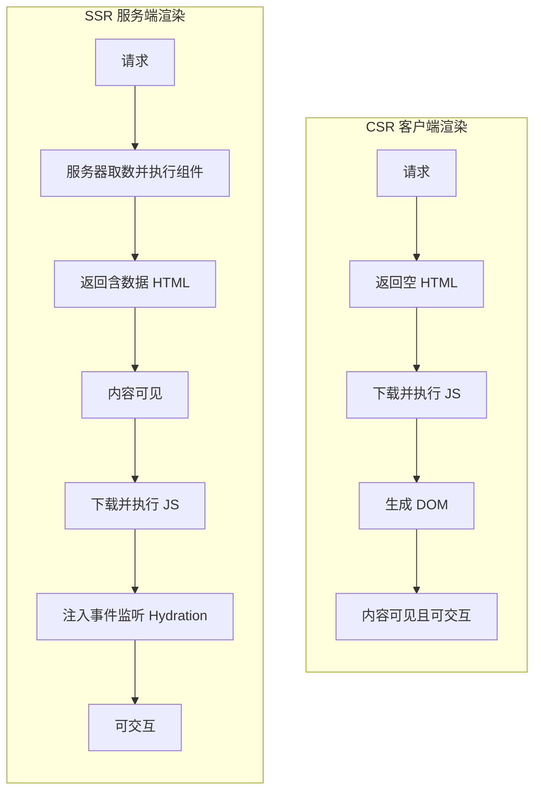

## 概念：SSR

> SSR（Server-Side Rendering，服务端渲染）是在服务器上执行页面组件、生成含实际数据的完整 HTML 后返回给客户端的渲染模式。

解决的核心痛点：CSR 下浏览器要等 JavaScript 下载并执行才能看到内容，首屏出现得晚；搜索引擎与社交爬虫拿到的初始 HTML 是空壳，正文与 Open Graph 元数据都不在里面。

**SSR 交换的不是渲染速度，而是内容出现的时间点**：把生成 HTML 的计算挪进请求链路，用服务器每次请求的计算换掉客户端在内容可见之前的那一段等待。代价与边界都从这句话里长出来——服务器开始按请求计费，而「能看」到「能用」之间仍隔着一道 Hydration。下面三条命题挂在这句话上。

### 核心命题

- [[SSR 的本质是计算前置而非渲染加速]]
- [[SSR 的代价是服务器负载而非免费午餐]]
- [[SSR 解决首屏但注水仍需 JS 执行]]

三条的顺序不是随意的：第一条定它做了什么（改的是计算发生的位置，不是渲染的快慢），第二条定它换来了什么又付出什么（服务器按请求承担成本），第三条定能力的尽头（首屏是内容指标，交互就绪是另一条时间线）。倒过来读会得出「上了 SSR 整页就变快」这个错误结论——第三条正是它的反例。

### 运行机制

两条链路的分叉在第二步：组件在哪里执行。因此 SSR 的首屏内容可见时间（FCP）通常更早，但首字节时间（TTFB）通常更高——服务器要先取数、先渲染才发得出响应。两条链路的可交互时间都落在 JS 执行之后，SSR 还多一道在已有 DOM 上绑定事件的 Hydration。渲染按请求发生，也意味着同一份组件与取数逻辑要能在服务器与浏览器两侧都跑通。

### 关键区别

| 维度 | SSR | [[CSR]] | [[SSG]] |
|:---|:---|:---|:---|
| HTML 何时生成 | 每次请求，在服务器 | 浏览器执行 JS 后 | 构建时，一次生成 |
| 首屏内容可见 | 早（受 TTFB 约束） | 晚（等 JS 下载执行） | 最早（静态文件可直接走 CDN） |
| 可交互时间 | 需 Hydration | JS 执行完即就绪 | 若带交互，同样需 Hydration |
| 服务器成本 | 每请求都要算一次 | 近零（纯静态托管） | 近零（无每请求渲染） |
| 内容时效性 | 每次请求都是新的 | 每次请求都是新的 | 绑定构建时刻，更新靠重建或客户端取数 |
| 爬虫拿到什么 | 含正文的完整 HTML | 空壳，需执行 JS 才能取到内容 | 含正文的完整 HTML |

这张表只为划界：三个方案的区别都在「HTML 在哪一步生成」，而不是谁更快。把 SEO 写成「CSR 不友好」并不准确——主流爬虫已能执行 JS，只是有渲染队列与预算限制，抓取滞后且不稳定。

### 适用范围

- ✅ **适用场景**
	- 内容型且依赖搜索或分享流量的页面：新闻、博客、商品详情、营销落地页——首屏 HTML 里就得有正文与 Open Graph 元数据。
	- 低端设备或弱网为主的用户群：把组件执行挪出客户端，减少一段必须完成的 JS 工作。
	- 每次请求内容都不同、又不能接受重新构建的延迟：这是 SSR 相对 SSG 最直接的优势。
- ⛔ **误用**
	- 登录后的强交互应用：后台管理、实时仪表盘拿不到 SEO 收益，却要照付 Hydration 与服务器成本。
	- 纯静态内容：文档站、活动页用 SSG 更省，不必为每次请求付一次渲染。
	- 期望「上了 SSR 整页就快」：它优化的是内容可见，不是交互就绪，两者是不同指标。
- **失效边界**
	- 管不到 TTFB：取数慢、服务器离用户远，首屏照样慢，甚至比 CSR 更慢。
	- 管不到 Hydration 之前的交互：HTML 里的按钮在这之前点了没有反应。
	- 有状态服务更难水平扩展：会话、按请求隔离、缓存失效都要自己兜住。

### 批判

- 成本随流量线性增长。CSR 把渲染成本摊给每个用户的设备，SSR 把它集中到自己的服务器；流量涨就是账单涨，页面级缓存、边缘渲染与流式 SSR 都是在补这个洞。
- 双端同构是约束，不是便利。组件要能在 Node 与浏览器两侧运行，`window`、浏览器 API、依赖时序的初始化都得额外处理，Hydration 不匹配正出在这里。
- 「非它不可」的范围在收窄。SSG 与增量静态再生成（ISR）覆盖内容型页面，流式 SSR 拆掉整页等待，React Server Components 让部分组件不必注水，主流爬虫也能执行 JS。以 SEO 为唯一理由上 SSR，比十年前弱得多。

### 问题与流程

- **相关问题**
	- [[为什么使用SSR（服务端渲染）？]] — 尚未收敛：什么场景值得为每次请求付一次渲染成本。
	- [[Q-Hydration 为什么会增加交互延迟]] — 待写：内容可见与可交互之间的那段间隔从哪来。
	- [[Q-SSR 和 SSG 应该怎么选择]] — 待写：渲染放在构建时还是请求时的分界怎么划。

### 知识图谱

- **上位**：[[前端开发]] — 它是前端交付链路上的一类渲染策略，不是某个框架的能力。
- **下位**：
	- [[Hydration]] — 客户端 JS 接管 SSR 输出的过程，本概念「能看但还不能用」的那一半由它解释。
- **并列**：
	- [[CSR]] — 把组件执行留在浏览器的另一种解法。
	- [[SSG]] — 把渲染挪到构建时的另一种解法。
- **相关**：
	- [[NextJS]] — 把 SSR、SSG 与流式渲染混在一套路由里的代表框架。
	- [[前端性能优化]] — 首屏内容可见只是它的一条手段，不是它的全部。
	- [[为什么使用SSR（服务端渲染）？]] — 同主题的开放问题，尚未收敛。
- **外部资料**
	- [Next.js: Rendering](https://nextjs.org/docs/app/building-your-application/rendering) — 服务器与客户端渲染的官方分工
	- [Web.dev: Rendering on the Web](https://web.dev/articles/rendering-on-the-web) — 各渲染模式在性能指标上的对照
