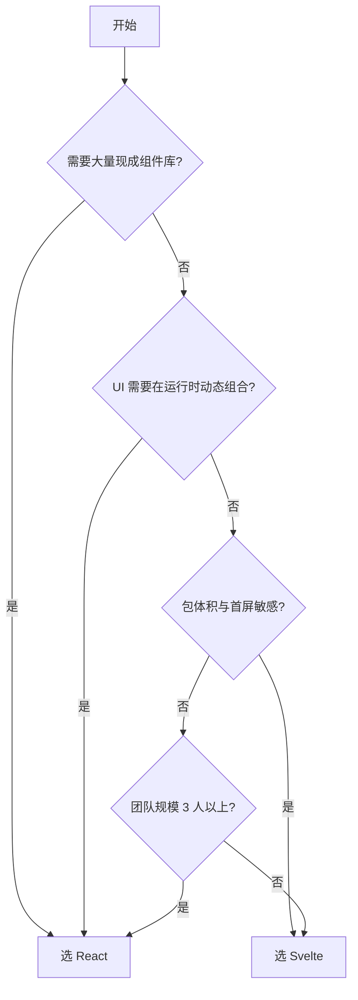

## Svelte vs React

### 一句话对比

Svelte 在构建期就把组件编译成节点级的 DOM 更新代码，运行时不存在可供比对的中间树；React 在运行时用虚拟 DOM 与 Fiber 调和，靠 diff 找出该改什么。**5.0 之后 Svelte 把依赖收集也交给了运行时信号图，但「不 diff」这一条没变**——所以两者的分界不在「编译 vs 运行时」，而在**要不要维护一棵描述 UI 的中间树**。

---

### 核心对比

| 维度 | **Svelte** | **React** |
|:---|:---|:---|
| **一句话定义** | 编译期生成节点级 DOM 更新的框架，5.0 起反应式由信号图驱动 | 基于虚拟 DOM 的运行时 UI 库 |
| **核心本质** | 编译器把「哪个节点依附哪个表达式」写死成代码 | 组件函数重跑 → 新元素树 → Fiber diff → 提交真实 DOM |
| **更新的默认粒度** | 细到节点：只有订阅了该值的那个节点被写入 | 细到组件：函数整体重跑，除非 Compiler / memo 收窄 |
| **适用场景** | 包体积与首屏敏感、交互密度中等、团队小 | 大型团队、复杂应用、重生态依赖 |

> 旧版这三格写过「无运行时库 / ~40KB / ~30KB」。数字已删：它们随版本、压缩方式与 tree-shaking 变化，且「无运行时」从来不成立——Svelte 的产物里一直带一份内部辅助代码，5 加信号后只会更多。

### 差异点

- **架构哲学**：
	- Svelte：把「结构 → DOM 的映射」前移到编译期，产物里没有描述树的中间层。代价是模板必须静态可分析。
	- React：保留这一层，换取「渲染是普通函数」——任意运行时组合、渲染函数、高阶组件都自然成立。代价是每次更新都要重新描述一次 UI。
- **响应式机制**（这三行必须分开看，混起来会得出错误结论）：

	| | 状态声明 | 依赖从哪来 | 赋值之后发生什么 |
	|:--|:--|:--|:--|
	| Svelte 4（legacy） | 顶层 `let` 隐式响应，`$:` 声明派生 | 编译器静态分析 | 改写成内部失效调用，触发该组件的更新函数 |
	| Svelte 5（runes） | `$state` / `$derived` / `$effect` | 运行时读值收集（信号图） | 标脏入队，微任务 flush 后只跑订阅了它的更新 |
	| React | `useState` / `useReducer` | 手动声明依赖（`useEffect` 数组）或全自动重跑 | 组件函数重跑，产出新元素树，交给调和算法 diff |

	差别最大的一行是「粒度」：Svelte 的默认更新单元是一个文本节点或属性，React 的默认更新单元是整个组件。React 要靠 `memo`、`useMemo` 或 React Compiler 才能把粒度收窄，Svelte 要靠「把状态提到更高层」才能把粒度放粗。
- **DOM 更新方式**：
	- Svelte：更新函数直接持有节点引用，写 `textContent` 或属性；不存在「找出差异」这一步。
	- React：生成 VNode 树，Fiber 双缓存比对，批量提交真实 DOM 变更。
- **组件模型**：
	- Svelte：单文件组件，模板 / 脚本 / 样式天然隔离且样式默认作用域化。props 用 `$props()` 解构声明（4 是 `export let`）；子内容用 snippet + `{@render children()}`（4 是 `<slot />`）。
	- React：函数组件 + JSX，props 就是函数参数，`children` 是普通 prop；样式需额外方案（CSS Modules / CSS-in-JS / Tailwind）。
- **状态管理**：
	- Svelte：本地状态用 runes；跨组件或跨模块时把 `$state` 放进 `.svelte.js` / `.svelte.ts`。`writable` 这类 store 在 5 里仍然存在，需要「订阅语义」或与老代码共存时照旧可用。
	- React：`useState` / `useReducer` + Context，跨组件靠 Redux / Zustand / Jotai 等社区方案。
- **生命周期**：
	- Svelte：`onMount` / `onDestroy` 仍是主入口；`beforeUpdate` / `afterUpdate` 在 5 里让位给 `$effect.pre` / `$effect`。
	- React：`useEffect` / `useLayoutEffect`，由依赖数组决定何时执行。
- **TypeScript 支持**：
	- Svelte：`$props()` 是普通解构，类型可直接标注，5 相比 4 是明显改善；但工具链边缘情况（泛型组件、复杂类型推断）磨得不如 React 透。
	- React：类型生态与社区实践最成熟，这仍是 React 的现实优势之一。
- **生态与社区**：
	- Svelte：生态小但精炼，SvelteKit 提供路由 / SSR / 适配器；组件库（图表、富文本、复杂表格）是最明显的缺口。
	- React：最大前端生态，Next.js / Remix 等框架与第三方库覆盖几乎所有场景。

---

### 相似之处

- 都是组件化、数据驱动视图的 UI 方案
- 都把「编译期能算完的事不要留到运行时」当作优化方向——只是 React 用来减少重渲染次数，Svelte 用来取消 diff
- 都有配套的全栈框架（SvelteKit / Next.js），都支持 SPA、SSR、SSG
- 都在向细粒度更新靠拢：React Compiler 自动记忆化，Svelte 5 引入信号图

---

### 场景选择

- **选 Svelte 当**：
	- 包体积与首屏敏感（移动端 H5、营销页、文档站、嵌入式 widget）
	- 项目小而精、团队规模小、第三方组件需求低
	- 偏好「一个文件装完」与更少的样板代码
	- 用 SvelteKit 做 SSR / SSG，且能接受服务端不参与响应式的语义
- **选 React 当**：
	- 大型团队协作，需要成熟的工程约定与现成解决方案
	- 重度依赖第三方组件（图表、拖拽、富文本、复杂表格）
	- 需要大量运行时动态组合 UI（渲染函数、HOC、运行时拼装）
	- 招聘与知识传承是硬约束——人才池与生态同源

---

### 决策树



> 这棵树的前两问是能力边界（做不到就是做不到），后两问才是权衡。把「团队规模」放前面是常见的倒置——小团队也未必该选 Svelte，大团队也未必不能用。

---

### 示例

**Svelte 5（runes）**：

```svelte
<script>
  let count = $state(0);
  const doubled = $derived(count * 2);
</script>

<button onclick={() => count++}>
  点击了 {count} 次，两倍是 {doubled}
</button>

<style>
  button { color: red; }
</style>
```

**React**：

```jsx
import { useState } from 'react';
import './Button.css';

export default function Button() {
  const [count, setCount] = useState(0);
  const doubled = count * 2;
  return <button onClick={() => setCount(c => c + 1)}>
    点击了 {count} 次，两倍是 {doubled}
  </button>;
}
```

两段代码的差别不在行数，在**变化发生时谁来做判断**：Svelte 编译后每个 `{}` 是一个独立的更新点，`count` 变了只影响两个文本节点；React 里 `doubled` 只是重跑时顺手算的一个局部变量，它和 `count` 的绑定关系由「整个函数重跑」保证。

---

### 知识图谱

> 固定五个桶，判据见 [[知识图谱词表]]。被比较的两个对象不进桶（已在标题与首段），这里只连机制与其他对比。

- **上位**：[[前端框架]] — 框架对比属于它的下一层
- **并列**：
	- [[Angular vs React]] — 全面框架 vs UI 库的对比
	- [[Vue vs React]] — 渐进式框架 vs UI 库，同一族的另一组
- **相关**：
	- [[Virtual DOM]] — React 一侧的中间结构，也是本文分界之所指
	- [[Fiber]] — React 的调和架构
	- [[Runes]]（待写） — Svelte 5 的响应式原语，对比表第二行的依据
	- [[Svelte 无需虚拟 DOM，编译时直接生成 DOM 操作代码]] — Svelte 一侧的机制依据
	- [[Vue编译器优化]] — 同样在编译期下手，但目标是缩小 diff 而非取消 diff
	- [[Vapor Mode]] — Vue 侧的同类尝试，三方对照时更清楚
- **外部资料**
	- [React 官方文档](https://react.dev/)
	- [Svelte 官方文档](https://svelte.dev/docs/svelte/overview)
	- [Introducing runes](https://svelte.dev/blog/runes) — Svelte 5 放弃编译期依赖分析的官方说明
