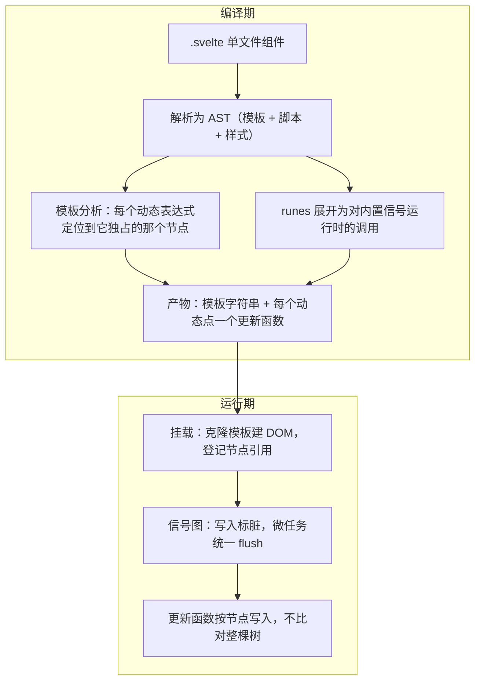

## 概念：Svelte

> **Svelte** 把「组件 → DOM 更新代码」这一步放在构建期完成：编译器读懂模板结构，直接生成按节点定位的更新函数，运行时不存在一棵可供 diff 的中间树。5.0 之前，它的响应式也由编译器静态决定（`$:`）；5.0 起改由 [[Runes]] 展开成的运行时信号图驱动——**但「无虚拟 DOM」这一条没有变。**

**解决的核心痛点**：React、Vue（普通模式）每次更新都要先生成一棵描述目标状态的中间树，再与旧树比对。这份中间结构在组件多、更新密时成为主要开销。Svelte 的选择是让编译器在构建期就把「哪个节点要改」写成代码，把比对这一步整个删掉。

---

### 版本断代：一句话被用错了两代

「Svelte 是编译时框架」这句在 5 之后仍然对，但含义窄了一半。要看清窄掉的是哪一半，得把两件事分开：

| | 编译期决定 | 运行期决定 |
|:--|:--|:--|
| **哪个 DOM 节点依附于哪个表达式** | ✅ 一直如此 | — |
| **哪个表达式依赖于哪个值**（依赖关系） | ✅ 仅 4 及以前 | ✅ 5 起改为信号图收集 |

于是「编译时响应式」这个说法有了明确的有效期：

| | Svelte ≤ 4 | Svelte 5 |
|:--|:--|:--|
| 响应式入口 | 组件顶层 `let` 隐式响应，`$:` 声明派生 | `$state` / `$derived` / `$effect` |
| 依赖从哪来 | **编译期静态分析**：看 `$:` 里出现了哪些变量 | **运行时读值收集**：读到谁就订阅谁 |
| 赋值怎么变成更新 | 改写为内部的 `$$invalidate(…)` 调用 | 展开为对内置信号运行时的函数调用 |
| 重构的影响 | 依赖被移进辅助函数后静态分析看不见，**静默不更新** | 依赖在运行时收集，移动代码不会失效 |
| 模板 → 节点 | 编译期确定 | 编译期确定（未变） |
| 中间结构 | 无虚拟 DOM | 无虚拟 DOM（未变） |

一句判据：**Svelte 的编译期优化管的是「更新哪一块 DOM」，不管「谁依赖谁」。** 4 及以前两件事都在编译期，所以「编译时响应式」成立；5 把后者交回运行时，前者留在编译期。

官方换掉它的理由正是静态分析的边界：把 `width * height` 提成一个函数后，编译器只看得到实参 `width`，`height` 变了就不重算；此外 `$:` 的执行顺序要靠静态分析排，且语言层面不好做类型推断。代价是信号图需要运行时支撑，所以下文「运行时体积」那一格不能再写 0。

> 兼容性上还有个坑：Svelte 5 仍支持 4 的语法，两种模式可以在同一项目里混用。所以「这个组件怎么响应式」取决于它用的是哪套写法，不存在统一答案——读旧代码前先看有没有 `$state`。

### 核心命题

- [[Svelte 无虚拟 DOM 的前提是更新点可静态识别]]
	- **原理**：模板结构在构建期已知，编译器把每个动态表达式绑定到它拥有的那个节点，生成的更新函数直接写 `textContent` 或属性，不生成 VNode、不比较
	- **边界**：只在更新点可静态定位时成立。动态组件、运行时拼装的模板、跨组件透传的插槽仍需运行时调度，那时与带运行时的框架差距收窄
- [[Svelte的编译期优化决定更新哪块DOM而不决定谁依赖谁]]
	- 待写：4 与 5 的分水岭就在这句；「编译时」三个字覆盖不了依赖关系去了哪
- [[Svelte5用运行时信号图换掉了编译期的依赖静态分析]]
	- 待写：换来的是重构免疫与跨模块响应式，付出的是运行时不再可忽略、以及「必须写在 `.svelte` / `.svelte.js` 里」这条约束

### 运行机制

编译与运行的分工如下。注意上下两半的边界：**编译期只负责「结构」，运行期才负责「变化」**。

四个环节各有一句要点：

1. **结构在编译期固定**：模板是 HTML 语法而非表达式，编译器能完整掌握父子关系，因此「某个文本节点只受某个表达式影响」可以静态推出。这是 Svelte 能做到节点级更新的前提，也是 JSX 换不来的东西——JSX 是函数调用，结构要到运行时才知道。
2. **runes 是编译器原语，不是运行时函数**：`$state` 只有在经过编译后才有意义，编译器把它替换成对信号运行时的调用。由此得到一个别家没有的余地：**SSR 时可以把信号整段删掉**——服务端只渲染一次，不需要订阅。Solid 的 `createSignal` 是普通函数，删不掉。
3. **写入不立即重算**：一次赋值只标脏并入队，同一 tick 内的多次写入共用一次 flush；flush 先跑模板更新，再跑用户 `$effect`。
4. **更新不经过中间树**：更新函数直接持有节点引用，写入即生效。省掉的是「构树 + 比对」，不是全部更新成本。

### 关键区别：四种「编译期」不是一回事

「编译时优于运行时」是个太粗的二分。把主流的四条路线摆在一起，区别才看得出来：

| | 编译期做什么 | 运行时还剩什么 | 有虚拟 DOM |
|:--|:--|:--|:--|
| **React** | JSX 转换；React Compiler 做自动记忆化，**减少重渲染次数** | 调和（Fiber）+ diff | ✅ |
| **Vue（普通模式）** | 静态提升、Block + patchFlag，**缩小 diff 范围** | 响应式代理 + diff | ✅ |
| **Vue Vapor / Solid** | 模板或 JSX 直接产出节点级操作 | 信号图 | ❌ |
| **Svelte 5** | 模板 → 节点级更新函数；runes → 信号调用 | 信号图（SSR 时被编译掉） | ❌ |

读法有三层：

- **四条路线拉的是三个不同的杠杆**：React Compiler 调的是「什么时候重渲染」，Vue 调的是「diff 时要看多少节点」，Svelte 与 Vapor 调的是「要不要 diff」。只有最后一种取消了这一步，前两种都是在同一步上省成本。把它们统称「编译优化」会把量级差别抹平。
- **Vue 的编译期优化服务的是 diff**——它让 diff 少看一些节点，但没有取消 diff。Svelte 取消的是 diff 本身。
- **Svelte 与 Vapor、Solid 的差别在契约形式**：Solid 的信号是普通函数，任何 JS 里都能用；Vapor 是 Vue 的一个可选编译模式，与虚拟 DOM 模式并存。Svelte 的 runes 是**编译器语法**，脱离编译就不成立——这换来了 SSR 可删除、语法更短，也换来了「只能在 `.svelte` / `.svelte.js` / `.svelte.ts` 里写」这条硬边界。

顺带说明一件事：旧版这格列过「~40KB / ~30KB / ~0KB」三个数字。它们既没标版本也没标压缩方式，且 `~0KB` 从来不成立——Svelte 一直在产物里带一份内部辅助代码，5 引入信号后只多不少。这类数字一年就过期，所以这里删掉，改为定性比较。

### 适用范围

- ✅ **适用场景**
	- **首屏与包体积敏感、交互密度中等的站点**：营销页、文档站、内容型站点、移动端 H5。
	- **嵌入式 widget**：产物小、无全局运行时污染，嵌进第三方页面时冲突面小。
	- **SvelteKit 的 SSR / SSG**：信号在服务端被编译掉，服务端没有响应式开销，只有一次渲染。
	- **小团队、偏好「一个文件装完」**：模板、脚本、样式天然隔离，样板代码少。
- ⛔ **误用**
	- **重度依赖现成组件库**：图表、富文本、复杂表格的成熟实现仍集中在 React 生态，这是 Svelte 当前最大的短板，且不是技术问题。
	- **运行时动态组合 UI**：渲染函数、高阶组件、运行时拼装模板——模板的静态性在这是限制而不是优势。
	- **以「招人即可上手」为组织目标的团队**：人才池与生态同源，规模小。
- **失效边界**
	- **「无虚拟 DOM 所以更快」只在更新点可静态定位时成立**。整块替换、大列表全量更新时，两种路线的差距会缩到噪声级。
	- **基准跑分不等于页面表现**。合成基准（如 js-framework-benchmark）测的是纯计算与 DOM 操作，真实页面的时间大头在网络、图片、字体与 hydration；框架层省下的那几毫秒，常被一张未优化的首图盖过。
	- **4 项目的静态依赖分析会静默失效**。依赖被移进函数、或在静态分析视野外闭包捕获，都不会报错，只是不更新——这是升级 5 的真实动机之一，也是 4 项目里最难查的一类 bug。
	- **两种模式共存使「Svelte 的行为」不确定**。同项目里 4 语法组件与 runes 组件的调度时机不同，混用时排查要逐组件确认语法。

### 批判

- **外部批判**
	- **把复杂度搬到了工具链**。编译器要理解你的代码，于是调试时要看编译产物，报错指向生成代码而非源文件；source map 能缓解，但「我写的东西和我跑的东西不是一回事」这个缝隙一直在。
	- **体积优势是相对的，且随 5 缩小**。信号图不是免费的运行时代码；在几乎无交互的纯静态页面上，Svelte 与 Vue、甚至与预渲染的 React 差距可以忽略。优势只在「组件多、交互多、代码量大」时才累积。
	- **生态是自增强的**。组件库少 → 采用少 → 组件库更少。这条循环不靠技术优势打破，只能靠时间与杀手级应用。
- **内在张力**
	- **语法糖与可推理性的张力，Svelte 前后各选了一面**。`$:` 写起来像魔法，代价是依赖靠静态推断、重构即失效；runes 显式了、可推理了，代价是每处状态都要标注，样板回来了。没有第三种解，只有取舍方向不同。
	- **「编译器替你优化」与「你必须知道编译器做了什么」互为条件**。越是把优化推给编译期，越要求开发者理解编译规则；写出编译器无法静态化的代码不会报错，只会性能静默回退。
	- **SSR 与客户端是两套语义**。runes 在服务端被删掉，意味着依赖响应式的逻辑不能放在首屏路径上。同一个组件因此有两种心智模型，而文档很少把这条界线画清楚。

### FAQ

- [[编译时框架为什么在动态组件和运行时拼装模板上失去优势？]] — 静态定位的前提被打破后，退化成了什么
- [[Svelte5从静态依赖分析换成信号图换来了什么又付出了什么？]] — 可重构性 vs 运行时体积与书写位置限制
- [[为什么runes能在SSR时被整个删掉而Solid的createSignal不能？]] — 编译器原语与运行时函数的分界
- [[无虚拟DOM的性能优势在真实页面里通常被什么掩盖？]] — 基准与真实负载的差距

### 知识图谱

> 固定五个桶，判据见 [[知识图谱词表]]。

- **上位**：[[前端框架]] — UI 框架专题的一支
- **下位**：
	- [[Svelte 无虚拟 DOM 的前提是更新点可静态识别]] — 本概念的结构性依据，已立成原子笔记
	- [[位掩码记脏只适用于编译期固定的变量，Svelte 5 已换模型]] — 4 及以前的标脏方式，5 起换成每节点状态位
	- [[Runes]]（待写） — 5.0 的响应式原语，`$state` / `$derived` / `$effect` 与 `$props`
	- [[SvelteKit]]（待写） — 建立在 Svelte 之上的应用框架（路由、SSR、适配器）
- **并列**：
	- [[Vue]] — 渐进式框架，编译期优化服务于 diff
	- [[React]] — 运行时框架，虚拟 DOM + Fiber 调和
	- [[Angular]] — 完整解决方案，依赖注入与强约定
- **相关**：
	- [[Virtual DOM]] — 被取消掉的那层中间结构
	- [[Vue编译器优化]] — 同样在编译期下手，但目标是缩小 diff 而非取消 diff
	- [[Vapor Mode]] — Vue 侧的同类尝试，可与 Svelte 的路线直接对照
	- [[Svelte vs React]] — 选型视角的对比，本篇只谈机制
	- [[新兴前端框架 Svelte 从入门到原理]] — 库内旧文，写作于 3.x 时代，读时注意版本断代
- **外部资料**
	- [Svelte 官方文档](https://svelte.dev/docs/svelte/overview)
	- [Introducing runes](https://svelte.dev/blog/runes) — 官方解释为何放弃编译期依赖分析，本篇版本断代的依据
	- [Svelte 5 migration guide](https://svelte.dev/docs/svelte/v5-migration-guide) — 4 → 5 的逐项变化与两套语法共存说明
