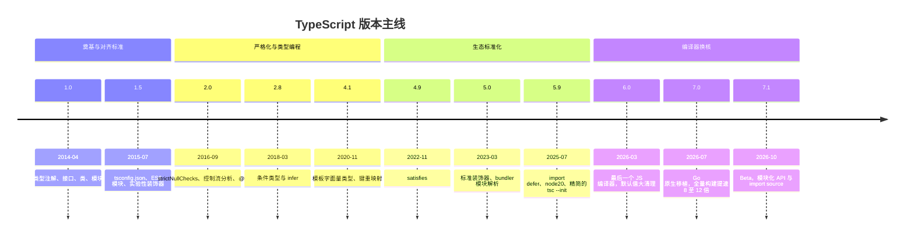

## TypeScript 版本演进

> TypeScript 的十二年可以读成三段：先把静态类型加进 JavaScript，再把类型系统做成可计算的表达层并逐年对齐 ECMAScript，最后发现瓶颈不在语言而在编译器本身，于是用 Go 重写了整套工具链。2026 年的 6.0 与 7.0 是这条线上第一次「为实现让路」的换版。

时间跨度：1.0（2014-04）→ 5.9（2025-07）→ 6.0（2026-03）→ 7.0（2026-07），7.1 Beta（2026-10）
演进动力：大型 JavaScript 工程缺少可静态验证的契约 → 类型表达力与标准同步的需求 → 百万行级仓库与 AI 辅助开发下工具链吞吐成为新瓶颈

---

### 演进概览

### 阶段详情

#### 奠基期：1.0–1.4（2014）

- 时间：2012-10 首次公开，1.0 于 2014-04 发布
- 核心变化：类型注解、接口、类、模块、枚举、泛型；`tsc` 编译到 ES3/ES5；与 Visual Studio 集成
- 解决的关键问题：大型 JavaScript 应用没有可静态检查的结构契约，重构与编辑器补全只能依赖命名约定
- 涉及：[[TypeScript]] · [[基础类型和接口（TypeScript）]] · [[类型擦除]]

#### 对齐 ECMAScript 期：1.5–1.9（2015–2016）

- 时间：1.5（2015-07）起
- 核心变化：`tsconfig.json` 首次出现、对齐 ES6 的模块与类、解构与 `for…of`、`.tsx` 与 JSX、实验性装饰器（与 Angular 2 协作）
- 解决的关键问题：TS 自有模块语法与 ES6 分叉；编译选项只能靠命令行传参，没有工程级配置载体
- 涉及：[[tsconfig.json]] · [[ECMAScript]] · [[TypeScript装饰器解析]]

#### 严格化与类型编程期：2.0–2.9（2016–2018）

- 时间：2.0（2016-09）→ 2.8（2018-03）
- 核心变化：`strictNullChecks`、基于控制流的类型分析、`never`、`--strict` 总开关、声明文件改由 npm 的 `@types` 分发；2.1 引入 `keyof` 与映射类型；2.8 引入条件类型与 `infer`
- 解决的关键问题：空值可赋给任何类型，类型检查形同虚设；类型无法由类型计算出来，声明文件也缺少统一分发渠道
- 涉及：[[类型收窄]] · [[类型守卫（TypeScript）]] · [[泛型（TypeScript）]] · [[反向类型提取]]

#### 表达力与语法补齐期：3.0–4.9（2018–2022）

- 时间：3.0（2018-07）→ 4.9（2022-11）
- 核心变化：项目引用与元组 rest/spread、`unknown`、3.7 可选链与空值合并、4.1 模板字面量类型与递归条件类型、4.7 Node.js ESM 与 `--module nodenext`、4.9 `satisfies`
- 解决的关键问题：类型层从「描述结构」走向「可计算」；ECMAScript 新语法与 Node 模块制式逐年落地，编译器必须同步；既要校验类型又要保留字面量推断
- 涉及：[[高级类型（TypeScript）]] · [[类型推断减少显式标注]] · [[抽象语法树]]

#### 生态标准化期：5.0–5.9（2023–2025）

- 时间：5.0（2023-03）→ 5.9（2025-07）
- 核心变化：5.0 标准装饰器（Stage 3）、`const` 类型参数、`--moduleResolution bundler` 与包体积优化；5.2 `using` 显式资源管理；5.4 回调中保留窄化与 `NoInfer<T>`；5.5 推断类型谓词与正则语法检查；5.8 `--erasableSyntaxOnly`；5.9 `import defer`、稳定的 `--module node20`、精简的 `tsc --init`
- 解决的关键问题：旧的实验性装饰器与 TC39 标准分叉；Node.js 原生类型擦除要求语法「可被擦除」；标准库类型要跟上逐年更新的 ECMAScript
- 涉及：[[TypeScript装饰器解析]] · [[using 声明]] · [[ES2026]] · [[Temporal API]]

#### 换核过渡期：6.0（2026-03-23）

- 时间：2026-03-23
- 核心变化：最后一个基于 JavaScript 代码库的稳定版，定位为 5.9 与 7.0 之间的桥；默认值翻转（`strict: true`、`module: esnext`、`target` 上调到当前 ES 版次、`types: []`、`rootDir` 改为 `tsconfig.json` 所在目录），集中弃用 `target: es5`、`moduleResolution: node` 与 `classic`、`baseUrl`、`outFile`、`module: amd/umd/system`、import assertions；新增 `#/` 子路径导入、`--stableTypeOrdering`、`es2025` target/lib、Temporal 与 `getOrInsert` 类型；`ignoreDeprecations: "6.0"` 是临时逃生阀
- 解决的关键问题：Go 版编译器不再支持一批 2012 年遗留的选项，必须先在 JS 版把默认值与弃用项清干净，让项目在同一套语义下完成迁移
- 涉及：[[tsconfig.json]] · [[Temporal API]] · [[ECMAScript]]

#### 原生编译器期：7.0 至今（2026-07 起）

- 时间：7.0（2026-07-08）；7.1 Beta（2026-10-20）
- 核心变化：Go 重写的编译器与语言服务，共享内存多线程，并行解析、类型检查与 emit，语言服务改走 LSP；官方实测全量构建提速 8 至 12 倍（VS Code 代码库 125.7s → 10.6s，11.9x），编辑器首个错误从 17.5s 降到 1.3s 以内，内存下降 6% 至 26%；`--checkers`（默认 4）、`--builders`、`--singleThreaded` 控制并行度；7.0 不提供编译器 API，改用 `@typescript/typescript6` 兼容包提供 `tsc6` 并行安装；7.1 Beta 补上模块化 API（`typescript/sync`、`/async`、`/fs`、`/ast`）、`import source`、稳定的 `--target es2026`
- 解决的关键问题：单线程 JS 编译器在百万行级仓库与高频 AI 辅助编辑下成为反馈回路瓶颈；换核又不能破坏既有语义，故以 6.0 作桥、以兼容包保留 6.0 的 API
- 涉及：[[抽象语法树]] · [[端到端类型安全]] · [[TypeScript]]

### 版本对照矩阵

> 全库唯一一份 TypeScript 版本对照。各版本的细节写在对应概念与术语笔记里，本表只留「同一组阶段 × 同一组维度」的对照格。

| 阶段 | 版本区间 | 主线 | 类型系统增量 | 工具链 / 生态增量 | 留下的缺口 |
|:---|:---|:---|:---|:---|:---|
| 奠基 | 1.0–1.4（2014） | 给 JS 加静态类型 | 注解、接口、类、泛型 | `tsc`、Visual Studio 集成 | 无工程配置；空值不设防 |
| 对齐 ES | 1.5–1.9（2015–16） | 跟随 ECMAScript | ES6 模块与类、实验性装饰器 | `tsconfig.json`、`.tsx` | 模块解析与声明文件分发 |
| 严格化 | 2.0–2.9（2016–18） | 类型可证明 | `strictNullChecks`、控制流分析、`keyof`、条件类型 | `@types` npm 化 | 大型仓库的检查耗时 |
| 表达力 | 3.0–4.9（2018–22） | 类型层可编程 | `unknown`、模板字面量类型、`satisfies` | 项目引用、Node ESM、`nodenext` | 装饰器与 TC39 标准分叉 |
| 标准化 | 5.0–5.9（2023–25） | 与标准、运行时对齐 | 推断类型谓词、`NoInfer<T>`、`const` 类型参数 | Stage 3 装饰器、`bundler` 解析、`--erasableSyntaxOnly` | 编译器实现本身的性能天花板 |
| 过渡 | 6.0（2026-03） | 为换核清理默认值 | 语义基本不变 | 默认值翻转、集中弃用、`--stableTypeOrdering` | 6.x 与 7.x 双轨兼容 |
| 换核 | 7.0–（2026-07） | 性能取代表达力成为主线 | 语义保持兼容 | Go 原生、LSP、并行度控制、7.1 新 API | 生态工具需适配新 API |

读这张表的要点：前五行的主线是「语言能表达什么」，后两行换成「工具链能多快跑完」。把 6.0 当成一次普通大版本会误判——它的新增特性不多，价值全在默认值与弃用项，目的是让 7.0 不必背 2012 年的配置包袱。

### 关键转折点

> 演进中的重要里程碑或范式转换

| 时间点 | 转折内容 | 影响 |
|:---|:---|:---|
| 1.5（2015-07） | `tsconfig.json` + ES6 语法 + 实验性装饰器 | 从语言实验变成可配置、可协作的工程工具；Angular 2 采用带来第一波生态背书 |
| 2.0（2016-09） | `strictNullChecks` + 控制流类型分析 | 类型检查从「有没有标注」变成「能不能证明」，也是十年后 `strict` 敢设为默认值的前提 |
| 2.8 / 4.1 | 条件类型与 `infer` / 模板字面量类型 | 类型层成为可编程的 DSL，类型级库与类型体操由此出现 |
| 5.0（2023-03） | 标准装饰器 + `moduleResolution: bundler` | 结束实验性装饰器分叉，编译配置正式向现代构建工具靠拢 |
| 6.0（2026-03） | 默认值翻转 + 集中弃用 | 唯一一次以「为下一个实现让路」为目的的破坏性版本 |
| 7.0（2026-07） | Go 原生编译器 GA | 瓶颈从类型表达力转到工具链吞吐，8 至 12 倍提速改变大型仓库与 CI 的反馈回路 |

### 未来展望

- 趋势：7.1 起补回模块化编译器 API，`typescript-eslint` 与各类构建插件将从 6.0 兼容包迁向原生 API；语言层继续逐年跟随 ECMAScript（7.1 已支持 `--target es2026`、`import source`、环境模块声明里的 import attributes）；并行度调优成为大型仓库新的配置维度。
- 待解决：7.0 不带 API，依赖编译器 API 的工具只能走 `@typescript/typescript6` 或等 7.1 稳定，而 7.1 API 的 `Disposable` / `using` 语义本身带来迁移成本；6.0 的 `types: []` 与 `strict: true` 在存量项目里仍会产生大量升级噪音；6 与 7 的声明 emit 顺序可能不同，比对时需 `--stableTypeOrdering`。
- 值得关注：7.1 正式版与 API 稳定化时间；Node.js 原生类型擦除与 `--erasableSyntaxOnly` 的配合；语言服务 LSP 化后各编辑器的适配进度。

### 知识图谱

- **上位**：
	- [[TypeScript]] — 演进线所属的语言
	- [[JavaScript]] — TS 是 JS 的超集，版本节奏受 ECMAScript 牵引
- **并列**：
	- [[Javascript版本演进]] — 同为语言级版本演进线
	- [[Vue版本演进]] · [[React版本演进]] · [[Angular版本演进]] — 前端技术栈的版本演进线
	- [[HTTP版本演进]] — 同为「阶段 × 维度」的对照矩阵
- **相关**：
	- [[tsconfig.json]] — 6.0 默认值翻转的落点
	- [[TypeScript装饰器解析]] — 5.0 标准装饰器的专门落点
	- [[using 声明]] — 5.2 引入、7.1 API 又依赖它管理 Go 侧资源
	- [[类型擦除]] — 换核不改变「类型只在编译期存在」的语言前提
	- [[ES2026]] — 标准库类型逐年跟随 ECMAScript 版次
- **外部资料**：
	- [TypeScript 6.0 Release Notes](https://www.typescriptlang.org/docs/handbook/release-notes/typescript-6-0.html)
	- [Announcing TypeScript 6.0](https://devblogs.microsoft.com/typescript/announcing-typescript-6-0/)
	- [Announcing TypeScript 7.0](https://devblogs.microsoft.com/typescript/announcing-typescript-7-0/)
	- [Announcing TypeScript 7.1 Beta](https://devblogs.microsoft.com/typescript/announcing-typescript-7-1-beta/)
	- [TypeScript Releases (GitHub)](https://github.com/microsoft/TypeScript/releases)
