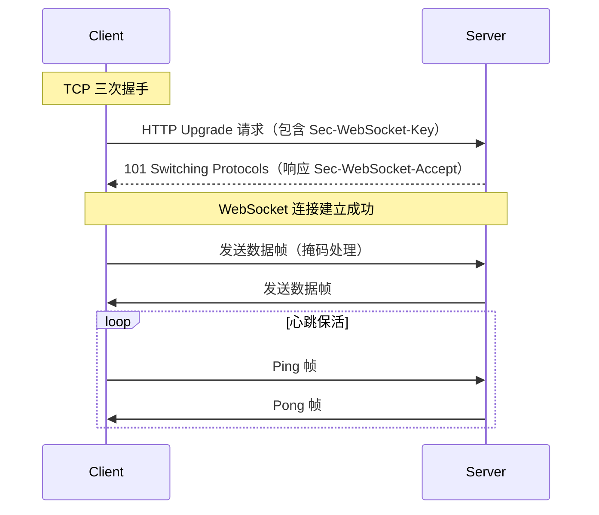

## 概念：WebSocket

> WebSocket 是一种全双工通信协议，允许服务器主动向客户端推送数据

**解决的核心痛点**：HTTP 轮询的实时性低、资源浪费问题；WebSocket 通过一次握手建立持久连接，服务器可随时推送消息

**WebSocket 卖的不是「更快」，而是「连接归谁所有」**：请求-响应模型里，连接属于一次请求，请求结束它就该关；WebSocket 把连接从请求里拆出来，双向与主动推送才谈得上。下面三条命题都挂在这句话上。

### 核心命题

- [[全双工只保证通道双向，不保证推得到人]]
- [[WebSocket 省的是重复握手，保活仍得自己做]]
- [[WebSocket帧头相比HTTP头部大幅减少重复开销]]

三条的顺序不是随意的：第一条说通道的形状（双向），第二条说连接的寿命（会静默断），第三条说连接的单价（帧头小）。先有形状，才谈得上寿命与单价；倒过来读会得出「它更省，所以该用 WebSocket」这个错误结论——第三条自己的边界里就写着，这个优势在 HTTP/2 之后已经收窄。

### 运行机制

**连接建立流程**：

1. 客户端发送 HTTP 请求，包含 `Upgrade: websocket` 头和 `Sec-WebSocket-Key`
2. 服务器返回 101 状态码，响应 `Sec-WebSocket-Accept`
3. 协议从 HTTP 升级为 WebSocket，建立持久 TCP 连接
4. 双方可随时发送数据帧，支持文本和二进制

### 关键区别

| 维度 | WebSocket | HTTP 轮询 | SSE |
|:--- |:--- |:--- |:--- |
| **通信方向** | 全双工 | 半双工（客户端主动） | 单向（服务器→客户端） |
| **连接方式** | 持久连接 | 每次请求新建 | 持久连接 |
| **实时性** | 毫秒级 | 取决于轮询间隔 | 秒级 |
| **资源消耗** | 低 | 高（频繁建连） | 低 |
| **浏览器支持** | 需降级处理 | 完全支持 | IE 不支持 |

### 适用范围

- ✅ **适用场景**
	- **即时通讯**：聊天应用、客服系统、游戏同步
	- **实时数据**：股票行情、在线协作、监控面板
	- **推送通知**：订单状态、活动提醒、系统告警
- ⛔ **误用**
	- **低频数据场景**：数据更新间隔大（小时级），用 HTTP 即可，无需 WebSocket
	- **REST 场景**：资源操作更适合 HTTP，WebSocket 难以表达语义
- **失效边界**
	- 中间设施不透明：代理、网关、CDN 默认不理解 Upgrade，企业网络里被拦是常见故障
	- 连接会静默死：移动网络切换、NAT 超时、代理空闲断开都算，协议层不负责告诉你
	- 有状态即要路由：多实例部署得做粘性会话或共享 pub/sub

### 批判

- 无内建会话层：心跳、重连、消息确认、背压全部要自建，这也是 Socket.IO 这类库存在的原因
- 对中间设施不友好：缓存、压缩、可观测性在 HTTP 里都是免费的，这里要重造一遍
- 边界在收窄：HTTP/2 的 HPACK 已把重复头部压到几字节，HTTP/3 更进一步；SSE 又用 10% 的额外字节换掉了断线重连与续传，「非它不可」的场景比过去少

### 问题与流程

- **相关问题**
	- [[Q-WebSocket与Socket.io的区别]]（待写） — 如何选择
	- [[Q-WebSocket连接断开如何处理]]（待写） — 重连策略
- **相关流程**
	- [[使用 WebSocket 实现实时双向通信]] — 从握手到重连的完整 WebSocket 前后端使用流程
	- [[优惠券发放、领取、核销的前端实现逻辑]] — 优惠券领取通知使用 WebSocket 实现

### 知识图谱

- **上位**：[[网络协议]] — 它是一条应用层协议，只是握手借了 HTTP
- **并列**：
	- [[SSE]] — 服务器推送的另一种方案
	- [[HTTP]] — 请求 - 响应模型
	- [[WebSocket vs SSE vs Long Polling]] — 三方案实测成本对比与选型
- **相关**：
	- [[WebSocket心跳机制]]（待写） — 保活策略
	- [[WebSocket断线重连]]（待写） — 容错处理
- **外部资料**
	- [RFC 6455 - The WebSocket Protocol](https://datatracker.ietf.org/doc/html/rfc6455)
	- [MDN Web Docs: WebSocket API](https://developer.mozilla.org/en-US/docs/Web/API/WebSocket)
