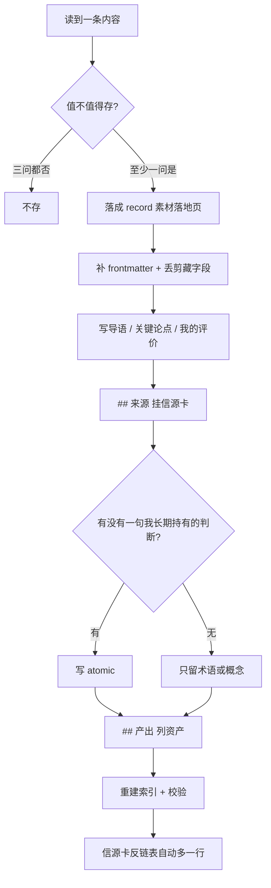

## SOP：信源落地

> 从信源里读到一条内容，到它成为一条可回溯的素材落地页、并交出它催生的知识资产为止。

目标：每篇素材都能答出两件事——**从哪个源来**（消费可溯）、**催生了什么**（产出可数）。缺任一件，这条素材在审计时就不存在。
边界：起点是「已经决定读某一期」，终点是「资产挂上、索引重建」。不含选源（归 [[信息收集工作流]]），不含打分（归 [[信源质量审计标准]]）。

### 适用场景

- **场景 1**：日报/RSS 里读到一篇值得存的长文或论文，需要落进知识库
- **场景 2**：播客/视频/书，没有原文可剪藏，需要自己落成文本
- **场景 3**：素材已落地，读时发现能提炼观点，需要往 `atomic` 走

### 流程图解



### 核心步骤

#### 1. 判断值不值得存

三问，至少一问为「是」才存：

- 它能改变我的判断吗？
- 三个月后我还会回来查它吗？
- 我能不能用一句话说清它讲了什么？

三问全否却存下来，就是收藏夹积灰的原料——它的成本不在存储，在每次审计时都要重新判断一次。

#### 2. 落成 record

形态与字段见 [[笔记类型规范#record 的三种形态]] 与 [[元数据规范]]，此处只说本 SOP 特有的动作：

- **位置**：按主题簇落到 `30-RESOURCES/` 下的子目录（`书单/`、`信源/` 等），没有合适簇就放 `30-RESOURCES/` 根。不留在 `00-INBOX/`——Inbox 是待处理区，留下的素材在反链表里不可见。
- **`up` 指知识归属，不指信源**。信源走 `## 来源`，两者不要混。
- **丢弃剪藏字段**：`source` / `author` / `published` / `created` / `tags: ["clippings"]` 是 Web Clipper 的产物，留一两个就会让下一篇误判「这是篇文章」而非「这是一篇素材」。作者写进导语，不进 frontmatter——库里没有这个人物笔记时，写成链接就是断链。

#### 3. 写正文三段

| 段 | 写什么 | 常见偷懒 |
|:---|:---|:---|
| 导语 | 谁、什么时候、主张什么，一句话 | 只写「这是一篇关于 X 的文章」 |
| 关键论点 | 中文转述，可点回原文对质 | 大段复制原文，等于没加工 |
| 我的评价 | 这篇的证据强度、对我已有判断的影响 | **省掉这一段** |

第三段是分界：省掉它，这篇素材三个月后与原文没有区别，读它不如读原文。

#### 4. 挂 `## 来源`

```markdown
## 来源

- [[信源卡文件名]]
```

这一行是信源卡「消费证据 · 素材落地页」表的唯一来源。用**文件名**建链，不用别名——`validate_meta.py --links` 会报别名建链。

#### 5. 提炼知识资产

判据只有一句：**这篇文章有没有一句我想长期持有的话？**

- 有 → 写 `atomic`（`50-ZETTELCASTEN/`），观点 + 边界 + 至多一个论据，结构见 [[笔记类型规范#atomic 的正文结构：观点 + 边界 + 至多一个论据]]
- 无，但有客观机制/定义 → 写 `term` 或补进 `concept`
- 都没有 → 到此为止，**不硬凑 atomic**。凑出来的伪 atomic 比没有更贵：它污染了「atomic 都是我的判断」这个前提。

一篇素材能出 0~5 条，出几条由内容密度定，不由「应该有几条」定。

#### 6. 挂 `## 产出`

```markdown
## 产出

- [[资产1]]
- [[资产2]]
```

只列第 5 步产出的知识资产（`atomic` / `concept` / `term` / `sop` / `comparison`），**不列素材本身、不列其他 `record`**——列了就重复计数。

产出为 0 时**留空，不写占位符**。空 = 0 条，这是有效数据；写「暂无」会让脚本读成 1 条。

#### 7. 入库与校验

```bash
python _scripts/build_wiki_index.py --note "一句话说明本次 ingest"
python _scripts/validate_meta.py --all
python _scripts/validate_meta.py --links
```

新建/改动笔记时走 `obsidian-note-local`，索引与日志由 `wiki-sync-local` 同步，两者都会覆盖本步。手动跑脚本的理由只有一个：改了多篇、想一次性确认。

### 实践示例

2026-10-26 的一次完整落地：

| 环节 | 实际 |
|:---|:---|
| 源 | [[AI资讯日报 RSS Feed]] |
| 素材 | `30-RESOURCES/书单/Building agents When to fold subagents into your main agent loop.md` |
| `## 来源` | 信源卡 |
| `## 产出` | 3 条 `atomic` + 2 条 `term` = 5 |
| 信源侧副作用 | 反链表多一行（消费 +1）；按映射 5 条 → `output_rate` 4 分 |

其中一处值得记：术语（[[子代理回传]]、[[渐进披露]]）是从素材的**关键论点**里抽出来的定义，而 atomic 是从**我的评价**里抽出来的判断。两类产出分别来自素材的不同段，混在一处写就抽不出干净的定义。

### 常见坑点

- ⛔ **把素材本身算成产出**：存一篇记一条，映射出来就是「存了就有产出」，产出率立刻虚高。
	- 🔧 排查：`## 产出` 里出现任何 `record`，去掉。
- ⛔ **素材停在 Inbox**：反链表列的是全库链到信源卡的 `record`，停在 Inbox 的同样会被列出——但 Inbox 的笔记没有 `## 来源`，于是消费和产出同时归零。
	- 🔧 排查：审计前先看 `00-INBOX/` 有没有带 `url` 的剪藏。
- ⛔ **只写关键论点，不写我的评价**：三个月后分不清哪些是原文、哪些是我当时的判断。
	- 🔧 排查：删掉「我的评价」段后，这篇还剩不剩只有我能提供的东西？
- ⛔ **`up` 写成信源卡**：`up` 表示知识归属，写成信源会让「它属于哪个领域」这个问题永久无解。
	- 🔧 排查：`up` 指向的应该是一个 `concept`/`MOC`，不是一个 `record`。
- ⛔ **为凑产出硬写 atomic**：违反「atomic 只能由人下判断」的前提，且会让后续所有 `atomic` 的可信度打折。
	- 🔧 排查：这条 atomic 的命题，我能说出它错在什么条件下吗？说不出就还不是我的判断。

### 知识图谱

- **上一环**：[[信息收集工作流]] — 选源、扫描、标记，产出是「值得读的链接」
- **下一环**：[[信源质量审计标准]] — 五维打分，产出率取自本 SOP 的 `## 产出`
- **真值引用**：[[笔记类型规范#record 的三种形态]]、[[元数据规范#up 的写法]]
- **母 MOC**：[[知识获取]]
