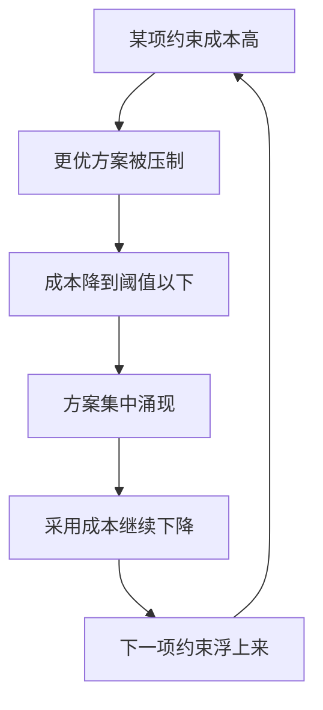

## 概念：前沿技术考察

> 按时间分界，考察每个阶段「流行什么、为什么流行、替代了谁」的笔记。筛选轴不是技术的新旧，而是它挪走了哪一项当时最贵的约束。

**解决的核心痛点**：技术名词的更新速度快于个人学习速度，按「新不新」筛选只能得到一份噪音清单；按「它挪走了哪项约束」筛选，才能判断哪些值得投入、面试为什么问它。

---

### 核心命题

> 只放链接，不写原理——原理是那篇 atomic 自己的论据。

- [[前沿技术的更替是约束的转移，不是名词的新旧]]
- [[面试考察前沿技术，考的是选型判断而非名词记忆]]
- [[技术流行度由采用成本决定，不由技术上限决定]]

这三条按「筛选标准 → 面试用途 → 流行机制」的顺序撑起主轴：先给一把筛子，再说明它如何转成面试答案，最后解释为什么热度会系统性偏离价值。

---

### 时间分界：约束转移年表
- [[2026前端就业形势与技术趋势深度研究报告.html]]

> 每节回答同一组四问：当年的主要约束 / 代表技术 / 替代了什么旧方案 / 面试会问什么。年份只在「约束换了一次」时切开，不按自然年机械切；四问缺一格，说明该年段尚未考察完。

#### 2020–2022：交付成本与工程化收尾

- **当年的主要约束**：前端交付成本与构建速度；算力成本决定了模型只能停留在演示阶段。
- **代表技术**：
	- 前端：Vite、Webpack 5 模块联邦、pnpm + Monorepo、qiankun 微前端
	- AI：GPT-3、GitHub Copilot、Stable Diffusion、ChatGPT（2022-11）
	- 基础设施：Serverless、边缘计算、WebAssembly
- **替代了什么旧方案**：Webpack 的繁重配置与冷启动、npm 扁平化带来的幽灵依赖、iframe 的硬隔离体验；模型侧则替代了「每个任务训练一个小模型」的作坊式做法。
- **面试会问什么**：构建工具选型依据（Vite 与 Webpack 的取舍）、Monorepo 依赖治理、微前端隔离方案的代价。

#### 2023–2024：生成式 AI 从演示走向工程

- **当年的主要约束**：上下文长度与幻觉率；「能生成」不再是门槛，「能稳定接入业务」才是。
- **代表技术**：
	- AI：GPT-4、Llama 2 与开源模型、RAG + 向量数据库、多模态输入、MCP（2024-11）
	- 前端：Rspack、React Server Components、Local-first 架构
	- 基础设施：推理服务与 GPU 调度、AI 网关
- **替代了什么旧方案**：全量微调被 RAG 部分替代；「一次性长 prompt」被检索与上下文编排替代；前端构建的 JS 工具链开始被 Rust 工具链替代。
- **面试会问什么**：RAG 与微调的取舍、向量检索的召回评估、多模态输入的处理链路、何时不该用大模型。

#### 2025–2026：推理成本与 Agent 可靠性

- **当年的主要约束**：单位推理成本与 Agent 的工具调用可靠性；模型能力不再是唯一瓶颈，成本与可控性成为选型主线。
- **代表技术**：
	- AI：推理模型（o1 / o3 / DeepSeek-R1）、Agent 协议与工具生态、AI 编程工具（Cursor、Claude Code）
	- 前端：AI 辅助编码进入日常、边缘渲染与流式交互
	- 基础设施：推理缓存与上下文压缩、Agent 可观测性
- **替代了什么旧方案**：「堆参数换能力」被「推理时计算 + 成本控制」替代；单轮问答被多步工具调用替代；人工编码的部分环节被 AI 编程工具替代。
- **面试会问什么**：推理模型的成本与延迟权衡、Agent 工具调用的失败模式与兜底、上下文压缩策略、如何评估一个 AI 功能是否该上线。

> 2026 年尚未走完，本节只记录已能确认的约束变化，不写趋势预测；新条目进本节前先问「它挪走的是哪项约束」。

---

### 运行机制

约束转移的循环：一项约束的成本高到压制方案 → 成本降到阈值以下 → 方案集中涌现 → 采用成本进一步下降 → 下一项约束浮上来成为新瓶颈。

判断一项技术是否处在「前沿」，看它是否正在推动这个循环，而不是看它是否刚发布。

---

### 关键区别

| 维度 | 前沿技术 | 成熟技术 | 炒作概念 |
|:--|:--|:--|:--|
| 判断依据 | 挪走了当前最贵的约束，且已有可复现的工程案例 | 约束已内化，选型看生态与迁移成本 | 只承诺挪走约束，没有可复现案例 |
| 学习顺序 | 先判断该约束是否与自己相关 | 按需补，优先补边界与坑 | 只记名词，不投入时间 |
| 面试价值 | 考选型判断与代价权衡 | 考原理与失效边界 | 考辨识能力：为什么它还不成熟 |

---

### 适用范围

- ✅ **适用场景**
	- **面试准备**：按年段对照「约束 → 技术 → 取舍」，回答「为什么用 A 不用 B」，而不是背名词。
	- **学习排序**：先学挪走当前最贵约束的技术，再补它的上下游。
	- **技术选型复盘**：判断一次选型是在追热度，还是在解约束。
- ⛔ **误用**
	- **把年表当技术深度**：知道某年流行什么，不等于能讲清它的机制与边界。
	- **用「新」替代「适用」**：发布得晚不是选型理由，约束对不上时新技术反而是负债。
- **失效边界**
	- 纯学术前沿尚无工程案例时，本框架只能判断「未到」，无法判断「值不值得」。
	- 已成熟领域里约束转移不再是主要变量，应改用生态与迁移成本判断。

---

### 批判

- **幸存者偏差**：年表只记录活下来的技术，同代失败方案被系统性忽略，容易把「结果」误读成「必然」。
- **炒作周期**：热度峰值常出现在工程可行性之前，按热度排序会买到半成品。
- **后见之明**：当时无法判断哪条约束最贵，回看时才显得理所当然；这一点决定了本笔记只能作考察框架，不能作预测工具。

---

### 知识图谱

- **并列**：
	- [[前端工程演进]] — 单条演进线，按版本讲机制变化；本篇是横向扫描，按时间讲约束转移，两者互补
- **相关**：
	- [[人工智能]] — 2023 年之后的年段主要约束来自模型侧
	- [[前端开发]] — 2020–2022 的年段主要样本来自前端工程
- **外部资料**
	- Gartner Hype Cycle for Emerging Technologies（年度报告）
	- 各方向官方 release notes 与迁移指南
