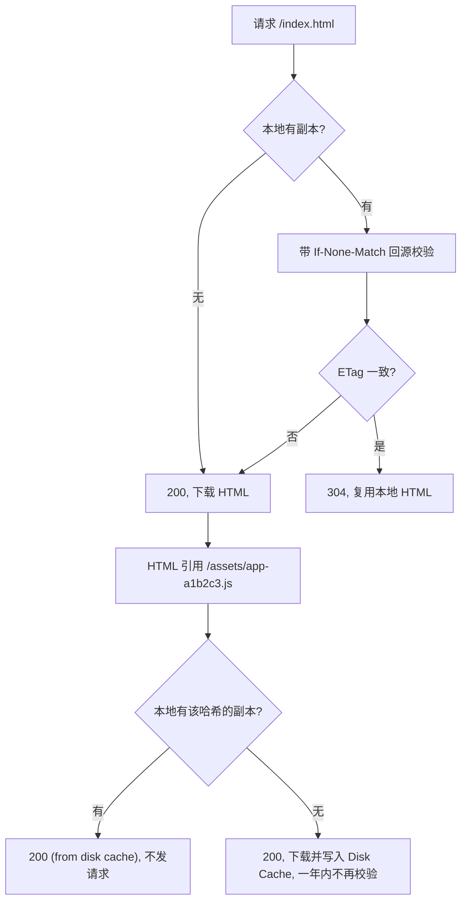

## SOP：配置前端静态资源的多级缓存

> 把「入口 HTML 每次校验、构建产物一年不变」这套配法落到具体响应头上，并交代它在什么条件下失效。

### 目标与边界

**目标**：发一次版之后，用户下次打开拿到的是新 HTML，其引用的新资产全部首次下载；未变的旧资产仍命中本地缓存、不回源。可观测的终态：开发者工具里 `index.html` 是 200 或 304（每次都发请求），`assets/*-a1b2c3.js` 是 `200 (from disk cache)` 且响应头带 `immutable`。

**依赖**：
- Nginx ≥ 1.7.5（`add_header … always` 自 1.7.5 起可用；更低版本在 4xx/5xx 响应上不带该头）
- 构建产物文件名含内容指纹：Vite ≥ 5（默认 `assets/[name]-[hash][extname]`）或 Webpack ≥ 5（`[contenthash]`）
- 静态资源与 HTML 同路径前缀；跨域或分域时，`Vary` 与 CDN 分片要另行核对

**失效条件**：
- 有 Service Worker 接管 `fetch` 时，HTTP 层的配法会被 SW 的缓存策略覆盖，此时以 SW 为准
- 接入 CDN 时边缘 TTL 可能与源站 `Cache-Control` 不一致，须先确认「回源头与边缘规则谁优先」
- 资源文件名没有指纹（老项目、第三方直出）时，第 3 步不适用，只能给短时效
- URL 不变但内容按用户动态生成的响应，不属于本文的资产档

### 适用场景

- 单页应用的静态托管：一个 `index.html` 加一堆带指纹的 JS / CSS / 字体
- 多页站点里「入口 HTML 会变、静态资源按内容寻址」的那部分
- 前端产物放在 Nginx、对象存储或自有源 CDN 上的部署方式（不含纯 SSR 的动态 HTML）

### 流程图解



### 核心步骤

1. **先分类，再配头**。按「文件名能否随内容变」分三档，不按扩展名分：
	- 入口与其余 HTML：名字固定、内容随发版变 → 每次校验
	- 构建产物（含 `contenthash`）：名字即内容 → `max-age`一年 + `immutable`
	- 无指纹静态文件（`favicon.ico`、`robots.txt`、直传图片）：名字固定 → 短时效

2. **HTML 档用 `Cache-Control: no-cache`，保留 `ETag`**。`no-cache` 不是不缓存，是每次使用前必须校验；未变时返回 304，只付一次往返、不付响应体。不要用 `no-store`，那连
3. 304 的复用也一并放弃。
4. **资产档用 `public, max-age=31536000, immutable`**。`immutable` 让浏览器在用户按刷新时也不发条件请求；代价是这一年里没有任何手段能让这个 URL 失效——回滚、紧急下线、合规删除都只能靠换名，而换不了名的响应本就不该进这一档。
5. **让构建产出真的带指纹**。Webpack 用 `[contenthash]`，不要用 `[hash]`：`[hash]` 属于整次构建，改一个文件会让全部文件名变化，等于每次发版全量失效。
6. **Nginx 落点用 `^~` 前缀匹配**。nginx 在最长前缀匹配之后仍会检查正则 location，`/assets/` 不加 `^~` 会被 `\.png$` 一类正则抢走，指纹资产反而拿到短时效。

```nginx
server {
    root /var/www/app;
    etag on;

    # 入口：每次校验，未变返回 304
    location = /index.html {
        add_header Cache-Control "no-cache" always;
    }

    # 带指纹的构建产物：一年 + immutable；^~ 阻止正则 location 抢匹配
    location ^~ /assets/ {
        add_header Cache-Control "public, max-age=31536000, immutable" always;
        access_log off;
    }

    # 无指纹静态文件：短时效，避免名不副实
    location ~* \.(?:png|jpe?g|gif|svg|webp|avif|ico|woff2?)$ {
        add_header Cache-Control "public, max-age=3600" always;
    }

    # SPA 兜底：不存在的路径回到入口
    location / {
        try_files $uri $uri/ /index.html;
    }
}
```

6. **核对 CDN 那一层**。边缘节点通常取「源站 `Cache-Control` 与边缘 TTL 规则中较小者」，但部分厂商以边缘规则优先。用 `curl -I` 分别打源站和加速域名，两边返回的 `Cache-Control` 一致才算配完。
7. **验收**：发一次版，看 HTML 是 304、新资产首次下载、旧资产不再回源；再按一次强制刷新，确认带 `immutable` 的资产没有发出条件请求。

### 实践/示例

```js
// webpack.config.js —— 关键是 [contenthash]，不是 [hash]
module.exports = {
  output: {
    filename: 'assets/[name].[contenthash:8].js',
    chunkFilename: 'assets/[name].[contenthash:8].chunk.js',
    assetModuleFilename: 'assets/[name].[contenthash:8][ext]',
  },
};
```

```js
// vite.config.js —— 默认已带指纹，这里改的是路径与分组
export default defineConfig({
  build: {
    assetsDir: 'assets',
    rollupOptions: {
      output: {
        entryFileNames: 'assets/[name]-[hash].js',
        chunkFileNames: 'assets/[name]-[hash].js',
        assetFileNames: 'assets/[name]-[hash][extname]',
      },
    },
  },
});
```

### 常见坑点

- ⛔ **给 `index.html` 配 `max-age`**：发版后用户拿着旧 HTML 引用旧哈希，新代码要等下次访问才生效，现象是「有人更新了、有人没有」。
- ⛔ **把 `[hash]` 当 `[contenthash]` 用**：一次构建一个 hash，改一行 CSS 就把全部 JS 的文件名换掉，缓存命中率归零。
- ⛔ **`immutable` 发给无指纹文件**：`/config.json`、`/sw.js`、第三方直出的 SDK，一旦下发就没有撤销手段。
- ⛔ **以为 location 里的 `add_header` 会继承 server 级**：nginx 的 `add_header` 是覆盖不是叠加，子级出现一次 `add_header`，父级全部失效——要么每层写全，要么用 `include` 统一。
- 🔧 **304 里没有 `Cache-Control`**：部分服务端 304 不带缓存头，浏览器会沿用上一次的规则；改了 `max-age` 却不生效时先查这一点。
- 🔧 **CDN 与源站不一致**：`curl -I` 分别打源站和加速域名，两边 `Cache-Control` 不同就先查边缘规则，不要先改 Nginx。
- 🔧 **压缩变体串味**：开了 gzip / brotli 却没配 `Vary: Accept-Encoding`，缓存可能把错误编码的响应发给不支持它的客户端。

### 验证记录

### 知识图谱

- **上位**：
	- [[浏览器缓存与客户端存储体系]] — 这套配法是「失效判定权」在工程侧的落地
- **相关**：
	- [[HTTP强缓存]] — `max-age` 与 `immutable` 的语义来源
	- [[HTTP协商缓存]] — `no-cache` 与 304 的判定链
	- [[Content-Hash]] — 指纹命名机制
	- [[前端缓存方案]] — 同主题的 MOC 视图
