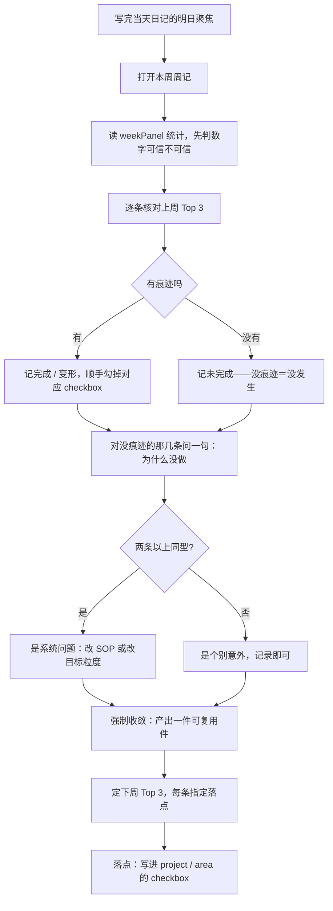

## SOP：周回顾

> 每周一次，把「上周说了要做什么」「这周实际发生了什么」「下周只做什么」对齐一遍。
> **问题溯源**：本 SOP 是 [[怎样设计周回顾]] 的收敛成果——四段结构的取舍、习惯回路的改造、触发挂在哪个动作后面，论证都在那里。

### 目标与边界

**目标**：每周产出一个决定（下周只做什么）、一件可复用资产（判断 / SOP 修订 / 项目状态），以及**三条能被勾选的目标**。

**边界**：
- 不写情绪日记。感受可以写，但不占四块正文。
- 不重述本周做过什么——weekPanel 已经列了，重述是抄写不是复盘。
- 不复述面板的数字，但要**判定它准不准**。面板按 `date-created` 归周，这个字段被批量改写时（目录迁移、字段收口）数字会整体偏高或偏低，此时写明真实值。
- 不做年度规划、不做月度目标拆解（那是月回顾的事）。
- 不停留在「回顾」。没有第 5 步的 Top 3，本 SOP 只是周报；Top 3 不落 checkbox，下周核对只能靠回忆。

### 适用场景

- **常规**：每周一次，写完周日当天日记的「🔭 明日聚焦」之后接着做，20 分钟。与 ISO 周（`YYYY-Www`）对齐。
- **断周补记**：只补「目标核对 + 下周 Top 3」，证据段留空。漏了一周不必追平。
- **不适用**：月末做月回顾时不重复本 SOP，本 SOP 是它的输入。

### 流程图解



### 核心步骤

1. **先看统计，不先想**（1 分钟）
	周记首行的 weekPanel 已列出本周知识资产、滞留笔记与产出分布。读它，**不要手数**。

	读完先判一句：**这组数字可信吗？** 判据是「这周有没有批量改过 frontmatter」。不可信时在周记里写明真实值，别让两个数字在同一页上打架。

2. **逐条核对上周 Top 3，顺手处理遗留**（5 分钟）
	每条给一个结论：完成 / 未完成 / **变形**（做成了别的东西）。判据只有一个——**有没有留下痕迹**（checkbox、日记、atomic、提交记录，任一即可）。

	核对时顺手做完三件事：完成的**去把 checkbox 勾掉**；没完成的**要么留在原地继续推，要么删掉并写一句「放弃」**。**不许既不推进也不删除。**

3. **阻碍从差值里读**（3 分钟）
	对第 2 步里**没留下痕迹**的那几条各问一句：为什么没做？

	> 「想做 A，实际做了 B」，差值就是阻碍。它不需要任何人每天记录，天然存在于核对结果里。

	一条阻碍是意外；**两条同型就是系统问题**——要么改 SOP，要么把目标粒度调小，不要归因于「这周太忙」。

4. **强制收敛：产出一件可复用件**（5 分钟）
	四选一，必须至少一件：
	- 一条 `atomic` —— 这周想明白了什么（必须能写出边界）
	- 一次 SOP 修订 —— 哪条流程被证明走不通
	- 一个项目状态变更 —— `10-PROJECTS/` 里某项目推进或搁置
	- 一条旧 atomic 的边界修正 —— 原判断在什么条件下失效了

	> 一件都产不出，就写「本周空转」。**空转是有效记录，不要编。**
	>
	> 四类**不扩展**。产出是脚本或工具时，按「SOP 修订」勾选并注明，不为此新增第五类——分类越细，每次多一个判断题。

5. **定下周 Top 3，每条指定落点**（5 分钟）
	不超过 3 条。每条写成**可验收的结果**（「写完 X 的第一版」），不是方向（「推进 X」）。三条里最多一条是「维持型」（运动 / 写作 / 阅读这类节律），其余必须「推进型」。

	**每条必须能指认落点，三选一**：

	| 落点 | 判据 | 写在哪 |
	|:---|:---|:---|
	| **① project** | 有明确终点，做完该项目就前进一格 | 该 project 文件的任务区加一条 `- [ ]` |
	| **② area** | 持续负责、没有终点（维护系统、积累能力、养习惯） | 对应 area 文件加一条 `- [ ]` |
	| **③ 节律** | 维持型，不属于任何项目或领域 | 不落 checkbox，只写在周记 |

	三条都指认不出落点 → **说明它不是目标，是愿望**，重写。

	> 为什么必须落 checkbox：`任务总览` 的两组查询（`10-PROJECTS`、`20-AREAS`）就是靠 `- [ ]` 抽的。写进周记只是三行字，写进 checkbox 才会在打开项目文件时出现、勾掉时有反馈。**周记是决定，checkbox 是执行。**
	>
	> 为什么是 3 条：第 4 条起必然落空，而落空一次就会让整套系统在心理上失信。

6. **落锚点**（1 分钟）
	把上一节的三条目标真正写出去：
	- ①② 类 → 打开对应文件，加 `- [ ]`，**写清可验收的完成态**（不是「推进 Agent 求职」，是「补完 Context 系列 6 题的答案」）
	- ③ 类 → 留在周记，作为日记里的可选行

7. **收尾**
	更新周记的 `date-modified`；若第 4 步产出 atomic 或改了 SOP，跑一次 `validate_meta.py --links` 与索引重建。

### 实践/示例

2026-W44 的写法（头一周可以只填这三块，证据段留空）：

```markdown
## 四、下周 Top 3
| # | 目标（可验收的结果） | 类型 | 落点 |
|:---:|:---|:---|:---|
| 1 | 写完周回顾 SOP 的第一版并跑通一次 | 推进 | 20-AREAS/A-个人成长 |
| 2 | 补完「个人成长」核心心智模型段（含 0 条自有判断的说明） | 推进 | 20-AREAS/A-个人成长 |
| 3 | 每周三次运动，每次 30 分钟 | 维持 | —（节律） |
```

第二周回来核对时，只问一句：**这三条在哪留下了痕迹？** 第 1 条该能看到它的 checkbox 被勾掉。

### 常见坑点

- ⛔ **目标写成方向**：「多读书」「推进项目」下周无法核对，等于没定。
- ⛔ **目标超过 3 条**：见步骤 5。
- ⛔ **Top 3 不落 checkbox**：只在周记写三行字，等于下周没有对照物。见步骤 6。
- ⛔ **用记忆代替痕迹**：想不起做过什么就当作做过，是复盘最常见的失效方式。
- ⛔ **checkbox 只增不减**：上周没做完就再加三条，未完成项会累积成噪音，最后整张表不可读。判据是「要么推进，要么删」。
- ⛔ **复盘写成情绪日记**：没有第 4 步的收敛动作，写多少都不算学习。
- ⛔ **周记抄面板的清单**：面板已列本周新增哪几篇。再列一遍，等某篇改名或被推翻，两处就开始打架。**周记只写面板数不到的**。
- ⛔ **目标自指**：拿「下周有没有做回顾」当目标之一，是用这张表证明这张表填了，没有独立对照物。目标必须指向表外的世界。
- 🔧 **排查**：连续两周产不出可复用件 → 目标粒度太大，一周装不下，拆小。
- 🔧 **排查**：周记统计为空 → 是本周真的没沉淀，不是脚本坏了。空表本身是证据。
- 🔧 **排查**：总是核对不上 → 检查第 6 步有没有做，而不是检查决心。
- 🔧 **排查**：周日想不起来要做回顾 → 触发没挂上。检查第 6 步的 checkbox 是否真的存在。

### 知识图谱

- **上位**：[[个人成长]] — 复盘属于「自我管理」范畴，本 SOP 是该范畴的执行流程
- **相关**：
	- [[时间管理]] — 习惯回路的判据借自该领域，**归属与来源分开**
	- [[习惯能否养成取决于触发与奖励是否可及]] — 本 SOP 落地前用它判过可行性
	- [[习惯由触发、行为、奖励构成]] — 三要素的具体改造见 [[怎样设计周回顾]]
	- [[GTD]] — 每周回顾是 GTD 的关键成功因素，本 SOP 是它在本库的落地形态
	- [[四象限法则]] — Top 3 的排序依据
	- [[在四象限中应用精力成本]] — 把 Top 3 分配到精力高峰期
	- [[任务总览]] — Top 3 落成的 checkbox 会出现在这里
- **问题来源**：[[怎样设计周回顾]] — 四段结构、触发方式与启动成本的取舍
