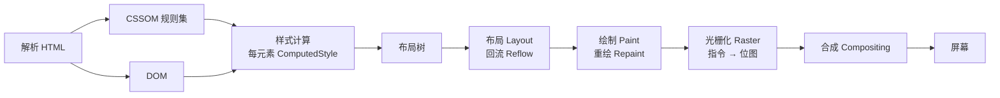

## 术语：回流和重绘

> **领域**：#前端/渲染性能

### 定义

| 术语 | 定义 |
|:---|:---|
| **回流 (Reflow)** | 浏览器重新计算元素几何属性（尺寸、位置），可能影响整个页面布局 |
| **重绘 (Repaint)** | 浏览器仅重新绘制元素外观（颜色、阴影），不改变布局 |

```bash
渲染过程：
解析 HTML/CSS → 样式计算 → 布局(Layout/回流) → 绘制(Paint/重绘,产出指令) → 光栅化 → 合成(Compositing)
```

### 浏览器渲染管线



### 何时触发

| 触发回流 | 仅触发重绘 |
|:---|:---|
| 元素尺寸变化（width、height） | 颜色变化（color、background-color） |
| 位置变化（margin、padding） | 可见性（visibility、outline） |
| 字体变化（font-size） | 阴影变化（box-shadow） |
| 添加/删除元素 | 边框圆角（border-radius） |
| 浏览器窗口 resize |  |

`opacity` 不在任何一列：未提升为合成层时它走 Paint，提升之后只走合成，两种情况都不碰布局——详见下一节。

### 性能影响

- **回流代价高**：可能影响整个页面布局，计算量大，且连带下游全部重跑
- **重绘的代价取决于面积**：不碰布局，但要重新记录失效区域的指令并重新光栅化；局部小改很便宜，整屏变化（如大面积阴影、固定背景）可以很贵
- **最坏情况**：连续多次回流/重绘导致掉帧、卡顿

### 优化策略

| 策略 | 方法 |
|:---|:---|
| **属性选择** | 优先使用 `transform`、`opacity`（仅触发合成，不触发回流/重绘） |
| **批量操作** | 使用 `DocumentFragment` 批量添加 DOM |
| **读写分离** | 先读所有布局属性，再写修改（避免强制同步回流） |
| **CSS 类批量修改** | 一次性切换 class，而非逐个修改 style |
| **display: none** | 隐藏元素后修改，再显示（避免中间触发） |
| **will-change** | 提示浏览器提前创建合成层 |

### 与合成层的关系

`transform` 与 `opacity` 便宜，但不是同一个原因下便宜，要分三级：

| 改什么 | 主线程做什么 | 掉帧风险 |
|:--|:--|:--|
| `left`、`top`、`width` | 布局 → 绘制 → commit → 光栅化 | 高 |
| `transform`、`opacity`（元素未提升为合成层） | 不重排不重绘，但**每帧仍要过一次 commit** | 中：主线程一忙就掉帧 |
| `transform`、`opacity`（已提升为合成层） | 完全不参与，合成器自行改变换 | 低 |

常见说法「浏览器会为 `transform`/`opacity` 创建独立合成层」是错的：**提升需要条件**。`will-change: transform`、3D 变换、`video`/`canvas`、某些滤镜与 `position: fixed` 等会触发，普通元素的 `transform` 不会。这就是「明明用了 transform 还是卡」的原因——它一直在主线程上排队。

详见：[[合成层]] · [[合成层 vs 合成线程]]

### 知识图谱

> 固定五个桶，判据见 [[知识图谱词表]]。

- **上位**：[[前端性能优化]] — 回流与重绘是这条链上最常被触发的两段
- **相关**：
	- [[浏览器渲染流程]] — 这两个阶段在整条链中的位置
	- [[光栅化]] — 重绘之后的下一步，像素在这一步才产生
	- [[合成层]] — 跳过两者的实现结果
	- [[合成层 vs 合成线程]] — 「提升为合成层」到底提升了什么
	- [[will-change]] — 触发层提升的常用手段
	- [[怎样减少回流和重绘]] — 具体优化实践
	- [[实现磁吸式光标]] — 利用层提升的实践
- **外部资料**
	- [Google Web Dev - 渲染性能](https://web.dev/articles/rendering-performance)
	- [CSS Triggers](https://csstriggers.com/) — 查某个属性会触发哪几个阶段
