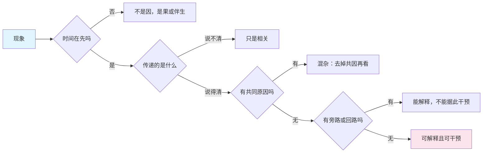

## 概念：因果链

> 因果链是把现象解释成 A → B → C 的单向传递序列。它的价值在于可检验——每一步都要能说出「传过去的是什么」；它的代价在于会掩盖环路与合取，而且链条越长，整体置信度按乘法衰减。

**解决的核心痛点**：把「出了事」变成「哪一步坏了」。没有链，归因只能停在「环境不好」或「某人不细心」这类无法验证、也无法改动的结论上。

### 核心命题

- 一条链要成立，必须同时满足三条：时间在先、机制可指认、共同原因已排除
	- **原理**：缺时间在先，是倒果为因；缺机制，是拿统计相关冒充传递；缺排除混杂，是把共同原因的两个产物当成前后相继。三者任一缺失，链就退化成相关——而相关的两个变量之间没有任何东西在传递
- 因果链是解释工具，不是干预工具
	- **原理**：知道 A → B → C，并不代表动 A 能得到 C。如果 B 还有别的入口，或者存在反馈把 C 送回 A，干预 A 的效果会被旁路分流或被回路抵消。「能不能干预」需要额外信息，这比「相关不等于因果」更少被提到，也是方案在纸面上成立、落地后失效的常见原因
- 多因一果时，链式写法必然丢掉交互项
	- **原理**：两个原因各自必要、合起来才充分的场合，链只能写成「A 和 B 都是原因」，无法表达「只有同时具备才成立」。所有「根本原因分析」都在这一步失真，于是复盘常常同时列出三条互斥的根因
- 链条越长越不可信，衰减是乘法而不是加法
	- **原理**：每多一步，整体置信度乘以这一步的可信度，十步各 90% 只剩约三成。所以长链的正当用途不是预测，而是定位那一步最脆弱、最该先去验证的环节

### 运行机制

检验一条链只需要三个问题，顺序不能换——时间过不了的链，后面两条不用问：

| 检验 | 问法 | 不通过时发生什么 |
|:--|:--|:--|
| 时间 | 因真的在果之前吗（在观测窗口内） | 倒果为因：把系统的自我修正当成了起因 |
| 机制 | 中间传过去的是什么（能量、信息、钱、激励、情绪） | 相关冒充因果：两边同步，但没有通道 |
| 混杂 | 有没有一个共同原因同时造成这两者 | 把共因的两个产物当成前后相继 |
| 反事实 | 如果没有 A，B 还会发生吗 | 无法回答时，这条链只能当假设，不能当结论 |

第四问是分水岭。前三问能靠观察回答，反事实只能靠干预、自然实验或结构假设——所以严格意义上的因果结论，成本远高于「讲得通」的解释。

### 关键区别

| | 因果链 | 反馈回路 | 相关 |
|:--|:--|:--|:--|
| 结构 | 开链，单向 | 闭环，果回到因 | 无方向 |
| 能否预测干预效果 | 仅在无旁路、无回路时 | 需要看回路增益与延迟 | 不能 |
| 典型用途 | 归因、排查、事故复盘 | 解释顽固问题与振荡 | 发现线索 |
| 失效方式 | 漏掉合取与旁路 | 忽略外部输入 | 被当成因果 |

还有一处更隐蔽的区别：**「根本原因」通常不是链条的起点，而是「谁有权限改」的那一环**。五问法之所以停在「员工不细心」，不是因为再往前问不下去，而是因为再往前问会问到流程设计者和预算决策者。所以复盘得到的根因，先看它是否落在可改动的一侧，再判断它是否真的是最早那一环。

### 适用范围

- ✅ **适用场景**
	- **单点故障排查**：有明确传递路径的问题（配错了一个值，一路传到用户看到的页面）
	- **事故复盘**：时间线加上机制说明，是唯一能同时说服工程与业务的写法
	- **成本结构分解**：把总成本拆成层层相加的项，本身就是一条链，且每步可核账
- ⛔ **误用**
	- **五问法式长链**：连问五个为什么，通常得到五个猜测拼成的链，每步都没验证。链越长，它越像故事
	- **把系统问题写成链**：反复发生的问题几乎都有回路，强行写成链，终点必定落在某个人身上
	- **用链做预测**：链只保证对已发生路径的解释力，不保证下一个案例同样走这条路径
- **失效边界**
	- **延迟大于观测窗口时，因果顺序在数据里看不出来**：只能靠机制推断，不能靠先后
	- **合取原因无法用链表达**：需要图，需要交互项，而链的语言里没有这两个东西
	- **反事实不可观测**：大多数场合做不了「没有 A」的实验，链条结论的强度被这一条封顶

### 批判

- **外部批判**
	- 因果推断的主流框架（Pearl 的结构因果模型、Rubin 的潜在结果）都把「链」看成有向无环图的一个特例：真实结构里有混杂、有合取、甚至有环，用链当通用模板会系统性地漏掉这三类
	- 事故调查领域（如 Rasmussen 的 AcciMap、STAMP）明确指出：重大事故的原因分布在多个组织层级上，逐层追问的链式模型会停在操作者一层，把系统问题读成人为失误
- **内在张力**
	- 链越短越可信，但越短越不解释问题；「直接原因」与「根本原因」如何取舍没有客观标准，实际中往往由谁有权限改动来决定。这让它既是解释工具，也是责任分配工具——两种用途经常打架，而打架时通常是责任赢了

### 知识图谱

- **上位**：[[线性思维]] — 链是线性思维的结构载体
- **并列**：
	- 反馈回路 — 把链闭合成环，果回到因（见 [[系统思维]]）
- **相关**：
	- [[系统思维]] — 处理链失效的那两类结构：环与延迟
	- [[批判性思维]] — 排除混杂是它的基本功
	- [[非线性思维]] — 链条隐含每步成比例，非线性处正是它断掉的地方
	- [[逻辑思维]] — 链的每一步都是一次推理，同样受形式约束
- **外部资料**
	- 《为什么：关于因果关系的新科学》（Pearl & Mackenzie，The Book of Why 中译本）— 混杂、干预与反事实的普及版，先看这本
	- 《因果论》（Pearl，Causality）— 结构因果模型与 do 算子的原始论述，判据以此为准
	- Rasmussen《Risk management in a dynamic society》— AcciMap 的出处，说明重大事故的原因为何分布在多个层级而非一条链上
