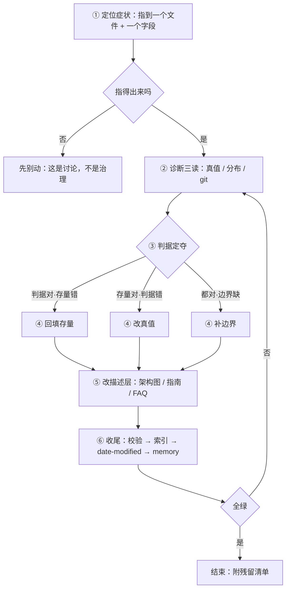

## SOP：存量治理

> 当库里的既有内容与判据不一致时，把它改到一致并留下证据。为什么这是主线、它和 llm-wiki 是什么关系，见 [[本库的实际运行方式]]；本篇只讲怎么做。

### 目标与边界

**目标**：终态可观测为四件事——判据已在 `01-META/` 有唯一落点；受影响面按新判据改完；`validate_meta.py --all` 与 `--links` 通过、索引已重建；`.workbuddy/memory/` 里有这次改动的依据与残留。

**依赖**：Python 3 + `_scripts/`（`validate_meta.py`、`build_wiki_index.py`、`check_targets.py`）；`01-META/Truth/` 与 `01-META/Specification/` 的真值文档；**可读的 git 历史**——诊断第 2 步要用它判断一条约定从哪来。

**失效条件**：多人同时改同一族（判据得先协商，协商不在本流程内）；改动意图本身还没定（那是讨论，别拿流程代偿思考）；判据归属无法定位（先补真值边界，别在存量上试错）。

### 适用场景

- 用户点名某篇或某族「不对」「不该这样」「是不是重复了」
- 脚本报脏值、死链、`content-type` 越界、索引与实际不符
- 新写的一条判据与存量冲突（新规范落地时的必然回填）
- 某个机制已停用，但文档里还在要求执行（如 wiki-log 停用后的收口）

### 流程图解



### 核心步骤

1. **定位症状**：把「感觉乱」换成可指认的对象——至少一个具体文件加一个具体字段或章节。指不出来就停，那不是治理任务。
	 - 注意：范围在这里定下来。一次只处理一族；跨族就拆成多次。

2. **诊断三读**：
	 - **读真值**：这条判据现在写在哪份文档、原文怎么说的。找不到落点，说明判据从未固化，直接跳到第 3 步的「补边界」。
	 - **读分布**：`grep` 关键词 + 数 `wiki-index` 命中，判断是一篇还是一族。规模决定第 4 步要不要分批。
	 - **读 git**：`git log --follow` 看这条约定何时进来、改过几次。改过多次说明它一直在漂，这次要定死。
	 - 产出两句话：**判据现状** 与 **存量差在哪**，附影响面计数。这两句话之后会原样进 memory。

3. **判据定夺**（不可跳过）：三种结局选一——
	 - 判据对、存量错 → 回填；
	 - 存量对、判据错 → 改真值，**不动存量**；
	 - 两边都对但边界没写清 → 补边界，仍不动存量。
	 - 注意：跳过这一步，「回填」就变成了默认动作，而默认动作会把判据的错误铺满全库。

4. **先改真值，再改引用，最后改存量**：
	 - 顺序不能反。先改存量后改真值，中间存在一个「两套定义并存」的窗口，而这窗口里下一个 agent 会按旧判据继续改。
	 - 判据的唯一定义处只有两处：`01-META/Truth/` 与 `01-META/Specification/`。别在 concept 里写第三份。

5. **改描述层**：架构图、流程图、指南、FAQ 里的旧表述一并处理。
	 - 注意：这些地方不改不会报错，只会误导人——所以它们最容易被漏。

6. **收尾四件**：
	 - `python _scripts/validate_meta.py --all` → `--links`
	 - `python _scripts/build_wiki_index.py`
	 - 所有改过的文件更新 `date-modified`
	 - `.workbuddy/memory/YYYY-MM-DD.md` 追加：判据是什么、改了什么、影响面、**残留项**

### 实践/示例

一次完整的诊断产出长这样（2026-11-06，wiki-log 停用）：

```bash
判据现状：llm-wiki-schema 仍规定 ingest/lint 追加 wiki-log 条目
存量差在哪：写端最后一条 10-27，之后 14 次 commit、0 条记录；读端 8 处引用无一处要求先读
影响面：13 个文件（2 个 skill + 6 处规则 + 5 处描述）
定夺：存量对、判据错 → 改真值，并在 schema 留停用声明防止被恢复
```

### 常见坑点

- ⛔ **顺手改无关笔记**：范围溢出的第一征兆是 diff 里出现你没打算动的文件。发现即回退。
- ⛔ **边回填边改判据**：混在一步，出问题时分不清是判据错还是执行错。
- ⛔ **把「脚本通过」当治理完成**：脚本只查字段与链接，不查判据对错——这是本流程唯一查不出的失败模式。
- 🔧 **改了 `SKILL.md` 但索引没变**：`build_wiki_index.py` 不索引 `.claude/`（隐藏目录），这类改动只能手工同步 `_skills-overview`。
- 🔧 **忘了 `date-modified`**：校验不报错，但「这篇什么时候动过」从此失真，后续诊断会误判。
- 🔧 **残留没说**：没修的项不写进 memory，下一次会从头再查一遍。

### 验证记录

- 2026-10-19 · 真值文档之间的交叉定义清理（笔记类型规范里定义元数据字段 → 归回 `元数据规范`）· 判据收敛到单一来源 · 全绿
- 2026-11-04 · CI-CD / DevOps / 软件工程 / AI First 四篇的边界与类型重切 · 43 篇变更 · 全绿
- 2026-11-06 · wiki-log 停用收口 · 13 个文件 · **断在第 6 步**：`build_wiki_index.py` 不索引 `.claude/skills`，AGENTS 那条「改过 SKILL.md 必同步索引」与实现不符，未修
- 2026-11-06 · 导航篇 ingest 时由 `--links` 暴露 `浏览器核心架构` 两处死链 · 顺带修复 · 全绿

### 知识图谱

> 五个桶，判据见 [[知识图谱词表]]。

- **上位**：[[本库的实际运行方式]] — 本篇是那条垂直循环的操作化：同一个判断，从「描述」落到「照着做」
- **并列**：
	- [[llm-wiki-schema]] — 另一套工作流（ingest / query / lint / sync），处理增量；本篇处理存量
	- [[_ingest-rules]] — 水平循环的入口，与本篇按「输入是素材还是判据」分工
- **相关**：
	- [[元数据规范]] — 回填时字段的唯一真值
	- [[笔记类型规范]] — 判型的唯一真值，类型争议都查这份
	- [[知识图谱词表]] — 关系桶的唯一判据，改「相关/并列」时照它
	- [[本库目录结构]] — 归属判定的顺序
	- [[人机分工规范]] — 谁写什么的契约，决定哪些改动不必征求同意
