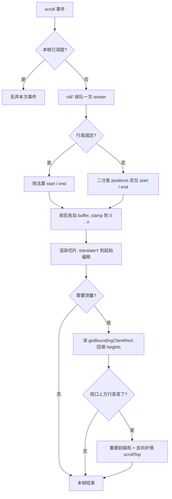

## SOP：实现简易虚拟列表

> 目标：在给定容器内渲染一万到十万条数据，滚动的任一时刻 DOM 节点数稳定在「一屏 + 2 × buffer」量级，且视口内容不跳动、不白屏。
> 本 SOP 给两条链路：示例 1 是固定行高的最小可用实现（除法定位），示例 2 是动态行高的推广（前缀和 + 二分定位）。两者共用同一套三层 DOM 结构与渲染时序，差别只在「如何把 scrollTop 换成索引」。

### 目标与边界

目标：滚动到任意位置时，容器内真实存在的列表节点数与数据总量无关，只与视口高度相关；滚动过程中不出现空白带，也不出现内容位移。

依赖：原生浏览器 API，不含框架与第三方库。用到 `clientHeight`、`requestAnimationFrame`、`getBoundingClientRect`，三者 Chrome 64+ / Safari 13.1+ / Firefox 69+ 均可用。动态行高版本默认「一次 layout 内可测出行高」；若行高会被图片加载、折叠面板等异步改变，需额外接 `ResizeObserver`，否则第一次测量之后就再也追不上。

失效条件：

- 横向虚拟化：本文的位置表是一维的，横轴需要另建一份宽度前缀和。
- 瀑布流、多列不等高：一维位置表无法表达「同一 y 上有多项」，要不换成二维定位，要不改用绝对定位 + 估位算法。
- 行高在可见区内持续变化：一次测量只能拿到一个瞬间值，改不动就会看到内容被顶开。
- 单行渲染本身很贵：虚拟列表减少的是节点数量，不是单个节点的渲染成本，重型组件仍会卡。
- 数据需要边滚边拉：本文假设全量数据已在内存，配合分页或按需加载时要额外处理占位高度。

### 适用场景

- 场景 1：一次性拿到全量数据的长列表（日志流、表格、聊天记录），条数上千且用户会拖动滚动条定位。
- 场景 2：行高固定（示例 1），已知每项高度，定位可以退化成一次除法。
- 场景 3：行高不定但可测量（示例 2），如多行文本、含标签的卡片，高度由内容决定。
- 场景 4：需要保留真实滚动条语义，总高度与内容一致，可直接拖拽跳转——这一点是无滚动的 `overflow: hidden` 方案给不了的。

### 流程图解



### 核心步骤

1. 搭三层结构：滚动容器 → 占位层 → 内容层。占位层只负责撑出 `总高度`，内容层用 `transform: translateY()` 平移到当前窗口，容器保留 `overflow-y: auto`。
	 - 注意：可视高度取 `clientHeight`，不要用 `offsetHeight`（后者含 border，会把可视区算大一到两行）。
	 - 注意：平移用 transform 而非 `top`，前者只走合成，不进 layout。
2. 算可视区间。固定行高是除法：`start = floor(scrollTop / h)`，`end = ceil((scrollTop + clientHeight) / h)`。
3. 加 buffer 并夹紧。前后各扩 3~5 项，再 `clamp(0, n)`；`start` 不夹到 0，负索引会让 `slice` 从数组尾部取数据，页面显示错乱却不报错。
4. 渲染切片并平移。只向内容层写入 `[start, end)` 的节点，偏移量取 `start × h`（固定行高）或 `positions[start]`（动态行高）。
5. 动态行高时，把「除法」换成「查表 + 二分」。维护 `positions[i]` = 第 i 项顶部偏移（前缀和），`start` 就是满足 `positions[i] <= scrollTop` 的最大 i，用二分在 O(log n) 内求出。
6. 测量回填并补偿。每帧渲染后读一遍真实高度写回 `heights`，重建前缀和；若变化发生在视口上方，同步反向调整 `scrollTop`，否则内容会向下跳。

### 实践/示例

#### 示例 1：原生 JS 固定行高的 MVP

结构只有三个节点，总高度写在占位层上：

```html
<div id="list"> 
  <div id="phantom"></div>
  <div id="content"></div>
</div>
```

```css
#list    { height: 480px; overflow-y: auto; position: relative; }
#phantom { width: 1px; }   /* 只负责撑高，不承载内容 */
#content { position: absolute; top: 0; left: 0; right: 0; will-change: transform; }
.row     { height: 48px; line-height: 48px; padding: 0 12px; box-sizing: border-box; }
```

```js
const ITEM_HEIGHT = 48;
const BUFFER = 4;
const data = Array.from({ length: 10000 }, (_, i) => '第 ' + (i + 1) + ' 行');

const listEl = document.getElementById('list');
const contentEl = document.getElementById('content');
const phantomEl = document.getElementById('phantom');

phantomEl.style.height = data.length * ITEM_HEIGHT + 'px';

let rafId = 0;
function scheduleRender() {
  if (rafId) return;                               // 一帧只算一次
  rafId = requestAnimationFrame(() => { rafId = 0; render(); });
}
listEl.addEventListener('scroll', scheduleRender, { passive: true });
window.addEventListener('resize', scheduleRender);

function render() {
  const scrollTop = listEl.scrollTop;
  const viewport = listEl.clientHeight;            // 不含 border 的可视高度

  const start = Math.max(0, Math.floor(scrollTop / ITEM_HEIGHT) - BUFFER);
  const end = Math.min(
    data.length,
    Math.ceil((scrollTop + viewport) / ITEM_HEIGHT) + BUFFER
  );

  contentEl.style.transform = 'translateY(' + start * ITEM_HEIGHT + 'px)';
  contentEl.innerHTML = data
    .slice(start, end)
    .map((text, i) => '<div class="row" data-index="' + (start + i) + '">' + text + '</div>')
    .join('');
}

render();
```

这条链路的代价是每帧重建 innerHTML：十万条数据下渲染节点只有十来行，重建成本可以忽略；但滚动极快时节点反复销毁重建，GC 压力会显形，那时该上节点池，见 [[虚拟列表采用DOM回收而非销毁重建]]。

#### 示例 2：动态行高，用二分查找定位

固定行高的前提一旦破了（多行文本、图片、折叠面板），除法就失效：`scrollTop / 平均高度` 在行高分布不均时会偏出好几屏。此时把「高度 × 索引」换成一张位置表——`positions[i]` 是第 i 项的顶部偏移，由前缀和算出。这张表天然单调不减，于是可以把定位从 O(n) 的线性扫描换成 O(log n) 的二分。

```js
const BUFFER = 4;
const ESTIMATED = 60;              // 未测量项的估计高度

const data = Array.from({ length: 20000 }, (_, i) => ({
  id: i,
  text: '第 ' + (i + 1) + ' 条：' + '内容'.repeat(1 + (i * 7) % 9)   // 长度不定，行高不定
}));

const listEl = document.getElementById('list');
const contentEl = document.getElementById('content');
const phantomEl = document.getElementById('phantom');

const heights = new Float64Array(data.length).fill(ESTIMATED);
const positions = new Float64Array(data.length + 1);   // positions[n] = 总高度

// 前缀和
function rebuildPositions() {
  let acc = 0;
  for (let i = 0; i < data.length; i++) {
    positions[i] = acc;
    acc += heights[i];
  }
  positions[data.length] = acc;
  phantomEl.style.height = acc + 'px';
}
rebuildPositions();

// 二分：找最大的 i，使 positions[i] <= offset，结果收敛在 [0, n-1]
function findIndexByOffset(offset) {
  let low = 0;
  let high = data.length - 1;
  while (low < high) {
    const mid = (low + high + 1) >> 1;      // 上取整，否则 low 不推进会死循环
    if (positions[mid] <= offset) low = mid;
    else high = mid - 1;
  }
  return low;
}

let rafId = 0;
function scheduleRender() {
  if (rafId) return;
  rafId = requestAnimationFrame(() => { rafId = 0; render(); });
}
listEl.addEventListener('scroll', scheduleRender, { passive: true });
window.addEventListener('resize', scheduleRender);

function render() {
  const scrollTop = listEl.scrollTop;
  const viewport = listEl.clientHeight;

  const viewStart = findIndexByOffset(scrollTop);                   // 顶边所在行
  const viewEnd = findIndexByOffset(scrollTop + viewport) + 1;      // 底边所在行，闭区间转开区间

  const start = Math.max(0, viewStart - BUFFER);
  const end = Math.min(data.length, viewEnd + BUFFER);

  contentEl.style.transform = 'translateY(' + positions[start] + 'px)';
  contentEl.innerHTML = '';
  for (let i = start; i < end; i++) {
    const el = document.createElement('div');
    el.className = 'row';
    el.textContent = data[i].text;
    contentEl.appendChild(el);
  }

  measure(start, end, viewStart, scrollTop);
}

function measure(start, end, viewStart, scrollTop) {
  let deltaAbove = 0;
  let changed = false;

  for (let i = start; i < end; i++) {
    const real = contentEl.children[i - start].getBoundingClientRect().height;
    const delta = real - heights[i];
    if (Math.abs(delta) > 0.5) {
      heights[i] = real;
      changed = true;
      if (i < viewStart) deltaAbove += delta;    // 变化发生在视口上方
    }
  }

  if (!changed) return;

  rebuildPositions();
  if (deltaAbove !== 0) listEl.scrollTop = scrollTop + deltaAbove;   // 反向补偿，抵消内容位移
}
```

配套样式只需去掉固定高度：

```css
.row { padding: 8px 12px; line-height: 1.6; border-bottom: 1px solid rgba(128, 128, 128, .25); }
```

两处容易看漏的设计点：

- 二分的判据用 `<=` 而不是 `<`。高度是浮点数，测量误差会让相邻两项高度趋近但不影响单调性，`<=` 让「offset 正好落在某项顶部」这种边界被稳定归到前一项，不会两边都匹配或都不匹配。
- 补偿写在测量之后、下一帧渲染之前。改 `scrollTop` 会再抛一次 scroll 事件，但那一帧测量出来的 `delta` 已经是 0，循环自行终止。

复杂度对照：

| 环节 | 固定行高 | 动态行高（前缀和 + 二分） |
|:---|:---|:---|
| 定位 start / end | O(1)，一次除法 | O(log n)，两次二分 |
| 高度变化后更新 | 无需更新 | O(n) 重建前缀和（换树状数组可降到 O(log n)） |
| 首次总高度 | `n × h`，精确 | 实测项之和 + 未测项 × 估计值，滚动中逐步收敛 |
| 十万项单次定位 | — | 约 17 次比较（实测见验证记录） |

为什么非要二分：滚动事件按帧触发，一帧要定位两次（顶边、底边）。十万项下线性扫描平均要比较五万次，60 fps 就是每秒约六百万次比较——这部分开销全落在主线程上，与 [[拆分长任务并让出主线程]] 里要避免的长任务同源。二分把每次定位压到约 17 次比较，量级差三个数量级。位置表单调是被二分的前提，若某天允许负数或动态收缩的高度，这个前提就不成立了。

### 常见坑点

- ⛔ 用 `offsetHeight` 取容器可视高度：它含 border，可视区被算大一到两行，底部出现空白带。改用 `clientHeight`。
- ⛔ 在 scroll 回调里同步重算：一次手势会触发多帧多个事件，全量重排会让滚动本身变卡。用 rAF 合并，一帧一次。
- ⛔ `startIndex` 不做 `Math.max(0, …)`：负值传给 `slice` 会从数组尾部取数据，屏幕上出现的是列表最后几条，且不抛错。
- ⛔ 动态行高测量后不补偿 `scrollTop`：向上滚动时上方行高被修正，内容整体位移，视觉上就是「列表在跳」。凡变化发生在视口上方，必须反向加减。
- ⛔ 二分的 `mid` 向下取整配 `low = mid`：`low` 永远推进不了，浏览器直接卡死。上取整或写成 `low = mid + 1` 的对称结构，二选一。
- ⛔ 估计高度偏离实际太远：未测量项越多，`phantom` 高度与实际总高差得越多，滚动条长度在滚动中反复变化。取首屏实测均值或内容中位数做估计值。
- 🔧 首屏空白：检查容器是否在 `display: none` 的祖先里——此时 `clientHeight` 为 0，可视区算出 0 行。等容器可见后再初始化，或监听 `resize` 重算。
- 🔧 底部总差几像素：逐项用 `Math.round` 累加会把误差滚大。用 `getBoundingClientRect().height` 保留小数，位置表用浮点数组。

### 验证记录

- 2026-10-27 · Node v22.22.2 本地脚本 · 十万项随机行高（20~100px）构建前缀和，2007 个 offset 探针（含 0、负数、总高、总高 + 500）下二分与线性扫描结果逐项一致，0 处不一致、0 次越界 · 两万次定位耗时：二分 2.82 ms、线性 702.63 ms，约 249 倍 · 结论：定位算法本身可用，边界收敛正确。
- 待补：示例 1、2 的 DOM 部分（渲染时序、视口上方行高变化的 scrollTop 补偿、快速滚动白屏）仅经推演，未在浏览器实测。补偿逻辑的终止性依赖「第二次测量 delta 为 0」，这一点尚未被实跑证实。

### 知识图谱

- 父级概念：
	- [[虚拟列表]] — 本 SOP 是该概念的可执行链路
- 核心命题：
	- [[虚拟列表通过滚动位置计算可见项]] — 固定行高是它的除法特例，动态行高是它的二分推广
	- [[虚拟列表的核心思想是只渲染可见区域]] — 两个示例共用这条前提
	- [[虚拟列表采用DOM回收而非销毁重建]] — 本文两例都重建节点，节点池是往上一层的优化
- 关联：
	- [[拆分长任务并让出主线程]] — 滚动回调本身就是主线程任务，rAF 合并是它的轻量版
	- [[前端性能优化]] — 本 SOP 服务的上层目标
- 第三方实现（对照用，不依赖）：react-virtuoso、react-window、vue-virtual-scroller（其 `IndexTree` 用树状数组维护前缀和，即上文 O(log n) 更新的那一路）
