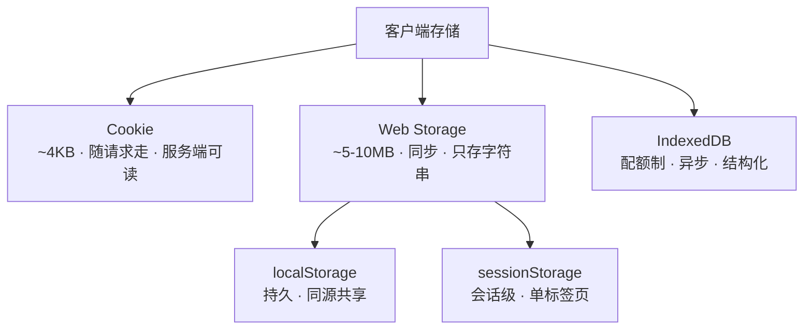

## 概念：客户端存储

> 浏览器把数据留在用户设备上的几种机制的总和——Cookie、Web Storage、IndexedDB，以及同属存储但用途不同的 Cache API。本页只回答一件事：**什么时候该用哪一个。**

**解决的核心痛点**：数据放在客户端，可以省掉一次网络往返、支持离线、让多次访问之间保持状态。但四种机制的容量、同步性、生命周期差着几个数量级，选错不会报错，只会在某个量级上突然变慢或突然丢数据。

---

### 一条判据，三个问题

选型不是比容量表，而是依次问：

1. **服务端要不要读到它？** 要 → Cookie（唯一会随请求自动发送的）。不要 → 往下。
2. **读写会不会卡住主线程？** 数据小、偶尔读写 → Web Storage 可以接受；数据大或高频 → IndexedDB。
3. **要不要按字段查？** 要 → IndexedDB（有索引与游标）；只要按键取 → 前两者够用。

三个问题的顺序不能换。最常见的错误是先比容量、再选 API，于是把几十 KB 的配置塞进 IndexedDB（绕三圈回调换一个同步读就够的事），或者把几 MB 的列表塞进 `localStorage`（每次读都要反序列化一遍，直接掉帧）。

---

### 存储方案

- [[Cookie]] — ~4KB，随每个同源请求自动发送，服务端可读
	- 唯一能承载鉴权态的一层：`HttpOnly` 让脚本读不到，`Secure` / `SameSite` 由服务端控制
- [[Web Storage]] — 同步键值对，只存字符串，约 5 MB 量级
	- [[localStorage 的「长期」只是不会被主动过期]] — 手动删才失效，同源所有标签页共享
	- [[sessionStorage 的「会话」指标签页，不是登录状态]] — 标签页关闭即失效
- [[IndexedDB]] — 异步、事务、带索引，配额按整源共享
	- 结构、版本升级与配额规则都在该页；这里只留一句：**它解决「量大且要查」，不解决「要快」**

资源缓存那一类（存 `Request`/`Response` 的 [[Cache API]]）不在本页——它归 [[Service Worker]]，与「应用数据」不是同一件事。

---

### 运行机制

---

### 关键区别

| 特性 | Cookie | localStorage | sessionStorage | IndexedDB |
|:--- |:--- |:--- |:--- |:--- |
| **容量** | ~4KB | ~5-10MB | ~5-10MB | 配额制（整源共享，Chrome 上限约磁盘 60%） |
| **随请求发送** | ✅ 自动 | ❌ | ❌ | ❌ |
| **服务端可读** | ✅ | ❌ | ❌ | ❌ |
| **有效期** | 可设置（会话 Cookie 随浏览器关闭失效） | 永久 | 会话级 | 永久 |
| **数据类型** | 字符串 | 字符串 | 字符串 | 结构化对象（结构化克隆） |
| **读写** | 简单 | 同步（阻塞主线程） | 同步（阻塞主线程） | 异步 |
| **事务** | 不支持 | 不支持 | 不支持 | 支持 |
| **按字段查** | 不支持 | 不支持 | 不支持 | 支持（索引、游标） |

「随请求发送」这一行是 Cookie 与其余三者的分水岭，其余差异都在它下游：因为要随请求走，所以它有 4KB 上限、有 `HttpOnly`、有 `SameSite`，也因此会拖慢每一个同源请求。

---

### 应用场景

- ✅ **适用**
	- **登录态**：Cookie（`HttpOnly` + `Secure` + `SameSite`）。用 Web Storage 存 token 等于把最贵的一层防护换成最便宜的便利
	- **用户偏好**：主题、语言、侧栏折叠（`localStorage`，几十字节、启动时读一次）
	- **单次流程的草稿**：多步表单（`sessionStorage`，关掉就该消失）
	- **大块离线数据**：日志缓冲、离线文档、邮件缓存（`IndexedDB`）
- ⛔ **误用**
	- **把 Cookie 当存储用**：4KB 上限之外，它会被带进每个同源请求
	- **把大对象塞进 `localStorage`**：同步 + 序列化，双重代价，且可能触发 `QuotaExceededError`
	- **存敏感信息**：除 `HttpOnly` Cookie 外，其余三者都能被同源脚本读到，XSS 一并全取

---

### 注意事项

- 三者都不提供过期时间（Cookie 除外），过期要自己写；`localStorage` 里的旧版本数据会一直留着，需要版本号或字段名带版本
- 都是**按源隔离**（协议 + 域名 + 端口）：`http://a.com` 与 `https://a.com` 不共享，换端口也不共享
- 都可能被清掉：用户清数据、浏览器按配额淘汰。要长期驻留得申请 `navigator.storage.persist()`
- 容量超限不是静默失败，而是抛异常（`QuotaExceededError`），写入路径必须能接住

---

### 知识网络

- **上位**：
	- [[浏览器]] — 客户端存储是浏览器提供给页面的持久化能力
- **下位**：
	- [[Cookie]] — 唯一与网络请求绑定的一层
	- [[Web Storage]] — `localStorage` 与 `sessionStorage` 两个同步容器
	- [[IndexedDB]] — 异步事务型对象数据库
- **并列**：
	- [[HTTP缓存机制]] — 同样减少重复读取，但它存的是响应副本，判失效的是协议而不是代码
- **相关**：
	- [[浏览器缓存与客户端存储体系]] — 把「请求路径上的缓存」与「应用数据的存储」放在一张图上对照；本页是其中存储那一半的展开
	- [[Cache API]] — 也是持久化存储，但存的是响应，归 [[Service Worker]]
	- [[前端性能优化]] — 存储选型影响的是首屏与交互延迟
- **外部资料**
	- [MDN: Storage quotas and eviction](https://developer.mozilla.org/en-US/docs/Web/API/Storage_API/Storage_quotas_and_eviction_criteria) — 配额与淘汰规则
	- [HTML Standard: Web Storage](https://html.spec.whatwg.org/multipage/webstorage.html) — 两个 Storage 对象的规范定义

---

### 待探索

- [ ] 补齐 Service Worker 与 Cache API 的离线存储专题 #todo
- [x] 沉淀「前端存储选型」决策 SOP（按容量/会话/离线需求） ✅ 2026-10-28
	- [[浏览器缓存与客户端存储体系|前端存储机制]]
- [ ] 收集 5~20 篇高价值客户端存储资料，对接 NotebookLM 专题研究
