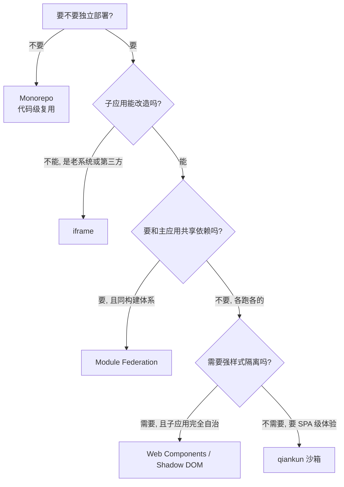

## 微前端方案对比

> 四种方案解决的是同一件事——把子应用挂进主应用并划出边界——差异全在边界划在哪：iframe 划在浏览器进程，qiankun 划在 JS 全局对象，Module Federation 划在构建产物，Web Components 划在 DOM 树。

---

### 一句话对比

| 方案 | 一句话 |
|:---|:---|
| iframe | 浏览器给的物理隔离，最彻底也最不听话 |
| qiankun（JS 沙箱） | 用 Proxy 假装出一个全局对象，兼容成本换 SPA 体验 |
| Module Federation | 不隔离，直接把子应用的模块当依赖用 |
| Web Components | 用自定义元素 + Shadow DOM 划边界，样式隔离强、事件隔离过强 |

---

### 四方案对照

| 维度 | iframe | qiankun（JS 沙箱） | Module Federation | Web Components |
|:---|:---|:---|:---|:---|
| **核心机制** | 浏览器原生嵌套文档 | HTML Entry 拉取子应用 DOM 并接管生命周期 | 构建期声明 exposes/remotes，运行时加载远程模块 | 自定义元素注册 + Shadow DOM 封装 |
| **JS 隔离** | 强物理隔离（独立 Window） | 逻辑隔离（快照沙箱 / Proxy 沙箱） | 无（同一全局上下文） | 无（同一全局上下文，只有 DOM 边界） |
| **通信方式** | `postMessage` | 主应用注入 props / 全局事件总线 | 直接 import 共享模块 | 元素属性 / 自定义事件 |
| **CSS 隔离** | 强物理隔离（独立 DOM 树） | 逻辑隔离（前缀 / 运行时切换样式表） | 无（靠 CSS Modules、BEM 等约定） | 强（Shadow DOM 样式边界，双向阻断） |
| **URL 路由** | 冲突且不同步，刷新易丢状态 | 与单页应用一致 | 与单页应用一致 | 需主应用接管，元素内部不管路由 |
| **弹窗 / 浮层** | 被视口框死，无法全屏 | 挂到顶级 body，可全屏 | 原生 DOM，可全屏 | 受 Shadow DOM 边界限制，弹层样式与事件会断 |
| **性能开销** | DOM 重建开销大，切换卡顿 | 局部替换，切换快 | 无重复依赖，首屏最优 | 无 DOM 重建，但每个组件多一层 shadow root |
| **接入侵入性** | 最低，零改造 | 中：子应用要暴露生命周期钩子 | 高：构建体系需锁定 Module Federation | 较高：子应用要改造成自定义元素 |
| **适用边界** | 老系统、第三方页面、强安全隔离 | 多框架共存、要 SPA 体验 | 同构建体系、要依赖共享 | 完全自治、不需主题化的子应用 |

---

### 三处最容易误判的地方

- 隔离强度不等于方案优劣。iframe 隔离最强，但路由、弹窗、性能三项全输，只在"能跑就行"的场景里划算。
- Module Federation 不是隔离方案。它共享的是模块，子应用和主应用跑在同一个全局上下文里，样式和全局变量该冲突还是会冲突。
- Shadow DOM 的隔离是双向的。外面的样式进不来，里面的样式和事件真实目标也出不去——弹窗丢样式、React 16 事件委托失效、全局主题割裂是同一堵墙的两面，不是三个独立问题。完全自治、不需要主题化的子应用（第三方 SDK、编辑器内核）用它仍然是对的。

---

### 选型决策

判断顺序不能反：先问独立部署（不要就退回 Monorepo），再问子应用能不能改造（不能就只剩 iframe），最后才在三个运行时方案里按隔离需求挑。

---

### 知识图谱

- **上位**：
	- [[微前端]] — 本表服务的概念
- **并列**：
	- [[何时选微前端或Monorepo]] — 上一层的问题：要不要拆
	- [[微前端vsMonorepo性能对比]] — 拆与不拆的性能差
- **下位**：
	- [[iframe在微前端中的应用与演进]] — iframe 方案的原理与硬伤
	- [[微前端沙箱隔离]] — qiankun 式 JS 沙箱与 CSS 隔离的实现
	- [[微前端ModuleFederation方案]] — Module Federation 配置流程
	- [[微前端WebComponents封装]] — 自定义元素封装子应用的流程
	- [[微前端路由分发模式]] — 主应用按路由挂载子应用的流程
- **相关**：
	- [[微前端架构下的ShadowDOM样式物理隔离研究]] — Shadow DOM 边界的具体表现
	- [[qiankun]] · [[Module Federation]] · [[Single SPA]]
