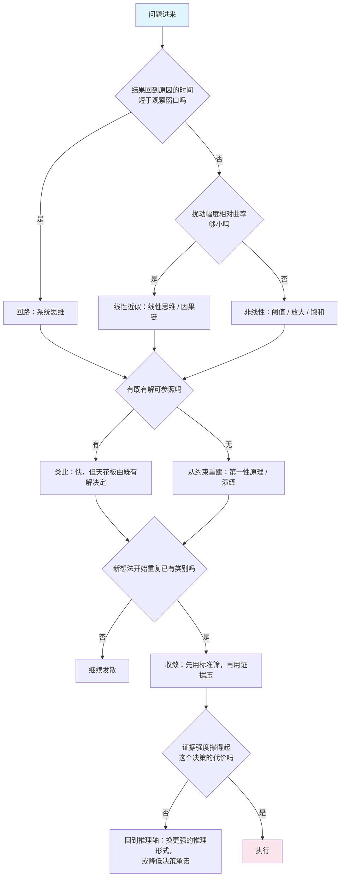

## 概念：思维方式

> 「思维方式」不是一个东西，是四个问题的答案被同一个词压扁了：世界是什么形状、凭什么推下去、此刻该展开还是收束、这个结论值不值得信。四者正交，换掉一个并不蕴含换掉另外三个。

**解决的核心痛点**：把「换一种思维方式」从口号变成动作。多数「思路打不开」不是能力不足，是在错误的轴上用力——用更大的决心去收敛一个从未展开过的问题，或者用整体视角替掉一次本来该做的减法。

### 核心命题

- 四条轴正交，一条轴上的选择不蕴含其他轴
	- **原理**：四条轴回答四个互不相干的问题。所以一个严密的演绎可以建立在一个从未被检验的前提上（质检轴缺席），一个习惯看整体的人也可能在发散阶段就被自己的全景图锁死（工序轴失效）。轴之间没有推导关系，因为问题不同
- 「换一种思维方式」这句话没有信息量，除非指明换哪一轴
	- **原理**：不指向具体轴的指令无法被验证，因此无法被改进。指明轴之后才有可执行的动作：换推理形式、补一轮发散、加一次质检。做不到这一步的讨论会一直停在「你要打开思路」这种无法执行的层面
- 轴之间有先后约束，顺序错了会互相抵消
	- **原理**：工序轴上发散必须先于收敛；质检轴上判断要在发散阶段关闭、在收敛阶段打开。同一时刻只允许一轴主导——边生成边评估，会让两个动作互相削弱：想法被过早否掉，标准也被浮夸的想法带偏
- 线性与非线性是同一族函数在不同扰动尺度下的两种近似，不是两派世界观
	- **原理**：光滑函数在局部可由一阶泰勒项近似，残差是曲率乘扰动幅度的平方。所以「该线性还是非线性」取决于扰动幅度相对曲率的比值，与问题「复不复杂」无关。这也解释了为什么同一个系统，预算评审时用线性模型够用，做压力测试时必须换非线性模型

### 运行机制

四条轴的取值与各自的失效症状：

| 轴 | 它回答 | 取值 | 用错的症状 |
|:--|:--|:--|:--|
| 本体 | 世界是什么形状 | 线性 / 回路 / 非线性 | 用回路解释一个反馈在观察窗口外才闭合的问题，把一周的事拖成一年 |
| 推理 | 凭什么推下去 | 演绎 / 归纳 / 类比 / 从约束重建 | 把类比得到的假设当证明用；用演绎的姿态对待归纳的前提 |
| 工序 | 此刻展开还是收束 | 发散 / 收敛 | 过早收敛（第一个可行解就走）；无休止发散（分析瘫痪） |
| 质检 | 这个结论值不值得信 | 批判 | 只有否定没有方案；质检只在事后做 |

四条轴串成一个动作序列，判定的顺序是固定的——先定形状，再定推理，再定工序，最后过质检：

图里有两处判据值得单拎出来，它们都不靠感觉：

- 判「线性还是回路」看时间窗口：反馈在你要观察的窗口内闭合，就必须画回路；闭合在窗口之外，线性近似够用而且更便宜。
- 判「发散够了没有」看类别重复：新想法开始复述已有类别，是覆盖度饱和，不是创造力枯竭。这条比「想不出来了」可判定得多。

### 关键区别

最常混的一对是「认知模式」与「流程」，它们不在同一个层级：

| | 认知模式（轴上取一个值） | 流程（轴的排程） |
|:--|:--|:--|
| 例子 | 系统思维、演绎、发散、批判性 | 设计思维、双钻模型、PDCA、科学方法 |
| 回答的问题 | 这一步按什么规则想 | 什么时候从哪一轴切到哪一轴 |
| 学它得到什么 | 一种看问题的方式 | 一张顺序表，加每一步的验收物 |
| 失效方式 | 用错轴：拿回路去解释单点故障 | 走完仪式但没有任何决策被改变 |

所以「设计思维是一种思维方式」这句话是错的：它不提供新的认知能力，只规定顺序——先共情再定义，先发散再原型。把它当第五种模式用，会得到一个走完全程却没有结论的工作坊。

### 适用范围

- ✅ **适用场景**
	- **诊断卡点**：先问「卡在哪一轴」，比问「该用什么思维」可执行，也更容易找到下一个动作
	- **拆解风格争论**：「我是逻辑型还是直觉型」这类分类不可验证；还原成四条轴上的具体位置之后，分歧往往只落在一条轴上
	- **判断要不要引入新方法**：先看它填的是哪条轴。填不出来的，多半是把旧动作换了名字
- ⛔ **误用**
	- **当人格标签**：「我是系统思维者」把一次轴上的选择固化成身份，代价是从此不收敛
	- **四条轴全开**：每个小决策都跑一遍分轴判定，成本高过收益。只有决策代价大到能覆盖判定成本时，分轴才划算
- **失效边界**
	- **不解释直觉**：专家直觉是在四条轴上跳过、直接给答案的压缩模式匹配。这套划分描述不了它如何工作，只能事后归因
	- **不产生新可能**：轴只负责组织已经存在的可能性，创造性不在这张图上
	- **假定你有离线时间**：现场对话、救火、实时对抗里跑不完四个判定，它属于事前设计和事后复盘的工具

### 批判

- **外部批判**
	- 认知风格（cognitive style）研究做了半个世纪，始终没有收敛出稳定、可复现的维度。本库这四条轴是工程用划分——验收标准是「能不能据此换下一个动作」，不是实证效度
	- 分类学的通病是自证：任何一次思考都能被追认到某一轴，因此缺少可证伪的预测。要让它可检验，只能看它给出的动作是否优于不分轴时的动作
- **内在张力**
	- 四轴要求「一次只看一轴」，而真实思考里四轴是交织的。写成顺序是为了可执行，代价是失真：分轴判定给出的动作，未必是当时最优的那一个

### 知识图谱

- **下位**：
	- [[逻辑思维]] — 推理轴上取「形式有效性」
	- [[线性思维]] — 本体轴上取「单向因果，反馈在窗口外」
	- [[系统思维]] — 本体轴上取「回路」
	- [[非线性思维]] — 本体轴上取「叠加失效」
	- [[发散思维]] — 工序轴上的展开
	- [[收敛思维]] — 工序轴上的收束
	- [[批判性思维]] — 质检轴
- **相关**：
	- [[设计思维]] — 不是第五轴，是轴的排程：把发散、收敛、测试排成固定节拍
	- [[视觉思维]] — 换了媒介，没换轴
	- [[奥卡姆剃刀]] — 收敛阶段最常用的默认判据
	- [[概率云]] — 当结论只能给出概率分布时，质检轴要换的判据
- **外部资料**
	- 《我们如何思维》— 杜威，把反思性思维拆成五步的最早尝试之一，也是「思维可以分阶段」这一思路的源头
	- [Design Council：History of the Double Diamond](https://designcouncil.org.uk/resources/the-double-diamond/history-of-the-double-diamond) — 一个流程类模型如何被造出来的一手叙述，正好说明流程与认知模式的差别
