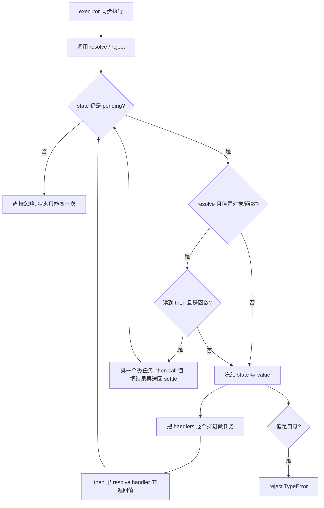

## SOP：手写一个符合规范的 Promise

> 目标：写出来的实现不是「长得像 Promise」，而是能与原生 Promise 混用——`.then` 回调进微任务队列、返回值自动展开、错误沿链冒泡、thenable 被采纳，且事件序列与原生逐项一致。
> 判据很硬：同一段剧本分别跑原生与本实现，得到的执行顺序必须一样。差一个 tick 就是错的，只不过多数场景看不出来。

### 目标与边界

目标：得到一个约 140 行、可直接替换原生 Promise 的单文件实现，通过 14 项行为断言，其中含「与原生事件序列完全一致」的对照测试。

依赖：`queueMicrotask`（Node 11+ / Chrome 71+ / Safari 12.1+），以及 class 私有字段 `#`（Node 12+ / Chrome 74+）。实现本身不使用 `async/await`，也不依赖任何库——用 Promise 实现 Promise 是自我循环，语义会失真。

失效条件：

- 宿主没有 microtask 队列：整个异步语义会塌回同步，且不报错。此时连 `queueMicrotask` 都没有，改用 `MutationObserver` 或 `process.nextTick` 属于换平台而非换写法。
- 需要 `Promise.withResolvers`、`Symbol.species`、`unhandledrejection` 上报：本文不覆盖，前两者是外围 API，第三项要靠宿主钩子。
- 需要与 async 函数完全相同的调试堆栈：手写实现多一层闭包，堆栈必然更长，这是结构性代价，不是写法问题。
- 跨 realm 使用（iframe、worker 之间传对象）：`instanceof MyPromise` 在这种场景下判定失败，规范用 thenable 检测而非 instanceof。

### 适用场景

- 场景 1：理解微任务与状态机——把「then 为什么是异步的」从背结论变成看得见的实现。
- 场景 2：宿主环境没有 Promise，又需要一个等价物（老引擎、插件沙箱）。
- 场景 3：要给 Promise 打补丁，例如加超时、取消、调用链埋点，需要先有一份可改的实现。
- 场景 4：面试。这道题的区分度不在「写不写得出来」，而在回调是否异步、catch 之后状态是否恢复。

### 流程图解



### 核心步骤

1. 只留一个落定入口。四个内部槽：`#state`、`#value`、`#handlers`，以及私有的 `#settle(type, payload)`。`resolve` / `reject` 都只是它的转发，第一行就是 `if (state !== pending) return`——状态只能变一次这条规则，靠一处检查覆盖全部路径。
2. `resolve` 要处理三件事，顺序不能换：值是自身 → 抛 `TypeError`；值是对象或函数且带 `then` → 采纳它的结果；否则冻结状态与值。第二件最容易漏，漏了就会出现「resolve 一个 Promise，拿出来还是个 Promise」。
3. thenable 采纳必须排进微任务。规范把「调用 then」定义为独立作业，不能在 `resolve` 的同步栈里执行——否则一个同步的 thenable 会把整条链拉回同步执行。
4. `then` 只做两件事：包一层新 promise 并返回，把回调排进微任务。已落定的也要排，不能因为它已经 settled 就直接同步调用。
5. 值穿透与错误穿透合并成一处：handler 不是函数时，fulfilled 就把值往下传，rejected 就把原因往下抛。
6. `catch` 与 `finally` 是 `then` 的语法糖；`all` / `allSettled` / `race` 是「转发每个元素，再用计数器判断是否收尾」。

> 速记口诀：状态私有只变一次，executor 包 try；resolve 遇 thenable 排微任务，then 必返回新实例；回调不在同步栈，catch 之后要恢复。

### 实践/示例

完整实现。注释只标「为什么」，不解释「是什么」。

```javascript
const PENDING = 'pending';
const FULFILLED = 'fulfilled';
const REJECTED = 'rejected';

class MyPromise {
  #state = PENDING;
  #value = undefined;
  #handlers = [];

  constructor(executor) {
    const resolve = (value) => this.#settle('resolve', value);
    const reject = (reason) => this.#settle('reject', reason);
    try {
      executor(resolve, reject);
    } catch (err) {
      this.#settle('reject', err);       // executor 同步抛错 → 转为 rejected
    }
  }

  // 唯一的落定入口：自引用、thenable 采纳、状态冻结都在这里
  #settle(type, payload) {
    if (this.#state !== PENDING) return;               // 状态只能变一次

    if (type === 'resolve') {
      if (payload === this) {                          // 自引用
        return this.#settle('reject', new TypeError('Chaining cycle detected'));
      }
      if (payload && (typeof payload === 'object' || typeof payload === 'function')) {
        let then;
        try {
          then = payload.then;                         // 读 then 也可能抛
        } catch (err) {
          return this.#settle('reject', err);
        }
        if (typeof then === 'function') {
          // 采纳必须排进微任务，不能在 resolve 的同步栈里调用 then
          queueMicrotask(() => {
            let called = false;
            try {
              then.call(
                payload,
                (v) => { if (!called) { called = true; this.#settle('resolve', v); } },
                (r) => { if (!called) { called = true; this.#settle('reject', r); } }
              );
            } catch (err) {
              if (!called) { called = true; this.#settle('reject', err); }
            }
          });
          return;
        }
      }
    }

    this.#state = type === 'resolve' ? FULFILLED : REJECTED;
    this.#value = payload;
    this.#flush();
  }

  #flush() {
    const list = this.#handlers;
    this.#handlers = [];                              // 先摘走，避免重复执行
    for (const run of list) queueMicrotask(run);      // 一个回调一个微任务
  }

  then(onFulfilled, onRejected) {
    return new MyPromise((resolve, reject) => {
      const run = () => {
        const handler = this.#state === FULFILLED ? onFulfilled : onRejected;
        if (typeof handler !== 'function') {          // 值穿透 / 错误穿透
          return this.#state === FULFILLED ? resolve(this.#value) : reject(this.#value);
        }
        try {
          resolve(handler(this.#value));
        } catch (err) {
          reject(err);
        }
      };
      if (this.#state === PENDING) this.#handlers.push(run);
      else queueMicrotask(run);                       // 已落定也要异步执行
    });
  }

  catch(onRejected) {
    return this.then(undefined, onRejected);
  }

  finally(onFinally) {
    return this.then(
      (value) => MyPromise.resolve(onFinally()).then(() => value),
      (reason) => MyPromise.resolve(onFinally()).then(() => { throw reason; })
    );
  }

  static resolve(value) {
    if (value instanceof MyPromise) return value;
    return new MyPromise((resolve) => resolve(value));
  }

  static reject(reason) {
    return new MyPromise((_, reject) => reject(reason));
  }

  static all(iterable) {
    return new MyPromise((resolve, reject) => {
      let items;
      try { items = [...iterable]; } catch (err) { return reject(err); }
      const results = new Array(items.length);
      let remaining = items.length;
      if (remaining === 0) return resolve(results);
      items.forEach((item, i) => {
        MyPromise.resolve(item).then((v) => {
          results[i] = v;                             // 按下标写，保证顺序
          if (--remaining === 0) resolve(results);
        }, reject);                                   // 任一失败立即短路
      });
    });
  }

  static allSettled(iterable) {
    return new MyPromise((resolve, reject) => {
      let items;
      try { items = [...iterable]; } catch (err) { return reject(err); }
      const results = new Array(items.length);
      let remaining = items.length;
      if (remaining === 0) return resolve(results);
      const done = () => { if (--remaining === 0) resolve(results); };
      items.forEach((item, i) => {
        MyPromise.resolve(item).then(
          (value) => { results[i] = { status: FULFILLED, value }; done(); },
          (reason) => { results[i] = { status: REJECTED, reason }; done(); }
        );
      });
    });
  }

  static race(iterable) {
    return new MyPromise((resolve, reject) => {
      let items;
      try { items = [...iterable]; } catch (err) { return reject(err); }
      for (const item of items) MyPromise.resolve(item).then(resolve, reject);
    });
  }
}
```

对照测试的写法值得单独留一笔：不写「我认为应该是这个顺序」，而是把同一段剧本分别喂给原生 `Promise` 和 `MyPromise`，比较两份日志。

```javascript
function scenario(P) {
  const log = [];
  const t = (x) => log.push(x);

  const p1 = new P((resolve) => { t('executor'); resolve(1); });
  p1.then((v) => t('A' + v));
  t('sync');                       // 同步代码必须排在 then 之前

  p1.then((v) => {
    t('B' + v);
    new P((_, reject) => reject('e1'))
      .catch((e) => { t('C' + e); return 'fixed'; })
      .then((v) => t('D' + v));    // catch 之后必须恢复为 fulfilled
    new P((resolve) => resolve({ then(ok) { ok('t'); } }))
      .then((v) => t('E' + v));    // thenable 采纳
    new P(() => { throw new Error('boom'); })
      .catch((e) => t('F' + e.message));
    new P((resolve) => resolve(1)).then().then((v) => t('G' + v));  // 值穿透
    P.all([new P((r) => r(1)), 2, new P((r) => setTimeout(() => r(3), 0))])
      .then((arr) => t('H' + arr.join(',')));
  });

  return log;
}

const native = scenario(Promise);
const mine = scenario(MyPromise);
// 断言：两份日志逐项相等
```

这条断言比任何单点用例都严：它同时检查了同步/异步边界、回调入队顺序、catch 的状态恢复、thenable 的微任务延迟、静态方法的收尾时机。本实现跑出的顺序是 `executor → sync → A1 → B1 → Ce1 → Fboom → Dfixed → Et → G1 → H1,2,3`，与原生一致。

### 常见坑点

- ⛔ 回调在 resolve 里直接 forEach 执行。原稿就是这么写的，实测输出 `then → sync`，回调抢在同步代码之前——所有依赖时序的代码静默错位。修法：`#flush` 里每个 handler 各排一个 `queueMicrotask`。
- ⛔ `handleRejected` 里写 `reject(result)`。onRejected 正常返回意味着这条链已经恢复，应该 `resolve(result)`。写反的后果实测：`.catch(e => 'recovered')` 之后链上仍是 rejected，且 `'recovered'` 变成了 rejection 的原因。这个 bug 只在 catch 后面还挂着 then 时才显形。
- ⛔ `resolve(promise)` 把 Promise 当普通值存下。实测 `resolve(inner)` 之后 `.then` 拿到的是 Promise 实例而不是它的值。修法：进 `#settle` 时先看 then。
- ⛔ `then` 返回 `this`。链上所有 then 共享同一个状态，链式调用变成多次覆盖，值与顺序全乱。
- ⛔ 用 `setTimeout(fn, 0)` 代替微任务。宏任务会被排在所有微任务之后，与原生 Promise 的顺序差一整轮，混用 async/await 时立刻暴露。
- ⛔ 只在 pending 时把回调塞进队列，忘了已落定也要异步。`p.then` 写在 `p` 落定之后是很常见的写法，这条漏掉就是同步执行。
- 🔧 用 `instanceof MyPromise` 判断是不是 Promise：跨 realm 失效（iframe、worker）。判据应该是「有 `then` 且是函数」，这也是 thenable 一词的由来。
- 🔧 自引用导致栈溢出：`p.then(() => p)` 在原生里是 `TypeError`，手写时若不检查会一路递归到爆栈。检查点是 `payload === this`。
- 🔧 `finally` 用 `resolve` 收尾会把 rejection 吞掉：回调里必须 `throw reason` 再往下传。

### 验证记录

- 2026-10-27 · Node v22.22.2 · 14 项断言全部通过，覆盖：与原生事件序列一致、then 不占同步栈、与原生微任务同队列、自引用 TypeError、重复落定无效、then 返回新实例、executor 抛错、值穿透与错误穿透、`all` 保序、`allSettled` 状态形状、`race` 取先落定者、`all([])`、`finally` 等待与不吞错。
- 2026-10-27 · 同环境复现原稿三处缺陷：then 回调抢在同步代码前（`then → sync`）、catch 之后仍是 rejected（原因变成 `recovered`）、`resolve(promise)` 不展开。三处均已在新实现中修正并被测试覆盖。

### 知识图谱

- 父级概念：
	- [[Promise]] — 本 SOP 是该概念的可执行链路
- 核心命题：
	- [[Promise 状态一旦确定就不会再改变]] — 对应 `#settle` 的第一行状态检查
	- [[Promise 通过 thenable 接口实现链式调用，解决回调地狱]] — 对应 then 返回新实例
	- Promise.all 失败时立即终止，Promise.allSettled 等待所有 Promise 完成 — 对应两个静态方法的差异
- 关联：
	- [[微任务]] — then 回调必须进微任务队列，这是整篇最核心的判据
	- [[事件循环]] — 微任务在宏任务末尾清空，决定回调与渲染的相对位置
	- [[手写经典功能]] — 同类 SOP 的上级清单
