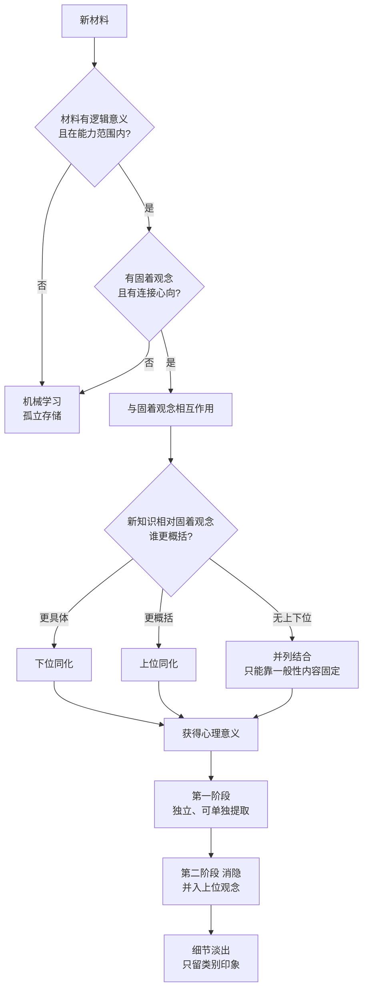

## 概念：有意义学习

> 新知识以「非人为的、实质性的」方式与认知结构里已有的观念发生作用，从而获得**心理意义**——它不再是记住的一句话，而是变成你能用的一个念头。

奥苏贝尔（David Ausubel）在《教育心理学：认知观点》（1968）里提出，它是本库三条方法论之一（PARA 管位置、卡片盒管内化、它管**联系为什么产生意义**）。

**解决的核心痛点**：为什么读了同样一篇文章，有人内化成能力，有人只是过了一遍。「读过了」和「学会了」之间的差别不是记忆量，是**有没有一个已有的观念把新东西接住**。

### 核心命题

- **它需要两个条件同时成立，缺一个就退化成机械学习。** 客观一侧：材料本身有逻辑意义，且在学习者理解能力范围内；主观一侧：认知结构里存在能接住它的固着观念（anchoring idea），**并且**学习者有心向去主动连接。缺主观条件时，材料再好的文章也只是被抄进库里。
- **同化有三种形态，方向由「谁更概括」决定，不由话题决定。** 新知识更具体 → 下位（归属于已有概念）；新知识更概括 → 上位（把已有概念收进来）；两者无上下位、只能靠认知结构中一般性内容固定 → 并列结合。前两种有明确的固着点，**并列结合最难**，因为没有一个具体观念可以挂。
- **有意义学习与机械学习是连续体，接受与发现是另一个独立维度。** 这是它最常被读错的地方：接受学习（听讲、读文）完全可以有意义，发现学习（动手、探究）也完全可以是机械的——做了实验却没接上任何已有观念，记下的只是操作步骤。判断标准从来不是「谁在讲」，是**有没有发生同化**。
- **遗忘不是痕迹消失，而是同化的第二阶段。** 新材料先以独立身份被固着（这一段还能单独回忆），随后逐步并入更概括的观念、失去自己的边界——于是你记得「那一类东西」，说不出「那一条」。细节退成印象，是这个机制的副产品，不是失败。

### 运行机制

三种同化的方向容易混，用一个例子拉平：

| 已有 | 新学 | 形态 | 固着点在哪 |
|:--|:--|:--|:--|
| 三角形 | 等边三角形 | 下位 | 「三角形」提供意义，等边只是加了一条限定 |
| 长方形、正方形、平行四边形 | 四边形 | 上位 | 三个下位概念被收进新概念，新概念靠它们获得意义 |
| 质量 | 能量 | 并列结合 | 没有一个更概括的观念能接住，只靠「物理量」这类一般印象 |

### 关键区别

把两个维度分开看，才知道「有意义」不是某类活动的专利：

| | 有意义 | 机械 |
|:--|:--|:--|
| **接受**（听讲、读文） | 听懂了、能用自己的话复述、能接上已有经验 | 抄下来、背下来、一字不差但说不清为什么 |
| **发现**（动手、探究） | 自己推出规律，并与已有观念咬合 | 按步骤做完实验，记下结论，不知其所以然 |

奥苏贝尔本人押注的是**有意义的接受学习**——这与当时流行的「发现学习才深刻」相反，也是他被布鲁纳一派批评的原因。

与机械学习的差别落在四个可观察的后果上：

| 维度 | 有意义学习 | 机械学习 |
|:--|:--|:--|
| 联系性质 | 非人为、实质（换个说法仍等值） | 人为、字面（换说法就断） |
| 保持 | 久，且随时间并入上位概念 | 短，且孤立 |
| 迁移 | 能进新情境 | 换个场景就失效 |
| 检索 | 由关系带出来 | 只能靠原样线索 |

### 从理论到本库的图谱

本库的关系桶里，前三桶（上位 / 下位 / 并列）直接借自这里的三型同化，这是有意为之：**写一条链接，等于做一次同化**。但借名时有两处条件没有跟着搬，另有两个桶根本不在这套理论里。

**滑动一：`下位` 从「机制」降为「分类」。** 奥苏贝尔的下位同化，前提是那个更概括的观念**真的起固着作用**——没有它，新知识根本得不到意义。本库的判据是「目标从属于本笔记：本笔记的结论在它身上成立，且它多了额外限定」，这是**逻辑包含**，不检查目标是否真从本笔记获得过意义。所以能写出「逻辑上从属、认知上从不互相引用」的假下位。补判据只需一问：这个下位笔记，我是不是在写它的时候真的回头读过这一篇？

**滑动二：`并列` 的条件被换掉了。** 奥苏贝尔的并列结合，恰恰是**没有共同上位**的关系——正因为没有，才只能靠一般性内容固定，才最难。本库的定义是「与本体共享同一个上位，互不从属」，加了奥苏贝尔那里没有的「共享上位」。后果很具体：跨领域的同级关系（CSRF 与 XSS、Fiber 与 Webpack）在这里判不出并列，只能落 `相关`。

**两桶不在理论内。** `相关` 是奥苏贝尔框架里不存在的关系——在他的模型里，接不上的联系不是「弱连接」，是「没发生有意义学习」。`外部资料` 更不是知识关系，是书目信息。五桶实际是「三个认知关系 + 一个兜底 + 一个出处字段」，平铺成同级会让 `相关` 看起来像 `上位` 的弱化版。词表承认「`相关` 是默认桶」，这个默认，一部分正是 `并列` 定义过窄挤出来的。

落到日常动作上，三句话：

- 填 `up` 时问：这篇新笔记是被哪一篇**接住**的？答不出来，说明它现在还是一段机械记忆，只是碰巧存在库里。
- 写下位时问：它真的从本篇获得意义，还是只是逻辑上更细？
- 跨领域的同级关系，老实落 `相关`——那里才是它的位置。

还有一处对应不在桶上，在层级上：**MOC 在功能上就是先行组织者**（advance organizer）。奥苏贝尔 1960 年提的策略是，在正式内容之前先给一份包摄性更广、更清晰稳定的引导材料，让后面的新知识有地方挂。本库的 MOC 正占这个位置——先有一张领域地图，后续概念才有 up 可指。反过来说，一个没有任何笔记从里面往外链的 MOC，只是目录清单，没起组织作用。

### 适用范围

- ✅ **有先备知识的领域**：固着观念已经存在，新知识有地方可挂。这是它最能发挥的场景。
- ✅ **逻辑连贯、可被理解的教材型材料**：教科书、规范文档、系统性的课程。
- ✅ **判断一次学习是否真的发生**：不必看时长和笔记量，只问「能用它解释一件别的事吗」。
- ⛔ **零基础的第一次接触**：认知结构里还没有固着观念，此时强行「有意义」会变成牵强附会。这个阶段需要先建骨架，别指望同化。
- ⛔ **本身无逻辑意义的材料**：外语单词表、元素符号、身份证号、API 签名——材料侧条件不成立，只能先机械记住，再靠使用赋予意义。
- **失效边界**：它解释「理解如何发生」，不解释「动机从哪来」。心向是它的必要条件，但理论只能要求心向，不能生产心向——所以「先有兴趣再学」这句话，它答不了。

### 批判

- **外部批判**
	- 布鲁纳一派：过度倚重接受学习，低估了发现与探究在建立直觉上的作用。后来的共识是两者都能有意义——这个结论本身就是对「哪一派更对」的否定。
	- 严格的层级假设：奥苏贝尔把认知结构设想成「最概括的观念在顶端」的层级树。后来的语义网络与图式理论把它放宽成带交叉连接的网——真实的知识常常不只有一个上位。
	- 情境认知一派（1980 年代末）：知识的意义离不开它被使用的情境，脱离情境谈「固着在认知结构里」，会高估抽象、低估实践共同体。
- **内在张力**
	- 两个条件里，主观条件（心向）最难保证，而理论对它几乎没有处方。于是它最像一份**诊断标准**，而不是**教学方案**：能判断这次学习是不是机械的，不能直接告诉你怎样让它变得有意义。

### 知识图谱

- **上位**：[[认知心理学]] — 它属于学习过程研究的一支
- **相关**：
	- [[费曼技巧]] — 用「讲不讲得通」反查固着是否真的发生
	- [[知识内化]] — 本库把同化落到笔记流程上的实现
	- [[认知负荷]] — 固着观念再多，工作记忆装不下也白搭
	- [[主动回忆]] — 检验意义是否稳固的提取动作
	- [[知识图谱词表]] — 五桶的判据与来源，本节「两次滑动」的对照对象
	- [[本库指南]] — 三方法论的并列关系
- **外部资料**
	- Ausubel, *Educational Psychology: A Cognitive View*, 1968（1978 修订版）— 同化理论与三型划分的原始出处
	- Ausubel, *The use of advance organizers in the learning and retention of meaningful verbal material*, 1960 — 先行组织者策略
