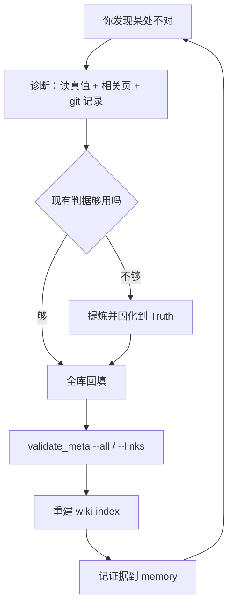

## 概念：本库的实际运行方式

> 本库名义上按 llm-wiki 的「素材流入」运转，实际驱动力是「判据先行 → 固化到 Truth → 脚本校验 → 全库回填」。前者提供命名与协作契约，后者决定每天做什么。

**解决的核心痛点**：llm-wiki 只回答了「新笔记进来怎么办」，没有回答「已有的 1220 篇结构不对怎么办」。2026-10 以来的工作几乎全在后者，而两份文档都没有为它留位置。不把这个错配写下来，每次都要重新争论「为什么不按 ingest 走」。

### 核心命题

- [[数字花园的状态反映了知识的成熟度]]
- [[痛点是知识管理的唯一动力源]]
- [[知识只有被调用时才产生价值]]

顺序是「阶段 → 驱动 → 验收」：先由成熟度决定当前该做增量还是治理，再确认驱动力来自你的判断而非外部素材，最后用「是否被调用」检验前两步的成果。三条合起来解释了本文要说的三件事——存量治理是常态、库不靠新素材长大、query 缺位是实质隐患而非习惯问题。

### 运行机制

实际每天发生的循环是垂直的：一个判据贯穿所有层，而不是知识在层间流动。

名义上的水平循环（素材 → INBOX → ingest → atomic → concept → 索引与日志）仍然存在，但只在 INBOX 有素材时启动。两者不是替代关系：垂直循环产出判据，水平循环消费判据。

本篇描述的是循环的**形状**；逐步怎么走见 [[存量治理]]——那是这条循环的操作化，不复述这里的判断。

这个形状差异解释了三件事：

1. 账本为什么换了。条目级的 index 与 wiki-log 无法表达「43 篇同时改 up」这类容器级改动，于是一部分账本功能迁移到按天分文件的 memory。
2. atomic 为什么被改。判据在演进，按旧判据写的 atomic 必须回填；「永不修改」这条只在判据稳定后成立。
3. 为什么需要第四层。判据要住在某处，而 llm-wiki 的三层没有这个位置，`Truth/` 只能自己长出来。

### 关键区别

| 维度 | llm-wiki（方法论） | 本库实际 |
|:---|:---|:---|
| 时间单位 | 一篇新笔记的到来 | 一个判断被推翻 |
| 主要输入 | 外部素材 | 你的痛点与质疑 |
| 主流程 | ingest 六步 | 存量治理：诊断 → 固化 → 回填 |
| 合格判据 | 索引与日志同步 | 脚本校验通过 + 判据已落库 |
| 账本 | index + log + state | index + memory |
| 变更粒度 | 一次一篇 | 一次一族 |

### 适用范围

- ✅ **适用场景**
	- **解释「为什么不按流程走」**：先判断当前处在增量期还是治理期，再论流程
	- **判断某个动作该配哪个工作流**：看它的输入是素材还是判据
	- **评估工具投入**：判据类的改动值得写脚本，单篇改动不值得
- ⛔ **误用**
	- **把「实际方式」当成「不需要流程」**：INBOX 有素材时 ingest 仍然要走，否则素材会烂在 Inbox（当前 5 篇停在 10-28 就是例子）
	- **把垂直循环当万能**：没有新素材进来，判据只能自我循环，库会越来越一致而不再长大
- **失效边界**
	- 采集恢复后水平循环重新成为主线，本文描述的重心会偏移
	- 多人协作库里「判据先行」失效：判据本身要先协商，而协商不在这个模型里

### 批判

- **内在张力**
	- 判据由实践提炼，又用来回填实践。判据提炼错了，全库会被系统性地改错，而 `validate_meta.py` 查不出来——它只查字段与链接，不查判据对不对。这是这套方式最脆弱的一环。
	- 「实际方式」是从 15 份工作日志里归纳的，样本只有一个月，且由同一个人驱动。它现在是一个观察，还不是一条规律。

### 知识图谱

- **上位**：[[知识管理]] — 本库是知识管理的一个实例
- **下位**：
	- [[存量治理]] — 这条垂直循环的操作化：触发、判据定夺、回填顺序、收尾校验
- **并列**：[[混合型知识库架构]] — 同样描述库的整体形态，那篇讲类型构成，本篇讲运转方式
- **相关**：
	- [[llm-wiki-schema]] — 名义方法论的作业指南，本库偏离它的地方都在这里
	- [[人机分工规范]] — 谁写什么的契约，是这套运转方式能成立的前提
	- [[知识内化工作流]] — 单篇知识从采集到内化的水平流程
