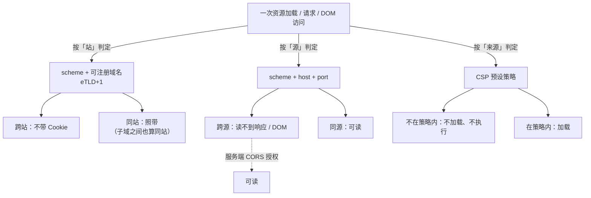

> 浏览器运行在不可信环境中，通过沙箱和隔离机制限制代码对系统资源、用户数据和其他网站的访问权限。

**解决的核心痛点**：如何在允许执行任意 Web 代码的同时，保护用户隐私和系统安全？

---

## 核心命题

- [[同源策略拦的是读响应，不是发请求，所以挡不住 CSRF]]
	- **原理**：以「源」（协议 + 域名 + 端口）为隔离单位，脚本只能读写同源文档的 DOM、Cookie 与响应。判的是「能不能读」
- [[CSP把资源加载从默认放行改为按策略判定]]
	- **原理**：在取 / 解析 / 执行三个位置插入判定点，依据预先声明的策略决定放行或拦截。判的是「来源」，不是「行为」
- [[SameSite按站而非源判定是否附带Cookie]]
	- **原理**：以「站」（scheme + 可注册域名）而非「源」为判定单位，决定跨站请求是否携带 Cookie。管的是「带不带凭据」，不是「请求发不发」

> 三条命题都只描述判定发生在哪一步、以什么为单位。至于「该配什么、配错了会怎样」，不属本页。

---

## 运行机制

> 三个判定并行发生，各自有各自的单位，谁也代替不了谁：**站**决定凭据带不带，**源**决定读不读得到，**来源**决定资源进不进得来。传输层（HTTPS / HSTS）是这三者的前提，不参与判定本身，属策略侧——归档在 [[Web安全策略]]。

---

## 关键区别

| 机制 | 判定单位 | 判定什么 |
|:--- |:--- |:--- |
| **同源策略** | 源（协议 + 域名 + 端口） | 能否读写另一份文档的 DOM、Cookie 与响应 |
| **CORS** | 源 | 跨源请求的响应能否被读取（服务端显式授权后才放行） |
| **CSP** | 来源（scheme + host + 端口 + 路径） | 资源能否被加载与执行 |
| **SameSite** | 站（scheme + 可注册域名） | 跨站请求是否携带 Cookie |

四行的判定单位各不相同，这正是它们不能互相替代的原因：同源策略管「读」，CORS 管「跨源读的授权」，CSP 管「资源能不能进来」，SameSite 管「凭据会不会跟出去」。

**「站」的两个边界**（第四行最容易记错的地方）：

- **scheme 计入，端口与子域不计**：`http://example.com` 与 `https://example.com` 算跨站（schemeful same-site）；而 `app.example.com` 与 `api.example.com` 同站，`example.com:443` 与 `example.com:8080` 也同站。
- **公共后缀表是真正的分界线**：「可注册域名」按公共后缀表解析，所以 `user1.github.io` 与 `user2.github.io` 跨站，`vercel.app`、`pages.dev` 同理——托管平台上的两个项目之间不共享 Cookie。
- **浏览器尚未对齐**：schemeful 判定在 Firefox 上只在 Nightly 默认开启，老资料多写「同站」并非全错，而是过时。

---

## 与 [[Web安全]] 的分工

同一件事有两种问法，分属两个领域：

| | 浏览器安全机制（本页） | [[Web安全]] |
|:---|:---|:---|
| 回答 | 这个机制为什么防得住、边界在哪 | 我要防什么、配什么、怎么验 |
| 典型问题 | 源怎么算、CSP 在哪一步拦截、预检为何必须存在 | 该开哪些指令、nonce 与 hash 怎么选、报告怎么处理 |
| 失败形态 | 讲错（说成「浏览器不允许跨域请求」） | 配错（`ALLOW-FROM` 已废弃还在用） |
| 验收物 | 一次跨域请求被拦在哪一步的链路图 | 某个项目的响应头，加一条真实告警 |

用 CSP 检验这套切分是否够用：机制侧（在哪一步读指令、nonce 怎么校验、`report-only` 与 `enforce` 的差别）与策略侧（开哪些指令、怎么逐步收紧、报告怎么收）能各自写出完整而不重复的一节，切分就成立。

- ✅ **本页负责回答**
	- 某次跨域请求为什么被拦、拦在哪一步
	- 某个响应头为什么挡得住、它的边界在哪
	- 「配置都加了但还是没生效」——先确认机制在这里生效了没有
- ⛔ **本页不回答**
	- 上线前该开哪些头、按什么顺序灰度 → [[Web安全]]
	- 配错了会造成什么后果、怎么验证 → [[Web安全]]

---

## 知识图谱

- **上位**：[[浏览器]] — 浏览器安全机制是浏览器的重要组成部分
- **下位**：
	- [[同源策略]] — 浏览器安全的基石
	- [[CORS]] — 跨域资源共享机制
	- [[CSP]] — 内容安全策略
- **相关**：
	- [[XSS]] — 跨站脚本攻击
	- [[CSRF]] — 跨站请求伪造
	- [[HTTPS]] — 安全传输协议
	- [[Web安全]] — 策略与配置侧，与本页的机制侧互为正反面

---

## 参考延伸

- [MDN Web Security](https://developer.mozilla.org/en-US/docs/Web/Security)
- [Site Isolation (Google)](https://developer.chrome.com/blog/site-isolation/)
