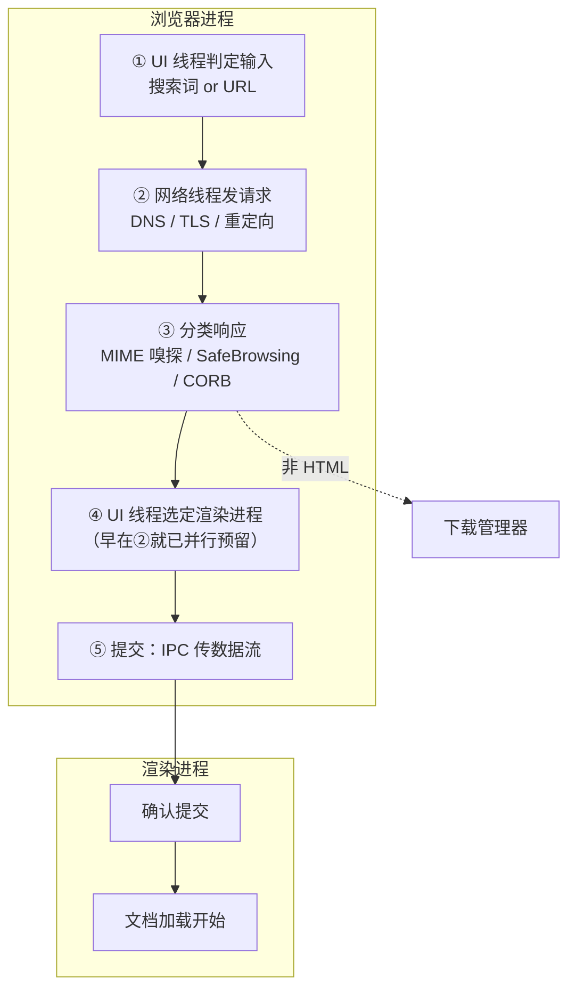
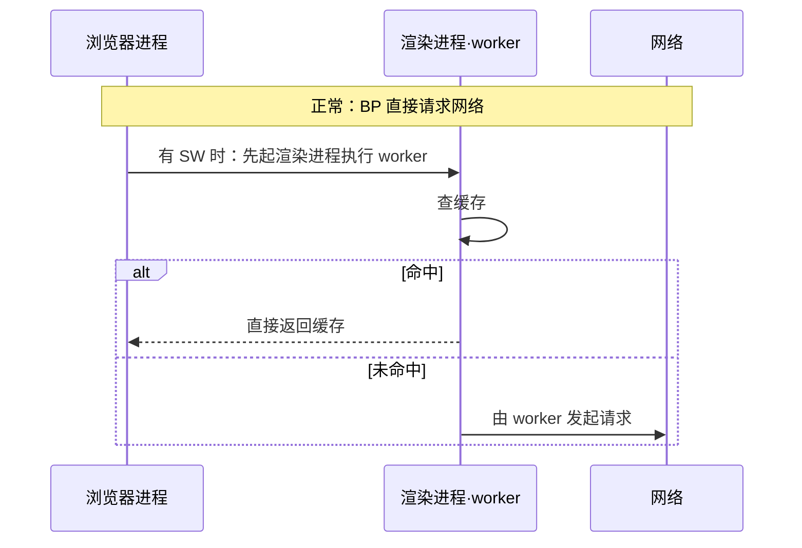

## 概念：浏览器导航

> **浏览器导航**是从用户敲下回车（或点击一个链接）起，到某个渲染进程确认「这份文档由我负责」为止的一段过程。它由浏览器进程全程主导：判定输入、发起网络请求、分类响应、选定渲染进程、提交并确认。**渲染进程拿到数据时，导航只剩最后一步。**

**解决的核心痛点**：页面「打不开」与「画得慢」是两个不同段上的故障，屏幕上却同样是空白。不分清导航卡在哪一步，就只能把 Network 面板从头翻到尾，最后归因于「网络慢」——而这个结论在四类失败里只对了一类。

### 核心命题

- [[IPC 保证送达，但不保证顺序与原子性]]
- [[Service Worker 让导航多一次进程往返，Navigation Preload 就是为了补回它]]（待写）

两条合起来给出本篇的判据：**导航的每一步都是跨进程消息，没有一步是同步的。** 所以「导航慢」该问的是「哪一次往返变长了」，而不是「哪个函数变慢了」。这也是它容易误诊的原因——性能工具默认你查的是单进程内的耗时。

### 运行机制

五步，注意每一步的主语都是浏览器进程里的某个线程：

① 输入判定：UI 线程先问「这是搜索词还是 URL」。地址栏同时是搜索框，没有可靠的外部信号能区分二者，只能靠解析加历史记录与补全规则去猜。猜错的代价是整条流程走错方向。

② 发起请求：网络线程接管，DNS、TLS 都在这里。收到 301/302 时它不自己往下跟，而是回头问 UI 线程，再发一次请求——所以一次跨域跳转在瀑布图上表现为两段独立请求，而不是一次。

③ 响应分类：看 `Content-Type`，但它可能缺失或写错，因此要 MIME 嗅探。这一步的实质是**分流**：HTML 交给渲染进程，ZIP 之类交给下载管理器。也就是说，**下载不是一种页面行为，而是导航在这里被改判了**——它压根没进渲染进程。同期还做 SafeBrowsing 与 CORB 检查。

④ 选定渲染进程：全篇最容易被忽略的优化。UI 线程在第 ② 步发出请求时就已经知道目标站点，于是**一边等网络一边提前找或起一个渲染进程**。数据到达时进程已在待命，省掉一次进程启动。代价是猜错：跨站重定向会让这个待命进程作废，必须另起一个。

⑤ 提交：浏览器进程用 IPC 把数据流交给渲染进程，渲染进程回执确认，导航完成。此后地址栏才更新、安全标识才刷新、会话历史才落盘。**顺序值得注意：界面上的「已经变了」发生在提交之后，不是请求发出之后。**

### 关键区别

「导航完成」「加载完成」「首帧」是三个时刻，混用会导致优化错位：

| 时刻 | 标志 | 此刻用户看到什么 |
|:--|:--|:--|
| 导航完成 | 渲染进程确认提交 | 地址栏已变，页面可能仍是空白 |
| 加载完成 | 所有帧的 `onload` 跑完、转圈停止 | 页面可见，但可能还在变 |
| 首帧 | 第一次上屏 | 有内容 |

判据：**转圈停止只说明 `onload` 跑完了，不说明导航成功。** 之后 JS 仍可加载资源、渲染新视图，所以「加载完成」从来不是终点。

第二组区别在离开当前页时：谁来检查 `beforeunload`。

| 发起方 | 谁先检查 | 为什么 |
|:--|:--|:--|
| 用户在地址栏输入 | 浏览器进程先问渲染进程 | 页面代码在渲染进程里，必须跨进程问 |
| 点击链接 / `location=` | 渲染进程自己先查 | 同进程，省一次往返；查完再向浏览器进程发导航 |

如果是跨站导航，系统会为新页面起一个渲染进程，同时保留旧进程处理 `unload` 一类收尾事件——两个进程短暂并存，这也是「离开时内存不降反升」的一个来源。

### Service Worker 对导航的改写

单独一节，因为它**倒置了顺序**。正常链路是 浏览器进程 → 网络 → 渲染进程；Service Worker 是「用应用代码写网络代理」，而它跑在渲染进程里。于是导航必须先去渲染进程起 worker、由它决定走缓存还是走网络，再回到浏览器进程。

代价是一次明确的额外往返：起进程、起 worker、判定，然后才轮到网络。**Navigation Preload 就是为补这次往返而生**——起 worker 的同时并行发请求，并用请求头标记，让服务端自行决定回全量还是只回增量。

判据：**一个 API 的存在本身就是证据。** Navigation Preload 本不必存在，除非 SW 拦截确实引入了可测量的延迟。它是对「正确性优先」买的一笔性能保险，不是一项新能力。

### 适用范围

- ✅ 适用场景
	- 判断白屏卡在哪一步：Network 有响应而页面不动 → ④⑤；完全没有请求发出 → ①②
	- 解释「下载为什么不跳转页面」：③ 处已被改判，请求从未进入渲染进程
	- 判断 SW 是否在导航链路上加了成本：看首字节之前是否插入了一次 worker 启动
- ⛔ 误用
	- 把导航耗时等同于下载耗时：五步里有四次跨进程往返，字节量只是其中一段
	- 认为渲染进程会主动发起首次导航：首次导航的主语一定是浏览器进程；渲染进程只在自己内部发起跳转时才成为发起方
- 失效边界
	- 解释不了渲染阶段的耗时：提交之后的事归 [[浏览器渲染流程]] 与 [[渲染进程]]
	- 解释不了网络协议内部细节：DNS / TCP / TLS 的逐跳顺序归 [[从输入URL到页面展示发生了什么]]
	- **不是规范**：这套流程是 Chromium 的实现细节，其他浏览器不必如此

### 批判

- 外部批判
	- 这是 Chromium 的架构文档，不是 Web 标准。 Firefox 的项目隔离、Safari 的进程复用策略都不同，「五步」只在 Chromium 上逐步可对照。
	- 文章写于 2018 年，④ 已经变化。 Site Isolation 让「猜对进程」更难：跨站 iframe 各自成进程，一次导航涉及的进程数是变量而非常量，投机预留的命中率随之下降。
- 内在张力
	- 「导航完成」在两个层面定义不一致。 实现上是「渲染进程回执这条 IPC」；规范上对应的是「文档被创建」。在重定向、SW 缓存命中、`204` 响应等情形下两者并不重合——所以「导航是否完成」这个问题在排查时常常得不到唯一答案。
	- 提前起进程是投机，不是优化的一定形态。 猜对省一次启动，猜错要销毁重来。同站跳转多的站点收益最大，短链跳转场景反而为负——这条优化没有普适的最优解。

### 问题与流程

- **相关问题**
	- [[从输入URL到页面展示发生了什么]] — 同一件事的面试视角：重网络逐跳，轻进程交接

### 知识图谱

> 固定五个桶，判据见 [[知识图谱词表]]。

- **上位**：[[浏览器工作原理]] — 它是那条四段接力里第二段（交接）的完整展开
- **并列**：
	- [[浏览器核心架构]] — 按进程横切；本篇按一次导航的时间纵切
	- [[浏览器渲染流程]] — 提交之后发生什么，第三段的展开
- **相关**：
	- [[IPC 保证送达，但不保证顺序与原子性]] — 提交这一步的通信语义
	- [[渲染进程]] — 接收方：提交之后的一切归它
	- [[Service Worker前端案例]] — SW 在导航链路上的实际用法
	- [[浏览器安全机制]] — SafeBrowsing 与 CORB 在这条链路上的插入点
	- [[资源加载与网络优化]] — 预连接、预解析作用于第 ② 步
- **外部资料**
	- [[深入了解现代网络浏览器(2) 导航过程]] — 本篇依据
	- [Navigation Preload](https://developer.chrome.com/blog/navigation-preload) — 补偿机制的原始说明
	- [Page Lifecycle API](https://developer.chrome.com/blog/page-lifecycle-api) — `beforeunload` / `unload` 的现代替代
