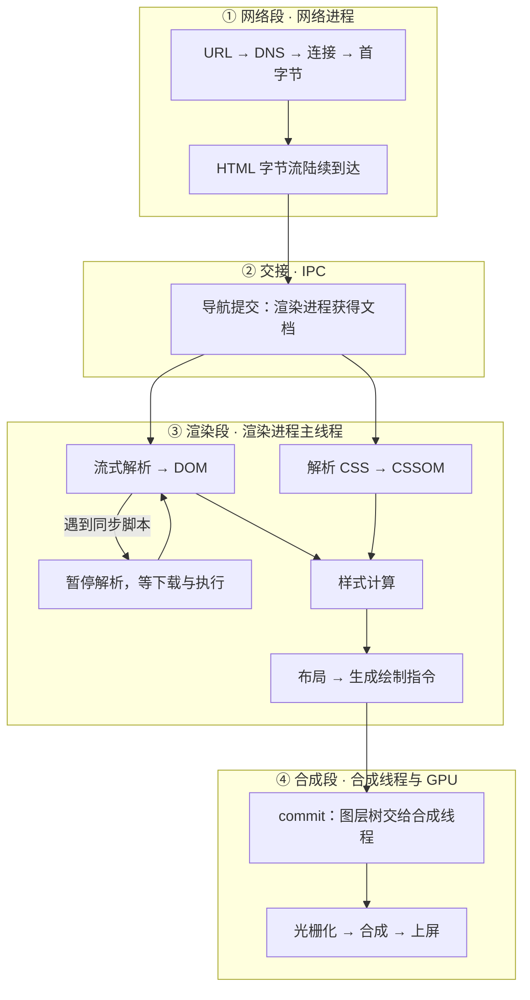

## 概念：浏览器工作原理

> **浏览器工作原理**指一次页面呈现从字节流到屏幕上像素的完整链路。它跨四个子系统接力：网络进程取回字节、IPC 把控制权交给渲染进程、主线程把 DOM 与样式算成绘制指令、合成线程与 GPU 把它变成帧。本篇只讲**段与段之间的交接**，每段内部的细节归各自的子篇。

**解决的核心痛点**：首屏慢、页面卡、动画抖，这三个症状发生在链路的不同段上，而开发者看到的往往只是「页面很慢」。不把链路切开，就只能靠猜——猜错方向时，优化一个从未成为瓶颈的环节，收益永远是零。

### 核心命题

- [[浏览器把一次页面呈现拆成四段接力，每段的瓶颈不同]]（待写）
	- **原理**：网络段贵在往返（DNS、TLS、首字节），交接段贵在跨进程拷贝，渲染段贵在主线程被独占的时长，合成段贵在纹理与带宽。四段的成本单位分别是毫秒级 RTT、内存带宽、主线程毫秒、GPU 时间，不可互相换算。
- [[script 阻塞解析的同时也阻塞后续下载，defer 与 async 只改执行时机]]
	- **原理**：解析器遇到同步脚本必须停下来，等它下载并执行完才能继续。这卡的是**解析**这一段，卡不到已经画出来的内容——它不阻止已经渲染的部分继续显示。区分「卡住谁」是本节三条命题的共同点。
- [[外部CSS阻塞首次绘制而不阻塞DOM构建]]（待写）
	- **原理**：DOM 构建与 CSSOM 构建并行，两者不互相等待；但样式计算要等 CSSOM 就绪，所以 CSS 卡的是「第一次能把东西画出来」这一步。这解释了一个常见现象：CSS 加载慢时 HTML 已经解析完，页面却仍是一片空白。

三条命题合起来给出一个判据：**说「阻塞」时必须补上「阻塞谁」**。同一次加载里，解析、绘制、主线程响应是三个不同的受害者，解法也不同。

### 运行机制

四段接力的主干，标出每次交接发生在哪里：

四段各自的成本与观测点：

| 段 | 主要成本 | 卡住时的现象 | 看哪里 |
|:--|:--|:--|:--|
| 网络 | 往返次数（DNS、TCP、TLS、首字节） | 白屏很久才开始出现内容 | Network 面板的瀑布图 |
| 交接 | 跨进程拷贝、导航提交 | 内容到了但迟迟不出 | Navigation 时间线 |
| 渲染 | 主线程被独占的时长 | 内容逐步出现但很慢，或整段空白 | Main 轨道、长任务 |
| 合成 | 纹理上传、图层数量 | 滚动/动画掉帧，主线程却空闲 | Frames、GPU 轨道 |

这张表的用法是排除法：**先看哪一段是空的**。网络段很长而渲染段很短，优化 JS 没有意义；反过来合成段吃满而主线程空闲，那问题在图层与纹理，与代码逻辑无关。

### 关键区别

「阻塞渲染」是一句被用滥的话。按受害者拆开，是三件不同的事：

| | 阻塞谁 | 典型触发 | 解法 |
|:--|:--|:--|:--|
| **解析阻塞** | HTML 解析器 | 同步 `<script>`、`document.write` | `defer` / `async` / 放尾部 |
| **渲染阻塞** | 首次绘制 | 外部 CSS、同步脚本（间接） | 关键 CSS 内联、非关键样式异步加载 |
| **主线程阻塞** | 一切要跑在主线程上的事，含输入响应 | 长任务、大量同步布局 | 切分任务、挪进 Worker |

三者常被混说成「阻塞渲染」，但只有第二列才是字面意义的渲染阻塞。第一类是解析停摆，第三类连渲染都不一定碰——它卡的是**响应**，指标上表现为 INP 变差而不是首屏变慢。

顺带厘清一个流传很广的说法：「GUI 渲染线程与 JS 引擎线程互斥」。现代 Chromium 里并没有这样两个互斥的线程——**Blink 与 V8 跑在同一个主线程上**，DOM 操作与 JS 执行天然串行，不需要锁。真正需要跨线程协调的是另一对：主线程与合成线程，它们靠 commit 交接只读快照（见 [[渲染进程]]）。旧说法描述的现象（JS 长任务导致卡顿）是对的，机制解释错了。

### 适用范围

- ✅ **适用场景**
	- **首屏慢的定位**：按上表做排除，先判断空的是哪一段，再决定优化对象。
	- **解释 `defer` / `async` 的差别**：两者的区别只在「解析是否等待」，属第一类阻塞，与渲染无关。详见 [[async vs defer]]。
	- **判断一次优化有没有意义**：任何优化都只能缩短它所在那一段的时间；段与段之间不共享收益。
- ⛔ **误用**
	- **把 CRP 六步当成线程调度图**：它是逻辑顺序，不是执行顺序。真实实现里解析是流式的、布局是增量的、绘制指令会分块生成，六步并不各占一个时间片。
	- **把三种阻塞统称「阻塞渲染」**：会导致优化错位，例如为「解析阻塞」去减少重绘。
	- **用 CRP 解释滚动卡顿**：合成器驱动的滚动根本不跑这条链路，它读的是上一帧的图层树。
- **失效边界**
	- **解释不了合成器驱动的交互**：滚动、`transform` 动画由合成线程独立完成，主线程完全静止也能流畅运行，此时 CRP 没有发生。
	- **解释不了跨进程合成**：跨站 iframe 有自己的渲染进程，帧的合成需要跨进程协调，单链路的串行模型在这里断裂。
	- **解释不了绕开 DOM 的绘制**：Canvas、WebGL、WASM 走的是另一条路径，不经过解析与布局。

### 批判

- **外部批判**
	- **CRP 是 WebKit 时代的模型，术语已经落后一轮。** 「渲染树」并没有消失，它改名成了**布局树**（`RenderObject` → `LayoutObject`，因为渲染被拆成 Layout / Paint / Composite 三段）。真正失真的是生成机制：它不是「DOM 与 CSSOM 合并」出来的——CSSOM 是规则集，只在样式计算时被逐元素匹配，从不变成节点。另外绘制产物是绘制指令列表（display list）而非一棵可遍历的「绘制树」。教材沿用旧模型是因为它仍能解释现象，但用 DevTools 时会对不上词。
- **内在张力**
	- **串行模型与增量实现互相矛盾。** CRP 画成六步串行，实际是流式解析、增量布局、分块光栅化的流水线：HTML 还没下载完就可能已经开始布局，布局完了某块区域可能还没光栅化。用串行模型推理「第几步慢」必然失真，它只能回答「哪一类工作多」。
	- **「关键路径」这个说法本身在漂移。** 它最初指「阻塞首次渲染的资源链路」，现在常被用来泛指任何影响性能的因素（含交互延迟）。概念一旦泛化，就没法再用它做取舍——本篇取的是狭义，交互延迟归 [[INP]] 与 [[渲染进程]]。

### 问题与流程

- **相关问题**
	- [[从输入URL到页面展示发生了什么]] — 网络段的逐跳细节，含 DNS、TCP、TLS 的完整顺序
	- [[async vs defer]] — 解析阻塞的两种解法，以及它们各自在什么时机执行
- **相关流程**
	- [[SOP-使用浏览器DevTools调试性能]] — 按段排查的操作流程（**尚未写**）

### 知识图谱

> 固定五个桶，判据见 [[知识图谱词表]]。

- **上位**：[[浏览器]] — 浏览器领域里「一次页面如何呈现」这条主线
- **下位**：
	- [[浏览器渲染流程]] — 第三段的完整展开，本篇只留骨架
	- [[渲染进程]] — 承载第三段的进程内部结构：线程分工与交接
	- [[回流和重绘]] — 第三段里最容易变慢的两种重算
	- [[光栅化]] — 第四段的起点：绘制指令变成位图
- **并列**：
	- [[浏览器核心架构]] — 同一条链路的另一种切法：它按进程横切，本篇按时间纵切
- **相关**：
	- [[事件循环]] — 决定第三段何时开始、每次能跑多久
	- [[V8 引擎]] — 主线程上跑 JS 的引擎
	- [[script 阻塞解析的同时也阻塞后续下载，defer 与 async 只改执行时机]] — 解析阻塞的机制依据
	- [[INP]] — 第三类阻塞（主线程）的度量指标
	- [[浏览器缓存与客户端存储体系]] — 网络段的上游：命中缓存可以整段跳过
- **外部资料**
	- [Critical Rendering Path](https://web.dev/articles/critical-rendering-path) — CRP 的原始定义与拆分方法
	- [Inside look at modern web browser](https://developer.chrome.com/blog/inside-browser-part1) — 从导航到渲染的进程视角，四篇连载
	- [RenderingNG](https://developer.chrome.com/blog/renderingng) — 现代 Chromium 渲染架构，本篇「批判」一节的依据
