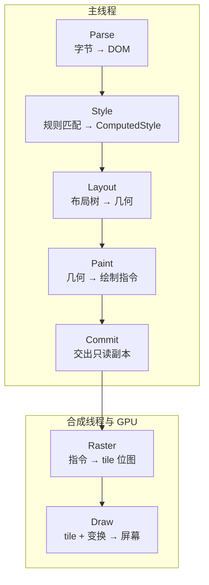

## 概念：浏览器渲染流程

> 浏览器把 HTML、CSS、JavaScript 变成屏幕像素，走的是一条**七段可分别重跑的链**，而不是一条跑完就结束的流水线。

**解决的核心痛点**：页面每一帧都在被重算。真正要回答的问题不是「渲染分几步」，而是「改这一行样式，会让哪几步重新跑」。

### 概念边界：它描述的是一帧，不是一次

三处容易搞混的边界，先划清：

- **不是一次性的。** 页面加载完成只是第一帧。滚动、动画、输入、定时器回调都在反复触发这条链的不同段，一秒钟可能跑几十次。
- **不全在主线程上。** 前五段在主线程；Raster 落在 raster 线程池（或 GPU 进程），Draw 由合成器与显示合成器完成。这就是「主线程卡死、页面还能滚」的机制来源。
- **不是「最后才合成」。** commit 之后图层树被交给合成线程，成为一份只读副本。此后主线程再改，也要等下一次 commit 才生效。

与相邻两篇的分工：[[浏览器工作原理]] 讲段与段之间的交接，[[渲染进程]] 讲每段跑在哪条线程上，本篇讲**每段内部做什么、以及什么条件下会被跳过**。

### 核心命题

- [[JavaScript执行会阻塞HTML解析]]
	- **原理**：解析器遇到同步脚本必须停下，因为脚本可能 `document.write` 改写它后面的字节流。停下的不只是解析，还包括之后所有资源的发现与下载。
- [[渲染管线的每一段都可以单独重跑]]
	- **原理**：每段的输入是上一段的输出，中间有失效标记（dirty bit）。改动只标脏它最早影响的那一段及其下游，上游原样复用。所以「改一个颜色」不必重算布局，「改一次宽度」却要连带重画。
- [[绘制阶段产出的是绘制指令而不是像素]]
	- **原理**：Paint 记录的是「在哪个坐标画什么」的指令列表（`PaintRecord` / `DisplayItemList`），像素要等 raster 阶段才生成。于是绘制与光栅化可以分开、可以延后、可以在别的线程做——这正是合成的前提。

三条合起来给出一个判据：**一次操作的代价，等于它把这条链回退到哪一段。**

### 运行机制

实线是**首次渲染**的路径。后续每一帧由合成器自行驱动，主线程只在有变更时，从被标脏的那一段开始重跑——这也是为什么滚动时主线程可以全程空闲。

| 段 | 输入 → 输出 | 什么会让它重跑 |
|:--|:--|:--|
| **Parse** | 字节流 → DOM | 新到达的 HTML、`document.write` |
| **Style** | DOM + 规则集 → 每个元素的 ComputedStyle | 选择器匹配结果变化、class / style 改动、样式表增删 |
| **Layout** | ComputedStyle + 布局树 → 每个盒的位置与尺寸 | 几何属性变化、字体加载完成、视口变化 |
| **Paint** | 几何 + 样式 → 绘制指令列表 | 影响外观的属性变化、图层内容变化 |
| **Commit** | 图层树 + 指令 → 合成线程的只读副本 | 上面四段任一有变化 |
| **Raster** | 绘制指令 → tile 位图 | 新出现的 tile、失效的 tile、DPR 变化 |
| **Draw** | tile + 变换 → 屏幕 | 每帧，由合成器自行驱动 |

三处细节值得单独记住：

- **Style 不是「合并两棵树」。** CSSOM 是规则集，不是与 DOM 平行的一棵待合并的树。这一段的动作是**为每个元素匹配规则并级联出 ComputedStyle**，产物是元素到样式的映射，不是树。下一段才把「参与布局的元素」组织成布局树。
- **布局树与 DOM 不是子集关系。** 它剪枝（`display: none`、`head`、`script` 不进），也插枝（伪元素有内容时生成节点，inline 与 block 混排时生成匿名盒）。所以 DOM 节点数与布局节点数两个方向都可能不等。
- **Paint 与 Raster 是两件事。** 前者记指令（可以很小、可以复用），后者把指令画成位图（代价按像素面积计）。DevTools 里 `Recalculate Style`、`Layout`、`Paint` 是主线程事件，`Raster` 出现在别的线程上。

### 关键区别

**（一）属性决定回退到哪一段**

| 最早受影响的段 | 典型属性 | 一次改动的连带开销 |
|:--|:--|:--|
| 只到合成（已提升为合成层） | `transform`、`opacity` | 主线程不参与，合成器改矩阵 |
| 只到 Commit（未提升） | `transform`、`opacity` | 不重排不重绘，但主线程每帧要跑一次 commit |
| Paint | `color`、`background-color`、`visibility`、`box-shadow`、`border-radius` | 重新记录失效区域的指令并重新光栅化 |
| Layout | `width`、`height`、`margin`、`padding`、`top`、`left`、`font-size`、`display` | 布局 → 绘制 → commit → 光栅化，全链下游 |
| Style 起 | 改 class、改内联样式、增删 DOM 节点 | 样式重算，通常连带布局 |

这张表最实用的一行是第二行：**`transform` 并不天然便宜。** 元素若不在自己的合成层上，它省掉的是布局与绘制，但每帧仍要过主线程做一次 commit。只有被提升为合成层（`will-change: transform`、3D 变换、`video`/`canvas` 等）之后，才真正脱离主线程。这解释了为什么「用了 transform 还是掉帧」——它一直在主线程上。

**（二）重排、重绘、合成不是三个并列的档位**

| | 重新跑哪些段 | 代价的量级 | 常见误说 |
|:--|:--|:--|:--|
| 重排 | Layout → Paint → Commit → Raster（样式若也变了则前置 Style） | 按受影响的盒子数 | 「重排比重绘贵」对，但贵在范围而非段数 |
| 重绘 | Paint → Commit → Raster | 按失效面积 | 「重绘不碰布局」对，但它仍要重新光栅化 |
| 合成 | 合成器只更新变换矩阵，主线程不参与 | 与内容无关 | 「合成只处理合成层变化」——它处理的是图层属性变化，不限于「合成层」这个词 |

### 适用范围

- ✅ **适用场景**
	- **性能归因**：掉帧时先判断改动落在这七段的哪一段，再决定是优化选择器、收敛布局范围，还是把元素提升为合成层。
	- **首屏判断**：首屏空白通常是 Style 卡在外部 CSS 上（样式没算完，就不敢画），而不是「渲染太慢」。
	- **DevTools 读图**：Performance 面板里的 `Recalculate Style`、`Layout`、`Paint`、`Composite Layers` 就是这条链的分段命名。
- ⛔ **误用**
	- **把「减少重排重绘」当通用建议**：如果改动落在 Layout，重绘只是下游的一小段，优化重绘等于没优化。
	- **用六步串行模型推算「第几步慢」**：真实实现是流式解析、增量布局、分块光栅化，三者都能与其它段重叠。
- **失效边界**
	- **Canvas / WebGL 内容不经过这条链**：位图直接进图层，没有 Style 与 Layout。
	- **视口外的 tile 不保证已光栅化**：滚动到才画，所以首次滚动常比后续卡。
	- **跨站 iframe 有独立的渲染管线**：主文档的段计数不包含它。

### 批判

- **外部批判**
	- **关键渲染路径（CRP）是 WebKit 时代留下的教学模型。** 它把渲染描述成「构建渲染树 → 布局 → 绘制」的串行六步，配上那张经典的 WebKit main flow 图。模型能解释现象，但三处已失真：渲染树这个名字 Blink 已弃用（`RenderObject` → `LayoutObject`，因为渲染被拆成 Layout / Paint / Composite 三段），CSSOM 并不参与「合并」，绘制也不产出像素。用它定位性能问题，会在 DevTools 里对不上词。
	- **「DOM + CSSOM = 渲染树」流传极广**，中文资料里几乎无例外。它是把「样式计算」误解成一次树的归并：实际是逐元素查表（规则匹配 + 级联），CSSOM 从头到尾没有变成节点。
- **内在张力**
	- **链是分段的，代价不是分段的。** 一次 Layout 可能重算整个文档（改根字号、改百分比高度），也可能只动一个盒子；一次 Paint 按失效矩形扩张，一次 Raster 按 tile 计价。所以「哪一段最贵」没有固定答案，取决于改动波及的范围。这也是所有「渲染性能清单」都只能给原则、给不出阈值的原因。
	- **同一段在不同设备上量级不同。** GPU 光栅化把 Raster 从 CPU 挪走，但 tile 内存与上传带宽成了新瓶颈；高分屏上同一图层的像素数按 DPR² 增长。

上面那套旧模型的原样，就是这张流传了十几年的 WebKit main flow 图——「DOM + CSSOM → 渲染树 → 布局 → 绘制」：

![[webkit-main-flow-b779d50c0cf28_856.png]]

### 问题与流程

- **相关问题**
	- [[Q-浏览器如何解析HTML并构建DOM树]] — 卡在第一段：解析器如何应对脚本与样式表的插入
	- [[Q-什么是浏览器的回流和重绘]] — 卡在第三、四段的分界：什么算几何变化
- **相关流程**
	- [[SOP-使用浏览器DevTools调试性能]] — 用 Performance 面板把一次卡顿归到具体的段

### 知识图谱

> 固定五个桶，判据见 [[知识图谱词表]]。

- **上位**：[[浏览器]] — 渲染流程是浏览器的核心职责之一
- **下位**：
	- [[浏览器通过DOM和CSSOM树构建渲染基础]] — 前两段（解析与样式计算）的展开
	- [[浏览器合成渲染树后进行布局和绘制]] — 第三、四段（布局与绘制）的展开
	- [[光栅化]] — 第六段的展开，含「浏览器光栅化与图形学同名词」的辨析
- **并列**：
	- [[浏览器工作原理]] — 同一条链的另一种切法：它讲段间交接，本篇讲段内
	- [[渲染进程]] — 它讲这些段跑在哪条线程上
	- [[浏览器核心架构]] — 按进程横切，本篇按时间纵切
- **相关**：
	- [[DOM]] — 第一段的产物
	- [[回流和重绘]] — 第三、四段被重新触发的两种情形
	- [[合成层 vs 合成线程]] — commit 之后位图由谁搬运
	- [[事件循环]] — 决定渲染时机在哪个任务之后
	- [[LCP]] — 用首屏最大元素的出现时刻反推这条链卡在哪
	- [[INP]] — 用交互到下一帧的延迟反推主线程被哪一段占用
- **外部资料**
	- [MDN: How browsers work](https://developer.mozilla.org/en-US/docs/Web/Performance/How_browsers_work) — 从导航到渲染的整体叙述
	- [Chromium: GPU Accelerated Compositing in Chrome](https://www.chromium.org/developers/design-documents/gpu-accelerated-compositing-in-chrome/) — 图层、合成与 `RenderObject → LayoutObject` 改名的出处（2014 年，部分实现已变）
