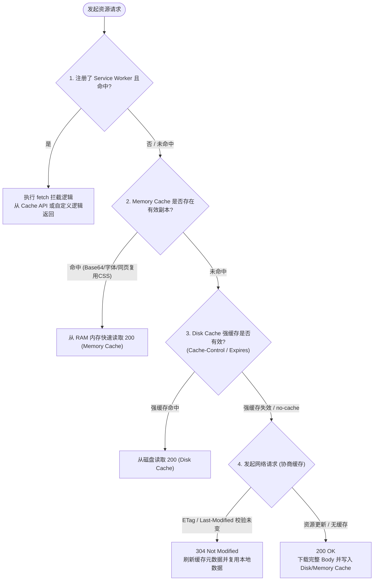

## 概念：浏览器缓存与客户端存储体系

> 浏览器缓存与客户端存储体系 指浏览器侧**所有让一次读取不必真的重新取回**的机制总和：一半在请求路径上拦截（Service Worker / Memory Cache / Disk Cache / CDN），一半在应用里持久化（Cookie / Web Storage / IndexedDB / Cache API）。

**归类的分界线不在「存在哪、多大」，在失效由谁判定**：响应头说了算（协议）、验证器比对说了算（服务端）、你的代码说了算（前端）、配额淘汰说了算（浏览器）。这条轴能解释一个反复出现的问题——「明明清了缓存还是旧的」，因为清掉的只是最后一层。

**它不是一份清单**：其中只有「请求路径上拦截」的那一半能省掉网络往返，另一半省的是计算与后端查询。混在一张表里按容量、介质对比，会看不出结构；逐层展开见 [[前端缓存怎么分类]]。

### 核心命题

> 核心命题引用 atomic 笔记（陈述句观点），每个命题是一句话洞见

- [[缓存分层分的是失效判定权，不是存储介质]]
- [[只有ServiceWorker同时握有请求拦截与存储写入，离线策略因此只能写在它里面]]
- [[选localStorage还是IndexedDB比较的应是同步阻塞而非容量]]
- [[文件名能否随内容变化，决定了它敢不敢用长期强缓存]]（待写）

### 运行机制

浏览器查找网络资源时，按下面的顺序逐层拦截（注意：`Push Cache` 已被现代浏览器废弃）：

> 这张图是**请求路径上的拦截顺序**，不是「五种可选的缓存方案」。所以「配了多级缓存」不等于五层都要配，它只告诉你：一次请求最可能被谁先拿走。

### 关键区别

为了彻底消除概念割裂，需将「底层网络级资源缓存」**与**「应用级数据持久化存储」两套体系分维对照：

#### 1. 网络级资源请求缓存流水线（协议与引擎驱动）

|**缓存层级**|**存储介质**|**控制权限**|**命中特点**|**生命周期**|
|---|---|---|---|---|
|**Service Worker Cache**|磁盘 / CacheStorage|**JS 完全可控** (`caches`)|可编程拦截 `fetch`，离线优先|持久化，由代码逻辑更新与淘汰|
|**Memory Cache**|RAM 内存|**浏览器内部调度**（代码不可读写）|快速响应短周期/体积较小资源、预加载标签|关闭当前 Tab 页或刷新即被释放|
|**Disk Cache**|硬盘文件系统|**HTTP 标头控制** (`Cache-Control`)|绝大多数强缓存资源（带 Hash 的静态文件）|受 `max-age`、`immutable` 与磁盘配额管理|

> **协商缓存不属于这张表的一行。** 它不存副本——用的还是 Disk Cache 那一份，只是把请求发出去问一句「变了没」。把它当第四层会得出「协商缓存的容量是多少」这种无解问题；它是 Disk Cache 复用的一个分支，机制见 [[HTTP协商缓存]]。

#### 2. 应用层数据持久化方案（JavaScript API 驱动）

|**存储方案**|**存储介质**|**容量限制**|**数据类型**|**读写机制**|**典型适用场景**|
|---|---|---|---|---|---|
|**Cookie**|硬盘 / 内存|~4 KB|ASCII 字符串|**同步**（每次 HTTP 请求自动随 `Cookie` 请求头携带）|用户鉴权 Token、会话 Session ID|
|**localStorage**|磁盘（LevelDB / SQLite，随引擎）|~5 MB（部分引擎 10 MB）|纯字符串键值对|**同步阻塞主线程**|用户偏好设置（主题/语言）、持久配置|
|**sessionStorage**|内存 / 磁盘|~5~10 MB|纯字符串键值对|**同步阻塞主线程**（仅限当前单个 Tab 页面生命周期）|多步骤表单草稿、单次会话临时状态|
|**IndexedDB**|磁盘|按整源配额（Chrome 上限约为磁盘的 60%，其他引擎更保守）|对象、TypedArray、Blob、文件等结构化数据|**异步非阻塞**（支持事务机制与游标索引查询）|复杂离线数据、日志埋点本地缓冲、富文本编辑器暂存|
|**Cache API**|磁盘|与 IndexedDB 共享同一份配额|专门存储 `Request` / `Response` 键值对|**异步非阻塞** (Promise 体系)|PWA 离线资源打包、REST API 响应持久化|

### 适用范围

- ✅ **适用场景**
	- **极致首屏静态分发**：入口 `index.html` 配置协商缓存（`no-cache`），其余带 Content-Hash 的 JS/CSS/字体资产配置一年强缓存（`Cache-Control: max-age=31536000, immutable`）直冲 Disk Cache。
	- **弱网离线与秒开（PWA）**：利用 Service Worker 拦截骨架屏与关键 API 响应并缓存至 Cache API。
	- **大容量离线客户端**：在线文档编辑器、Canvas 绘图应用的大型草稿及历史版本持久化至 IndexedDB。
- ⛔ **误用**
	- **高频大体积数据滥用 localStorage**：在 `scroll`、`resize` 等高频事件或大对象序列化中读写 `localStorage`，造成明显的 JavaScript 运行时卡顿与主线程掉帧。
	- **对无 Hash 静态资产开启长期 Disk 强缓存**：由于无法主动撤销磁盘缓存，发版后用户无法及时获取新代码。
	- **在 Cookie 中存放非鉴权业务数据**：所有同源接口请求都会自动携带 Cookie，过大的 Cookie 体积会导致严重的请求头带宽开销。
- **失效边界**
	- **浏览器存储配额淘汰机制（Eviction Policy）**：当用户磁盘空间紧张时，浏览器会按照 LRU 策略自动清除 Cache API 与 IndexedDB 中未标记为 `persistent` 的数据。
	- **无痕模式（Incognito Mode）**：所有本地持久化存储（localStorage / IndexedDB / Cache API）均降级为内存会话级，窗口全部关闭后立即彻底销毁。

### 批判

- **外部批判**
	- **API 碎片化与维护心智负担**：Web 平台先后推出了 Cookie、Web Storage、WebSQL（已废弃）、IndexedDB、Cache API，各 API 间数据类型与同步/异步机制完全割裂，开发者必须依赖第三方封装库（如 `idb`、`localForage`）才能降低接入成本。
	- **强缓存黑盒不可撤销性**：一旦强缓存写入磁盘，在过期前完全脱离服务端控制，强制将"缓存一致性"问题推给前端打包工具链（强制要求文件名 Hash 化）。
- **内在张力**
	- **持久化容量与主线程性能的权衡**：同步 API（Web Storage）简单易用但伤害性能；异步 API（IndexedDB）性能极佳但代码复杂度极高。

### FAQ

> 与本概念相关的开放性问题，先理解问题（发散），再看标准流程（收敛）

- [[为什么F5刷新与强制刷新对Memory Cache与Disk Cache的影响不同？]]（待写）
- [[现代浏览器为什么在Chrome 106中废弃了HTTP2 Server Push与Push Cache？]]（待写）
- [[跨域iframe环境下第三方Cookie被拦截对前端存储方案带来了哪些冲击？]]（待写）

### SOP

> 与本概念相关的标准操作流程，是 FAQ 中问题经过实践验证后的收敛成果

- [[前端静态资源多级缓存配置规范]]（待写）— 区分 HTML 与 Hash 资产的 Webpack/Vite + Nginx 生产级缓存配置
- [[多级缓存示例]]
- [[SOP-Web应用客户端离线存储与IndexedDB降级封装实践]]（待写）— 使用 `idb` / `localforage` 构建健壮的客户端离线缓存层

### 知识图谱

> 知识图谱链接 term（术语定义）和相关 concept，建立概念关系网络

- **上位**：
	- [[浏览器工作原理]] — 本篇是其中「可以不联网」的那一类能力
- **下位**：
	- [[HTTP缓存机制]] — 协议驱动的那一半：存储期判定与复用期五条件
	- [[HTTP强缓存]] — 复用期里「不用问」的分支
	- [[HTTP协商缓存]] — 复用期里「问一句」的分支
	- [[Service Worker]] — 客户端请求代理与后台线程
	- [[Cache API]]— Request/Response 专用异步缓存存储
	- [[IndexedDB]]— 客户端大容量事务型对象数据库
	- [[Web Storage]] — localStorage 与 sessionStorage 键值存储
	- [[Cookie]] — 唯一会随同源请求自动发送的存储
- **并列**：
	- [[服务端 Redis 缓存]]（待写）— 运行在后端集群中的内存级分布式缓存
- **相关**：
	- [[客户端存储]] — 本页「存储」那一半的展开：四种存法的选型判据
	- [[Content-Hash]]— 前端构建输出的指纹化命名机制
	- [[StorageManager API]]（待写）— 查询与申请持久化配额的 Web 原生接口
	- [[新鲜度]] — 判定「这份副本还能用吗」的时间依据
	- [[RTT]] — 每次回源验证要付的代价单位
	- [[前端缓存方案]] — 同一主题的 MOC 视图
- **外部资料**
	- MDN Web Docs: _Client-side storage & HTTP caching_
	- web.dev: _Love your cache - storage on the web_
	- Chromium Projects: _HTTP Cache & Memory Cache Internals_
