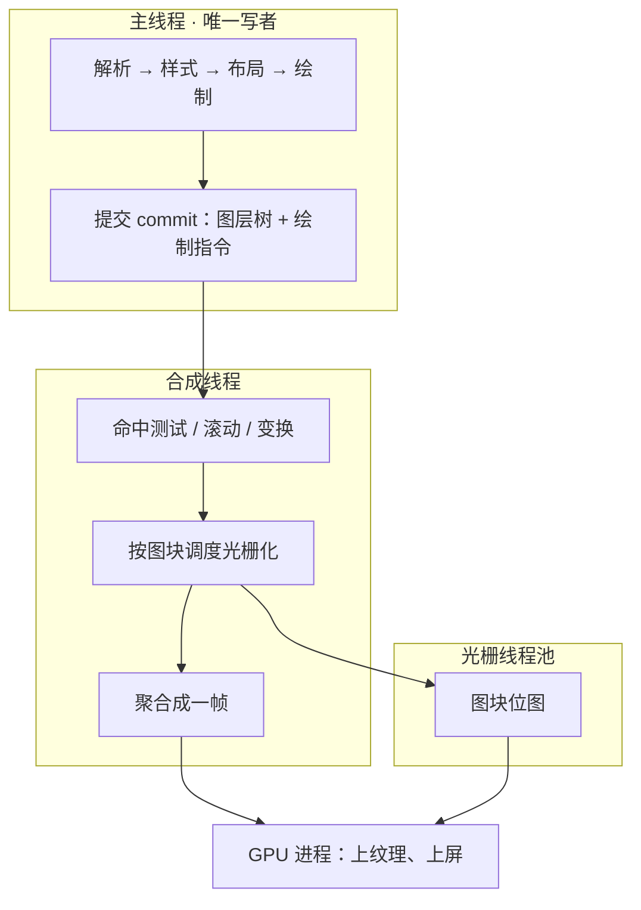

## 概念：渲染进程

> **渲染进程**是页面代码的沙箱与执行场：它承载 Blink 与 V8，把「主线程串行的语义」变成「多线程并行的流水线」。它与 [[浏览器渲染流程]] 的分工是：后者讲主线程上「HTML/CSS/JS → 像素」的阶段顺序，本篇讲这些阶段跑在哪个线程上、线程之间怎么交接。

**解决的核心痛点**：两件事互相拉扯——未知代码必须被关起来（沙箱、崩溃隔离），而页面又必须在代码跑不动时仍有响应（滚动、动画不能跟着卡）。前一件事要求隔离，后一件事要求把工作从「跑代码的线程」上挪走。渲染进程的结构就是这两个要求的折中产物。

### 核心命题

- [[渲染进程的边界是站点而非标签页]]（待写）
	- **原理**：Chromium 按 site instance 分配进程——跨站 iframe 会独立成进程（OOPIF），同站点的多个标签也可能共享一个进程。标签是用户组织页面的单位，不是进程的分配单位。「一个标签一个进程」是 2018 年之前的简化说法，用它估算内存或推断跨页通信都会出错。
- [[渲染进程的多线程是一个写者加多个只读者]]（待写）
	- **原理**：只有主线程能改 DOM、样式树与布局结果；合成线程、光栅线程拿到的是提交之后的快照，Worker 连 DOM 都碰不到。正因为其余角色读的是不可变副本，这条流水线才不需要锁——它的并行是「一写多读」，不是「多写共享」。

### 运行机制

先看有哪几个线程，以及各自能不能碰 DOM：

| 线程 | 位置 | 负责 | 能改 DOM |
|:--|:--|:--|:--|
| **主线程** | 渲染进程 | 解析、样式、布局、绘制、JS、事件回调 | ✅ 唯一 |
| **合成线程** | 渲染进程 | 命中测试、滚动与变换、图层合成、提交帧 | ❌ 只读快照 |
| **光栅线程池** | 渲染进程 | 把绘制指令光栅化成图块（tile） | ❌ |
| **IO 线程** | 渲染进程 | 接收 IPC、分发输入事件 | ❌ |
| **Worker 线程** | 渲染进程 | 独立脚本上下文 | ❌ 只能消息通信 |
| **GPU 线程** | GPU 进程 | 纹理上传、最终合成与上屏 | ❌ |

再看交接顺序。整条链上只有一处「写」，之后全是读：

三条边界值得单独记住，它们是理解卡顿的钥匙：

1. **进程边界按站点切**。Site Isolation 把「同源」从安全概念变成了进程概念：不同站点默认不共享进程，所以跨站 iframe 的脚本即使同页也无法直接读写对方 DOM。代价是内存——每个进程都有自己的 V8 堆与 Blink 对象，站点越多，进程越多。
2. **线程边界由 commit 划开**。commit 之前，图层树归主线程所有；commit 之后，它成为合成线程持有的副本，此后不再被修改。所以合成线程读它不需要加锁，也所以**它能拿着上一帧继续工作，而不管主线程此刻是否卡死**。
3. **事件边界决定谁先接到输入**。输入事件的流向常被画反：它是 **Browser 进程 → 渲染进程**，先到合成线程做命中测试，不是渲染进程「上报」给浏览器。

第 3 条还有一个直接后果，值得单独讲：

> **`passive: true` 不是性能优化开关，而是一句承诺**——「我不会 `preventDefault`，你可以直接滚」。

命中测试与滚动本身不需要主线程：合成线程用上一帧的图层树就能算。但只要元素上挂了非 passive 的 `wheel` / `touchmove` 监听，浏览器就无法确定这次滚动会不会被 `preventDefault` 拦掉，只能把事件排进主线程队列等它决定。主线程一忙，滚动就跟着卡。「加了个滚动监听，页面变卡了」的根因在此，不在监听函数本身有多重。

### 关键区别

真正需要分清的不是「主线程 vs 合成线程」，而是**哪些事合成器能自己干，哪些必须回到主线程**：

| | 合成线程可独立完成 | 必须回到主线程 |
|:--|:--|:--|
| **滚动** | ✅ 未被非 passive 监听拦截时 | 需要 JS 响应或 `preventDefault` 时 |
| **动画** | `transform`、`opacity` | 改 `width` / `top` / 颜色（触发布局或重绘） |
| **输入** | 命中测试、光标样式 | click、input、键盘、任何要跑 JS 的逻辑 |
| **几何** | ❌ | 任何影响布局的变更 |

由此得到一句可操作的结论：**「CSS 动画比 JS 动画流畅」的原因不是语言快慢，而是它在不在主线程上。** 一条 `transform` 动画在合成线程跑，主线程被长任务占满也不掉帧；同样效果的 JS 逐帧改 `left`，则每一帧都要主线程先算布局。

顺带纠正旧稿的一处架构误读：渲染进程的主要 IPC 对端是 **GPU 进程**（提交帧），不是浏览器进程；与浏览器进程的通信走 Mojo，内容多为导航与权限，不是逐帧数据。

### 适用范围

- ✅ **适用场景**
	- **卡顿归因**：先判断卡的是「主线程上的事」（JS、布局）还是「主线程之外的事」（光栅化、GPU、纹理上传），两者的优化手段不重叠。
	- **判断一个交互会不会被拖住**：看它是否需要主线程参与，而不是看它「看起来复不复杂」。滚动与 `transform` 动画可以完全不经过主线程。
	- **解释 INP**：INP 度量的是「输入到下一帧呈现」的延迟，天然由主线程排队时间主导——这正是把重活挪出主线程能改善它的原因。
- ⛔ **误用**
	- **把「多线程」当成「可以并行改 DOM」**：只有主线程能写，其余线程只能读快照或发消息。任何「开个子线程更新列表」的想法都要先绕回主线程。
	- **拿「一个标签一个进程」做容量估算**：站点隔离之后，进程数跟站点数、iframe 数相关，与标签数不一一对应。
	- **无脑 `will-change` 开层**：每个合成层都要独立纹理，层数一多，显存与合成开销反噬，低端设备上直接掉帧。
- **失效边界**
	- **只描述 Chromium 系**。「渲染进程」是引擎实现概念，不是 Web 标准术语；Firefox 的 content process 与 Fission、Safari 的进程模型各有差异，跨浏览器下结论前要重新核对。
	- **解释不了跨进程合成**：跨站 iframe 有自己的渲染进程，合成需要跨进程协调，本篇的单进程视角在 OOPIF 场景下不完整。
	- **解释不了 GPU 侧瓶颈**：纹理上传带宽、显存容量、GPU 频率都不在渲染进程内部，只能从帧耗时里间接看到。

### 批判

- **外部批判**
	- **把实现细节当成规范概念，是这个主题最大的误导来源。** WHATWG 与 W3C 的规范里没有「渲染进程」，只有 agent、event loop、browsing context；「渲染进程」是 Chromium 的架构选择。大量中文资料把 Chromium 的实现写成「浏览器的原理」，于是「一个标签一个进程」「合成线程做光栅化」这类描述被反复复制，而它们在别的引擎里根本不成立。
- **内在张力**
	- **沙箱与成本互为代价**。进程隔离越彻底，跨站通信越贵（IPC 加共享内存），内存占用也越高。Site Isolation 是用内存换安全，这笔账在低端设备上直接表现为页面被系统杀掉。
	- **挪出主线程的东西越多，「两边状态一致」就越难**。合成器滚动时，滚动位置由合成线程掌握，主线程的 `scrollTop` 要稍后同步；同一个状态在两个线程上各有一份，就必然存在短暂的窗口期不一致。很多「滚动位置读到旧值」的怪问题都出在这里，而不是代码写错。

### 问题与流程

- **相关问题**
	- [[浏览器的事件循环是如何工作的]] — 事件循环跑在主线程上，与合成线程的调度是两套循环，容易混为一谈
	- [[什么是浏览器的回流和重绘]] — 卡在「改哪个属性触发哪一步」，与本篇的线程分工是同一件事的两面

### 知识图谱

> 固定五个桶，判据见 [[知识图谱词表]]。

- **上位**：[[浏览器]] — 浏览器多进程架构中的执行单元
- **下位**：
	- [[合成层 vs 合成线程]] — 本篇内部两个最易混淆的组件
	- [[合成层]] — 合成线程操作的对象
	- [[浏览器渲染流程]] — 主线程之内的阶段顺序，本篇只交代它跑在哪条线程上
	- [[回流和重绘]] — 主线程上最容易造成长任务的两种重算
	- [[光栅化]] — 绘制指令被画成图层位图的那一步；与图形学同名不同义，该篇有辨析
- **并列**：
	- [[浏览器核心架构]] — 同一架构的两级视角：它看进程之间，本篇看进程内部
- **相关**：
	- [[事件循环]] — 主线程的调度规则，决定任务何时开始
	- [[JS执行机制]] — 主线程上「谁在什么时候拿到控制权」
	- [[V8 引擎]] — 主线程上的 JS 引擎，长任务的直接来源
	- [[Web Worker]] — 把计算挪出主线程的另一条路，代价是不能碰 DOM
	- [[requestAnimationFrame]] — 与渲染帧对齐的唯一时机，跑在主线程上
	- [[INP]] — 用指标度量本篇第三条边界的后果
	- [[深入了解现代网络浏览器(3) 渲染进程]]
- **外部资料**
	- [Inside look at modern web browser](https://developer.chrome.com/blog/inside-browser-part1) — 进程与线程分工的权威科普，四篇连载
	- [RenderingNG](https://developer.chrome.com/blog/renderingng) — 现代 Chromium 渲染架构：合成、光栅、GPU 分工的官方说明
	- [Site Isolation](https://www.chromium.org/Home/chromium-security/site-isolation/) — 「进程边界按站点切」的原始设计文档
	- [Chromium 多进程架构](https://www.chromium.org/developers/design-documents/multi-process-architecture/) — 较早但仍是 Mojo 之前的基础文档
