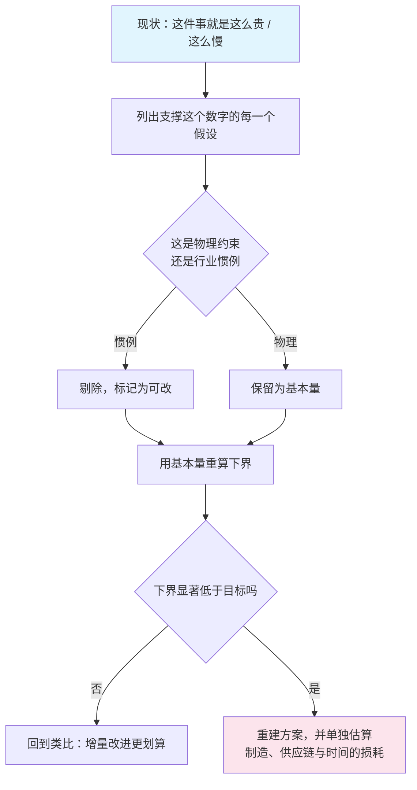

## 概念：第一性原理

> 第一性原理是从约束出发、而不是从既有解出发的推理：把问题拆到当前不可再拆的基本量（物理定律、数学恒等、材料成本），再从这些量重新推一遍。它通常给出「这件事最多能有多便宜、多快」的下界，而不是「实际能做到」的答案。

**解决的核心痛点**：当整个行业都用同一种做法时，报价、工期、成本的真实上限被既有解封住了。类比只能在这个天花板之下微调，看不到天花板本身是可以移动的。

### 核心命题

- 它与类比推理的差别只在起点，不在推理形式
	- **原理**：两者都可以严格演绎。类比把起点放在「别人已有的解」，第一性原理把起点放在「不可再拆的约束」。起点决定天花板：从既有解出发，无论推理多严密，结论都落在既有解的附近
- 「第一性」的判定标准是可验证，不是听起来基础
	- **原理**：行业报价、惯例、法规、组织流程都不是第一性——它们是别人的解，只是被重复得足够久。拆到自己不懂的地方就停下，是最常见的一种伪装：那时拿到的不是基本量，是自己的知识边界
- 它给出的是下界，不是可行成本
	- **原理**：从材料现货价推出每千瓦时 80 美元，省略了制造良率、设备折旧、供应链、时间与工程风险。理论与实际之间差的不是误差范围，是一整条产业链——这个差额本身才是真正的工程问题所在
- 值得用的场合很少：只有类比路径的天花板明显低于目标时，重建才划算
	- **原理**：重建要付出「重新推导 + 重新验证」的双重成本。绝大多数决策里既有解已经够好，类比是更优策略。用第一性原理处理日常问题，等于每次都重新发明轮子，而且发明得更慢

### 运行机制

四步，其中第二步（区分物理约束与行业惯例）是全部难度所在：

一个具体的算例，也是这套方法最常被引用的例子：2012 年电池包的行业报价是每千瓦时 600 美元，普遍看法是「一直会这么贵」。把电池拆成钴、镍、铝、碳、隔膜与外壳，按伦敦金属交易所的现货价加总，得到材料成本约每千瓦时 80 美元。这一步拆出的是「贵在材料」这个假设是假的——材料只占七分之一，剩下的都在制造与产业链上。至于从 80 走到实际可用的价格，花了十一年：到 2023 年电池包均价才降到每千瓦时 128 美元，仍高于当年算出的材料下界。**下界说明空间在哪，不说明路有多长。**

### 关键区别

| | 第一性原理 | [[类比思维]] |
|:--|:--|:--|
| 起点 | 不可再拆的约束 | 别人已有的解 |
| 成本 | 高，要能自己推导并验证 | 低，照抄加改动 |
| 天花板 | 由物理决定 | 由既有解决定 |
| 主要风险 | 把惯例当物理，得到虚假下界 | 永远在既有解附近微调 |
| 适合 | 目标明显超出行业现状 | 绝大多数日常决策 |

两者不是优劣关系，是成本与上限的交换。Musk 自己把类比称作「我们一生中不得不做的事」——不做类比，人连一天都过不完；第一性原理是留给少数「必须突破现有天花板」的问题的。

### 适用范围

- ✅ **适用场景**
	- **成本结构被行业惯例锁死**：所有供应商报同一个价，先算材料与工序的理论下界
	- **进入一个所有人都用同一做法的领域**：既有解的天花板就是所有人的天花板，此时重建有超额回报
	- **判断一个报价是否合理**：拆开看各项占比，比货比三家更能发现问题在哪一层
- ⛔ **误用**
	- **当口号**：「用第一性原理思考」被用来否定一切经验，实际结果是重新发明轮子，而且更慢更差
	- **把下界当预算**：从物理下界做财务模型，忽略良率与规模爬坡，这是这套方法最常见也最贵的错
	- **用在人身上**：组织、激励、协作没有「不可再拆的物理量」，拆到底得到的是假设，不是事实
- **失效边界**
	- **约束本身会变**：基本量依赖当前的科学与工艺水平，「不可再拆」只在当下成立
	- **只回答能不能更便宜、更快**：它不回答该不该做。价值判断、优先级、代价分配都在它的范围之外
	- **对含人的系统失效**：人不是材料，其行为依赖预期与制度，无法从个体属性相加得出

### 批判

- **外部批判**
	- 这套方法在工程与成本领域成立，在涉及偏好、制度与协调的问题上退化。把它推广成通用决策法，等于把物理学的可分解性当成世界的普遍性质
	- 「第一性」的判定依赖专家判断，而专家判断本身来自行业训练——最需要摆脱惯例的人，恰恰是最难识别哪些是惯例的人
- **内在张力**
	- 越彻底越贵，越不彻底越像类比。所谓「拆到底」在实践中总被预算与时间截断，止点由人定，不由原理定。这意味着同一个问题，不同的止点会给出完全不同的「第一性」结论

### 知识图谱

- **上位**：[[逻辑思维]] — 它是演绎的极端形式：先把前提压到不可再证，再往下推
- **并列**：
	- [[类比思维]] — 同一件事的另一种起点：从既有解出发
- **相关**：
	- [[线性思维]] — 共享还原论前提，但不假定单向因果：重建出来的结构可以是回路
	- [[因果链]] — 拆解的过程常常写成链，但拆到基本量之后要看的是结构而非顺序
	- [[奥卡姆剃刀]] — 选前提时的偏好：能少假设就少假设
- **外部资料**
	- 亚里士多德《物理学》— 「第一原理」作为不可再证起点的出处
	- Kevin Rose 2012 年访谈（[全文存档](https://www.elonmuskarchive.org/video/foundation-kevin-rose-2012-09-08)）— 电池算例的原始叙述，比二手转述准确
	- [电池包均价的历年数据](https://www.startuparchive.org/p/elon-musk-explains-first-principles-thinking-and-uses-it-to-predict-80-decline-in-battery-prices) — 80 到 128 这十一年的落差
