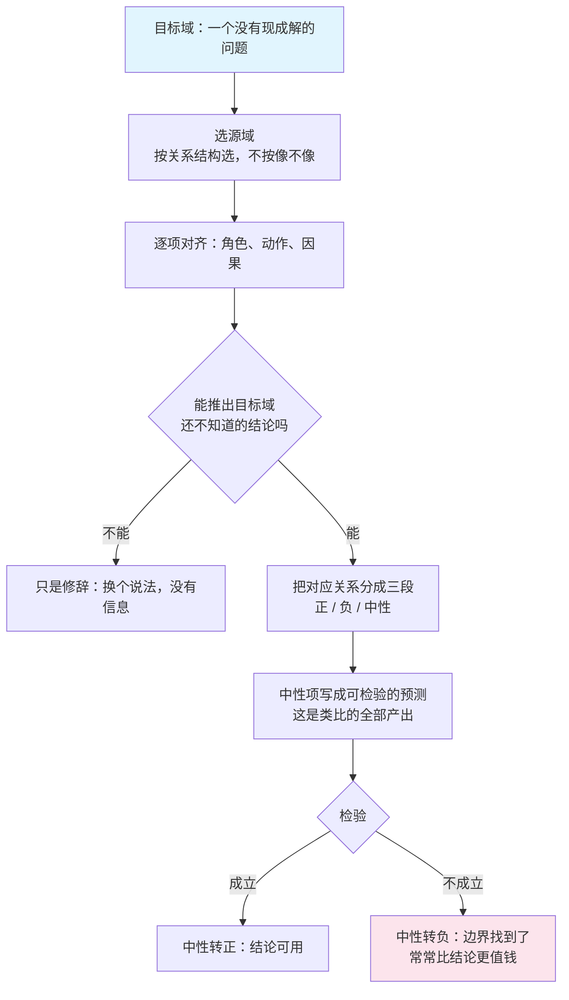

## 概念：类比思维

> 类比思维是把一个熟悉领域（源域）的关系结构搬到陌生领域（目标域）的推理。它先假定两者的因果骨架同构，再把源域里已经成立的推论平移过去。搬的是关系，不是属性。

**解决的核心痛点**：遇到全新问题时，没有可套的规则，也来不及从约束重建。类比是唯一能在几分钟内给出「大概长这样」的方法——代价是这个答案只是假设，而它长得跟结论一模一样。

### 核心命题

- 类比搬的是关系系统，不是属性相似
	- **原理**：Gentner 1983 的结构映射理论指出，有效类比要求两个领域在关系上同构——谁作用于谁、什么导致什么、哪几步是并列的——而事物本身的相似只决定好不好想起来。所以属性相似的类比可以完全无效（把公司比作家庭，理由是都由人组成），毫无表面相似的类比也可以完全成立（电子绕核与行星绕日）。系统性原则再补一条：优先保留那些互相咬合的因果关系，孤立的相似点权重最低
- 检索靠表面，验真靠结构：两个判据相反，这是它系统性失效的来源
	- **原理**：Duncker 的肿瘤问题里，先读「将军分兵合围」的故事但不给提示，只有 20% 的人想到用它；加一句「刚才那个故事可能有用」，75% 解出；完全不给故事，10%。Keane 1987 把瓶颈定位得更准：同领域的源故事 88% 被想起，远领域只有 12%；而一旦被想起，两者的解出率都是约 86%。**难的从来不是映射，是检索。** 所以「我怎么没想到」不是智力问题，是索引问题——知识按表面场景存档，就只能在表面场景里被取回
- 新知识只出现在中性类比里
	- **原理**：Hesse 1966 把任何类比切成三段：正类比（已知共享）、负类比（已知不共享）、中性类比（还不知道共不共享）。正类比只是换个说法，负类比只是划出边界，**只有中性段能推出新预测**。光波与声波水波的类比里，「需要介质」长期是中性项；Michelson-Morley 把它判成负类比之后，这个类比才开始产出知识。一个类比如果全是正项，它是修辞；如果全是负项，它是打比方
- 类比错了的样子和它对了的样子一样顺
	- **原理**：失效方式是「相似性选错了维度」，而错的那一维在结论里看不出来。所以一个类比要算完成，必须同时说出「哪一处必须不成立」；说不出，它就无法被证伪，也就无法被纠正。Rutherford 把电子绕核比作行星绕日，结构映射成立，但按经典电动力学，轨道电子应当持续辐射并在约 10⁻¹¹ 秒内坠入核——这个负类比不是类比失败，它恰恰是量子化轨道的入口

### 运行机制

四步：选源域 → 逐项对齐 → 分出三段 → 落成可检验的预测。第三步是全部价值所在，也是最常被跳过的一步。

将军与肿瘤的对应关系，按三段拆开才看得清这个类比在赌什么：

| 源域 | 目标域 | 哪一段 |
|:--|:--|:--|
| 军队要抵达城堡 | 射线要抵达肿瘤 | 正 |
| 大部队走一条路会触雷 | 高强度射线会伤及健康组织 | 正 |
| 分成小队，多路同时出发 | 多束低强度射线，多角度同时照射 | 正 |
| 各小队同时抵达，兵力相加 | 各束在焦点处叠加成高强度 | **中性** |
| 士兵沿途不受影响 | 射线沿途仍会累积剂量 | 负 |

真正被赌上的是第四行：叠加是否等价于高强度。这一条在目标域成不成立，取决于组织对射线的吸收是否线性可加——这是类比的假设，不是类比的结论。第三行之所以是正项，是因为「分兵」在两边都是同一个操作；第四行之所以是中性项，是因为「相加」在两边是两个不同的物理过程。**把中性项当正项用，是类比最贵的错。**

### 关键区别

类比最常被和隐喻混为一谈，两者的可证伪性完全不同：

| | 类比 | 隐喻 | 举例 |
|:--|:--|:--|:--|
| 断言 | 关系同构，故推论可移植 | A 就是 B | B 是 A 的一个实例 |
| 能否被推翻 | 能：指出不成立的那一处 | 不能，只能整体换掉 | 能，但只检验分类 |
| 产出 | 假设与预测 | 视角与态度 | 说明 |
| 失败方式 | 相似性选错维度 | 掩盖差异 | 代表性不足 |

一句话：隐喻负责让人看见，类比负责让人推出下一步。同一个句子可以两用——「市场是一台投票机」当隐喻用时是态度；当类比用时，它逼你回答计票规则是什么、什么情况下计票结果会被纠正，答不出来它就退回成隐喻。

另一组常被放在一起的是 [[第一性原理]]：差别不在推理形式，在起点。类比把起点放在别人已有的解上，第一性原理把起点放在不可再拆的约束上。前者便宜、天花板由既有解决定；后者昂贵、天花板由物理决定。

### 适用范围

- ✅ **适用场景**
	- **进入陌生系统**：先找一个结构上同构的熟悉系统，再逐项核对哪一处不同，比逐条读文档快得多
	- **借既有的解**：工程上绝大多数「新方案」是别的领域的旧方案平移，问题只在于平移时有没有检查中性项
	- **生成假设**：研究、排障、写方案的早期阶段，它能在没有任何数据时给出一个可检验的方向
- ⛔ **误用**
	- **当证明用**：类比不产生证据，只产生候选。它是 [[逻辑思维]] 三种推理里唯一既不增信息、也不保真的那一种
	- **同域照搬**：看起来越像的地方越没人检查机制，这是同域迁移比远域迁移更容易出错的原因
	- **用它决定不可逆的事**：迁移失败常常在落地半年后才显形，而决策成本已经付完
	- **拿隐喻当论据**：「就像……」之后什么都不用证明，这是最省力也最空的一种说服
- **失效边界**
	- **目标域没有熟悉的同构物**：无从下手。不是每个新问题都有源域
	- **目标域的主导机制在源域不存在**：人有预期与制度，材料没有。把组织当机器、把市场当物理系统，失效都在这一层
	- **它给不出数量**：类比只说「方向像」，不说「差多少」。涉及量级与阈值时必须换工具

### 批判

- **外部批判**
	- 结构映射只看结构，忽略了目的：Holyoak 与 Thagard 的约束满足模型认为，一个映射能否被接受，同时受相似性、结构、使用目的三者约束。同一对领域，为解决不同问题会选出不同的对应关系——纯结构主义解释不了这一点
	- 迁移研究的经验基础比想象中薄：Barnett 与 Ceci 2002 把迁移按知识领域、情境、时间等九个维度分级，结论是距离越远越罕见。他们也提醒，「迁移几乎不发生」这类悲观结论有相当部分来自实验室任务的刻意设计，真实场景里既非易事，也不是不可能
- **内在张力**
	- 距离越远，信息量越大，可靠性越低，没有最优点。近类比几乎必然成立，也因此几乎不产生新东西；远类比才可能带来洞察，也才可能整段错掉。选点只能按「错了要付多少」定，不能按「像不像」定
	- 「结构」本身依赖你已经知道的机制。遇到真正新的机制时，你不知道该对齐什么，这时类比给的不是假设，而是错觉。这也解释了为什么范式转换很少由类比完成——它通常只能把人推到旧框架的边界上

### 知识图谱

- **上位**：[[逻辑思维]] — 它是三种推理形式之一，也是唯一只搬运、不产生证据的那一种
- **并列**：
	- [[第一性原理]] — 起点相反：从约束重建，不从既有解出发
- **相关**：
	- [[发散思维]] — 类比是发散阶段最稳定的想法来源，因为它的成本只有一次回想
	- [[批判性思维]] — 负责检查引申有没有越过负类比划出的边界
	- [[视觉思维]] — 把关系结构画出来，是发现两个领域结构同构最便宜的办法
- **外部资料**
	- Gentner, D. (1983). Structure-Mapping: A Theoretical Framework for Analogy. Cognitive Science — 结构映射与系统性原则的出处
	- [Holyoak, K. J. (2005). Analogy.](https://sites.lifesci.ucla.edu/psych-reasoninglab/wp-content/uploads/sites/273/2021/04/Holyoak.analogy.2005.pdf) — 检索与映射分离的那组数据（10% / 20% / 75%，88% / 12% 与 86%）
	- Hesse, M. (1966). Models and Analogies in Science — 正 / 负 / 中性类比三分，以及光波与声波那个案例
	- Gick, M. L., & Holyoak, K. J. (1980). Analogical Problem Solving. Cognitive Psychology — 肿瘤问题与将军故事的原始实验
